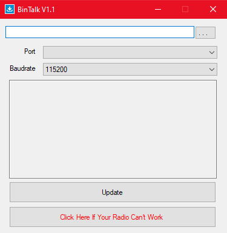

# Baojie BJ-8300 — firmware v1.0T, channel banks and CHIRP driver

<p align="center">
  <a href="README.md"></a>
</p>

Modified firmware for the **Baojie/Bajeton BJ-8300** handheld (JieLi AC695X, pi32v2 CPU), built by
reverse engineering the stock **V0.12** firmware, with no vendor documentation. It adds **16 real
channel banks**, a scramble that talks to the Baofeng UV-17L, a faster spectrum and a dedicated
**CHIRP driver**. The "T" in the version stands for **Tempra**.

> [!TIP]
> ## 🎉 v1.0T — the first stable release
>
> **[⬇️ Download v1.0T from the Releases page](https://github.com/tempraturbo/BajetonBJ8300/releases/tag/v1.0T)**
>
> | Release file | What it is for |
> |---|---|
> | `BJ8300_BANK_v1.0T.anc` | the firmware, to flash into the radio |
> | `bj8300_v1.0TEMPRA.py` | the CHIRP module for this firmware |
> | `BinTalk-V1.1.zip` | the flasher (BinTe ANC Bootloader) |
> | `CH340-driver.zip` | the driver for the USB programming cable |
>
> Tested on the radio. To flash it: [step by step](#-how-to-flash-the-firmware-step-by-step). For
> CHIRP: [step by step](#-how-to-use-chirp-with-this-firmware).

💚 **Like the project?** [Support it with a PayPal donation](#-support-the-project) — any amount
helps the next version come out.

---

## ✨ What changed from the stock V0.12 to v1.0T

### 🆕 New features

| Feature | What it looks like on the radio |
|---|---|
| 🗂️ **16 channel banks** | Each bank has a **12-character name**, and a channel can be in **as many banks as you like**. You can turn **several banks on at once**: up/down and scan then only see the channels of the banks that are on. With none on, the radio works as stock. New menus: `BANK`, `BANK NAME` and `BANK CH` ([how to use](#using-banks-on-the-radio)) |
| 🔐 **Scramble with 8 frequencies** | `SCRAMBLE` goes from OFF/ON to **OFF and 2700 to 3400 Hz, in 100 Hz steps**, in ascending order. **3400 Hz** is the stock ON (it talks to other BJ-8300s), and the **Baofeng UV-17L's modes 1, 2 and 3** each match one of these frequencies. Tested with all three modes |
| 🔔 **BEEP 2 roger** | `ROGER` gets a fourth option: OFF, BEEP 1 (the stock one), **BEEP 2** (four tones: 1125, 1857, 1359 and 931 Hz, ~0.4 s in total) and TONE1200 |
| 📊 **Spectrum with 320 and 640 points** and a **10 kHz step** | On top of the stock 160 points, to see a wider band at once |
| 📈 **Peak hold on the spectrum** | The bar rises at once and, when the signal goes away, comes down gradually |
| 🔌 **Dedicated CHIRP driver** | Reads and writes the banks (**Banks** tab), their names, and the new roger and scramble, in a single cable session. It refuses to write to a radio with the stock firmware ([how to use](#-how-to-use-chirp-with-this-firmware)) |
| 🧰 **Extended cable command** | Reads the whole data chip (24-bit address) and writes only to the banks area. It is what the CHIRP driver uses |

### ⚡ Improvements

| What | Detail |
|---|---|
| 🚀 **Spectrum twice as fast** | 160 points in ≈ 2.5 s. And, stopped on a found signal, the arrow resumes the sweep without touching the threshold |
| 🟩 **Selected VFO highlight** | The active side's block (name, frequency and signal bar) gets a green background; the other one stays black |
| ↕️ **Menu arrows swapped** | The up arrow now moves up the list instead of stepping the value |
| 🔤 **English texts revised** | 25 strings fixed and made consistent (e.g. `VOICEPRI` → `ENCRYPT`). The `VERSION` menu shows `Firmware: V1.0T` |

### 🐞 Fixes

| V0.12 problem | In v1.0T |
|---|---|
| During scan, the signal bar froze on the last channel found, and the channel number got out of step with the name | The screen follows every channel of the sweep |

### ➖ Removed

| What | Why |
|---|---|
| The `ZONE` and `Zone Or Channel` menu items | The banks do the zones' job, with more freedom. The zone function is still in the firmware, and the CHIRP driver always writes **Full Channel**, so the radio never gets stuck in zone mode |

### 🔒 What does not change

- **Channels, settings and calibration** live in a separate chip and are **not touched** when the
  firmware is flashed.
- The **flashing mode** (`UPDATE`) is read before any modified code, and the build script refuses
  to write to it.
- **Going back to stock** is just flashing the [original firmware](firmware/original/), the same
  way.

---

## ⚠️ Before flashing

Flashing modified firmware carries risk. This project has one safety net, **tested on the radio**:
powering the radio on while holding **PTT2 + the shortcut key** shows `UPDATE` on the screen and
leaves it waiting for a flash. That path runs at boot, **before** anything the modification
touches (the build script refuses to write to the functions involved; see `PROTEGIDAS` in
[firmware/scripts/montar.py](firmware/scripts/montar.py)). During development the radio boot-looped
once ([changelog](docs/changelog.md)) and came back through this combo, without opening it.

The flasher also has a *"Click Here If Your Radio Can't Work"* button, which is presumably for when
the firmware does not even start, but it has **never been tested**.

**Keep the stock firmware**: [firmware/original/BJ8300_V0.12.anc](firmware/original/).

---

## 📥 How to flash the firmware, step by step

You need a Windows PC and the radio's **USB programming cable** (the CH340 one, the same the stock
CPS uses).

**1. Download the files.** From the [v1.0T release page](https://github.com/tempraturbo/BajetonBJ8300/releases/tag/v1.0T),
download `BJ8300_BANK_v1.0T.anc`, `BinTalk-V1.1.zip` and, if Windows does not recognise the cable
yet, `CH340-driver.zip`. Unzip them. (The same files are in the repository, under
`firmware/releases/`, `tools/anc-bootloader/` and `tools/ch340-driver/`.)

**2. Install the cable driver, if needed.** Plug the cable into the PC and open **Device
Manager**. If **Ports (COM & LPT)** shows `USB-SERIAL CH340 (COMx)`, you are set: note the COM
number. If it does not, right-click `ch341ser.inf` from `CH340-driver.zip` → **Install** (or, in a
PowerShell **run as administrator**, `pnputil /add-driver ch341ser.inf /install`) and unplug and
replug the cable.

**3. Open the flasher.** Run `BinTe ANC Bootloader.exe` (its window is called **BinTalk V1.1**).
Close any program that uses the COM port first (CHIRP, CPS).

<p align="center"></p>

- In the top field, click **`...`** and pick `BJ8300_BANK_v1.0T.anc`.
- **Port:** the cable's COM port (from step 2).
- **Baudrate:** **115200** (the default).

**4. Put the radio in flashing mode.** With the radio **off** and the cable plugged into it, power
it on **while holding PTT2 + the shortcut key**, until `UPDATE` shows on the screen.

**5. Flash.** Click **Update** and wait. The log shows `Update Mode` → `Baudrate OK` →
`Update 3%` → `Jump To Loader` → `Progress 100%` → `Finish`. Do not unplug anything halfway.

**6. Check.** Turn the radio off and on. The `VERSION` menu should show `Firmware: V1.0T`, and the
`BANK`, `BANK NAME` and `BANK CH` items show up in the menu.

**If you get `Retry1..5 / Failure!`:** turn the radio off, make sure no other program holds the
COM port, go back to step 4 and try again.

---

## 📻 How to use CHIRP with this firmware

> [!CAUTION]
> **With v1.0T, use only the `bj8300_v1.0TEMPRA.py` module from this release.**
>
> - **Do not use CHIRP's stock models** that serve the stock BJ-8300 (**Bajeton BJ7800** and
>   **Radtel RT-920**). They neither read nor write the banks, and they do not know the BEEP 2
>   roger or the new scramble frequencies: with BEEP 2 set, their settings screen does not even
>   open. RT-920 also offers "Zone or Channel", and in zone mode the radio gets stuck, because the
>   menu to leave it was removed.
> - **Do not use older versions of this module**: they do not know the new options, and a channel
>   with a new scramble frequency shows up as invalid.
> - The other way round holds too: the module **refuses** to write to a radio with the stock
>   firmware.

**1. Install the latest CHIRP.** Download **CHIRP-next** from
[chirpmyradio.com](https://chirpmyradio.com/projects/chirp/wiki/Download). The module uses the
current version's `radtel_rt900` driver; with an old CHIRP, step 3 fails with *"Invalid or
unsupported module file"*.

**2. Turn developer mode on (once).** Menu **Help** → **Developer Mode**. CHIRP warns *"Danger
Ahead"*: click **Yes**. Then it says *"Restart Required"*: click **OK**, then **close and reopen
CHIRP**. The mode stays on from then on.

**3. Load the module (every time you open CHIRP).** Menu **File** → **Load Module...** (it only
shows up in developer mode). CHIRP warns that loading a module is dangerous: click **Yes** and pick
`bj8300_v1.0TEMPRA.py`. The window turns **red** and the title shows `CHIRP **Module Loaded**`:
that is the sign the module is loaded. Closing CHIRP unloads it, so next time it has to be loaded
again.

**4. Read the radio.** With the radio on as usual and the cable plugged in, menu **Radio** →
**Download from radio...**:

| Field | Choose |
|---|---|
| **Port** | the cable's COM port |
| **Vendor** | **Baojie** (not "Bajeton") |
| **Model** | **BJ8300_v1.0TEMPRA** |

CHIRP shows the *"Experimental driver"* notice, with the module's instructions: click **Yes**, then
**OK** to read.

> [!NOTE]
> If `BJ8300_v1.0TEMPRA` is not listed under **Baojie**, the module is not loaded: go back to step 3.

**5. Edit.** On the right you get the list of the radio's parts:

- **Memories (VHF/UHF):** the 960 channels. The **Scramble** column and the channel's other
  properties are here.
- **Banks (VHF/UHF):** one column per bank; tick which banks each channel is in, and rename the
  banks.
- **Settings:** the radio settings, with the 4-option roger and the VFO A and B scramble. In
  **Settings → Bancos**, turn each bank on or off and pick which one the radio's menu items edit.
- **Memories (FM / AM / HF):** the other bands, as in the stock driver.

**6. Write and restart the radio.** Menu **Radio** → **Upload to radio...**. After writing,
**turn the radio off and on**: the bank filter is built at boot.

Keep a copy of the first download (**File** → **Save**) before changing anything.

---

## Using banks on the radio

The menu gets three items, together, where the zone items used to be:

| Item | What it does |
|---|---|
| **BANK** | The arrows walk through the 16 banks; shows `n name` and ` ON` if it is on. **OK turns the bank on/off** and selects it for the other two items |
| **BANK NAME** | Names the selected bank (12 characters), with the same text editor as `CH-NAME` |
| **BANK CH** | Walks through the 960 channels showing `bank-channel`; **OK marks/unmarks** the channel in the selected bank. ` IN` = in the bank, ` -` = empty memory slot |

Behaviour details:

- Turning on a bank that **has no stored channel** filters nothing (the radio would have no
  channel to show) — the firmware undoes it by itself.
- Marking or unmarking a channel **takes effect at once**, no restart.
- Writing banks **over the cable** (CHIRP) needs a power cycle: the filter is built at boot.
- The bank state is stored in the data chip and **survives power-off**.
- Rewriting channels with CHIRP or the CPS **does not erase any bank**: the banks live in the data
  chip (0xC1000 onwards), outside the channel area.

The main screen looks the same: numbering stays **absolute, 1 to 960** (channel 500 is still 500,
not "the 3rd in the bank") and the active bank's name is not shown there. What changes is only what
**up/down and scan can see** — with a bank on, they jump straight from one marked channel to the
next.

---

## How the CHIRP driver works

The file is [chirp/bj8300_v1.0TEMPRA.py](chirp/bj8300_v1.0TEMPRA.py). The name is deliberate: it
only works with **this** firmware, so nobody with a stock BJ-8300 uses it by mistake. It derives
from CHIRP's `radtel_rt900.py`, which already handles this radio as part of the RT-920/BJ7800
family, and adds:

- The **Banks** tab and the **Settings → Bancos** group (above).
- Download and upload of the banks area through the extended command, together with the channels
  and **in a single session** (the firmware answers the closing `E` with an ACK and only closes the
  session afterwards); on upload, only the sectors that changed.
- The roger with the radio's four options and the scramble with its nine, writing the same values
  the radio's menu writes.
- **No zones:** every upload writes **Full Channel** (`0x9028` = 1), because zone mode is still in
  the firmware and, without the menu item, the radio would have no way out of it — in zone mode
  up/down is stuck within 64 channels.
- The stock-firmware lock: the banks firmware answers the extended read with size `0x40`, while
  the stock one echoes the size with bit 7 set and sends more than 128 bytes. The driver reads the
  header, discards the rest (the cable does not lose sync) and stops **before writing anything**.

Three test suites, none of them needing the radio:

- `python -I tests/teste_bj8300.py` — the banks core (stored format, checksum matching the one the
  radio itself wrote, multiple membership), with CHIRP stubbed out;
- `python -I tests/teste_chirp_real.py` — **against the real installed CHIRP**: whether the class
  fits the API (bank model, `apply_to` + settings callbacks), whether an image saved by the RT-920
  driver opens without blowing up, and whether roger and scramble end up as the bytes the radio
  writes;
- `python -I tests/teste_clonagem.py` — the **cable conversation**: CHIRP's whole `sync_in` and
  `sync_out` against a simulated radio that answers like the firmware (read from the disassembly),
  with both firmwares.

The cable's electrical side and the radio's response timing can only be tested on the real radio —
that was checked by hand with the tools in `tools/cabo/`.

---

## Older releases

All in [firmware/releases/](firmware/releases/). The full story, with what broke and why, is in
the [changelog](docs/changelog.md).

| File | Status |
|---|---|
| `BJ8300_BANK_v1.0T.anc` | **stable** — v25 under the version's name (same file); use with the CHIRP driver from the same release |
| `BJ8300_BANK_v24.anc` | v23 + 2900 Hz scramble (the Baofeng UV-17L's mode 3) — tested on the radio |
| `BJ8300_BANK_v23.anc` | v21 + BEEP 2 roger — tested on the radio |
| `BJ8300_BANK_v21.anc` | v19 + spectrum twice as fast, 10 kHz step, 320 and 640 points and peak hold; darker highlight green (v20 without the boot loop; v20 was withdrawn) — tested on the radio |
| `BJ8300_BANK_v19.anc` | v18 + the arrow resumes the spectrum when stopped on a find; the menu table where the original was — tested on the radio |
| `BJ8300_BANK_v18.anc` | v17 with the green background on the RX/TX box too — not tested on the radio |
| `BJ8300_BANK_v17.anc` | VFO block highlight without the black stripes ([screen map](docs/screen-map.md)) — tested on the radio |
| `BJ8300_BANK_v16.anc` | first working highlight; thin black stripes remain between the block's lines |
| `BJ8300_BANK_v14.anc` | earlier highlight attempt: the green only showed on the signal bar |
| `BJ8300_BANK_v12.anc` | banks, arrows, texts, the scan fix and the 24-bit cable — tested on the radio |
| `firmware/original/BJ8300_V0.12.anc` | stock firmware, to go back |

---

## Cable tools

In [tools/cabo/](tools/cabo/), PowerShell, nothing to install:

| Script | Purpose |
|---|---|
| `cabo.ps1` | Library: handshake, `Le-Bloco`, `Grava-Bloco` (the others use it) |
| `mapa_memoria.ps1` | Proves the 24-bit read, tells whether data comes raw, finds the **real chip size** and lists what lives above 64 KB |
| `ler_memoria.ps1` | Dumps the 64 KB the stock protocol reaches and checks channels and calibration (read only) |
| `teste_cabo_grava.ps1` | Proves writing to the banks area and that the firmware **refuses** to write outside it; cleans up at the end |
| `logo.ps1` | Reads (and, on a firmware that unlocks the range, writes) the boot image |

Boot image conversion: `python -I firmware/scripts/logo_bmp.py para-radio input.bmp output.bin
preview.png` (24-bit 160×138 BMP → RGB565, the same the CPS11 produces, checked byte for byte).

> **Never send anything before the magic** (not `E`, not zeros): the radio matches the magic from
> the start of the buffer and any byte in front makes every following attempt fail until the radio
> is turned off. And the magic ends in `U`, which is an UPDATE-mode command — insisting with the
> radio out of sync makes it drop into UPDATE by itself.

---

## Building

Needs the JieLi toolchain (clang for `pi32v2`) and Python 3:

```sh
sh firmware/build.sh
```

It compiles `firmware/src/bancos.c`, builds the `.anc` from the original and **checks** the
result: CRCs of all 12 entries, code and menu table present and identical in all 6 flash images,
menu items, every hook and patch, texts, and that no byte changed outside the expected ranges —
nowhere near the protected areas. The output ends in `RESULTADO: tudo certo`, and the build is
reproducible: the same source gives the same `.anc`, byte for byte.

The toolchain path is in `firmware/build.sh` (`C:/tools/jl-toolchain-2.5.3/...`).

**Space budget:** the new code lives in the only free area of the 6 images, from `0x01E96124`,
with **3292 bytes**; v1.0T uses 3012. The menu table is written where the original was and takes
none of that area. [docs/reverse-engineering.md](docs/reverse-engineering.md) explains how to
measure it and where space was already saved.

---

## Repository layout

```
firmware/
  src/          bancos.c (all the new code) and bancos.ld
  scripts/      build (.anc), checks, disassembler, analysis
  original/     BJ8300_V0.12.anc — stock firmware
  releases/     .anc files ready to flash
  build.sh      compiles, builds and checks
chirp/          CHIRP driver (bj8300_v1.0TEMPRA.py)
tools/
  anc-bootloader/  BinTe ANC Bootloader flasher (BinTalk V1.1)
  ch340-driver/    USB cable driver
  cabo/            PowerShell tools that talk to the radio
  ghidra-scripts/  scripts used during analysis
logo/           boot image (BMP) and converter
tests/          CHIRP driver tests
docs/           reverse engineering, changelog, screen map, images and working notes
```

---

## 💚 Support the project

v1.0T came out of many hours of reverse engineering: the stock firmware opened byte by byte, with
no vendor documentation at all, every routine mapped in the disassembly, and 25 versions, nearly
all of them flashed and tested on a real radio, until a stable release was reached. Everything here
is, and will stay, **free**, to use, study and modify.

If your BJ-8300 got better — the banks sorted out your channels, the scramble now talks to your
friend's Baofeng, the spectrum got faster —, consider buying the project a coffee. Any amount
helps: it means time for new features, gear to test on, and the next version coming out.

<p align="center">
  <a href="https://www.paypal.com/donate/?hosted_button_id=2VPWYBMKBSJX6"></a>
  <br><br>
  <a href="https://www.paypal.com/donate/?hosted_button_id=2VPWYBMKBSJX6"></a>
  <br>
  <sub>Point your phone's camera at the QR code, or click the button.</sub>
</p>

**Thank you!** Every donation is a sign that it is worth carrying on. 📻

---

## Credits and licence

- The CHIRP driver **derives** from `chirp/drivers/radtel_rt900.py` (Copyright 2025, 2026 Fred
  Trimble; 2024 Pavel Moravec, OK2MOP; 2023 Jim Unroe), distributed under **GPL-2.0-or-later** —
  the same licence applies to it.
- The stock firmware (and its part inside the `.anc` releases), the BinTe flasher, the CH340
  driver (WCH) and the `bajeton` logo belong to their makers and are kept here only for
  reproducibility and recovery.
- Everything else (bank code, scripts, tools and documentation) is by **tempraturbo**, under the
  **[0BSD](LICENSE)** licence: use, copy, modify and distribute it for any purpose, without even
  having to give credit.

No warranty of any kind. You are responsible for whatever you flash onto your radio.
