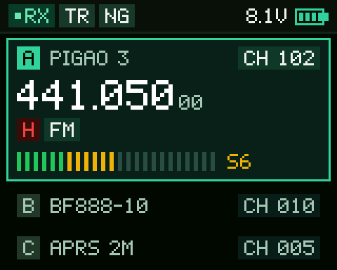
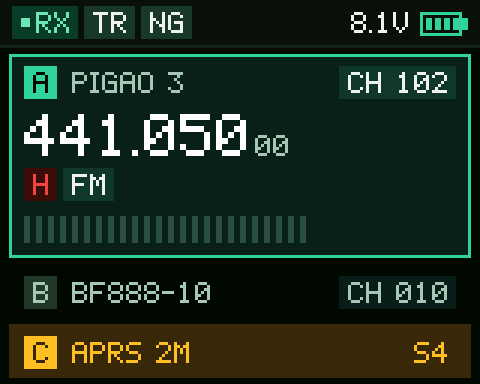
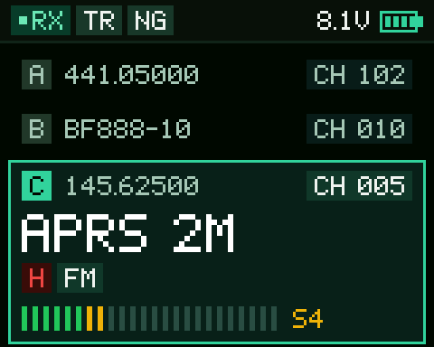
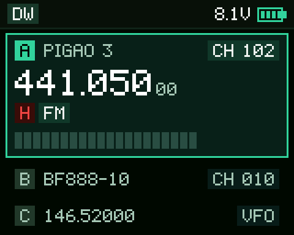
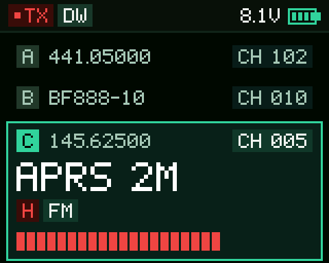
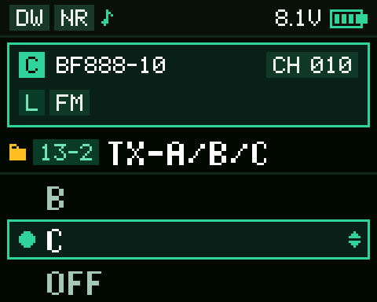
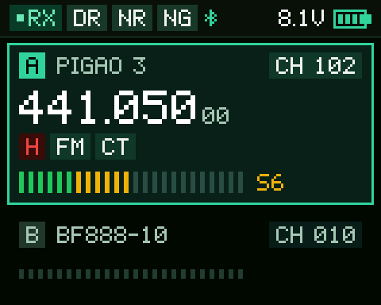
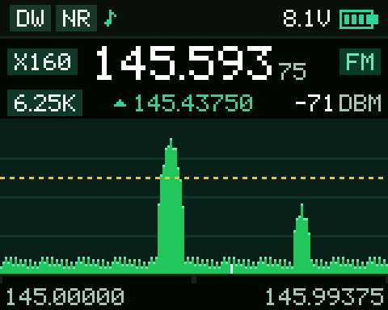
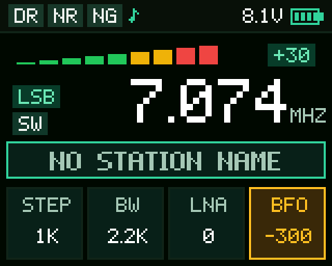
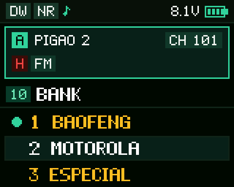

# Baojie BJ-8300 — firmware V2.6T: triple watch, a new screen, channel banks and CHIRP driver

<p align="center">
  <a href="README.md"></a>
</p>

Modified firmware for the **Baojie/Bajeton BJ-8300** handheld (JieLi AC695X, pi32v2 CPU), built by
reverse engineering the stock **V0.12** firmware, with no vendor documentation. It adds **triple
watch (TRIPLE)**, a first on this radio, **a new screen across every screen**, **16 real channel
banks**, a scramble that talks to the Baofeng UV-17L, microphone gain in the menu, a faster
spectrum and a dedicated **CHIRP driver**. The "T" in the version stands for **Tempra**.

> [!TIP]
> ## 🎉 V2.6T — three frequencies at once
>
> **[⬇️ Download V2.6T from the Releases page](https://github.com/tempraturbo/BajetonBJ8300/releases/tag/v2.6T)**
>
> | Release file | What it is for |
> |---|---|
> | `BJ8300_BANK_v2.6T.anc` | the firmware, to flash into the radio |
> | `bj8300_v2.6TEMPRA.py` | the CHIRP module for this firmware |
> | `BinTalk-V1.1.zip` | the flasher (BinTe ANC Bootloader) |
> | `CH340-driver.zip` | the driver for the USB programming cable |
>
> Tested on the radio. To flash it: [step by step](#-how-to-flash-the-firmware-step-by-step). For
> CHIRP: [step by step](#-how-to-use-chirp-with-this-firmware). The earlier ones are still
> available: [V2.0T](https://github.com/tempraturbo/BajetonBJ8300/releases/tag/v2.0T), with the new screen and no WATCH, and
> [v1.0T](https://github.com/tempraturbo/BajetonBJ8300/releases/tag/v1.0T), with the stock screen.

💚 **Like the project?** [Support it with a PayPal donation](#-support-the-project) — any amount
helps the next version come out.

---

## 🔺 TRIPLE: the BJ-8300 listening to three frequencies

The stock firmware has only two sides, A and B, and dual watch (TDR) watches both. V2.6T adds a
**third side, C**, and the radio now watches **three frequencies** at once. No BJ-8300 firmware did
this before.

| | |
|:---:|:---:|
|  |  |
| **A in focus, receiving.** B and C sit in strips below, each with its letter, name and channel | **The watch stopped on C**: its strip turns amber while it receives |
|  |  |
| **C in focus** (A/B key): it gets the card, transmits and changes channel like A and B | **C on a VFO**: the strip shows the frequency and `VFO` |
|  |  |
| **Transmitting on C** with `TX-A/B/C` on C: it comes into focus while PTT is pressed, as A and B do, and goes back on release | **The `TX-A/B/C` menu**, with C in focus in the summary at the top |

- **The `WATCH` menu** picks how many frequencies the main screen shows: **SINGLE** (one side only,
  full screen), **DUAL** (the usual A/B) or **TRIPLE**.
- **The watch (`TTR`, formerly TDR)** goes through all three, A → B → C → A, with the same time on
  each. When it is off, only the one in focus receives.
- **The A/B key** goes from A to B, from B to C and from C to A. With C in focus, everything applies
  to it: transmitting, arrows, typing, VFO/MR, STEP, power, tones.
- **C is a full side**, on a VFO or a channel, with the same options as A and B. Its channel is the
  `CH-C` item, and what its strip shows (name, frequency or channel) is `MDF-C`.
- **`TX-A/B/C`** (the stock TX-A/B, with C) picks the side PTT transmits on with the watch on. On C,
  C comes into focus while PTT is pressed, as A and B do, even when it is on neither side; on
  release, everything goes back as it was.
- **In CHIRP**, all of this is under **Settings → VFO A/B/C Channel**.

---

## 📺 The new look

| | |
|:---:|:---:|
|  |  |
| **Main screen:** both sides, with A highlighted and receiving; the top bar shows only what is on (RX, dual watch, noise reduction, Bluetooth) | **Spectrum:** the running frequency, the sweep peak in green with the dBm, the bars with the measured column in white and the threshold line in amber |
|  |  |
| **Radio** on LSB, changing the BFO: S meter, band, the big frequency and the settings in cards | **BANK menu:** the highlighted side summed up at the top, the item in a tag and the banks that are on in amber |

The images come from the PC preview ([firmware/previa/](firmware/previa/)), which runs the same
drawing code that goes into the radio.

## ✨ What changed from the stock V0.12 to V2.6T

### 🆕 New features

| Feature | What it looks like on the radio |
|---|---|
| 🔺 **WATCH: SINGLE, DUAL and TRIPLE** | A new menu item. **SINGLE** shows only the side in focus, full screen: the frequency in large type, a wide meter and, with an offset, the transmit frequency below (the watch stays off). **DUAL** is the usual A/B. **TRIPLE** adds a third side, C, and the watch goes through all three ([see above](#-triple-the-bj-8300-listening-to-three-frequencies)) |
| 📡 **Side C** | A full side, on a VFO or a channel, with the same options as A and B. The A/B key goes A → B → C → A, and with C in focus it transmits and changes like the others. New menus: `CH-C` (C's channel) and `MDF-C` (how its strip shows: name, frequency or channel) |
| 📤 **TX-A/B/C** | The stock `TX-A/B` (the side PTT transmits on with the watch on) becomes `TX-A/B/C`: OFF, A, B and C. In TRIPLE, on C, C comes into focus while PTT is pressed, as A and B do, even when it is on neither side, and on release everything goes back as it was, writing nothing |
| 🎙️ **MIC GAIN** | A new menu item, right after `NOISE REDUCTION`, with three levels: **HIGH** (31, one step above the 30 the factory calibration had on the test radio), **MID** (25) and **LOW** (19). Up to V2.0T the gain came only from the calibration, with no setting. It starts at HIGH. It takes effect at once, without turning the radio off, whether changed in the menu, in CHIRP or by the reset to factory settings |
| 💡 **Light on in the spectrum** | While the spectrum is on the screen, the light does not go off. On leaving it, the `ABR` time applies again, and the radio never powers on with the light stuck |
| 🖥️ **A new screen across the radio** | Every screen was redrawn: the main one (the highlighted side in a card with the big frequency and the meter, coloured tags for power, modulation and tones, and a top bar with only what is on), the menus and the name editor, the FM/AM/SSB radio, QT scan, DTMF, the spectrum and the power-on voltage ([see above](#-the-new-look)) |
| 🗂️ **16 channel banks** | Each bank has a **12-character name**, and a channel can be in **as many banks as you like**. You can turn **several banks on at once**: up/down and scan then only see the channels of the banks that are on. With none on, the radio works as stock. New menus: `BANK`, `BANK NAME` and `BANK CH` ([how to use](#using-banks-on-the-radio)) |
| 🔐 **Scramble with 8 frequencies** | `SCRAMBLE` goes from OFF/ON to **OFF and 2700 to 3400 Hz, in 100 Hz steps**, in ascending order. **3400 Hz** is the stock ON (it talks to other BJ-8300s), and the **Baofeng UV-17L's modes 1, 2 and 3** each match one of these frequencies. Tested with all three modes |
| 🔔 **BEEP 2 and COIN rogers** | `ROGER` gets two more options: OFF, BEEP 1 (the stock one), **BEEP 2** (four tones: 1125, 1857, 1359 and 931 Hz, ~0.4 s in total), **COIN** (the coin) and TONE1200 |
| 📊 **Spectrum with 320 and 640 points** and a **10 kHz step** | On top of the stock 160 points, to see a wider band at once |
| 📈 **Peak hold on the spectrum** | The bar rises at once and, when the signal goes away, comes down gradually |
| 🎯 **A spectrum that shows more** | The column being measured in white, the running frequency at the top, the peak frequency of every sweep in green, with the dBm |
| 🔌 **Dedicated CHIRP driver** | Reads and writes the banks (**Banks** tab), their names, the new roger and scramble, WATCH, VFO C and MIC GAIN, in a single cable session. It refuses to write to a radio with the stock firmware ([how to use](#-how-to-use-chirp-with-this-firmware)) |
| 🧰 **Extended cable command** | Reads the whole data chip (24-bit address) and writes only to the banks area. It is what the CHIRP driver uses |

### 🖥️ The new screen, screen by screen

Since V2.0T, **every** screen of the stock firmware gives way to a dark green theme, with coloured
tags and a font of its own:

| Screen | What changed |
|---|---|
| **Main** (both sides) | The highlighted side sits in a **green-bordered card**, with the name, the channel, the **big frequency** (the last two digits small) and a **20-segment meter** (green, yellow and red). The other side is compact, in a thin strip. Coloured tags: power (**H** red, **M** amber, **L** green), FM/AM, tone (CT/DCS), narrow band, offset, scramble and zone |
| **Main in SINGLE** | Only the side in focus, from the bar to the bottom of the screen: an even bigger frequency, the tags, a wide meter and, with an offset, the transmit frequency below |
| **Main in TRIPLE** | The side in focus in the card and the other two in strips, in A, B, C order, each with its letter, text and channel (or `VFO`). The strip that is receiving turns amber ([see above](#-triple-the-bj-8300-listening-to-three-frequencies)) |
| **Top bar** | Shows **only what is on**: RX and TX in a tag with a dot (green on RX, red on TX), dual watch (DW), VOX, MO, noise reduction (NR), DTMF ST, Bluetooth and the lock; the **voltage in volts** and the battery, which gets a red outline and blinks when low |
| **Transmitting** | The big line switches to the transmit frequency, and the meter turns **red, filled by the power** |
| **Typing** | The frequency is typed in its place, over the `---.---` mask; the channel, in the channel tag |
| **DTMF** (`#` key) | An amber box in place of the card of the side in use, with the digits |
| **Menus** | A medium font, easier to read; the item number in a green tag and the title in large type; three options, the one under the cursor in a card and the **saved value marked with a green dot**. Changing the value, the card gets the green border and the arrows, with no blinking. At the top, the highlighted side summed up |
| **Name editor** (BANK NAME, CH-NAME) | The text in a card, in large type when it fits, with the amber cursor, how many characters out of how many and the mode (`abc`, `ABC`, `123`, switched with `#`) in an amber tag |
| **Banks** (BANK, BANK CH) | The banks that are on, and the banks the channel is in, in **amber** |
| **FM/AM/SSB radio** | A 9-step S meter, the band in a tag, the **big frequency** with its unit, the station name in a card (with no name, `NO STATION NAME` instead of `Unknow`), and **STEP, BW, LNA and BFO in four cards**, the one being changed in amber. `SEEK...` and the start-up wait (`RADIO STARTING...`) in the new theme too |
| **Spectrum** | The running frequency in large type, points and step in tags, the **sweep peak in green** with the dBm, the graph on a panel with a grid, the measured column in white, the **threshold line dashed in amber** and the ends of the window at the bottom |
| **QT scan** (EXIT held) | The title, what it searches for (CTCSS / DCS) and the state, RUNNING in a green card or STOP in amber |
| **Power-on** | With the power-on message set to voltage, the voltage shows in a card, in volts |

### ⚡ Improvements

| What | Detail |
|---|---|
| 🚀 **Spectrum twice as fast** | 160 points in ≈ 2.5 s. And, stopped on a found signal, the arrow resumes the sweep without touching the threshold |
| 🟩 **Highlighted side stands out** | The active side sits in a green-bordered card, with the big frequency and the meter; the other one is compact |
| 📻 **FM/AM/SSB radio** | Switching modulation is ~2.5 s faster, and the saved settings (step, bandwidth, LNA, BFO and the memories) are checked on entry and on every switch: a value outside the menus' limits goes back to the default |
| ↕️ **Menu arrows swapped** | The up arrow now moves up the list instead of stepping the value |
| 🔤 **English texts revised** | 25 strings fixed and made consistent (e.g. `VOICEPRI` → `ENCRYPT`), `TDR` became `TTR` (Transmitter Triple Receiver), because with TRIPLE the watch is triple, and `TX-A/B` became `TX-A/B/C`. The `VERSION` menu shows `Firmware: V2.6T` |

### 🐞 Fixes

| V0.12 problem | In V2.6T |
|---|---|
| During scan, the signal bar froze on the last channel found, and the channel number got out of step with the name | The screen follows every channel of the sweep |
| At power-on with the voltage, the `   Voltage` text had the voltage written over it, and the "ge" was lost | `VOLTAGE` in full, with the voltage in a card |
| On the radio, a station with no name showed as `Unknow` | `NO STATION NAME` |

### ➖ Removed

| What | Why |
|---|---|
| The `ZONE` and `Zone Or Channel` menu items | The banks do the zones' job, with more freedom. The zone function is still in the firmware, and the CHIRP driver always writes **Full Channel**, so the radio never gets stuck in zone mode |
| The voices and the `VOICE` item | On request: the radio no longer speaks numbers and modes, and their space holds part of the new code |
| The Chinese language and the `LANGUAGE` item | The new screen only has Latin letters; the radio is always in English |

### 🔒 What does not change

- **Channels, settings and calibration** live in a separate chip and are **not touched** when the
  firmware is flashed.
- The **flashing mode** (`UPDATE`) is read before any modified code, and the build script refuses
  to write to it.
- **Going back to stock** is just flashing the [original firmware](firmware/original/), the same
  way.

---

## ⚠️ Before flashing

Flashing modified firmware carries risk. This project has one safety net, **tested on the radio**:
powering the radio on while holding **PTT2 + the shortcut key** shows `UPDATE` on the screen and
leaves it waiting for a flash. That path runs at boot, **before** anything the modification
touches (the build script refuses to write to the functions involved; see `PROTEGIDAS` in
[firmware/scripts/montar.py](firmware/scripts/montar.py)). During development the radio boot-looped
once ([changelog](docs/changelog.md)) and came back through this combo, without opening it.

The flasher also has a *"Click Here If Your Radio Can't Work"* button, which is presumably for when
the firmware does not even start, but it has **never been tested**.

**Keep the stock firmware**: [firmware/original/BJ8300_V0.12.anc](firmware/original/).

---

## 📥 How to flash the firmware, step by step

You need a Windows PC and the radio's **USB programming cable** (the CH340 one, the same the stock
CPS uses).

**1. Download the files.** From the [V2.6T release page](https://github.com/tempraturbo/BajetonBJ8300/releases/tag/v2.6T),
download `BJ8300_BANK_v2.6T.anc`, `BinTalk-V1.1.zip` and, if Windows does not recognise the cable
yet, `CH340-driver.zip`. Unzip them. (The same files are in the repository, under
`firmware/releases/`, `tools/anc-bootloader/` and `tools/ch340-driver/`.)

**2. Install the cable driver, if needed.** Plug the cable into the PC and open **Device
Manager**. If **Ports (COM & LPT)** shows `USB-SERIAL CH340 (COMx)`, you are set: note the COM
number. If it does not, right-click `ch341ser.inf` from `CH340-driver.zip` → **Install** (or, in a
PowerShell **run as administrator**, `pnputil /add-driver ch341ser.inf /install`) and unplug and
replug the cable.

**3. Open the flasher.** Run `BinTe ANC Bootloader.exe` (its window is called **BinTalk V1.1**).
Close any program that uses the COM port first (CHIRP, CPS).

<p align="center"></p>

- In the top field, click **`...`** and pick `BJ8300_BANK_v2.6T.anc`.
- **Port:** the cable's COM port (from step 2).
- **Baudrate:** **115200** (the default).

**4. Put the radio in flashing mode.** With the radio **off** and the cable plugged into it, power
it on **while holding PTT2 + the shortcut key**, until `UPDATE` shows on the screen.

**5. Flash.** Click **Update** and wait. The log shows `Update Mode` → `Baudrate OK` →
`Update 3%` → `Jump To Loader` → `Progress 100%` → `Finish`. Do not unplug anything halfway.

**6. Check.** Turn the radio off and on. The `VERSION` menu should show `Firmware: V2.6T`, and the
`BANK`, `BANK NAME` and `BANK CH` items show up in the menu.

**If you get `Retry1..5 / Failure!`:** turn the radio off, make sure no other program holds the
COM port, go back to step 4 and try again.

---

## 📻 How to use CHIRP with this firmware

> [!CAUTION]
> **With V2.6T, use only the `bj8300_v2.6TEMPRA.py` module from this release.** It replaces
> `bj8300_v2.0TEMPRA.py` and `bj8300_v1.0TEMPRA.py` (the model in CHIRP is now
> `BJ8300_v2.6TEMPRA`), and a `.img` image saved with an older module opens in it as usual. V2.0T
> and v1.0T have their own module in their releases.
>
> - **Do not use CHIRP's stock models** that serve the stock BJ-8300 (**Bajeton BJ7800** and
>   **Radtel RT-920**). They neither read nor write the banks, and they do not know the BEEP 2
>   roger or the new scramble frequencies: with BEEP 2 set, their settings screen does not even
>   open. RT-920 also offers "Zone or Channel", and in zone mode the radio gets stuck, because the
>   menu to leave it was removed.
> - **Do not use older versions of this module**: they do not know the new options, and a channel
>   with a new scramble frequency shows up as invalid.
> - The other way round holds too: the module **refuses** to write to a radio with the stock
>   firmware.

**1. Install the latest CHIRP.** Download **CHIRP-next** from
[chirpmyradio.com](https://chirpmyradio.com/projects/chirp/wiki/Download). The module uses the
current version's `radtel_rt900` driver; with an old CHIRP, step 3 fails with *"Invalid or
unsupported module file"*.

**2. Turn developer mode on (once).** Menu **Help** → **Developer Mode**. CHIRP warns *"Danger
Ahead"*: click **Yes**. Then it says *"Restart Required"*: click **OK**, then **close and reopen
CHIRP**. The mode stays on from then on.

**3. Load the module (every time you open CHIRP).** Menu **File** → **Load Module...** (it only
shows up in developer mode). CHIRP warns that loading a module is dangerous: click **Yes** and pick
`bj8300_v2.6TEMPRA.py`. The window turns **red** and the title shows `CHIRP **Module Loaded**`:
that is the sign the module is loaded. Closing CHIRP unloads it, so next time it has to be loaded
again.

**4. Read the radio.** With the radio on as usual and the cable plugged in, menu **Radio** →
**Download from radio...**:

| Field | Choose |
|---|---|
| **Port** | the cable's COM port |
| **Vendor** | **Baojie** (not "Bajeton") |
| **Model** | **BJ8300_v2.6TEMPRA** |

CHIRP shows the *"Experimental driver"* notice, with the module's instructions: click **Yes**, then
**OK** to read.

> [!NOTE]
> If `BJ8300_v2.6TEMPRA` is not listed under **Baojie**, the module is not loaded: go back to step 3.

**5. Edit.** On the right you get the list of the radio's parts:

- **Memories (VHF/UHF):** the 960 channels. The **Scramble** column and the channel's other
  properties are here.
- **Banks (VHF/UHF):** one column per bank; tick which banks each channel is in. To rename a
  bank, **double-click its column header**.
- **Settings:** the radio settings, with the 4-option roger and, in **BJ8300_v2.6TEMPRA Specific**,
  **Mic Gain** (HIGH, MID or LOW) right after Noise reduction.
- **Settings → Banks:** one block per bank, from **BANK 1** to **BANK 16**:

  | Row | What it is |
  |---|---|
  | **Name** | the bank's name (up to 12 characters), editable here too |
  | **Channels** | how many programmed channels the bank has (read only, counted when the page opens) |
  | **Enabled** | turns the bank on or off |

  A bank with no programmed channel **cannot be turned on**: if you tick it, CHIRP unticks it right
  away. And removing a bank's last channel turns it off by itself. At the end of the page, **Bank
  edited by the radio menu** picks the bank the radio's `BANK NAME` and `BANK CH` items work on.
- **Settings → VFO A/B/C Channel:** **WATCH** (SINGLE, DUAL or TRIPLE), **TTR** and **TX-A/B/C** at
  the top, and a block for each side (A, B and C), each with its MDF and scramble. **VFO C** has the same fields
  as A and B, plus Work Mode and **CH-C**. With C in focus on the radio, blocks B and C are
  read only: change them on the radio, or press A/B on it and download again.
- **Memories (FM / AM / HF):** the other bands, as in the stock driver.

> [!NOTE]
> After you tick and untick a checkbox, CHIRP draws it grey and its label in bold. That is just
> CHIRP's way of showing "changed" (it happens with every checkbox, the stock driver's too); the
> stored value is the unticked one.

**6. Write and restart the radio.** Menu **Radio** → **Upload to radio...**. After writing,
**turn the radio off and on**: the bank filter is built at boot.

Keep a copy of the first download (**File** → **Save**) before changing anything.

---

## Using banks on the radio

The menu gets three items, together, where the zone items used to be:

| Item | What it does |
|---|---|
| **BANK** | The arrows walk through the 16 banks; shows `n name` and ` ON` if it is on. **OK turns the bank on/off** and selects it for the other two items |
| **BANK NAME** | Names the selected bank (12 characters), with the same text editor as `CH-NAME` |
| **BANK CH** | Walks through the 960 channels showing `bank-channel`; **OK marks/unmarks** the channel in the selected bank. ` IN` = in the bank, ` -` = empty memory slot |

Behaviour details:

- Turning on a bank that **has no stored channel** filters nothing (the radio would have no
  channel to show) — the firmware undoes it by itself.
- Marking or unmarking a channel **takes effect at once**, no restart.
- Writing banks **over the cable** (CHIRP) needs a power cycle: the filter is built at boot.
- The bank state is stored in the data chip and **survives power-off**.
- Rewriting channels with CHIRP or the CPS **does not erase any bank**: the banks live in the data
  chip (0xC1000 onwards), outside the channel area.

The main screen looks the same: numbering stays **absolute, 1 to 960** (channel 500 is still 500,
not "the 3rd in the bank") and the active bank's name is not shown there. What changes is only what
**up/down and scan can see** — with a bank on, they jump straight from one marked channel to the
next.

---

## How the CHIRP driver works

The file is [chirp/bj8300_v2.6TEMPRA.py](chirp/bj8300_v2.6TEMPRA.py). The name is deliberate: it
only works with **this** firmware, so nobody with a stock BJ-8300 uses it by mistake. It derives
from CHIRP's `radtel_rt900.py`, which already handles this radio as part of the RT-920/BJ7800
family, and adds:

- The **Banks** tab and the **Settings → Banks** group (above). An enabled bank with no programmed
  channel never reaches the radio: the upload turns it off before writing, as the radio itself does.
- Download and upload of the banks area through the extended command, together with the channels
  and **in a single session** (the firmware answers the closing `E` with an ACK and only closes the
  session afterwards); on upload, only the sectors that changed.
- The roger with the radio's four options and the scramble with its nine, writing the same values
  the radio's menu writes.
- WATCH, CH-C, MDF-C and VFO C, written to the WATCH record (`0xD2000`) and to C's VFO sector
  (`0xD3000`). The upload only writes what changes and checks it by reading it back, and the
  radio's state (C on side B, and B's channel, mode and VFO) comes from the radio, not from the
  image. SINGLE turns TTR off, as in the firmware.
- **Noise reduction** read and written at the byte the radio uses (`0x9032`; the base driver uses
  `0x9031`), and **VFO A's Voice Privacy**, which the base driver did not write.
- **Mic Gain** at byte `0x9033` of the settings block, the same one the radio's MIC GAIN item uses
  (0 HIGH, 1 MID, 2 LOW; the radio reads any other value as HIGH), and **TX-A/B/C** in TX-A/B's 2 bits
  (`0x9013`), with C (3).
- **No zones:** every upload writes **Full Channel** (`0x9028` = 1), because zone mode is still in
  the firmware and, without the menu item, the radio would have no way out of it — in zone mode
  up/down is stuck within 64 channels.
- The stock-firmware lock: the banks firmware answers the extended read with size `0x40`, while
  the stock one echoes the size with bit 7 set and sends more than 128 bytes. The driver reads the
  header, discards the rest (the cable does not lose sync) and stops **before writing anything**.

Three test suites, none of them needing the radio:

- `python -I tests/teste_bj8300.py` — the banks core (stored format, checksum matching the one the
  radio itself wrote, multiple membership), with CHIRP stubbed out;
- `python -I tests/teste_chirp_real.py` — **against the real installed CHIRP**: whether the class
  fits the API (bank model, `apply_to` + settings callbacks), whether an image saved by the RT-920
  driver opens without blowing up, and whether roger and scramble end up as the bytes the radio
  writes;
- `python -I tests/teste_clonagem.py` — the **cable conversation**: CHIRP's whole `sync_in` and
  `sync_out` against a simulated radio that answers like the firmware (read from the disassembly),
  with both firmwares.

The cable's electrical side and the radio's response timing can only be tested on the real radio —
that was checked by hand with the tools in `tools/cabo/`.

---

## Older releases

All in [firmware/releases/](firmware/releases/). The full story, with what broke and why, is in
the [changelog](docs/changelog.md).

| File | Status |
|---|---|
| `BJ8300_BANK_v2.6T.anc` | **stable, the recommended one** — v51: v41 + WATCH (SINGLE, DUAL and TRIPLE), the full side C (VFO or channel), TX-A/B/C, MIC GAIN, the light on in the spectrum, TTR and the DTMF box in the new theme; use with the CHIRP driver from the same release |
| `BJ8300_BANK_v2.0T.anc` | the previous stable one, the new screen without WATCH — v41 under the version's name (same file); use with the CHIRP driver from the same release |
| `BJ8300_BANK_v45.anc` | v41 + the `WATCH` menu (SINGLE: one side full screen; DUAL: the usual A/B; TRIPLE: a third frequency, C, picked in `CH-C` and shown as `MDF-C` asks, which dual watch watches with the same time as the others and the A/B key brings into focus) — tested on the radio |
| `BJ8300_BANK_v41.anc` | v39 + the spectrum in theme B, the radio settings checked on entry and on every modulation switch, a modulation switch ~2.5 s faster and the S of the medium font — tested on the radio |
| `BJ8300_BANK_v39.anc` | v36 + the other screens in theme B (menu with the medium font, name editor, radio, QT scan, DTMF and the power-on voltage), no Chinese language, both sides on a bank change and the `VERSION` menu at `V2.0T` — tested on the radio (a freeze when switching to USB/LSB came from what was saved in it: [changelog](docs/changelog.md), v40) |
| `BJ8300_BANK_v36.anc` | v34 + the new main screen (theme B): a card for the highlighted side with the big frequency and the meter, colored tags for power, modulation and tones, and a top bar with only what is on; in the Chinese language the screen stays the stock one — tested on the radio |
| `BJ8300_BANK_v34.anc` | v32 + the spectrum in the voice space, the green peak and the whole dBm on the AM/FM toggle; the last one with the stock main screen — tested on the radio |
| `BJ8300_BANK_v32.anc` | v27 without the voices (and without the VOICE item), COIN roger (the coin), memory read over the cable; frees ~112 KB for the new screen theme — tested on the radio |
| `BJ8300_BANK_v27.anc` | v1.0T + spectrum with the current bar in white, the running frequency, the peak line and the dBm on the right; BEEP 3 roger (the coin, called COIN since v31) — tested on the radio |
| `BJ8300_BANK_v1.0T.anc` | the first stable one, with the stock screen — v25 under the version's name (same file) |
| `BJ8300_BANK_v24.anc` | v23 + 2900 Hz scramble (the Baofeng UV-17L's mode 3) — tested on the radio |
| `BJ8300_BANK_v23.anc` | v21 + BEEP 2 roger — tested on the radio |
| `BJ8300_BANK_v21.anc` | v19 + spectrum twice as fast, 10 kHz step, 320 and 640 points and peak hold; darker highlight green (v20 without the boot loop; v20 was withdrawn) — tested on the radio |
| `BJ8300_BANK_v19.anc` | v18 + the arrow resumes the spectrum when stopped on a find; the menu table where the original was — tested on the radio |
| `BJ8300_BANK_v18.anc` | v17 with the green background on the RX/TX box too — not tested on the radio |
| `BJ8300_BANK_v17.anc` | VFO block highlight without the black stripes ([screen map](docs/screen-map.md)) — tested on the radio |
| `BJ8300_BANK_v16.anc` | first working highlight; thin black stripes remain between the block's lines |
| `BJ8300_BANK_v14.anc` | earlier highlight attempt: the green only showed on the signal bar |
| `BJ8300_BANK_v12.anc` | banks, arrows, texts, the scan fix and the 24-bit cable — tested on the radio |
| `firmware/original/BJ8300_V0.12.anc` | stock firmware, to go back |

---

## Cable tools

In [tools/cabo/](tools/cabo/), PowerShell, nothing to install:

| Script | Purpose |
|---|---|
| `cabo.ps1` | Library: handshake, `Le-Bloco`, `Grava-Bloco` (the others use it) |
| `mapa_memoria.ps1` | Proves the 24-bit read, tells whether data comes raw, finds the **real chip size** and lists what lives above 64 KB |
| `ler_memoria.ps1` | Dumps the 64 KB the stock protocol reaches and checks channels and calibration (read only) |
| `teste_cabo_grava.ps1` | Proves writing to the banks area and that the firmware **refuses** to write outside it; cleans up at the end |
| `logo.ps1` | Reads (and, on a firmware that unlocks the range, writes) the boot image |

Boot image conversion: `python -I firmware/scripts/logo_bmp.py para-radio input.bmp output.bin
preview.png` (24-bit 160×138 BMP → RGB565, the same the CPS11 produces, checked byte for byte).

> **Never send anything before the magic** (not `E`, not zeros): the radio matches the magic from
> the start of the buffer and any byte in front makes every following attempt fail until the radio
> is turned off. And the magic ends in `U`, which is an UPDATE-mode command — insisting with the
> radio out of sync makes it drop into UPDATE by itself.

---

## Building

Needs the JieLi toolchain (clang for `pi32v2`) and Python 3:

```sh
sh firmware/build.sh
```

It compiles `firmware/src/bancos.c` and `firmware/src/tela.c`, builds the `.anc` from the original and **checks** the
result: CRCs of all 12 entries, code and menu table present and identical in all 6 flash images,
menu items, every hook and patch, texts, and that no byte changed outside the expected ranges —
nowhere near the protected areas. The output ends in `RESULTADO: tudo certo`, and the build is
reproducible: the same source gives the same `.anc`, byte for byte.

The toolchain path is in `firmware/build.sh` (`C:/tools/jl-toolchain-2.5.3/...`).

**Space budget:** the new code lives in three places, all at the same address in the 6 images:

- **the free area at the end of the image**, from `0x01E96124`, with 3260 bytes (V2.6T uses 2304);
- **the space that was the voices'**, with the spectrum, but only inside the files C0 and C1
  (1066 bytes, of which V2.6T uses 674), because the radio's loader refuses an image that changes
  more voice files;
- **the place of the G.729 and MP3 decoders**, inside `app.bin`, with the B screens, WATCH, TRIPLE
  and the menu table (38884 bytes, of which V2.6T uses 19542).

The menu table has lived in that last place since v43, in a 64-slot array (V2.6T uses 56); the
original, with 54, is left intact. [docs/reverse-engineering.md](docs/reverse-engineering.md)
explains how to measure it, where space was already saved and why these places are safe.

**Screen B preview on the PC:** `python -I previa/previa.py <folder>`, from inside `firmware/`,
writes every screen scenario as PNG. It needs zig (`pip install ziglang`), which serves as the C
compiler.

---

## Repository layout

```
firmware/
  src/          bancos.c (banks, menus, spectrum, cable), tela.c (main screen B) and bancos.ld
  fonte/        screen B's 5x7 font and icons, as text
  previa/       screen B preview on the PC
  scripts/      build (.anc), checks, disassembler, analysis
  original/     BJ8300_V0.12.anc — stock firmware
  releases/     .anc files ready to flash
  build.sh      compiles, builds and checks
chirp/          CHIRP driver (bj8300_v2.6TEMPRA.py)
tools/
  anc-bootloader/  BinTe ANC Bootloader flasher (BinTalk V1.1)
  ch340-driver/    USB cable driver
  cabo/            PowerShell tools that talk to the radio
  ghidra-scripts/  scripts used during analysis
logo/           boot image (BMP) and converter
tests/          CHIRP driver tests
docs/           reverse engineering, changelog, screen map, images and working notes
```

---

## 💚 Support the project

This firmware came out of many hours of reverse engineering: the stock firmware opened byte by
byte, with no vendor documentation at all, every routine mapped in the disassembly, and 49
versions, nearly all of them flashed and tested on a real radio, until the new screen and triple
watch. Everything here is, and will stay, **free**, to use, study and modify.

If your BJ-8300 got better — the banks sorted out your channels, TRIPLE watches three frequencies,
the scramble now talks to your friend's Baofeng, the spectrum got faster —, consider buying the project a coffee. Any amount
helps: it means time for new features, gear to test on, and the next version coming out.

<p align="center">
  <a href="https://www.paypal.com/donate/?hosted_button_id=2VPWYBMKBSJX6"></a>
  <br><br>
  <a href="https://www.paypal.com/donate/?hosted_button_id=2VPWYBMKBSJX6"></a>
  <br>
  <sub>Point your phone's camera at the QR code, or click the button.</sub>
</p>

**Thank you!** Every donation is a sign that it is worth carrying on. 📻

---

## Credits and licence

- The CHIRP driver **derives** from `chirp/drivers/radtel_rt900.py` (Copyright 2025, 2026 Fred
  Trimble; 2024 Pavel Moravec, OK2MOP; 2023 Jim Unroe), distributed under **GPL-2.0-or-later** —
  the same licence applies to it.
- The stock firmware (and its part inside the `.anc` releases), the BinTe flasher, the CH340
  driver (WCH) and the `bajeton` logo belong to their makers and are kept here only for
  reproducibility and recovery.
- Everything else (bank code, scripts, tools and documentation) is by **tempraturbo**, under the
  **[0BSD](LICENSE)** licence: use, copy, modify and distribute it for any purpose, without even
  having to give credit.

No warranty of any kind. You are responsible for whatever you flash onto your radio.
