# Bajeton BJ-8300 — TEMPRA firmware V4.1T

  

New firmware for the **Baojie/Bajeton BJ-8300** radio, built by reverse engineering the stock V0.12 firmware: a
**folder menu**, **triple watch**, **APRS and Morse**, **16 channel banks**, a **new screen** across the whole radio and
**remote control from the PC**. It comes with **Tempra Link**, the program that flashes the firmware and programs the
radio over the cable. The "T" in the version stands for **Tempra**.

  
  
  

> [!TIP]
> **💚 This project is free, and it lives on donations.** If your BJ-8300 got better with it, buy the project a coffee:
> every donation means time for new features, gear to test on and the next version coming out.
> [**Donate with PayPal**](https://www.paypal.com/donate/?hosted_button_id=2VPWYBMKBSJX6) · [the QR code](#-support-the-project)

### 📑 On this page

- [📻 What the radio gets](#-what-the-radio-gets)
- [💻 Tempra Link: the radio from the PC](#-tempra-link-the-radio-from-the-pc)
- [📥 How to flash the firmware](#-how-to-flash-the-firmware-step-by-step): [with Tempra Link](#-with-tempra-link-automatic) or [with BinTalk](#-with-bintalk-the-factory-flasher)
- [🔌 How to use CHIRP](#-how-to-use-chirp-with-this-firmware)
- [📖 Full documentation](#-full-documentation)
- [💚 Support the project](#-support-the-project)
- [📜 Credits and licence](#credits-and-licence)

> [!NOTE]
> **🎉 New in V4.1T:** Tempra Link, remote control from the PC, ROGER CUSTOM, a faster scan with THRESHOLD, Bluetooth
> that stays on during TX and the spectrum line, which left at the bottom would not come back up. [Everything that changed](https://github.com/tempraturbo/BajetonBJ8300/wiki/Versions)

---

## 📻 What the radio gets

| | | |
|:---:|:---:|:---:|
| <a href="https://github.com/tempraturbo/BajetonBJ8300/wiki/Radio-features#-the-new-look">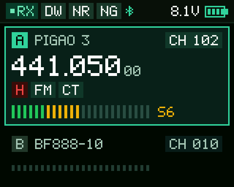</a> | <a href="https://github.com/tempraturbo/BajetonBJ8300/wiki/Radio-features#-a-new-menu-everything-in-folders">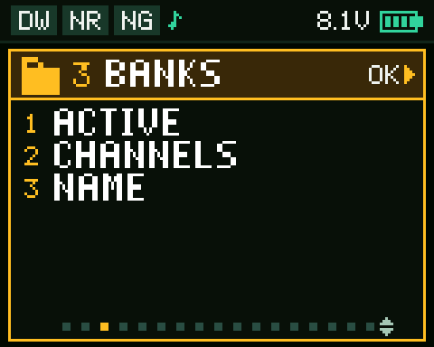</a> | <a href="https://github.com/tempraturbo/BajetonBJ8300/wiki/Radio-features#-triple-the-bj-8300-listening-to-three-frequencies">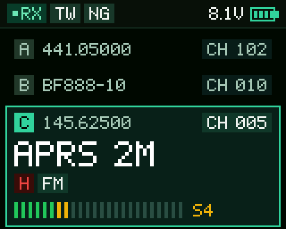</a> |
| [**New screen**, with the S-meter](https://github.com/tempraturbo/BajetonBJ8300/wiki/Radio-features#-the-new-look) | [**Menu in 17 folders**](https://github.com/tempraturbo/BajetonBJ8300/wiki/Radio-features#-a-new-menu-everything-in-folders) | [**TRIPLE:** three frequencies](https://github.com/tempraturbo/BajetonBJ8300/wiki/Radio-features#-triple-the-bj-8300-listening-to-three-frequencies) |
| <a href="https://github.com/tempraturbo/BajetonBJ8300/wiki/Radio-features#-the-aprs-messages-screen-in-v32t">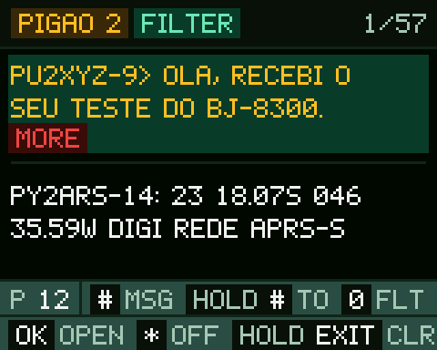</a> | <a href="https://github.com/tempraturbo/BajetonBJ8300/wiki/Radio-features#-the-morse-messages-screen-in-v37t">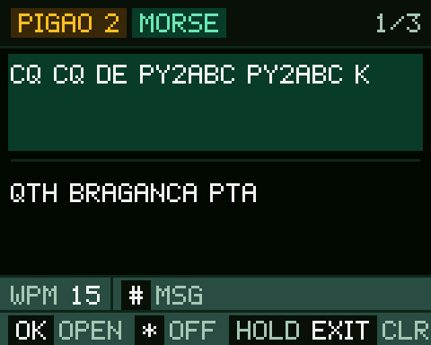</a> | <a href="https://github.com/tempraturbo/BajetonBJ8300/wiki/Radio-features#using-banks-on-the-radio">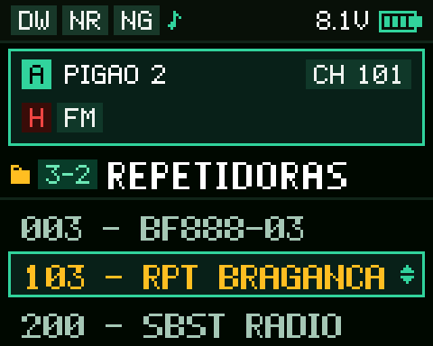</a> |
| [**APRS:** messages and position](https://github.com/tempraturbo/BajetonBJ8300/wiki/Radio-features#-the-aprs-messages-screen-in-v32t) | [**Morse:** reads and sends](https://github.com/tempraturbo/BajetonBJ8300/wiki/Radio-features#-the-morse-messages-screen-in-v37t) | [**16 channel banks**](https://github.com/tempraturbo/BajetonBJ8300/wiki/Radio-features#using-banks-on-the-radio) |
| <a href="https://github.com/tempraturbo/BajetonBJ8300/wiki/Radio-features#spectrum">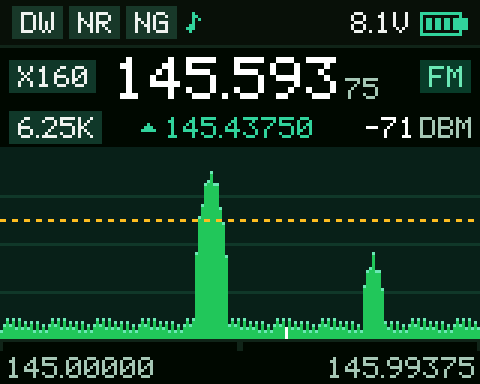</a> | <a href="https://github.com/tempraturbo/BajetonBJ8300/wiki/Radio-features#roger-custom">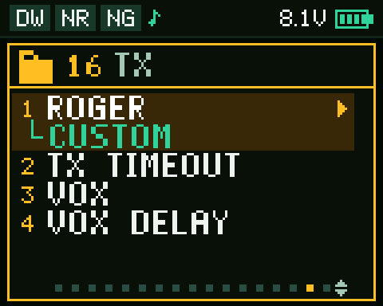</a> | <a href="https://github.com/tempraturbo/BajetonBJ8300/wiki/Radio-features#eq">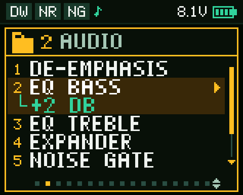</a> |
| [A faster **spectrum**](https://github.com/tempraturbo/BajetonBJ8300/wiki/Radio-features#spectrum) | [**ROGER CUSTOM**](https://github.com/tempraturbo/BajetonBJ8300/wiki/Radio-features#roger-custom) | [**EQ** on RX and TX](https://github.com/tempraturbo/BajetonBJ8300/wiki/Radio-features#eq) |

**And more:** an S-meter from S1 to S9+60, a scramble that talks to the Baofeng UV-17L, a scan at one channel every 60 ms
with THRESHOLD, microphone compressor and AGC, crystal fine tuning, screen brightness, a full C side and remote control
over the cable and Bluetooth. **[Every feature, explained in the wiki →](https://github.com/tempraturbo/BajetonBJ8300/wiki/Radio-features)**

---

## 💻 Tempra Link: the radio from the PC

The Windows program that comes with this firmware. It **flashes the firmware by itself** (from the stock one to TEMPRA,
with nothing to download by hand) and then programs the whole radio over the cable. A single `.exe`, nothing to install.

| | |
|:---:|:---:|
| <a href="https://github.com/tempraturbo/BajetonBJ8300/wiki/Tempra-Link-manual#10-remote-control">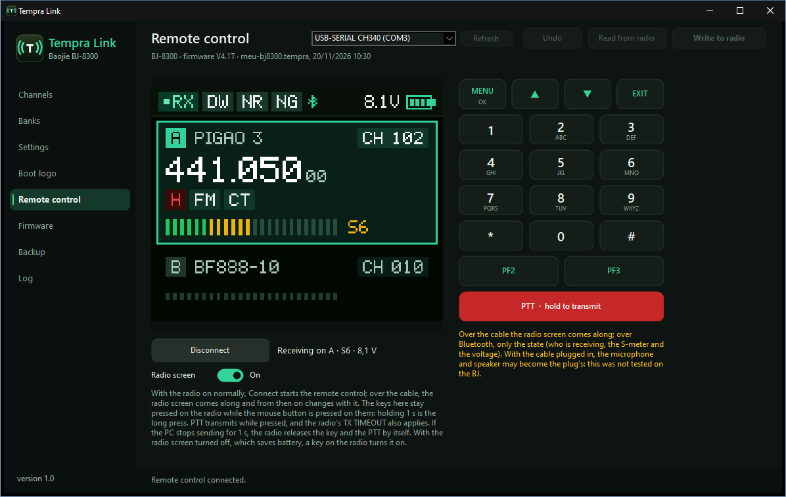</a> | <a href="https://github.com/tempraturbo/BajetonBJ8300/wiki/Tempra-Link-manual#4-channels">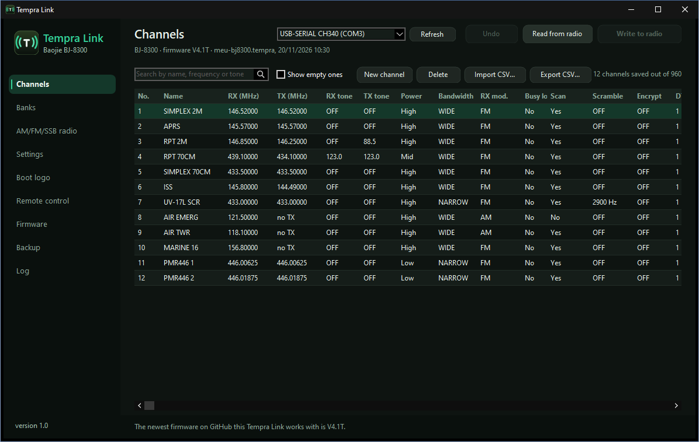</a> |
| [**Remote control:** the radio's screen, keypad and PTT on the PC](https://github.com/tempraturbo/BajetonBJ8300/wiki/Tempra-Link-manual#10-remote-control) | [**Channels:** all 960, like a spreadsheet](https://github.com/tempraturbo/BajetonBJ8300/wiki/Tempra-Link-manual#4-channels) |

- 🔥 **Flashes the firmware:** downloads the right version from GitHub, checks it and flashes it over the cable; and goes back to stock.
- 📻 **Channels and banks:** copy and paste and CHIRP's CSV; and the **AM/FM/SSB radio memories**, with names.
- ⚙️ **Settings:** the radio's menu, the VFOs, the APRS and Morse texts and DTMF.
- 🎵 **ROGER CUSTOM:** composed on a piano, or imported from MIDI and sound.
- 💾 **A backup** of every reading, and it **updates itself** from GitHub.

**[⬇️ Download Tempra Link](https://github.com/tempraturbo/BajetonBJ8300/releases/latest)** ·
**[📖 The manual, with every screen](https://github.com/tempraturbo/BajetonBJ8300/wiki/Tempra-Link-manual)**

---

## 📥 How to flash the firmware, step by step

**From the stock firmware to TEMPRA in about 3 minutes**, over the radio's USB programming cable (the CH340 one, the
same the stock CPS uses). Two ways:

### 🚀 With Tempra Link: automatic

1. Download and open `TempraLink-BJ8300_v1.0.exe`, from the [V4.1T release](https://github.com/tempraturbo/BajetonBJ8300/releases/latest).
2. With the radio on and the cable plugged into the PC, click **Read from radio**. Seeing the stock firmware, it offers
   to download and flash V4.1T: **Yes**.
3. When it asks, turn the radio off and turn it on holding **PTT2 + the shortcut key**, until `UPDATE` shows, and
   confirm.
4. Wait about 3 minutes and turn the radio off and on: `SYSTEM > VERSION` shows `Firmware: V4.1T`.

| | |
|:---:|:---:|
| <a href="https://github.com/tempraturbo/BajetonBJ8300/wiki/Flashing-the-firmware#-option-1-with-tempra-link-automatic">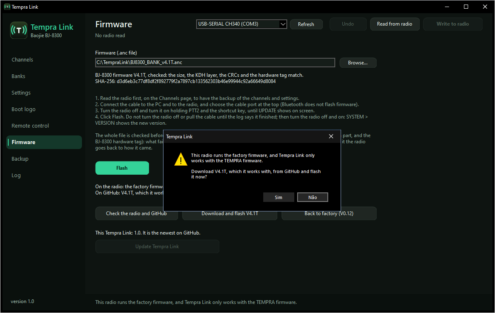</a> | <a href="https://github.com/tempraturbo/BajetonBJ8300/wiki/Tempra-Link-manual#11-flashing-the-firmware">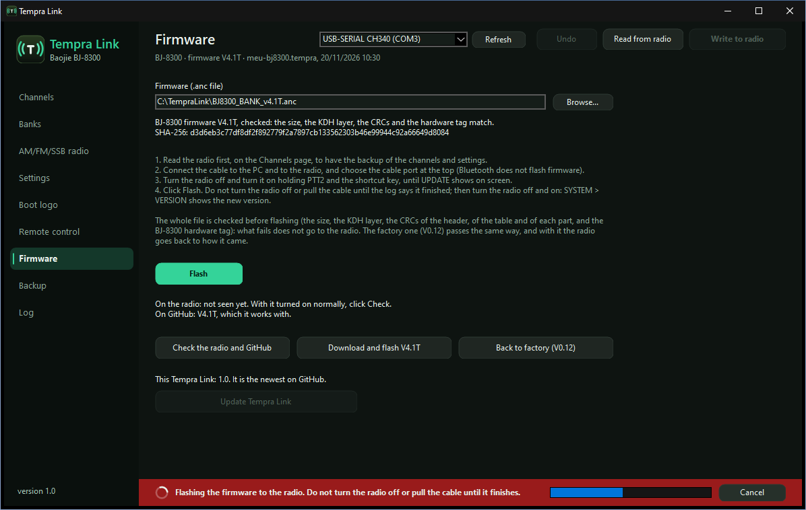</a> |
| [It sees the stock firmware and offers V4.1T](https://github.com/tempraturbo/BajetonBJ8300/wiki/Flashing-the-firmware#-option-1-with-tempra-link-automatic) | [Flashing: the red bar until the end](https://github.com/tempraturbo/BajetonBJ8300/wiki/Tempra-Link-manual#11-flashing-the-firmware) |

### 🔧 With BinTalk: the factory flasher

1. Download `BJ8300_BANK_v4.1T.anc` and `BinTalk-V1.1.zip` from the [V4.1T release](https://github.com/tempraturbo/BajetonBJ8300/releases/latest),
   and open `BinTe ANC Bootloader.exe`.
2. Pick the `.anc`, the cable's COM port and **115200**.
3. Turn the radio off and turn it on holding **PTT2 + the shortcut key**, until `UPDATE` shows, and click **Update**.
4. Wait for `Finish` and turn the radio off and on.

Channels, settings and calibration are not touched by flashing, and UPDATE mode runs before any modified part: you can
go back to stock whenever you want. **[The full step by step: the cable driver, what to do if it fails and going back
to stock →](https://github.com/tempraturbo/BajetonBJ8300/wiki/Flashing-the-firmware)**

---

## 🔌 How to use CHIRP with this firmware

Load the `bj8300_v4.1TEMPRA.py` module from the [V4.1T release](https://github.com/tempraturbo/BajetonBJ8300/releases/latest)
into CHIRP (**File → Load Module**, with developer mode on) and pick **Bajeton → BJ8300_v4.1TEMPRA**. CHIRP's stock models
(Bajeton BJ7800 and Radtel RT-920) do not work with this firmware. **[The step by step →](https://github.com/tempraturbo/BajetonBJ8300/wiki/Using-CHIRP)**

---

## 📖 Full documentation

> [!IMPORTANT]
> **Every feature of the radio and of Tempra Link is explained in detail, with the screens, in the
> [📖 project wiki](https://github.com/tempraturbo/BajetonBJ8300/wiki/English).**

| | |
|---|---|
| 📻 **[Radio features](https://github.com/tempraturbo/BajetonBJ8300/wiki/Radio-features)** | the 17-folder menu, TRIPLE, APRS, Morse, the banks, the new screen and everything that changed from V0.12 |
| 💻 **[Tempra Link](https://github.com/tempraturbo/BajetonBJ8300/wiki/Tempra-Link-manual)** | the manual, page by page, with the screens |
| 📥 **[Flashing the firmware](https://github.com/tempraturbo/BajetonBJ8300/wiki/Flashing-the-firmware)** | both ways, the cable driver, errors and going back to stock |
| 🔌 **[CHIRP](https://github.com/tempraturbo/BajetonBJ8300/wiki/Using-CHIRP)** | the module, the banks in CHIRP and how the driver works |
| 🗂️ **[Releases](https://github.com/tempraturbo/BajetonBJ8300/wiki/Versions)** and **[changelog](docs/changelog.md)** | every version, what changed and why |
| 🔬 **[Reverse engineering](docs/reverse-engineering.md)** | how the stock firmware was opened and modified |
| 🛠️ **[Development](https://github.com/tempraturbo/BajetonBJ8300/wiki/Development)** | building, the cable tools, the space budget and the repository layout |

---

## 💚 Support the project

This firmware came out of many hours of reverse engineering: the stock firmware opened byte by
byte, with no vendor documentation at all, every routine mapped in the disassembly, and 49
versions, nearly all of them flashed and tested on a real radio, until the new screen and triple
watch. Everything here is, and will stay, **free**, to use, study and modify.

If your BJ-8300 got better — the banks sorted out your channels, TRIPLE watches three frequencies,
the scramble now talks to your friend's Baofeng, the spectrum got faster —, consider buying the project a coffee. Any amount
helps: it means time for new features, gear to test on, and the next version coming out.

  
    
  
   
  Point your phone's camera at the QR code, or click the button.

**Thank you!** Every donation is a sign that it is worth carrying on. 📻

---

## Credits and licence

- The CHIRP driver **derives** from `chirp/drivers/radtel_rt900.py` (Copyright 2025, 2026 Fred
  Trimble; 2024 Pavel Moravec, OK2MOP; 2023 Jim Unroe), distributed under **GPL-2.0-or-later** —
  the same licence applies to it.
- The stock firmware (and its part inside the `.anc` releases), the BinTe flasher, the CH340
  driver (WCH) and the `bajeton` logo belong to their makers and are kept here only for
  reproducibility and recovery.
- Everything else (bank code, scripts, tools and documentation) is by **tempraturbo**, under the
  **[0BSD](LICENSE)** licence: use, copy, modify and distribute it for any purpose, without even
  having to give credit.

No warranty of any kind. You are responsible for whatever you flash onto your radio.
