# Bajeton BJ-8300 — firmware V3.6T: menu em pastas, escuta tripla, APRS e Morse, EQ, barra S, tela nova, bancos de canais e driver do CHIRP

<p align="center">
  <a href="README.en.md"></a>
</p>

Firmware modificado para o rádio **Baojie/Bajeton BJ-8300** (JieLi AC695X, CPU pi32v2), feito por
engenharia reversa do firmware de fábrica **V0.12**, sem documentação do fabricante. Traz um **menu
em pastas**, a **escuta tripla (TRIPLE)**, inédita neste rádio, **uma tela nova em todas as telas**,
**APRS e Morse**, um **equalizador** de graves e agudos na recepção e na transmissão, a **barra S**,
**16 bancos de canais de verdade**, scramble compatível com o Baofeng UV-17L, ganho, compressor, AGC e redução
de ruído do microfone no menu, expansor e porta de ruído na recepção, o ganho do receptor, ajuste fino do cristal, brilho da tela,
espectro mais rápido e um **driver do CHIRP** próprio. O "T" da versão é de **Tempra**.

> [!TIP]
> ## 🎉 V3.6T — o CH MEMORY, os BANKS refeitos, os nomes claros no menu e o TRIPLE WATCH
>
> **[⬇️ Baixar a V3.6T na página de Releases](https://github.com/tempraturbo/BajetonBJ8300/releases/tag/v3.6T)**
>
> | Arquivo do release | Para que serve |
> |---|---|
> | `BJ8300_BANK_v3.6T.anc` | o firmware, para gravar no rádio |
> | `bj8300_v3.6TEMPRA.py` | o módulo do CHIRP para este firmware |
> | `BinTalk-V1.1.zip` | o gravador (BinTe ANC Bootloader) |
> | `CH340-driver.zip` | o driver do cabo de programação USB |
>
> A V3.6T é a V3.5T com:
>
> - o **CH MEMORY**, o menu de canais refeito: o SAVE, o DELETE e o CH NAME em listas só com o que serve, `DELETE?` antes de
>   apagar, cancelar sem salvar e um aviso no lugar de lista vazia;
> - os **BANKS** no mesmo molde: ACTIVE, CHANNELS e NAME, com a lista dos bancos e a dos canais salvos, e cada OK gravando na
>   hora;
> - os **avisos de modo**: `VFO ONLY` no TX SHIFT e no OFFSET em canal, `SAVE CHANNEL FIRST` no SCAN ADD e no CH NAME em VFO;
> - as **listas** abrindo com o cursor no meio, com o anterior em cima e o próximo embaixo;
> - os **nomes claros** no menu, iguais aos do Baofeng UV-17L: SQUELCH, TAIL CUT, BUSY LOCK, TX POWER, BANDWIDTH,
>   BACKLIGHT TIME, SHOW A, B e C, TX TIMEOUT, TX SIDE e outros;
> - o **TRIPLE WATCH** no lugar do TTR, e **DW** e **TW** na barra de cima;
> - a pasta **APRS (SMS)**, antes APRS;
> - os mesmos nomes no **CHIRP**.
>
> A V3.6T é a v142, gravada e testada no rádio, com o nome da versão no item VERSION e o nome da pasta APRS (SMS), que
> entraram depois do teste. Para gravar: [passo a passo](#-como-gravar-o-firmware-passo-a-passo).
> Para o CHIRP: [passo a passo](#-como-usar-o-chirp-com-este-firmware). As anteriores continuam
> disponíveis: a [V3.5T](https://github.com/tempraturbo/BajetonBJ8300/releases/tag/v3.5T), com os menus MEMORY e BANKS antigos e os nomes de fábrica, a [V3.2T](https://github.com/tempraturbo/BajetonBJ8300/releases/tag/v3.2T), com a tela MESSAGES e sem o MIC GAIN DEFAULT, a [V3.1T](https://github.com/tempraturbo/BajetonBJ8300/releases/tag/v3.1T), com o RX, o MESSAGE e o SEND separados e sem o RX GAIN, a [V3.0T](https://github.com/tempraturbo/BajetonBJ8300/releases/tag/v3.0T), sem o EQ no CHIRP,
> a [V2.9T](https://github.com/tempraturbo/BajetonBJ8300/releases/tag/v2.9T), sem o APRS e o Morse, a [V2.6T](https://github.com/tempraturbo/BajetonBJ8300/releases/tag/v2.6T), com a
> escuta tripla e o menu numa lista só, a [V2.0T](https://github.com/tempraturbo/BajetonBJ8300/releases/tag/v2.0T),
> com a tela nova e sem o WATCH, e a [v1.0T](https://github.com/tempraturbo/BajetonBJ8300/releases/tag/v1.0T),
> com a tela de fábrica.

💚 **Gostou do projeto?** [Apoie com uma doação pelo PayPal](#-apoie-o-projeto) — qualquer valor
ajuda a próxima versão a sair.

---

## 📁 Menu novo: tudo em pastas

O menu de fábrica é uma fila de mais de 50 itens. Desde a V2.7T eles ficam em pastas por assunto (**17 na V3.6T**),
em ordem alfabética, numa janela que mostra o que tem dentro de cada uma antes de abrir.

| | | |
|:---:|:---:|:---:|
| 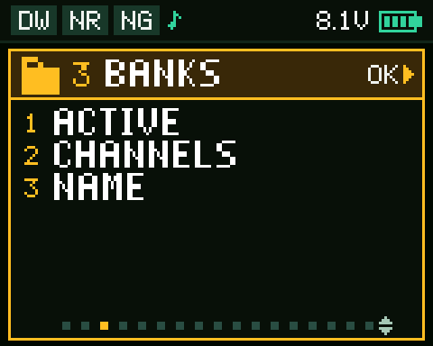 | 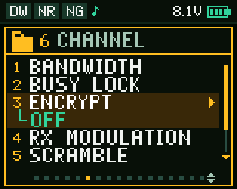 | 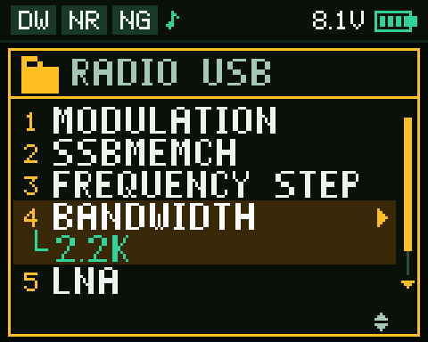 |
| **As pastas:** ▲▼ escolhem, os itens dela aparecem embaixo, e os pontinhos mostram qual das 17 está escolhida | **Dentro da pasta:** o item do cursor num cartão e o valor dele embaixo, em verde; quando a lista não cabe, as setas e a barra mostram que tem mais | **O menu do rádio** (FM, AM e SSB) na mesma janela, com os itens da modulação de agora |

- **OK** abre a pasta e, nela, **OK** já abre o item para mudar o valor, sem um segundo OK. Gravando
  ou cancelando, volta para a pasta, no mesmo item. **EXIT** volta para as pastas, e de novo sai do
  menu. Cada OK que grava um valor já o guarda no chip: desligar com o menu aberto não perde nada.
- **O número digitado** vai direto: `3` escolhe a pasta 3 e, dentro dela, `2` vai ao item `3-2`.
- **ACTIVE** e **CHANNELS**, na pasta BANKS, são de marcar vários: cada OK grava na hora e a lista
  fica, e o EXIT volta.
- **VERSION** abre só para leitura, e sai pelo EXIT.
- **A letra do menu** ficou um pouco maior e mais espaçada, e o menu reabre na última pasta usada.

| Pasta | Itens |
|---|---|
| 1 APRS (SMS) | CALLSIGN, DECODE, MESSAGES, PATH, SSID, TO |
| 2 AUDIO | DE-EMPHASIS, EQ BASS, EQ TREBLE, EXPANDER, NOISE GATE, SQUELCH, TAIL CUT |
| 3 BANKS | ACTIVE, CHANNELS, NAME |
| 4 CALIBRATION | CRYSTAL FINE, LIGHT PWM, MODEM GAIN, RX GAIN |
| 5 CH MEMORY | CH NAME, DELETE, SAVE |
| 6 CHANNEL | BANDWIDTH, BUSY LOCK, ENCRYPT, RX MODULATION, SCRAMBLE, STEP, TX POWER |
| 7 DISPLAY | BACKLIGHT TIME, BRIGHTNESS, MENU EXIT TIME, POWER-ON MSG, SHOW A, SHOW B, SHOW C |
| 8 DTMF | DTMF CODE, DTMF DELAY, DTMF GROUP, DTMF SIDETONE |
| 9 KEYS | AUTOLOCK, KEY BEEP, PF2, PF2 LONG, PF3 |
| 10 MIC | COMPRESSOR, EQ BASS, EQ TREBLE, MIC AGC, MIC GAIN, NOISE REDUCTION |
| 11 MORSE | MESSAGE, SEND, SPEED, TONE (depois da V3.6T: MESSAGES, SPEED, TONE) |
| 12 REPEATER | OFFSET, RPT TAIL CUT, RPT TAIL DELAY, TONE BURST, TX SHIFT |
| 13 SCAN | SCAN ADD, SCAN RESUME |
| 14 SYSTEM | ALARM MODE, BATTERY SAVE, BLUETOOTH, RESET, VERSION |
| 15 TONES | RX CTCSS, RX DCS, TX CTCSS, TX DCS |
| 16 TX | ROGER, TX TIMEOUT, VOX, VOX DELAY |
| 17 WATCH | TRIPLE WATCH, TX SIDE, WATCH |

### 🆕 O que a V3.0T trouxe ao menu

| | | |
|:---:|:---:|:---:|
| 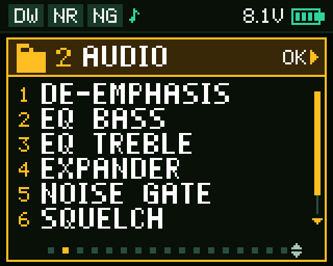 | 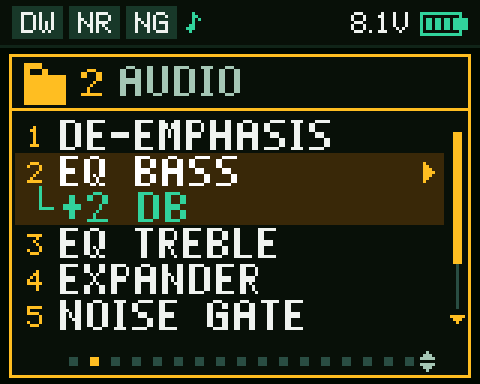 | 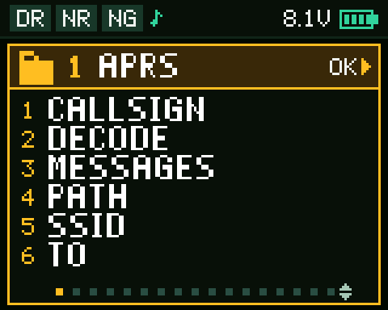 |
| **A pasta AUDIO:** o EQ, o EXPANDER, a NOISE GATE e a DE-EMPHASIS da recepção, com o SQUELCH e o TAIL CUT | **O EQ BASS aberto,** em +2 dB: os graves de −3 a +4 dB; os agudos, de −1 a +4 dB | **A pasta APRS (SMS)** (desde a V3.2T; o nome é da V3.6T): o indicativo, o DECODE, a tela MESSAGES, o PATH, o SSID e o destinatário (TO) |

- **EQ BASS e EQ TREBLE:** na AUDIO valem para o que se ouve, na MIC para o que se transmite. DEFAULT é o de
  fábrica, que já corta 1 dB dos graves na recepção e um pouco dos agudos na transmissão.
- **EXPANDER:** o gêmeo do compressor, no áudio recebido: abaixo de um nível, cada dB a menos vira 2, 3 ou 4
  (LOW, MID, HIGH). Desfaz a compressão de quem transmite com compander e cala o chiado nas pausas.
- **NOISE GATE:** corta o áudio abaixo de um nível (OFF, LOW, DEFAULT, MID, HIGH, do que menos corta ao que
  mais corta). DEFAULT é o de fábrica.
- **DE-EMPHASIS:** ON é o de fábrica; OFF deixa o áudio de FM bem mais agudo.
- **MORSE:** a mensagem (até 37 caracteres), a velocidade (5 a 40 wpm) e o tom (400 a 1200 Hz); o SEND toca. Depois da
  V3.6T, o MESSAGES lê o Morse que chega, e o `#` dele abre a caixa da mensagem.
- **CALIBRATION:** o LIGHT PWM (a frequência do PWM que escurece a luz, para fugir da interferência), o
  MODEM GAIN (o ganho do modem que a tela MESSAGES usa) e, desde a V3.2T, o RX GAIN (o ganho do receptor).

### 📨 A tela MESSAGES do APRS na V3.2T

Na pasta APRS (SMS), o **MESSAGES** abre a tela em que as mensagens chegam e de onde saem.

| | |
|:---:|:---:|
| 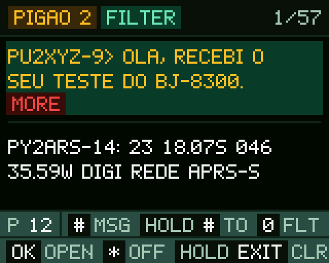 | 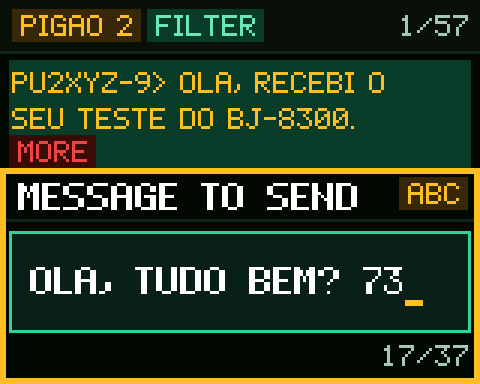 |
| **A tela MESSAGES:** a mensagem recebida num cartão, com o MORE embaixo quando não cabe (o OK a abre inteira), o histórico embaixo e, no rodapé, o P (o total de syncs) e as teclas | **O #** abre por cima a caixa **MESSAGE TO SEND**, sempre vazia, com até 37 caracteres. O OK manda a mensagem ao TO (vazio, como status), e a tela volta sozinha depois da transmissão |
| 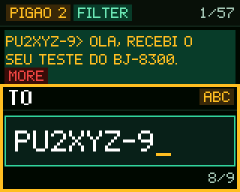 | 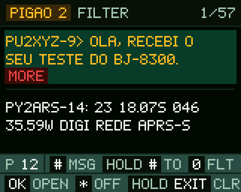 |
| **O # segurado** (0,6 s) abre a caixa **TO**, com o destinatário gravado. O OK grava, em branco inclusive, e volta | **A tecla 0** desliga o FILTER, que a tela liga ao abrir (FM, o filtro largo, os graves em −3 dB, os agudos em +4 dB e o SAVE desligado): o rádio fica como o menu o deixa e o P recomeça, para comparar |

- **A volta.** O rádio só transmite com o menu fechado. Depois do envio, e do ack automático do que chega para o
  seu indicativo, o firmware reabre a tela MESSAGES sozinho, sem bipe, e o FILTER fica como estava. Uma tecla ou
  o PTT nesse meio interrompem a volta.
- **Na caixa**, o EXIT com ela vazia, ou segurado, cancela e volta para a tela. Cada mensagem leva um número
  novo, e o texto não fica guardado: a caixa da mensagem abre sempre vazia. Enquanto se digita, a recepção do
  APRS fica parada.

### 💾 O CH MEMORY e os BANKS na V3.6T

Os dois menus saem do mesmo molde, igual ao do Baofeng UV-17L: listas só com o que serve, confirmação e avisos no lugar de
lista vazia.

| | |
|:---:|:---:|
| 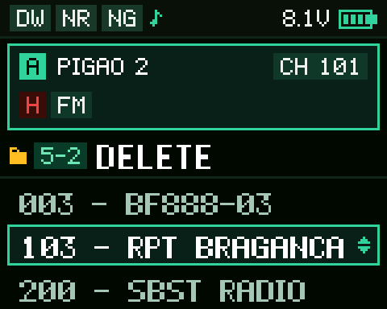 | 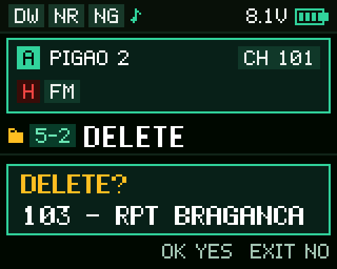 |
| **As listas do CH MEMORY:** o DELETE e o CH NAME mostram só os canais salvos, e o SAVE só os números livres, com o canal em uso ou o mais perto no meio | **O DELETE pergunta:** o OK apaga e a lista segue no mais perto, para apagar vários; o EXIT desiste |
| 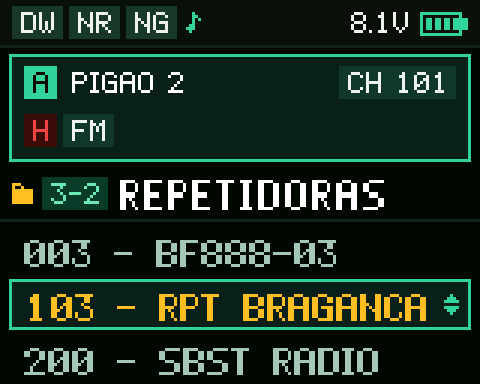 | 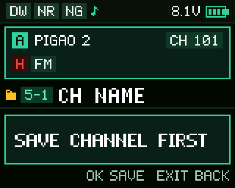 |
| **CHANNELS, nos BANKS:** depois de escolher o banco, só os canais salvos, com os do banco em âmbar e o nome dele no título | **Os avisos:** em VFO, o CH NAME e o SCAN ADD mostram `SAVE CHANNEL FIRST`, e o OK leva ao SAVE |

- **Cancelar não salva.** O SAVE e o CH NAME só gravam no OK do editor. O EXIT com a caixa vazia, ou segurado, volta à lista
  sem gravar, e o OK em branco grava `CH 101`.
- **Sem lista vazia.** No lugar dela aparece `NO SAVED CHANNELS`, `MEMORY FULL` ou `BANK EMPTY`.
- **Os modos.** Em canal, o TX SHIFT e o OFFSET abrem com `VFO ONLY`, e na pasta, embaixo do item, aparece `VFO` ou `CHANNEL`.
- **O 3 segurado** abre o mesmo SAVE, e o número digitado vai ao canal mais perto da lista.

---

## 🔺 TRIPLE: o BJ-8300 escutando três frequências

O firmware de fábrica só tem dois lados, A e B, e a dupla escuta (TDR) vigia os dois. Desde a V2.6T, ele tem um
**terceiro lado, a C**, e o rádio passa a vigiar **três frequências** ao mesmo tempo. Nenhum
firmware do BJ-8300 fazia isso.

| | |
|:---:|:---:|
| 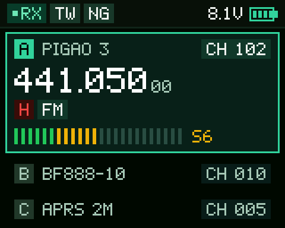 | 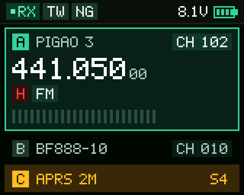 |
| **O A em evidência, recebendo.** O B e a C ficam em faixas embaixo, cada uma com a letra, o nome e o canal | **A escuta parou na C**: a faixa dela fica em âmbar enquanto recebe, com o S no lugar do canal |
| 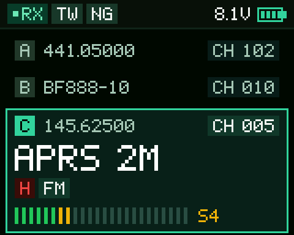 | 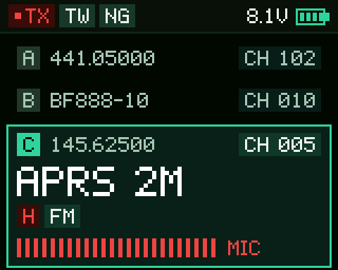 |
| **A C em evidência** (tecla A/B): ela ganha o cartão, transmite e muda de canal como o A e o B | **Transmitindo na C** com o `TX SIDE` em C: ela fica em evidência enquanto o PTT está apertado, com a barra do microfone, e volta ao soltar |

- **O menu `WATCH`** escolhe quantas frequências a tela principal mostra: **SINGLE** (só o lado A,
  em tela cheia: a tecla A/B não troca), **DUAL** (o A/B de sempre) ou **TRIPLE**.
- **A escuta (`TRIPLE WATCH`, o antigo TDR)** passa pelas três, A → B → C → A, com o mesmo tempo em
  cada uma. Desligada, só a que está em evidência recebe. Ligada, a barra de cima mostra **DW** com dois
  lados e **TW** com três.
- **A tecla A/B** vai de A para B, de B para C e de C para A. Com a C em evidência, tudo vale para
  ela: transmitir, setas, digitação, VFO/MR, STEP, potência, tons.
- **A C é um lado completo**, em VFO ou em canal, com as mesmas opções do A e do B. O canal dela se
  escolhe com ela em evidência (tecla A/B), como nos outros lados, e o que a faixa mostra (nome,
  frequência ou canal) é o `SHOW C`.
- **O `TX SIDE`** (o TX-A/B de fábrica, com o C) escolhe em que lado o PTT transmite com a escuta
  ligada. Em C, a C fica em evidência enquanto o PTT está apertado, como o A e o B ficam, mesmo
  estando fora dos dois lados; ao soltar, tudo volta como estava.
- **No CHIRP**, tudo isso fica em **Settings → VFO A/B/C Channel**.

---

## 📺 A cara nova

| | |
|:---:|:---:|
| 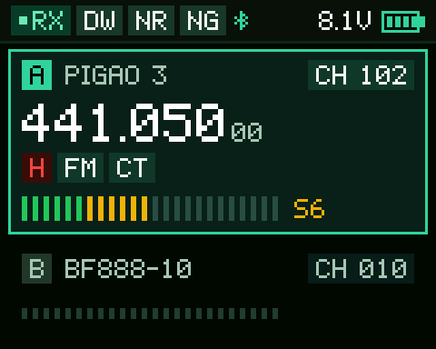 | 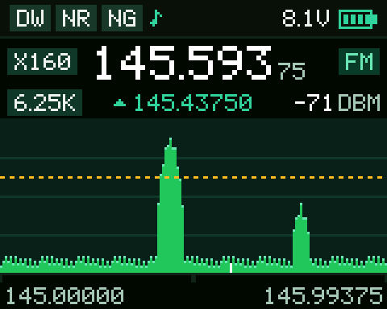 |
| **Tela principal:** os dois lados, com o A em evidência recebendo em S6 na barra S; na barra de cima só o que está ligado (RX, dupla escuta, redução de ruído, porta de ruído, Bluetooth) | **Espectro:** a frequência que roda, o pico da passada em verde com o dBm, as barras com a coluna medida em branco e a linha do limite em âmbar |
| 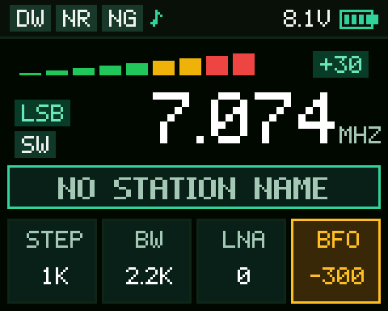 | 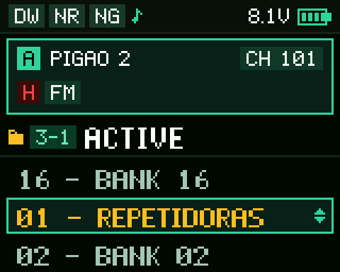 |
| **Rádio** em LSB, mudando o BFO: medidor S, a banda, a frequência grande e os ajustes em cartões | **Item aberto (BANKS → ACTIVE):** o lado em evidência resumido em cima, a pasta e o número `3-1`, e os bancos ligados em âmbar |

As imagens saem da prévia no PC ([firmware/previa/](firmware/previa/)), que roda o mesmo código de
desenho que vai para o rádio.

## ✨ O que mudou da V0.12 de fábrica para a V3.6T

### 🆕 Recursos novos

| Recurso | &#8199;&#8199;&#8199;&#8199;&#8199;&#8199;&#8199;&#8199;&#8199;&#8199;&#8199;&#8199;&#8199;&#8199;&#8199;&#8199;&#8199;Tela&#8199;&#8199;&#8199;&#8199;&#8199;&#8199;&#8199;&#8199;&#8199;&#8199;&#8199;&#8199;&#8199;&#8199;&#8199;&#8199;&#8199; |
|---|:---:|
| 📁 **Menu em pastas**<ul><li>Os itens do menu ficam em **17 pastas** por assunto, em ordem alfabética, numa janela âmbar.</li><li>A janela mostra os itens de cada pasta e, dentro dela, o valor do item do cursor, com rolagem quando a lista não cabe.</li><li>**OK** no item já abre a edição, e gravar ou cancelar volta para a pasta.</li><li>O menu do rádio (FM/AM/SSB) usa a mesma janela ([veja acima](#-menu-novo-tudo-em-pastas)).</li></ul> |  |
| 📨 **APRS**<ul><li>Pasta nova **APRS (SMS)**: CALLSIGN, SSID, PATH (WIDE1-1, WIDE1-1,WIDE2-1 ou nenhum), TO, DECODE e a tela **MESSAGES**, onde as mensagens chegam e de onde saem ([veja acima](#-a-tela-messages-do-aprs-na-v32t)).</li><li>**Envio:** o **#** abre a caixa da mensagem (até 37 caracteres), e o OK a manda ao TO (vazio, um status) em AX.25. O **# segurado** abre a caixa do TO. Depois do envio, a tela volta sozinha.</li><li>Sem **CALLSIGN** gravado, o **#** pede o indicativo antes, e nada vai ao ar sem pacote.</li><li>O AFSK de 1200 bps é gerado no rádio e posto na entrada do microfone, como um TNC de placa de som: o APRSdroid e os TNCs leem.</li><li>**FILTER:** a tela abre com FM, o filtro largo, sem scramble nem compressor, os graves em −3 dB, os agudos em +4 dB e o SAVE desligado. A tecla 0 o desliga para comparar, e tudo volta ao do menu ao sair.</li><li>**Recepção:** a mensagem, a posição, o tempo, os objetos e o Mic-E decodificados (ou como vieram, com o DECODE em OFF), o ack do que chega para o seu indicativo, o histórico e a conta dos syncs (P).</li><li>A recepção usa o modem do chip de rádio, que só acerta o pacote que chega sem erro: pega menos que um TNC.</li></ul> |  |
| 📻 **Morse**<ul><li>Pasta nova **MORSE**: MESSAGE (até 37 caracteres), SEND, SPEED (5 a 40 wpm) e TONE (400 a 1200 Hz).</li><li>Sai em FM pelo gerador de tom, como o roger; o PTT ou qualquer tecla param no meio.</li><li>O editor de texto das mensagens vai a 37 caracteres, em duas linhas quando não cabe numa.</li></ul> | 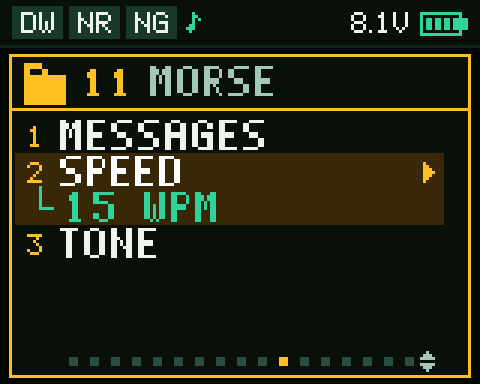 |
| 📻 **Tela MESSAGES do Morse**, depois da V3.6T, ainda sem release<ul><li>A pasta passa a **MESSAGES**, **SPEED** e **TONE**: o MESSAGES lê o Morse que chega e guarda as mensagens, como o do APRS.</li><li>O **#** abre a caixa da mensagem. O envio leva 0,3 s de portadora muda, para o squelch de quem recebe abrir, e o KA no começo e o AR no fim.</li><li>A tela é calada, com ou sem sinal; com o SQUELCH em OFF, ouve-se tudo.</li><li>Lê o que o UV-17L manda: provado no ar a 15 wpm e 700 Hz.</li></ul> | 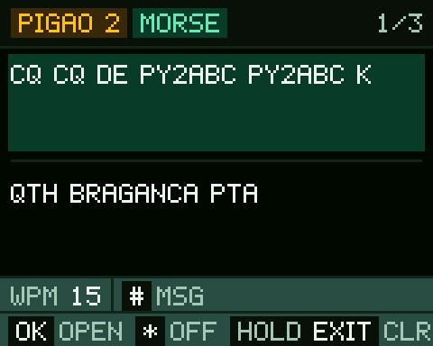 |
| 🎚️ **EQ**<ul><li>**EQ BASS** e **EQ TREBLE** na pasta AUDIO (o que se ouve) e na MIC (o que se transmite).</li><li>Graves de −3 a +4 dB e agudos de −1 a +4 dB, pelo equalizador do próprio chip de rádio.</li><li>DEFAULT é o de fábrica. O CHIRP também os ajusta.</li></ul> |  |
| 📶 **Barra S**<ul><li>O medidor de cada lado virou uma barra S de **24 segmentos**: 2 por S do S1 ao S9 e 1 por 10 dB acima, até S9+60.</li><li>O S escrito ao lado: verde até o S3, amarelo até o S8 e vermelho do S9 para cima.</li><li>O S1 começa no chiado de cada faixa, pela calibração de fábrica, e a leitura é 4 vezes por segundo.</li><li>No SINGLE, no DUAL (também no lado compacto) e no TRIPLE (na faixa de quem recebe, no lugar do canal).</li><li>Transmitindo, mostra o nível do microfone, com MIC.</li></ul> | 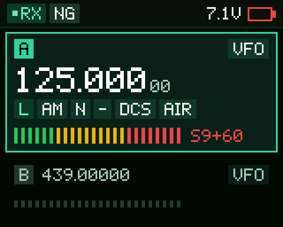 |
| 🔊 **Pasta AUDIO**<ul><li>**EXPANDER** (OFF, LOW, MID, HIGH): o expansor do áudio recebido, que o chip tem e a fábrica deixava desligado.</li><li>**NOISE GATE** (OFF, LOW, DEFAULT, MID, HIGH): corta o áudio abaixo de um nível; DEFAULT é o de fábrica.</li><li>**DE-EMPHASIS**: ON, a de fábrica, ou OFF.</li><li>Com o SQUELCH, o TAIL CUT e o EQ.</li></ul> |  |
| 🔺 **WATCH: SINGLE, DUAL e TRIPLE**<ul><li>Item novo do menu.</li><li>**SINGLE** mostra só o lado A, em tela cheia (a tecla A/B não troca): a frequência em tamanho grande, uma barra larga e, com deslocamento, a frequência de transmissão embaixo (a escuta fica desligada).</li><li>**DUAL** é o A/B de sempre.</li><li>**TRIPLE** põe um terceiro lado, a C, e a escuta passa pelas três ([veja acima](#-triple-o-bj-8300-escutando-três-frequências)).</li><li>Com a escuta ligada, o item **TRIPLE WATCH**, a barra de cima mostra **DW** com dois lados e **TW** com três.</li></ul> | 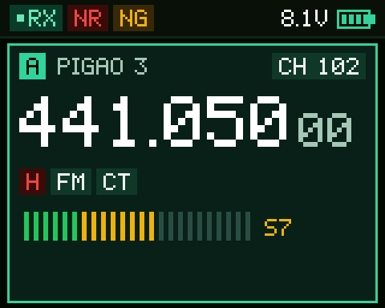 |
| 📡 **O lado C**<ul><li>Um lado completo, em VFO ou em canal, com as mesmas opções do A e do B.</li><li>A tecla A/B passa por A → B → C → A, e com a C em evidência ela transmite e muda como os outros, canal incluído.</li><li>Menu novo: `SHOW C` (como a faixa dela aparece: nome, frequência ou canal).</li></ul> |  |
| 📤 **TX SIDE**<ul><li>O `TX-A/B` de fábrica (em que lado o PTT transmite com a escuta ligada) vira `TX SIDE`: OFF, A, B e C.</li><li>No TRIPLE, em C, a C fica em evidência enquanto o PTT está apertado, como o A e o B ficam, mesmo estando fora dos dois lados.</li><li>Ao soltar, tudo volta como estava, sem gravar nada.</li></ul> | 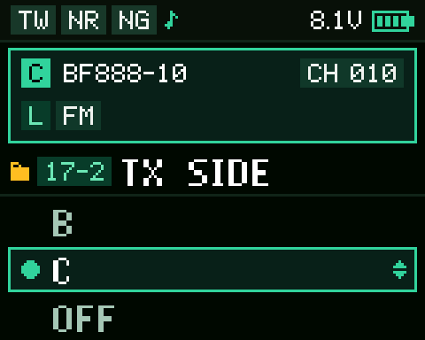 |
| 🎙️ **Pasta MIC**<ul><li>**MIC GAIN** com **HIGH** (31), **MID** (25), **LOW** (19) e **DEFAULT**, a calibração do próprio rádio, em ordem de valor entre eles.</li><li>**COMPRESSOR** do áudio de TX (OFF, LOW, MID e HIGH: 1,33:1, 2:1 e 4:1), que o chip tem e a fábrica deixava desligado.</li><li>**MIC AGC**: ON, o de fábrica, ou OFF.</li><li>**NOISE REDUCTION** com níveis: OFF, LOW, MID, DEFAULT e HIGH; DEFAULT é o ON de fábrica.</li><li>O EQ da transmissão.</li></ul> | 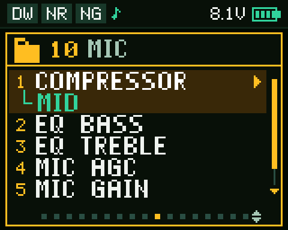 |
| 🎯 **Pasta CALIBRATION**<ul><li>**CRYSTAL FINE**: o ajuste fino do cristal, de −2000 a +2000 Hz em 435,5 MHz, de 10 em 10, proporcional à frequência e somado à calibração de fábrica.</li><li>**LIGHT PWM**: a frequência do PWM que escurece a luz (240 Hz a 25 kHz), para tirar a interferência de um receptor encostado.</li><li>**MODEM GAIN**: o ganho do modem que a tela MESSAGES usa.</li><li>**RX GAIN**: os cinco degraus do AGC do receptor, em **DEFAULT** (os de fábrica: −2, −17, −40, −57 e −71 dB, do sinal mais fraco para o mais forte) ou **MAX** (0, −6, −15, −30 e −50 dB), com mais ganho em cada degrau; o de cima já é o máximo do chip.</li></ul> | 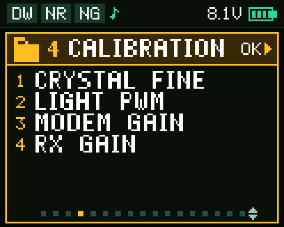 |
| 🔆 **BRIGHTNESS**<ul><li>Na pasta DISPLAY: a luz da tela em 100% (a de fábrica), 60%, 35%, 20% ou 10%, por PWM.</li><li>A 100% e com a luz apagada o pino fica como de fábrica, sem PWM.</li></ul> | 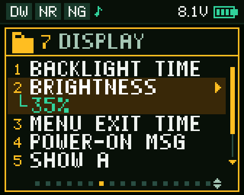 |
| 📡 **Quem recebe, com o menu aberto**<ul><li>Recebendo com o menu aberto, a barra de cima mostra, numa caixa âmbar, a letra do lado (A, B ou C) e o nome, a frequência ou o canal, como o MDF dele pede.</li><li>A caixa some quando o sinal acaba.</li></ul> | 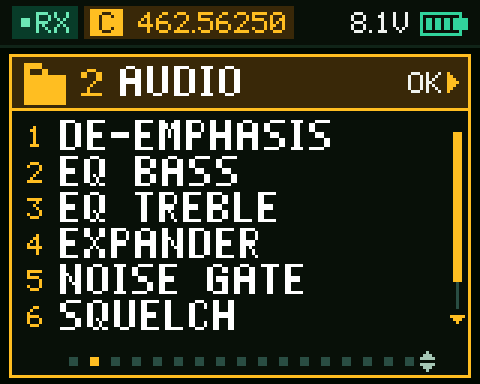 |
| 🏷️ **Etiqueta do tom de TX**<ul><li>Transmitindo, a etiqueta mostra o tom de TX em vermelho, CT ou DCS.</li><li>Sem tom de TX ela some, mesmo com tom no RX.</li></ul> | 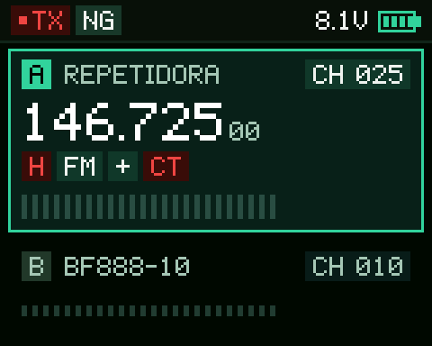 |
| ✈️ **Etiqueta AIR**<ul><li>De 108 a 135,99999 MHz, ao lado do AM.</li></ul> | 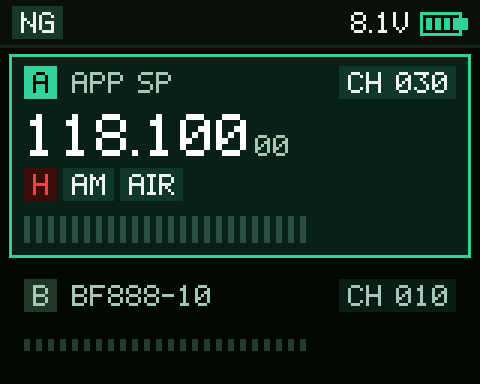 |
| 🎚️ **MIC GAIN com DEFAULT**<ul><li>O **DEFAULT** é a calibração de fábrica do próprio rádio.</li><li>Ele entra em ordem de valor entre os níveis, no rádio e no CHIRP: no rádio de teste, HIGH 31, DEFAULT 30, MID 25 e LOW 19.</li></ul> | 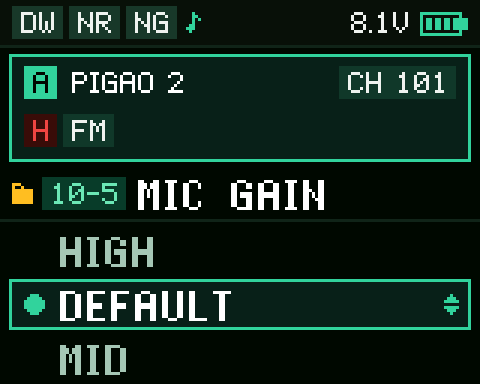 |
| 🆔 **CALLSIGN antes do envio**<ul><li>Sem indicativo gravado, o **#** da tela MESSAGES abre o CALLSIGN na mesma caixa.</li><li>Gravado, abre a caixa da mensagem.</li><li>Nada vai ao ar sem pacote.</li></ul> | 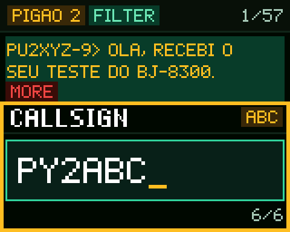 |
| 💾 **SAVE que já pede o nome**<ul><li>Depois de salvar em canal, o editor do nome abre vazio.</li><li>O lado fica no canal salvo, também vindo do VFO.</li></ul> | 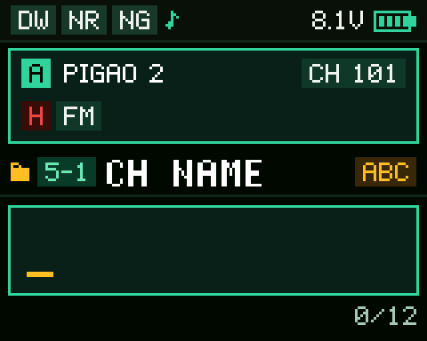 |
| 🔋 **Teto de 90% no PA**<ul><li>Nenhum bias do amplificador de potência passa de 229, 90% de 255, em todas as potências.</li><li>No rádio de teste só o H de VHF e de UHF mudam. É o teto da polarização, não de watts.</li></ul> | |
| 🚫 **NO TX**<ul><li>O canal gravado sem frequência de TX (como o CHIRP grava um canal só de escuta) mostra NO TX em vermelho.</li><li>No SINGLE, no lugar da linha de TX; no DUAL e no TRIPLE, nas etiquetas.</li></ul> | 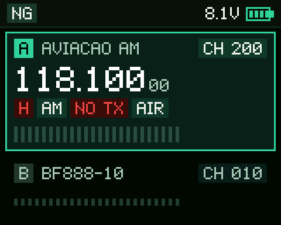 |
| ⌨️ **Editor de texto**<ul><li>No NAME dos BANKS, no CH NAME, na mensagem do Morse e nas caixas do APRS.</li><li>O **EXIT segurado** (0,6 s) sai sem gravar.</li><li>A **tecla 0** começa no espaço e traz `- / = + @ ( ) * #`, que nenhuma tecla alcançava, para o SSID e as mensagens.</li><li>As mensagens vão a 37 caracteres, em duas linhas.</li></ul> | 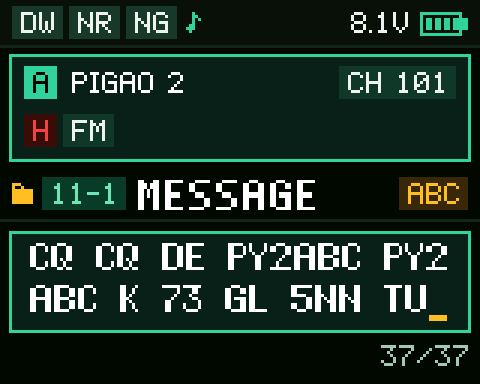 |
| 🖥️ **Tela nova em todo o rádio**<ul><li>Todas as telas foram redesenhadas ([veja acima](#-a-cara-nova)).</li><li>A principal: o lado em evidência num cartão com a frequência grande e a barra S, etiquetas coloridas de potência, modulação e tons, e a barra de cima só com o que está ligado.</li><li>Os menus e o editor de nome, o rádio FM/AM/SSB, o scan QT, o DTMF, o espectro e a tensão na partida.</li></ul> |  |
| 💾 **CH MEMORY**<ul><li>A pasta de salvar e nomear canais: **SAVE**, **DELETE** e **CH NAME**, com listas só do que serve ([veja acima](#-o-ch-memory-e-os-banks-na-v36t)).</li><li>O **DELETE** pergunta antes de apagar, e cancelar não salva.</li><li>No lugar de lista vazia, um aviso.</li></ul> |  |
| ⚠️ **Avisos de modo**<ul><li>O TX SHIFT e o OFFSET em canal abrem com `VFO ONLY`.</li><li>O SCAN ADD e o CH NAME em VFO mostram `SAVE CHANNEL FIRST`, e o OK leva ao SAVE.</li><li>De fábrica, um dava só o bipe de erro e o outro não fazia nada.</li></ul> | 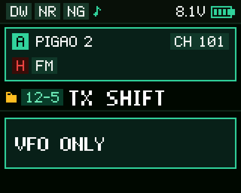 |
| 🗂️ **16 bancos de canais**<ul><li>Cada banco tem **nome de 12 caracteres**, e um canal pode estar em **quantos bancos quiser**.</li><li>Dá para ligar **vários bancos ao mesmo tempo**: o sobe/desce e a busca passam a ver só os canais dos bancos ligados.</li><li>Sem nenhum ligado, o rádio funciona como de fábrica.</li><li>Pasta nova **BANKS**, com `ACTIVE`, `CHANNELS` e `NAME` ([como usar](#usando-os-bancos-no-rádio)).</li></ul> |  |
| 🔐 **Scramble com 8 frequências**<ul><li>O `SCRAMBLE` passa de OFF/ON para **OFF e de 2700 a 3400 Hz, de 100 em 100**, em ordem crescente.</li><li>O **3400 Hz** é o ON de fábrica (fala com outros BJ-8300).</li><li>Os **modos 1, 2 e 3 do Baofeng UV-17L** caem, cada um, numa dessas frequências. Testado com os três modos.</li></ul> | 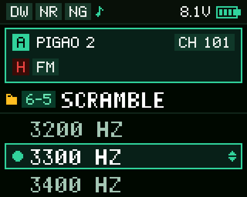 |
| 🔔 **Roger BEEP 2 e COIN**<ul><li>O `ROGER` ganha duas opções: OFF, BEEP 1 (o de fábrica), **BEEP 2**, **COIN** e TONE1200.</li><li>**BEEP 2**: quatro tons (1125, 1857, 1359 e 931 Hz), ~0,4 s no total.</li><li>**COIN**: a moeda.</li></ul> | 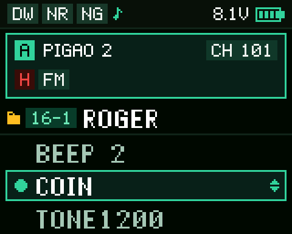 |
| 📊 **Espectro**<ul><li>**320 e 640 pontos** além dos 160 de fábrica, e **passo de 10 kHz**.</li><li>**Pico seguro**: a barra sobe na hora e desce aos poucos.</li><li>A coluna medida em branco, a frequência que roda no alto e a do pico de cada passada em verde, com o dBm.</li><li>A luz não apaga enquanto ele está na tela.</li></ul> |  |
| 🔌 **Driver do CHIRP próprio**<ul><li>Lê e grava os bancos (aba **Banks**), os nomes, o roger e o scramble novos, o WATCH, o VFO C, a pasta MIC, o CRYSTAL FINE, o BRIGHTNESS, o LIGHT PWM, o MODEM GAIN, a pasta AUDIO, o EQ, a pasta **APRS (SMS)** (menos a mensagem, que se digita no rádio), a pasta **Morse** e o DECODE.</li><li>Tudo numa sessão só pelo cabo; fica na lista do **Bajeton**.</li><li>Recusa gravar num rádio com firmware de fábrica ([como usar](#-como-usar-o-chirp-com-este-firmware)).</li></ul> | |
| 🧰 **Comando estendido no cabo**<ul><li>Leitura do chip de dados inteiro (endereço de 24 bits).</li><li>Gravação só nas áreas do firmware novo: os bancos, o WATCH, o VFO C, o Morse e o APRS.</li><li>É o que o driver do CHIRP usa.</li></ul> | |

### 🖥️ A tela nova, tela por tela

Desde a V2.0T, **todas** as telas do firmware de fábrica dão lugar a um tema escuro em verde, com
etiquetas coloridas e uma fonte própria:

| Tela | O que mudou |
|---|---|
| **Principal** (os dois lados) | O lado em evidência fica num **cartão de borda verde**, com o nome, o canal, a **frequência grande** (os dois últimos dígitos pequenos) e a **barra S** com o S escrito ao lado. O outro lado fica compacto, numa faixa fina, também com a barra e o S. Etiquetas coloridas: potência (**H** vermelho, **M** âmbar, **L** verde), FM/AM, tom (CT/DCS), banda estreita, deslocamento, scramble, zona e NO TX |
| **Principal em SINGLE** | Só o lado A, da barra ao pé da tela: a frequência ainda maior, as etiquetas, a barra S larga e, com deslocamento, a frequência de transmissão embaixo |
| **Principal em TRIPLE** | O lado em evidência no cartão e os outros dois em faixas, na ordem A, B, C, cada uma com a letra, o texto e o canal (ou `VFO`). A faixa que está recebendo fica em âmbar, com o S no lugar do canal ([veja acima](#-triple-o-bj-8300-escutando-três-frequências)) |
| **Barra de cima** | Mostra **só o que está ligado**: RX e TX numa etiqueta com bolinha (verde no RX, vermelha no TX), a escuta ligada (DW no DUAL, TW no TRIPLE), VOX, MO, a redução de ruído do microfone (NR) e a porta de ruído do RX (NG), na cor de sempre no DEFAULT e verde, amarela e vermelha no LOW, MID e HIGH, DTMF ST, Bluetooth e cadeado; a **tensão em volts** e a bateria, que fica com contorno vermelho e pisca quando está fraca. Com o menu aberto, recebendo, quem recebe numa caixa âmbar no lugar dos ícones |
| **Transmitindo** | A linha grande passa para a frequência de transmissão, e a barra mostra o **nível do microfone**, em vermelho, com MIC; a potência fica na etiqueta H/M/L |
| **Digitando** | A frequência entra no lugar dela, sobre a máscara `---.---`; o canal, na etiqueta do canal |
| **DTMF** (tecla `#`) | Uma caixa âmbar no lugar do cartão do lado em uso, com os dígitos |
| **Menus** | As pastas e os itens numa **janela âmbar** ([veja acima](#-menu-novo-tudo-em-pastas)). O item aberto: a pasta e o número (`12-2`) numa etiqueta verde e o título; três opções, a do cursor num cartão e o **valor gravado marcado com um ponto verde**; mudando o valor, o cartão ganha a borda verde e as setas, sem piscar. Em cima, o lado em evidência resumido. Tudo na letra do menu, um pouco maior que a média |
| **Editor de texto** (NAME dos BANKS, CH NAME, a mensagem do Morse e as caixas do APRS) | O texto num cartão, em tamanho grande quando cabe e em duas linhas nas mensagens, com o cursor âmbar, quantos caracteres de quantos e o modo (`ABC` ou `123`, trocado pelo `#`) numa etiqueta âmbar |
| **APRS MESSAGES** | O FILTER (apagado quando a tecla 0 o desliga) e a página no alto, a mensagem ou o pacote decodificado num cartão, com o MORE em vermelho embaixo quando não cabe, o histórico embaixo, e no rodapé o P (o total de syncs) e as teclas: `#` MSG, `#` segurado TO, `0` FLT (o FILTER), OK OPEN, `*` OFF (apaga a tela) e EXIT segurado CLR (limpa o histórico). As caixas do `#` abrem por cima da metade de baixo, numa borda âmbar, com o título (MESSAGE TO SEND ou TO), o modo (`ABC` ou `123`) e quantos caracteres de quantos, e a tela fica atrás delas |
| **Bancos** (ACTIVE e CHANNELS, na pasta BANKS) | Os bancos ligados, e os canais do banco aberto, em **âmbar**, com o nome do banco no título |
| **Rádio FM/AM/SSB** | Medidor S de 9 degraus, a banda numa etiqueta, a **frequência grande** com a unidade, o nome da estação num cartão (sem nome, `NO STATION NAME` no lugar do `Unknow`), e **STEP, BW, LNA e BFO em quatro cartões**, o que está sendo mudado em âmbar. O `SEEK...` e a espera da partida (`RADIO STARTING...`) também no tema novo, e o menu dele na janela de pastas |
| **Espectro** | A frequência que roda em tamanho grande, pontos e passo em etiquetas, o **pico da passada em verde** com o dBm, o gráfico num painel com grade, a coluna medida em branco, a **linha do limite tracejada em âmbar** e as pontas da janela embaixo |
| **Scan QT** (EXIT segurado) | O título, o que ele procura (CTCSS / DCS) e o estado, RUNNING num cartão verde ou STOP em âmbar |
| **Tensão** | Na partida (com a mensagem de partida em tensão) e segurando o `0` na tela inicial, a tensão aparece num cartão, em volts |

### ⚡ Melhorias

| O que | Detalhe |
|---|---|
| 💾 **Todo ajuste grava no OK** | A fábrica só gravava os ajustes ao fechar o menu. Agora cada OK que confirma um valor já o guarda no chip, e desligar com o menu aberto não perde nada |
| 🚀 **Espectro duas vezes mais rápido** | 160 pontos em ≈ 2,5 s. E, parado num sinal achado, a seta continua a varredura sem mexer no limite |
| 🟩 **Lado em evidência destacado** | O lado ativo fica num cartão de borda verde, com a frequência grande e a barra S; o outro fica compacto |
| 📻 **Rádio FM/AM/SSB** | A troca de modulação ficou ~2,5 s mais rápida, e os ajustes salvos (passo, largura, LNA, BFO e as memórias) são conferidos ao entrar e a cada troca: valor fora dos limites dos menus volta ao padrão |
| ↕️ **Setas do menu invertidas** | A seta de cima passa a subir na lista, em vez de avançar o valor |
| 🔤 **Textos em inglês revisados** | 25 cadeias corrigidas e padronizadas (ex.: `VOICEPRI` → `ENCRYPT`), o `TDR` virou `TRIPLE WATCH`, porque com o TRIPLE a escuta é tripla, e o `TX-A/B` virou `TX SIDE`. O menu `VERSION` mostra `Firmware: V3.6T` |
| 🏷️ **Nomes claros no menu** | Os nomes curtos de fábrica viraram nomes que dizem o que o item faz, iguais aos do Baofeng UV-17L: `SQL` é `SQUELCH`, `STE` é `TAIL CUT`, `BCL` é `BUSY LOCK`, `TXP` é `TX POWER`, `W/N` é `BANDWIDTH`, `TOT` é `TX TIMEOUT` e `MDF-A` é `SHOW A`, entre outros. A [tabela das pastas](#-menu-novo-tudo-em-pastas) traz todos, e a [seção 35](docs/engenharia-reversa.md#35-os-nomes-do-menu-desde-a-v141) lista o nome antigo de cada um |

### 🐞 Correções

| Problema da V0.12 | Na V3.6T |
|---|---|
| Os ajustes do menu só iam para o chip ao fechar o menu: desligado com ele aberto, o que mudou se perdia | Cada OK grava na hora |
| O medidor de sinal tinha 5 degraus e já enchia num sinal fraco (entre −117 e −96 dBm) | A barra S, do chiado (S1) a S9+60 |
| Com o menu aberto, ao receber, o lado em evidência aparecia por cima da janela no formato antigo (e a C saía como B) | Não aparece mais; a barra de cima mostra quem recebe |
| Durante o scan, a barra de sinal ficava congelada no último canal achado, e o número do canal descasava do nome | A tela acompanha cada canal da varredura |
| Na partida com a tensão, e segurando o `0`, o texto `   Voltage` tinha a tensão escrita por cima, e o "ge" sumia | `VOLTAGE` inteiro, com a tensão num cartão |
| Nome de canal gravado pelo CHIRP abria no editor com `?` no fim e `12/12`: o editor contava os bytes de preenchimento | O editor conta só as letras, como a tela já mostrava |
| No rádio, estação sem nome aparecia como `Unknow` | `NO STATION NAME` |

### ➖ Removido

| O que | Por quê |
|---|---|
| Itens de menu `ZONE` e `Zone Or Channel` | Os bancos fazem o papel das zonas, com mais liberdade. A função de zona continua no firmware, e o driver do CHIRP sempre grava **Full Channel**, para o rádio nunca ficar preso em modo zona |
| As vozes e o item `VOICE` | A pedido: o rádio deixa de falar os números e os modos, e o espaço delas guarda parte do código novo |
| O idioma chinês e o item `LANGUAGE` | A tela nova só tem letras latinas; o rádio fica sempre em inglês |
| O item `CH-C` | A C virou um lado completo: o canal dela se escolhe com a tecla A/B, como no A e no B. O CHIRP ainda o grava |
| As minúsculas (`abc`) no editor de nome | A fonte só tem maiúsculas: ficam `ABC` e `123` |

### 🔒 O que não muda

- **Canais, ajustes e calibração** ficam num chip à parte e **não são tocados** pela gravação do
  firmware.
- O **modo de gravação** (`UPDATE`) é lido antes de qualquer parte modificada, e o script de
  montagem recusa escrever nele.
- **Voltar ao de fábrica** é só gravar o [firmware original](firmware/original/), do mesmo jeito.

---

## ⚠️ Antes de gravar

Gravar firmware modificado tem risco. Este projeto tem uma rede de segurança, **testada no
rádio**: ligar o rádio segurando **PTT2 + o botão de atalho** mostra `UPDATE` na tela e deixa ele
esperando gravação. Esse caminho roda na inicialização, **antes** de qualquer coisa que a
modificação toca (o script de montagem recusa escrever nas funções envolvidas; ver `PROTEGIDAS` em
[firmware/scripts/montar.py](firmware/scripts/montar.py)). Durante o desenvolvimento o rádio
entrou em bootloop uma vez ([histórico](docs/historico.md)) e voltou por esse combo, sem abrir o
aparelho.

O gravador também tem o botão *"Click Here If Your Radio Can't Work"*, que deve servir para quando
o firmware nem chega a ligar, mas ele **nunca foi testado**.

**Guarde o firmware de fábrica**: [firmware/original/BJ8300_V0.12.anc](firmware/original/).

---

## 📥 Como gravar o firmware, passo a passo

Precisa de um PC com Windows e do **cabo de programação USB** do rádio (o de chip CH340, o mesmo do
CPS de fábrica).

**1. Baixe os arquivos.** Na [página do release V3.6T](https://github.com/tempraturbo/BajetonBJ8300/releases/tag/v3.6T),
baixe o `BJ8300_BANK_v3.6T.anc`, o `BinTalk-V1.1.zip` e, se o Windows ainda não reconhece o cabo,
o `CH340-driver.zip`. Descompacte os zips. (Os mesmos arquivos estão no repositório, em
`firmware/releases/`, `tools/anc-bootloader/` e `tools/ch340-driver/`.)

**2. Instale o driver do cabo, se precisar.** Ligue o cabo no PC e abra o **Gerenciador de
Dispositivos**. Se em **Portas (COM e LPT)** aparece `USB-SERIAL CH340 (COMx)`, está pronto: anote
o número da COM. Se não aparece, clique com o botão direito no `ch341ser.inf` do `CH340-driver.zip`
→ **Instalar** (ou, num PowerShell **como administrador**, `pnputil /add-driver ch341ser.inf
/install`) e desconecte e conecte o cabo.

**3. Abra o gravador.** Rode o `BinTe ANC Bootloader.exe` (a janela se chama **BinTalk V1.1**).
Feche antes qualquer programa que use a porta COM (CHIRP, CPS).

<p align="center">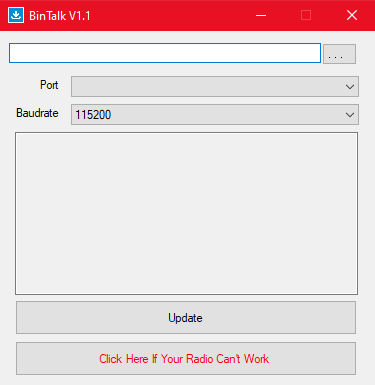</p>

- No campo de cima, clique em **`...`** e escolha o `BJ8300_BANK_v3.6T.anc`.
- **Port:** a COM do cabo (a do passo 2).
- **Baudrate:** **115200** (já vem assim).

**4. Ponha o rádio em modo de gravação.** Com o rádio **desligado** e o cabo conectado nele, ligue
o rádio **segurando PTT2 + o botão de atalho**, até aparecer `UPDATE` na tela.

**5. Grave.** Clique em **Update** e espere. O log mostra `Update Mode` → `Baudrate OK` →
`Update 3%` → `Jump To Loader` → `Progress 100%` → `Finish`. Não desconecte nada no meio.

**6. Confira.** Desligue e ligue o rádio. O menu abre nas pastas, e em `SYSTEM` → `VERSION` deve
aparecer `Firmware: V3.6T`.

**Se der `Retry1..5 / Failure!`:** desligue o rádio, confira que nenhum outro programa está com a
porta COM, volte ao passo 4 e tente de novo.

---

## 📻 Como usar o CHIRP com este firmware

> [!CAUTION]
> **Com a V3.6T, use só o módulo `bj8300_v3.6TEMPRA.py` deste release.** Ele substitui os
> anteriores (de `bj8300_v1.0TEMPRA.py` a `bj8300_v3.1TEMPRA.py`). O modelo no CHIRP passou a ser
> **Bajeton → `BJ8300_v3.6TEMPRA`** (até a V2.8T ele ficava em Baojie), e uma imagem `.img` salva com
> um módulo antigo abre nele normalmente. As versões anteriores têm o módulo delas no release de cada
> uma.
>
> - **Não use os modelos de fábrica do CHIRP** que servem para o BJ-8300 de fábrica (**Bajeton
>   BJ7800** e **Radtel RT-920**). Eles não leem nem gravam os bancos, e não conhecem o roger BEEP
>   2 nem as frequências novas do scramble: com o BEEP 2 ligado, a tela de ajustes deles nem abre.
>   O RT-920 ainda oferece o "Zone or Channel", e em modo zona o rádio fica preso, porque o menu
>   para sair dele foi removido.
> - **Não use versões antigas deste módulo**: elas não conhecem as opções novas, e um canal com
>   uma frequência de scramble nova aparece como inválido.
> - Ao contrário também vale: o módulo **recusa** gravar num rádio com o firmware de fábrica.

**1. Instale o CHIRP mais recente.** Baixe o **CHIRP-next** em
[chirpmyradio.com](https://chirpmyradio.com/projects/chirp/wiki/Download). O módulo usa o driver
`radtel_rt900` da versão atual; com um CHIRP antigo, o passo 3 falha com *"Invalid or unsupported
module file"*.

**2. Ligue o modo desenvolvedor (só uma vez).** Menu **Help** → **Developer Mode**. O CHIRP avisa
*"Danger Ahead"*: clique **Yes**. Depois avisa *"Restart Required"*: clique **OK**, **feche e abra o
CHIRP**. O modo fica ligado nas próximas vezes.

**3. Carregue o módulo (toda vez que abrir o CHIRP).** Menu **File** → **Load Module...** (só
aparece com o modo desenvolvedor). O CHIRP avisa que carregar módulo é perigoso: clique **Yes** e
escolha o `bj8300_v3.6TEMPRA.py`. A janela fica **vermelha** e o título mostra
`CHIRP **Module Loaded**`: é o sinal de que o módulo está carregado. Ao fechar o CHIRP, ele é
descarregado, e na próxima vez é preciso carregar de novo.

**4. Leia o rádio.** Com o rádio ligado normalmente e o cabo conectado, menu **Radio** →
**Download from radio...**:

| Campo | Escolha |
|---|---|
| **Port** | a COM do cabo |
| **Vendor** | **Bajeton** |
| **Model** | **BJ8300_v3.6TEMPRA** (não o BJ7800, que é o modelo de fábrica) |

O CHIRP mostra o aviso *"Experimental driver"*, com as instruções do módulo: clique **Yes** e
depois **OK** para ler.

> [!NOTE]
> Se o `BJ8300_v3.6TEMPRA` não aparece em **Bajeton**, o módulo não está carregado: volte ao passo 3.

**5. Edite.** No lado direito aparece a lista das partes do rádio:

- **Memories (VHF/UHF):** os 960 canais. As colunas **Scramble** e as outras propriedades do canal
  estão aqui.
- **Banks (VHF/UHF):** uma coluna por banco; marque em quais bancos cada canal está. Para
  renomear um banco, **dê duplo clique no cabeçalho da coluna** dele.
- **Settings:** os ajustes do rádio, com o roger de 4 opções e, no **BJ8300_v3.6TEMPRA Specific**,
  logo depois do Noise reduction, o **Expander**, a **Noise gate**, a **De-emphasis**, o **EQ bass (RX)** e o
  **EQ treble (RX)**, o **Mic Gain** (com o DEFAULT, na ordem do rádio), o **Compressor**, o **Mic AGC**, o **EQ bass (TX)** e o
  **EQ treble (TX)**, o **Crystal fine** (em Hz, em 435,5 MHz), o **Brightness**, o **Light PWM** e o
  **Modem gain**.
- **Settings → APRS (SMS) e Settings → Morse:** o indicativo, o SSID, o PATH, o destinatário e o DECODE do APRS, e
  a mensagem, a velocidade e o tom do Morse. A mensagem do APRS se digita na tela MESSAGES, desde a V3.2T. Gravar o APRS e o Morse precisa da V3.0T, e o EQ, da V3.1T.
- **Settings → Banks:** um bloco por banco, de **BANK 1** a **BANK 16**:

  | Linha | O que é |
  |---|---|
  | **Name** | o nome do banco (até 12 caracteres), editável aqui também |
  | **Channels** | quantos canais gravados o banco tem (só leitura, contados quando a página abre) |
  | **Enabled** | liga ou desliga o banco |

  Banco sem nenhum canal gravado **não liga**: se você marcar, o CHIRP desmarca na hora. E tirar
  o último canal de um banco o desliga sozinho.
- **Settings → VFO A/B/C Channel:** o **WATCH** (SINGLE, DUAL ou TRIPLE), o **TRIPLE WATCH** e o
  **TX SIDE** em cima, e um bloco para cada lado (A, B e C), cada um com o seu SHOW e o scramble. O **VFO C** tem os mesmos
  campos do A e do B, mais o Work Mode e o canal da C (**CH-C**). Com a C em evidência no rádio, os blocos B e C
  ficam só de leitura: mude pelo rádio, ou aperte A/B nele e baixe de novo.
- **Memories (FM / AM / HF):** as outras faixas, como no driver de fábrica.

> [!NOTE]
> Depois de marcar e desmarcar um checkbox, o CHIRP o desenha em cinza e o rótulo em negrito. Isso
> é só o desenho do CHIRP para "mudou" (acontece com qualquer checkbox, até os do driver de
> fábrica); o valor gravado é o desmarcado.

**6. Grave e reinicie o rádio.** Menu **Radio** → **Upload to radio...**. Depois de gravar,
**desligue e ligue o rádio**: o filtro dos bancos é montado na partida.

Guarde uma cópia do primeiro download (**File** → **Save**) antes de mudar qualquer coisa.

---

## Usando os bancos no rádio

No menu, a pasta **BANKS** tem três itens:

| Item | O que faz |
|---|---|
| **ACTIVE** | A lista dos 16 bancos, como `01 - REPETIDORAS`, com os ligados em âmbar. **O OK liga e desliga** na hora, e a lista fica, para mexer em vários. Banco sem canais não liga: aparece `BANK EMPTY`. Na pasta, embaixo do item, `2 ON` ou `ALL CHANNELS` |
| **CHANNELS** | Primeiro se escolhe o banco; depois vêm só os canais salvos, como `102 - PIGAO 3`, a partir do que está em uso, com os do banco em âmbar. **O OK põe e tira** na hora. O EXIT volta aos bancos, e de novo à pasta. Sem nenhum canal salvo, `NO SAVED CHANNELS` |
| **NAME** | A lista dos bancos abre o editor (12 caracteres), vazio se o banco não tem nome. O OK grava; em branco, o banco volta ao nome de fábrica, como `BANK 01`; cancelar não grava |

Detalhes de comportamento:

- Banco **sem nenhum canal gravado** não liga, e apagar o último canal à vista refaz o filtro: sem nada
  à vista, o rádio mostra todos.
- Marcar ou desmarcar canal **vale na hora**, sem reiniciar.
- Gravar bancos **pelo cabo** (CHIRP) exige desligar e ligar o rádio: o filtro é montado na partida.
- O estado dos bancos fica gravado no chip de dados e **sobrevive a desligar o rádio**.
- Regravar os canais pelo CHIRP ou pelo CPS **não apaga banco nenhum**: os bancos ficam no chip de
  dados (0xC1000 em diante), fora da área de canais.

Na tela inicial a aparência não muda: a numeração continua **absoluta, de 1 a 960** (o canal 500
continua sendo o 500, não "o 3º do banco") e o nome do banco ligado não aparece ali. O que muda é
só o que **o sobe/desce e a busca enxergam** — com banco ligado, eles pulam direto de um canal
marcado para o outro.

---

## Como o driver do CHIRP funciona

O arquivo é [chirp/bj8300_v3.6TEMPRA.py](chirp/bj8300_v3.6TEMPRA.py). O nome é proposital: só
funciona com **este** firmware, e assim ninguém com um BJ-8300 de fábrica o usa por engano. Ele
deriva do `radtel_rt900.py` do CHIRP, que já trata este rádio como família RT-920/BJ7800, e
acrescenta:

- A aba **Banks** e o grupo **Settings → Banks** (acima). Banco ativo sem canal gravado nunca
  sobe para o rádio: o upload o desliga antes de gravar, como o próprio rádio faz.
- Download e upload da área dos bancos pelo comando estendido, junto com os canais e **numa sessão
  só** (o firmware responde ao `E` de saída com um ACK e só fecha a sessão depois); no upload, só
  os setores que mudaram.
- O roger com as quatro opções do rádio e o scramble com as nove, gravando os mesmos valores que o
  menu do rádio grava.
- O WATCH, o CH-C, o SHOW C e o VFO C, gravados no registro do WATCH (`0xD2000`) e no setor dos
  VFOs da C (`0xD3000`). O upload só grava o que muda e confere lendo de volta, e o estado do rádio
  (a C no lado B, e o canal, o modo e o VFO do B) vem do rádio, não da imagem. SINGLE desliga o
  TRIPLE WATCH, como no firmware.
- O **Noise reduction** lido e gravado no byte que o rádio usa (`0x9032`; o driver de base usa
  `0x9031`), e a **Voice Privacy do VFO A**, que o driver de base não gravava.
- O **Mic Gain** no byte `0x9033` do bloco de ajustes, o mesmo que o item MIC GAIN do rádio usa
  (0 HIGH, 1 MID, 2 LOW, 3 DEFAULT; outro valor o rádio lê como DEFAULT), com a lista na ordem do rádio, que sai da
  calibração da imagem, e o **TX SIDE** nos 2 bits do TX-A/B
  (`0x9013`), com o C (3).
- **Sem zonas:** todo upload grava **Full Channel** (`0x9028` = 1), porque o modo zona continua no
  firmware e, sem o item de menu, o rádio não teria como sair dele — em modo zona o sobe/desce fica
  preso em 64 canais.
- A trava contra firmware de fábrica: o firmware dos bancos responde à leitura estendida com tamanho
  `0x40`, e o de fábrica ecoa o tamanho com o bit 7 ligado e manda mais de 128 bytes. O driver lê
  o cabeçalho, descarta o resto (o cabo não dessincroniza) e para **antes de gravar qualquer
  coisa**.

Três conjuntos de teste, os três sem rádio:

- `python -I tests/teste_bj8300.py` — o miolo dos bancos (formato gravado, soma batendo com a que
  o próprio rádio gravou, pertinência múltipla), com o CHIRP stubado;
- `python -I tests/teste_chirp_real.py` — **contra o CHIRP instalado de verdade**: se a classe
  encaixa na API (modelo de bancos, `apply_to` + callbacks dos ajustes), se imagem salva pelo
  driver RT-920 abre sem estourar, e se roger e scramble terminam nos bytes que o rádio grava;
- `python -I tests/teste_clonagem.py` — a **conversa pelo cabo**: `sync_in` e `sync_out` inteiros
  contra um rádio simulado que responde como o firmware (lido no desmontado), nos dois firmwares.

A elétrica do cabo e o tempo de resposta do rádio só o rádio real testa — isso foi validado à mão
com as ferramentas de `tools/cabo/`.

---

## Versões anteriores

A última fica em [firmware/releases/](firmware/releases/). As lançadas estão na
[página de Releases](https://github.com/tempraturbo/BajetonBJ8300/releases), e todas, as de teste inclusive, no
histórico do git. A história completa, com o que quebrou e por quê, está no [histórico](docs/historico.md).

| Arquivo | Estado |
|---|---|
| `BJ8300_BANK_v3.6T.anc` | **estável, a recomendada** — a v142: a V3.5T + o CH MEMORY, os BANKS refeitos, os avisos de modo, as listas com o cursor no meio, os nomes claros, o TRIPLE WATCH com DW e TW na barra e a pasta APRS (SMS); use com o driver do CHIRP do mesmo release |
| `BJ8300_BANK_v3.5T.anc` | estável anterior — a v139: a V3.2T + o SAVE que já pede o nome, as etiquetas do tom de TX e AIR, o MIC GAIN com DEFAULT, o teto de 90% no PA, o CALLSIGN antes do envio, o OK que grava o canal e um EXIT só nos itens de texto; use com o driver do CHIRP do mesmo release |
| `BJ8300_BANK_v3.2T.anc` | estável anterior — a v115: a V3.1T + a tela MESSAGES no lugar do RX, do MESSAGE e do SEND do APRS (o `#` abre a caixa da mensagem e o `#` segurado a do TO, e a tela volta sozinha depois do envio), o rodapé com o P e o RX GAIN na CALIBRATION; use com o driver do CHIRP do mesmo release |
| `BJ8300_BANK_v3.1T.anc` | estável anterior — a v111: a V3.0T + o EQ no CHIRP (que a V3.0T voltava a DEFAULT a cada gravação pelo cabo), o APRS RX com o FILTER pondo os graves em −3 dB, os agudos em +4 dB e o SAVE desligado, a tecla 0 que liga e desliga o FILTER, o rodapé com S, B e F, o MORE embaixo da mensagem e a limpeza do firmware; use com o driver do CHIRP do mesmo release |
| `BJ8300_BANK_v3.0T.anc` | estável anterior — a v110: a V2.9T + as pastas APRS (o envio pela entrada do microfone, a recepção com o FILTER, o histórico e o ack) e MORSE, o EQ de graves e agudos na recepção e na transmissão, a barra S de 24 segmentos, a pasta AUDIO (EXPANDER, NOISE GATE e DE-EMPHASIS), a NOISE REDUCTION com níveis, o LIGHT PWM, o MODEM GAIN, o NO TX e cada ajuste gravado no OK; use com o driver do CHIRP do mesmo release |
| `BJ8300_BANK_v2.9T.anc` | estável anterior — a v64: a V2.8T + a pasta MIC (COMPRESSOR, MIC AGC e o MIC GAIN, que saiu do TX), a pasta CALIBRATION com o CRYSTAL FINE, o BRIGHTNESS no DISPLAY, quem recebe na barra de cima com o menu aberto (sem o bloco antigo por cima do menu) e o driver do CHIRP em Bajeton; use com o driver do CHIRP do mesmo release |
| `BJ8300_BANK_v2.8T.anc` | estável anterior — a v58: a V2.7T com o fundo âmbar do 3º item de cada pasta e do menu do rádio inteiro; use com o driver do CHIRP do mesmo release |
| `BJ8300_BANK_v2.7T.anc` | o menu em pastas com o fundo do 3º item pela metade — a v57: a V2.6T + o menu em 13 pastas (com o valor do item, a rolagem, OK abrindo já na edição, BANK e CHANNEL de marcar vários e o VERSION só leitura), a letra do menu maior, o menu do rádio na mesma janela, sem o item CH-C, o editor de nome contando só as letras e só com ABC e 123, e a tensão do `0` segurado no tema novo, mas o fundo âmbar do 3º item sai pela metade; use com o driver do CHIRP do mesmo release |
| `BJ8300_BANK_v2.6T.anc` | a escuta tripla com o menu numa lista só — a v51: a v41 + o WATCH (SINGLE, DUAL e TRIPLE), o lado C completo (VFO ou canal), o TX-A/B/C, o MIC GAIN, a luz acesa no espectro, o TTR e a caixa do DTMF no tema novo; use com o driver do CHIRP do mesmo release |
| `BJ8300_BANK_v2.0T.anc` | a tela nova sem o WATCH — a v41 com o nome da versão (mesmo arquivo); use com o driver do CHIRP do mesmo release |
| `BJ8300_BANK_v45.anc` | v41 + o menu `WATCH` (SINGLE: um lado em tela cheia; DUAL: o A/B de sempre; TRIPLE: uma terceira frequência, a C, escolhida no `CH-C` e mostrada como o `MDF-C` pede, que a dupla escuta vigia com o mesmo tempo das outras e a tecla A/B põe em evidência) — testado no rádio |
| `BJ8300_BANK_v41.anc` | v39 + o espectro no tema B, os ajustes do rádio conferidos na entrada e na troca de modulação, a troca de modulação ~2,5 s mais rápida e o S da fonte média — testado no rádio |
| `BJ8300_BANK_v39.anc` | v36 + as outras telas no tema B (menu com a fonte média, editor de nome, rádio, scan QT, DTMF e a tensão na partida), sem o idioma chinês, os dois lados no banco e o menu `VERSION` em `V2.0T` — testado no rádio (um travamento na troca para USB/LSB vinha do que estava salvo nele: [histórico](docs/historico.md), v40) |
| `BJ8300_BANK_v36.anc` | v34 + a tela principal nova (tema B): cartão do lado em evidência com a frequência grande e o medidor, etiquetas coloridas de potência, modulação e tons, e a barra de cima só com o que está ligado; no idioma chinês a tela fica a de fábrica — testado no rádio |
| `BJ8300_BANK_v34.anc` | v32 + o espectro no espaço das vozes, o pico em verde e o dBm inteiro na troca de AM/FM; a última com a tela principal de fábrica — testado no rádio |
| `BJ8300_BANK_v32.anc` | v27 sem as vozes (e sem o item VOICE), roger COIN (a moeda), leitura de memória pelo cabo; abre ~112 KB de espaço para o tema novo da tela — testado no rádio |
| `BJ8300_BANK_v27.anc` | v1.0T + espectro com a barra atual em branco, a frequência que roda, a linha do pico e o dBm à direita; roger BEEP 3 (a moeda, chamada de COIN desde a v31) — testado no rádio |
| `BJ8300_BANK_v1.0T.anc` | a primeira estável, com a tela de fábrica — a v25 com o nome da versão (mesmo arquivo) |
| `BJ8300_BANK_v24.anc` | v23 + scramble 2900 Hz (o do Baofeng UV-17L no modo 3) — testado no rádio |
| `BJ8300_BANK_v23.anc` | v21 + roger BEEP 2 — testado no rádio |
| `BJ8300_BANK_v21.anc` | v19 + espectro duas vezes mais rápido, passo de 10 kHz, 320 e 640 pontos e pico seguro; verde do realce mais escuro (a v20 sem o bootloop; a v20 foi retirada) — testado no rádio |
| `BJ8300_BANK_v19.anc` | v18 + a seta continua o espectro parado num achado; a tabela de menus no lugar da original — testado no rádio |
| `BJ8300_BANK_v18.anc` | v17 com o fundo verde também na caixinha do RX/TX — não testado no rádio |
| `BJ8300_BANK_v17.anc` | realce do bloco do VFO sem as faixas pretas ([mapa da tela](docs/mapa-da-tela.md)) — testado no rádio |
| `BJ8300_BANK_v16.anc` | primeiro realce funcionando; sobram faixas finas pretas entre as linhas do bloco |
| `BJ8300_BANK_v14.anc` | tentativa anterior do realce: o verde só saía na barra de sinal |
| `BJ8300_BANK_v12.anc` | bancos, setas, textos, correção do scan e o cabo de 24 bits — testado no rádio |
| `firmware/original/BJ8300_V0.12.anc` | firmware de fábrica, para voltar atrás |

---

## Ferramentas pelo cabo

Em [tools/cabo/](tools/cabo/), em PowerShell, sem instalar nada:

| Script | Para que serve |
|---|---|
| `cabo.ps1` | Biblioteca: handshake, `Le-Bloco`, `Grava-Bloco` (as outras usam) |
| `mapa_memoria.ps1` | Prova a leitura de 24 bits, diz se os dados vêm crus, acha o **tamanho real do chip** e lista o que existe acima de 64 KB |
| `ler_memoria.ps1` | Despeja os 64 KB que o protocolo de fábrica alcança e confere canais e calibração (só leitura) |
| `teste_cabo_grava.ps1` | Prova a gravação na área dos bancos e que o firmware **recusa** gravar fora dela; limpa no fim |
| `logo.ps1` | Lê (e, num firmware que libere a faixa, grava) a imagem de abertura |

Conversão da imagem de abertura: `python -I firmware/scripts/logo_bmp.py para-radio entrada.bmp
saida.bin previa.png` (BMP 160×138 de 24 bits → RGB565, o mesmo que o CPS11 produz, conferido byte
a byte).

> **Nunca mande nada antes do magic** (nem `E`, nem zeros): o rádio compara o magic desde o início
> do buffer e qualquer byte à frente faz todas as tentativas seguintes falharem até desligar o
> aparelho. E o magic termina em `U`, que é comando do modo UPDATE — insistir com o rádio fora de
> sincronia faz ele entrar em UPDATE sozinho.

---

## Compilar

Qualquer pessoa compila o firmware no Windows só com o que está no repositório: o compilador da JieLi
(clang para `pi32v2`) vem junto, em [`tools/jl-toolchain-2.5.3`](tools/jl-toolchain-2.5.3/LEIA-ME.md),
e faltam só dois programas gratuitos.

**1. Instale, uma vez só:**

| Programa | Onde | Detalhe |
|---|---|---|
| **Git para Windows** | <https://git-scm.com/download/win> | o instalador com as opções padrão serve; ele traz o `bash` que roda o build |
| **Python 3.8 ou mais novo** | <https://www.python.org/downloads/> | na primeira tela do instalador, marque **"Add python.exe to PATH"** |

**2. Baixe o repositório:** `git clone https://github.com/tempraturbo/BajetonBJ8300.git`, ou, no
GitHub, **Code → Download ZIP** (e descompacte).

**3. Compile:** dois cliques em **`compilar.bat`**, na raiz do repositório. Ou, no Git Bash, dentro da
pasta do repositório:

```sh
sh firmware/build.sh
```

Leva uns dois minutos. No fim aparecem `RESULTADO: tudo certo`, as quatro linhas da pilha com `ok` e o
arquivo pronto, **`firmware/build/BJ8300_BANK.anc`**: é ele que se grava no rádio
([como gravar](#-como-gravar-o-firmware-passo-a-passo)). Se faltar o Git ou o Python, o
`compilar.bat` diz qual e onde baixar.

O build compila `firmware/src/bancos.c` e `firmware/src/tela.c`, monta o `.anc` a partir do original e
**confere** o resultado: CRCs das 12 entradas, código e tabela de menus presentes e iguais nas 6
imagens de flash, itens de menu, todos os ganchos e remendos, textos, e que nenhum byte foi alterado
fora dos trechos previstos — nem perto das áreas protegidas. Depois mede a **pilha**
(`firmware/scripts/pilha.py`): o código novo roda na pilha de quem o chama, e o caminho mais fundo
dele não pode passar do que o firmware de fábrica já usa ali. O build é reprodutível: o mesmo fonte
dá o mesmo `.anc`, byte a byte, então dá para comparar o sha256 com o do release. Antes de compilar
ele confere o sha256 dos cinco arquivos do compilador; para usar outra cópia do compilador, aponte a
variável `JL_TOOLCHAIN` para ela.

**Opcionais:**

- **Prévia da tela no PC** (abaixo): `pip install ziglang`.
- **Teste do Morse e do APRS** (o pacote, o AFSK, o decodificador e a leitura do Morse nas capturas do rádio, no PC):
  `python -I tests/teste_mensagem.py`,
  com o mesmo zig; e o laço da recepção do APRS inteiro, com o modem, a flash e as teclas imitados:
  `python -I tests/teste_rx.py`.
- **Testes do driver do CHIRP:** `python -I tests/teste_bj8300.py` não precisa de nada;
  `python -I tests/teste_chirp_real.py` precisa do CHIRP
  (`pip install https://codeload.github.com/kk7ds/chirp/tar.gz/refs/heads/master --no-deps`).
- **Estudar o firmware de fábrica:** o build deixa o desmontado inteiro em `firmware/build/app.dis`, e
  os scripts de `firmware/scripts` trabalham sobre ele: `desmonta.sh` (um trecho), `contexto.py` (quem
  chama um endereço, com os argumentos), `fluxo.py` (os caminhos dentro de uma rotina) e
  `escritas.py` (quem lê ou grava um endereço de RAM).

**Orçamento de espaço:** o código novo mora em cinco lugares, todos no mesmo endereço nas 6 imagens:

- **a área livre do fim da imagem**, a partir de `0x01E96124`, com 3260 bytes (a V3.6T usa 3154);
- **o espaço que era das vozes**, com o espectro, mas só dentro dos arquivos C0 e C1 (1066 bytes,
  dos quais a V3.6T usa 1060), porque o carregador do rádio recusa a imagem que muda mais arquivos de
  voz;
- **o lugar dos decodificadores G.729 e MP3**, dentro do `app.bin`, com as telas B, o WATCH, o
  TRIPLE, o menu em pastas, o APRS e a tabela de menus (38884 bytes, dos quais a V3.6T usa 38850);
- **os caminhos das vozes**, no `app.bin`, só com o que o nosso código chama (2944 bytes, dos quais a V3.6T usa 2702);
- **a tabela de menu de fábrica**, morta desde a v43, no `app.bin` (1512 bytes, dos quais a V3.6T usa 1190).

A tabela de menus fica no lugar do G.729 e do MP3 desde a v43, num vetor de 96 vagas (a V3.6T usa as 96: as 17
pastas e os 79 itens); a original, de 54, virou espaço de código na v140. [docs/engenharia-reversa.md](docs/engenharia-reversa.md)
explica como medir, onde já foi economizado e por que esses lugares são seguros.

**Prévia da tela B no PC:** `python -I previa/previa.py <pasta>`, de dentro de `firmware/`, grava
cada cenário da tela em PNG. Precisa do zig (`pip install ziglang`), que faz o papel de compilador
de C.

---

## Estrutura do repositório

```
compilar.bat    compila com dois cliques (Git para Windows e Python 3)
firmware/
  src/          bancos.c (bancos, menus, espectro, cabo), tela.c (a tela principal B) e bancos.ld
  fonte/        a fonte 5x7 da tela B e os ícones, em texto
  previa/       prévia da tela B no PC
  scripts/      montagem (.anc), conferência, pilha, desassemblador, análise
  original/     BJ8300_V0.12.anc — firmware de fábrica
  releases/     .anc prontos para gravar
  build.sh      compila, monta e confere
chirp/          driver do CHIRP (bj8300_v3.6TEMPRA.py)
tools/
  jl-toolchain-2.5.3/  o compilador da JieLi (os 5 executáveis que o build usa)
  anc-bootloader/  gravador BinTe ANC Bootloader (BinTalk V1.1)
  ch340-driver/    driver do cabo USB
  cabo/            ferramentas PowerShell que falam com o rádio
  ghidra-scripts/  scripts usados na análise
logo/           imagem de abertura (BMP) e conversor
tests/          testes do driver do CHIRP
docs/           engenharia reversa, histórico, mapa da tela, imagens e notas de trabalho
```

---

## 💚 Apoie o projeto

Este firmware nasceu de muitas horas de engenharia reversa: o firmware de fábrica aberto byte a
byte, sem nenhuma documentação do fabricante, cada rotina mapeada no desmontado e 49 versões, quase
todas gravadas e testadas num rádio de verdade, até chegar à tela nova e à escuta tripla. Tudo aqui
é e vai continuar **livre e gratuito**, para usar, estudar e modificar.

Se o seu BJ-8300 ficou melhor — os bancos organizaram seus canais, o TRIPLE vigia três frequências,
o scramble passou a falar com o Baofeng do colega, o espectro ficou mais rápido —, considere pagar
um café para o projeto. Qualquer valor ajuda: é tempo para novas funções, equipamento para testar e a próxima versão saindo.

<p align="center">
  <a href="https://www.paypal.com/donate/?hosted_button_id=2VPWYBMKBSJX6"></a>
  <br><br>
  <a href="https://www.paypal.com/donate/?hosted_button_id=2VPWYBMKBSJX6"></a>
  <br>
  <sub>Aponte a câmera do celular para o QR code, ou clique no botão.</sub>
</p>

**Obrigado!** Cada doação é um sinal de que vale a pena continuar. 📻

---

## Créditos e licença

- O driver do CHIRP **deriva** do `chirp/drivers/radtel_rt900.py` (Copyright 2025, 2026 Fred
  Trimble; 2024 Pavel Moravec, OK2MOP; 2023 Jim Unroe), distribuído sob **GPL-2.0-or-later** — a
  mesma licença se aplica a ele.
- O firmware de fábrica (e a parte dele dentro das releases `.anc`), o gravador BinTe, o driver
  CH340 (WCH) e o logo `bajeton` são dos respectivos fabricantes e estão aqui só para
  reprodutibilidade e recuperação.
- O restante (código dos bancos, scripts, ferramentas e documentação) é de **tempraturbo**, sob a
  licença **[0BSD](LICENSE)**: use, copie, modifique e distribua para o que quiser, sem precisar
  nem dar crédito.

Sem garantia de espécie alguma. Você é responsável pelo que grava no seu rádio.
