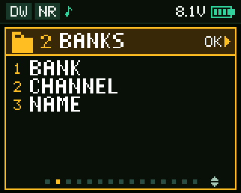
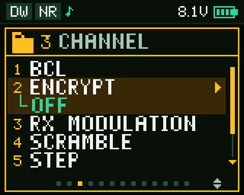
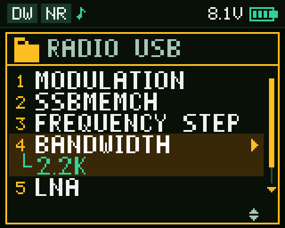

# Baojie BJ-8300 — firmware V2.8T: menu em pastas, escuta tripla, tela nova, bancos de canais e driver do CHIRP

<p align="center">
  <a href="README.en.md"></a>
</p>

Firmware modificado para o rádio **Baojie/Bajeton BJ-8300** (JieLi AC695X, CPU pi32v2), feito por
engenharia reversa do firmware de fábrica **V0.12**, sem documentação do fabricante. Traz um **menu
em pastas**, a **escuta tripla (TRIPLE)**, inédita neste rádio, **uma tela nova em todas as telas**,
**16 bancos de canais de verdade**, scramble compatível com o Baofeng UV-17L, ganho do microfone no menu, espectro mais
rápido e um **driver do CHIRP** próprio. O "T" da versão é de **Tempra**.

> [!TIP]
> ## 🎉 V2.8T — o menu em pastas, com o cartão do 3º item inteiro
>
> **[⬇️ Baixar a V2.8T na página de Releases](https://github.com/tempraturbo/BajetonBJ8300/releases/tag/v2.8T)**
>
> | Arquivo do release | Para que serve |
> |---|---|
> | `BJ8300_BANK_v2.8T.anc` | o firmware, para gravar no rádio |
> | `bj8300_v2.8TEMPRA.py` | o módulo do CHIRP para este firmware |
> | `BinTalk-V1.1.zip` | o gravador (BinTe ANC Bootloader) |
> | `CH340-driver.zip` | o driver do cabo de programação USB |
>
> A V2.8T é a V2.7T com o fundo âmbar do 3º item de cada pasta, e do menu do rádio, inteiro: na
> V2.7T a metade de baixo dele, a do valor, saía sem fundo.
>
> Testada no rádio. Para gravar: [passo a passo](#-como-gravar-o-firmware-passo-a-passo). Para o
> CHIRP: [passo a passo](#-como-usar-o-chirp-com-este-firmware). As anteriores continuam
> disponíveis: a [V2.7T](https://github.com/tempraturbo/BajetonBJ8300/releases/tag/v2.7T), o mesmo menu com aquele defeito, a [V2.6T](https://github.com/tempraturbo/BajetonBJ8300/releases/tag/v2.6T), com a
> escuta tripla e o menu numa lista só, a [V2.0T](https://github.com/tempraturbo/BajetonBJ8300/releases/tag/v2.0T),
> com a tela nova e sem o WATCH, e a [v1.0T](https://github.com/tempraturbo/BajetonBJ8300/releases/tag/v1.0T),
> com a tela de fábrica.

💚 **Gostou do projeto?** [Apoie com uma doação pelo PayPal](#-apoie-o-projeto) — qualquer valor
ajuda a próxima versão a sair.

---

## 📁 Menu novo: tudo em pastas

O menu de fábrica é uma fila de mais de 50 itens. Desde a V2.7T eles ficam em **13 pastas por assunto**,
em ordem alfabética, numa janela que mostra o que tem dentro de cada uma antes de abrir.

| | | |
|:---:|:---:|:---:|
|  |  |  |
| **As pastas:** ▲▼ escolhem, os itens dela aparecem embaixo, e os pontinhos mostram qual das 13 está escolhida | **Dentro da pasta:** o item do cursor num cartão e o valor dele embaixo, em verde; quando a lista não cabe, as setas e a barra mostram que tem mais | **O menu do rádio** (FM, AM e SSB) na mesma janela, com os itens da modulação de agora |

- **OK** abre a pasta e, nela, **OK** já abre o item para mudar o valor, sem um segundo OK. Gravando
  ou cancelando, volta para a pasta, no mesmo item. **EXIT** volta para as pastas, e de novo sai do
  menu.
- **O número digitado** vai direto: `3` escolhe a pasta 3 e, dentro dela, `2` vai ao item `3-2`.
- **BANK** e **CHANNEL**, na pasta BANKS, são de marcar vários: o OK marca e continua na lista, e o
  EXIT sai com tudo gravado.
- **VERSION** abre só para leitura, e sai pelo EXIT.
- **A letra do menu** ficou um pouco maior e mais espaçada, e o menu reabre na última pasta usada.

| Pasta | Itens |
|---|---|
| 1 AUDIO | NOISE REDUCTION, SQL, STE |
| 2 BANKS | BANK, CHANNEL, NAME |
| 3 CHANNEL | BCL, ENCRYPT, RX MODULATION, SCRAMBLE, STEP, TXP, W/N |
| 4 DISPLAY | ABR, MDF-A, MDF-B, MDF-C, MENU EXIT TIME, POWER-ON MSG |
| 5 DTMF | DTMF CODE, DTMFST, PTT-LT, S-CODE |
| 6 KEYS | AUTOLOCK, BEEP PROMPT, PF2, PF2 LONG PRESS, PF3 |
| 7 MEMORY | CH-NAME, DELCH, MEMCH |
| 8 REPEATER | OFFSET, RP-STE, RPT-RL, SFT-D, TONE |
| 9 SCAN | SC-REV, SCAN ADD |
| 10 SYSTEM | AL-MOD, BLUETOOTH, RESET, SAVE, VERSION |
| 11 TONES | R-CTCSS, R-DCS, T-CTCSS, T-DCS |
| 12 TX | MIC GAIN, ROGER, TOT, VOX, VOX DELAY |
| 13 WATCH | TTR, TX-A/B/C, WATCH |

---

## 🔺 TRIPLE: o BJ-8300 escutando três frequências

O firmware de fábrica só tem dois lados, A e B, e a dupla escuta (TDR) vigia os dois. A V2.8T põe um
**terceiro lado, a C**, e o rádio passa a vigiar **três frequências** ao mesmo tempo. Nenhum
firmware do BJ-8300 fazia isso.

| | |
|:---:|:---:|
|  |  |
| **O A em evidência, recebendo.** O B e a C ficam em faixas embaixo, cada uma com a letra, o nome e o canal | **A escuta parou na C**: a faixa dela fica em âmbar enquanto recebe |
|  |  |
| **A C em evidência** (tecla A/B): ela ganha o cartão, transmite e muda de canal como o A e o B | **A C em VFO**: a faixa mostra a frequência e `VFO` |
|  |  |
| **Transmitindo na C** com o `TX-A/B/C` em C: ela fica em evidência enquanto o PTT está apertado, como o A e o B, e volta ao soltar | **O item `TX-A/B/C`** (pasta WATCH) aberto, com a C em evidência no resumo de cima |

- **O menu `WATCH`** escolhe quantas frequências a tela principal mostra: **SINGLE** (um lado só,
  em tela cheia), **DUAL** (o A/B de sempre) ou **TRIPLE**.
- **A escuta (`TTR`, o antigo TDR)** passa pelas três, A → B → C → A, com o mesmo tempo em cada
  uma. Desligada, só a que está em evidência recebe.
- **A tecla A/B** vai de A para B, de B para C e de C para A. Com a C em evidência, tudo vale para
  ela: transmitir, setas, digitação, VFO/MR, STEP, potência, tons.
- **A C é um lado completo**, em VFO ou em canal, com as mesmas opções do A e do B. O canal dela se
  escolhe com ela em evidência (tecla A/B), como nos outros lados, e o que a faixa mostra (nome,
  frequência ou canal) é o `MDF-C`.
- **O `TX-A/B/C`** (o TX-A/B de fábrica, com o C) escolhe em que lado o PTT transmite com a escuta
  ligada. Em C, a C fica em evidência enquanto o PTT está apertado, como o A e o B ficam, mesmo
  estando fora dos dois lados; ao soltar, tudo volta como estava.
- **No CHIRP**, tudo isso fica em **Settings → VFO A/B/C Channel**.

---

## 📺 A cara nova

| | |
|:---:|:---:|
|  |  |
| **Tela principal:** os dois lados, com o A em evidência recebendo; na barra de cima só o que está ligado (RX, dupla escuta, redução de ruído, Bluetooth) | **Espectro:** a frequência que roda, o pico da passada em verde com o dBm, as barras com a coluna medida em branco e a linha do limite em âmbar |
|  |  |
| **Rádio** em LSB, mudando o BFO: medidor S, a banda, a frequência grande e os ajustes em cartões | **Item aberto (BANKS → BANK):** o lado em evidência resumido em cima, a pasta e o número `2-1`, e os bancos ligados em âmbar |

As imagens saem da prévia no PC ([firmware/previa/](firmware/previa/)), que roda o mesmo código de
desenho que vai para o rádio.

## ✨ O que mudou da V0.12 de fábrica para a V2.8T

### 🆕 Recursos novos

| Recurso | Como fica no rádio |
|---|---|
| 📁 **Menu em pastas** | Os itens do menu ficam em 13 pastas por assunto, em ordem alfabética, numa janela âmbar que mostra os itens de cada pasta, e dentro dela o valor do item do cursor, com rolagem quando a lista não cabe. OK no item já abre a edição, e gravar ou cancelar volta para a pasta. O menu do rádio (FM/AM/SSB) usa a mesma janela ([veja acima](#-menu-novo-tudo-em-pastas)) |
| 🔺 **WATCH: SINGLE, DUAL e TRIPLE** | Item novo do menu. **SINGLE** mostra só o lado em evidência, em tela cheia: a frequência em tamanho grande, um medidor largo e, com deslocamento, a frequência de transmissão embaixo (a escuta fica desligada). **DUAL** é o A/B de sempre. **TRIPLE** põe um terceiro lado, a C, e a escuta passa pelas três ([veja acima](#-triple-o-bj-8300-escutando-três-frequências)) |
| 📡 **O lado C** | Um lado completo, em VFO ou em canal, com as mesmas opções do A e do B. A tecla A/B passa por A → B → C → A, e com a C em evidência ela transmite e muda como os outros, canal incluído. Menu novo: `MDF-C` (como a faixa dela aparece: nome, frequência ou canal) |
| 📤 **TX-A/B/C** | O `TX-A/B` de fábrica (em que lado o PTT transmite com a escuta ligada) vira `TX-A/B/C`: OFF, A, B e C. No TRIPLE, em C, a C fica em evidência enquanto o PTT está apertado, como o A e o B ficam, mesmo estando fora dos dois lados, e ao soltar tudo volta como estava, sem gravar nada |
| 🎙️ **MIC GAIN** | Item novo do menu, logo depois do `NOISE REDUCTION`, com três níveis: **HIGH** (31, um degrau acima do 30 que a calibração de fábrica tinha no rádio de teste), **MID** (25) e **LOW** (19). Até a V2.0T o ganho vinha só da calibração, sem ajuste. Começa em HIGH. Vale na hora, sem desligar o rádio, mudado pelo menu, pelo CHIRP ou pelo retorno aos ajustes de fábrica |
| 💡 **Luz acesa no espectro** | Enquanto o espectro está na tela, a luz não apaga. Ao sair, o tempo do `ABR` volta a valer, e o rádio nunca liga com a luz presa |
| 🖥️ **Tela nova em todo o rádio** | Todas as telas foram redesenhadas: a principal (o lado em evidência num cartão com a frequência grande e o medidor, etiquetas coloridas de potência, modulação e tons, e a barra de cima só com o que está ligado), os menus e o editor de nome, o rádio FM/AM/SSB, o scan QT, o DTMF, o espectro e a tensão na partida ([veja acima](#-a-cara-nova)) |
| 🗂️ **16 bancos de canais** | Cada banco tem **nome de 12 caracteres**, e um canal pode estar em **quantos bancos quiser**. Dá para ligar **vários bancos ao mesmo tempo**: o sobe/desce e a busca passam a ver só os canais dos bancos ligados. Sem nenhum ligado, o rádio funciona como de fábrica. Pasta nova **BANKS**, com `BANK`, `CHANNEL` e `NAME` ([como usar](#usando-os-bancos-no-rádio)) |
| 🔐 **Scramble com 8 frequências** | O `SCRAMBLE` passa de OFF/ON para **OFF e de 2700 a 3400 Hz, de 100 em 100**, em ordem crescente. O **3400 Hz** é o ON de fábrica (fala com outros BJ-8300), e os **modos 1, 2 e 3 do Baofeng UV-17L** caem, cada um, numa dessas frequências. Testado com os três modos |
| 🔔 **Roger BEEP 2 e COIN** | O `ROGER` ganha duas opções: OFF, BEEP 1 (o de fábrica), **BEEP 2** (quatro tons: 1125, 1857, 1359 e 931 Hz, ~0,4 s no total), **COIN** (a moeda) e TONE1200 |
| 📊 **Espectro com 320 e 640 pontos** e **passo de 10 kHz** | Além dos 160 pontos de fábrica, para ver uma faixa maior de uma vez |
| 📈 **Pico seguro no espectro** | A barra sobe na hora e, quando o sinal some, desce aos poucos |
| 🎯 **Espectro que mostra mais** | A coluna que está sendo medida em branco, a frequência que roda no alto, a frequência do pico de cada passada em verde, com o dBm |
| 🔌 **Driver do CHIRP próprio** | Lê e grava os bancos (aba **Banks**), os nomes, o roger e o scramble novos, o WATCH, o VFO C e o MIC GAIN, numa sessão só pelo cabo. Recusa gravar num rádio com firmware de fábrica ([como usar](#-como-usar-o-chirp-com-este-firmware)) |
| 🧰 **Comando estendido no cabo** | Leitura do chip de dados inteiro (endereço de 24 bits) e gravação só na área dos bancos. É o que o driver do CHIRP usa |

### 🖥️ A tela nova, tela por tela

Desde a V2.0T, **todas** as telas do firmware de fábrica dão lugar a um tema escuro em verde, com
etiquetas coloridas e uma fonte própria:

| Tela | O que mudou |
|---|---|
| **Principal** (os dois lados) | O lado em evidência fica num **cartão de borda verde**, com o nome, o canal, a **frequência grande** (os dois últimos dígitos pequenos) e um **medidor de 20 segmentos** (verde, amarelo e vermelho). O outro lado fica compacto, numa faixa fina. Etiquetas coloridas: potência (**H** vermelho, **M** âmbar, **L** verde), FM/AM, tom (CT/DCS), banda estreita, deslocamento, scramble e zona |
| **Principal em SINGLE** | Só o lado em evidência, da barra ao pé da tela: a frequência ainda maior, as etiquetas, um medidor largo e, com deslocamento, a frequência de transmissão embaixo |
| **Principal em TRIPLE** | O lado em evidência no cartão e os outros dois em faixas, na ordem A, B, C, cada uma com a letra, o texto e o canal (ou `VFO`). A faixa que está recebendo fica em âmbar ([veja acima](#-triple-o-bj-8300-escutando-três-frequências)) |
| **Barra de cima** | Mostra **só o que está ligado**: RX e TX numa etiqueta com bolinha (verde no RX, vermelha no TX), dupla escuta (DW), VOX, MO, redução de ruído (NR), DTMF ST, Bluetooth e cadeado; a **tensão em volts** e a bateria, que fica com contorno vermelho e pisca quando está fraca |
| **Transmitindo** | A linha grande passa para a frequência de transmissão, e o medidor fica **vermelho, cheio pela potência** |
| **Digitando** | A frequência entra no lugar dela, sobre a máscara `---.---`; o canal, na etiqueta do canal |
| **DTMF** (tecla `#`) | Uma caixa âmbar no lugar do cartão do lado em uso, com os dígitos |
| **Menus** | As pastas e os itens numa **janela âmbar** ([veja acima](#-menu-novo-tudo-em-pastas)). O item aberto: a pasta e o número (`12-2`) numa etiqueta verde e o título; três opções, a do cursor num cartão e o **valor gravado marcado com um ponto verde**; mudando o valor, o cartão ganha a borda verde e as setas, sem piscar. Em cima, o lado em evidência resumido. Tudo na letra do menu, um pouco maior que a média |
| **Editor de nome** (NAME dos BANKS, CH-NAME) | O texto num cartão, em tamanho grande quando cabe, com o cursor âmbar, quantos caracteres de quantos e o modo (`ABC` ou `123`, trocado pelo `#`) numa etiqueta âmbar |
| **Bancos** (BANK e CHANNEL, na pasta BANKS) | Os bancos ligados, e os bancos em que o canal está, em **âmbar** |
| **Rádio FM/AM/SSB** | Medidor S de 9 degraus, a banda numa etiqueta, a **frequência grande** com a unidade, o nome da estação num cartão (sem nome, `NO STATION NAME` no lugar do `Unknow`), e **STEP, BW, LNA e BFO em quatro cartões**, o que está sendo mudado em âmbar. O `SEEK...` e a espera da partida (`RADIO STARTING...`) também no tema novo, e o menu dele na janela de pastas |
| **Espectro** | A frequência que roda em tamanho grande, pontos e passo em etiquetas, o **pico da passada em verde** com o dBm, o gráfico num painel com grade, a coluna medida em branco, a **linha do limite tracejada em âmbar** e as pontas da janela embaixo |
| **Scan QT** (EXIT segurado) | O título, o que ele procura (CTCSS / DCS) e o estado, RUNNING num cartão verde ou STOP em âmbar |
| **Tensão** | Na partida (com a mensagem de partida em tensão) e segurando o `0` na tela inicial, a tensão aparece num cartão, em volts |

### ⚡ Melhorias

| O que | Detalhe |
|---|---|
| 🚀 **Espectro duas vezes mais rápido** | 160 pontos em ≈ 2,5 s. E, parado num sinal achado, a seta continua a varredura sem mexer no limite |
| 🟩 **Lado em evidência destacado** | O lado ativo fica num cartão de borda verde, com a frequência grande e o medidor; o outro fica compacto |
| 📻 **Rádio FM/AM/SSB** | A troca de modulação ficou ~2,5 s mais rápida, e os ajustes salvos (passo, largura, LNA, BFO e as memórias) são conferidos ao entrar e a cada troca: valor fora dos limites dos menus volta ao padrão |
| ↕️ **Setas do menu invertidas** | A seta de cima passa a subir na lista, em vez de avançar o valor |
| 🔤 **Textos em inglês revisados** | 25 cadeias corrigidas e padronizadas (ex.: `VOICEPRI` → `ENCRYPT`), o `TDR` virou `TTR` (Transmitter Triple Receiver), porque com o TRIPLE a escuta é tripla, e o `TX-A/B` virou `TX-A/B/C`. O menu `VERSION` mostra `Firmware: V2.8T` |

### 🐞 Correções

| Problema da V0.12 | Na V2.8T |
|---|---|
| Durante o scan, a barra de sinal ficava congelada no último canal achado, e o número do canal descasava do nome | A tela acompanha cada canal da varredura |
| Na partida com a tensão, e segurando o `0`, o texto `   Voltage` tinha a tensão escrita por cima, e o "ge" sumia | `VOLTAGE` inteiro, com a tensão num cartão |
| Nome de canal gravado pelo CHIRP abria no editor com `?` no fim e `12/12`: o editor contava os bytes de preenchimento | O editor conta só as letras, como a tela já mostrava |
| No rádio, estação sem nome aparecia como `Unknow` | `NO STATION NAME` |

### ➖ Removido

| O que | Por quê |
|---|---|
| Itens de menu `ZONE` e `Zone Or Channel` | Os bancos fazem o papel das zonas, com mais liberdade. A função de zona continua no firmware, e o driver do CHIRP sempre grava **Full Channel**, para o rádio nunca ficar preso em modo zona |
| As vozes e o item `VOICE` | A pedido: o rádio deixa de falar os números e os modos, e o espaço delas guarda parte do código novo |
| O idioma chinês e o item `LANGUAGE` | A tela nova só tem letras latinas; o rádio fica sempre em inglês |
| O item `CH-C` | A C virou um lado completo: o canal dela se escolhe com a tecla A/B, como no A e no B. O CHIRP ainda o grava |
| As minúsculas (`abc`) no editor de nome | A fonte só tem maiúsculas: ficam `ABC` e `123` |

### 🔒 O que não muda

- **Canais, ajustes e calibração** ficam num chip à parte e **não são tocados** pela gravação do
  firmware.
- O **modo de gravação** (`UPDATE`) é lido antes de qualquer parte modificada, e o script de
  montagem recusa escrever nele.
- **Voltar ao de fábrica** é só gravar o [firmware original](firmware/original/), do mesmo jeito.

---

## ⚠️ Antes de gravar

Gravar firmware modificado tem risco. Este projeto tem uma rede de segurança, **testada no
rádio**: ligar o rádio segurando **PTT2 + o botão de atalho** mostra `UPDATE` na tela e deixa ele
esperando gravação. Esse caminho roda na inicialização, **antes** de qualquer coisa que a
modificação toca (o script de montagem recusa escrever nas funções envolvidas; ver `PROTEGIDAS` em
[firmware/scripts/montar.py](firmware/scripts/montar.py)). Durante o desenvolvimento o rádio
entrou em bootloop uma vez ([histórico](docs/historico.md)) e voltou por esse combo, sem abrir o
aparelho.

O gravador também tem o botão *"Click Here If Your Radio Can't Work"*, que deve servir para quando
o firmware nem chega a ligar, mas ele **nunca foi testado**.

**Guarde o firmware de fábrica**: [firmware/original/BJ8300_V0.12.anc](firmware/original/).

---

## 📥 Como gravar o firmware, passo a passo

Precisa de um PC com Windows e do **cabo de programação USB** do rádio (o de chip CH340, o mesmo do
CPS de fábrica).

**1. Baixe os arquivos.** Na [página do release V2.8T](https://github.com/tempraturbo/BajetonBJ8300/releases/tag/v2.8T),
baixe o `BJ8300_BANK_v2.8T.anc`, o `BinTalk-V1.1.zip` e, se o Windows ainda não reconhece o cabo,
o `CH340-driver.zip`. Descompacte os zips. (Os mesmos arquivos estão no repositório, em
`firmware/releases/`, `tools/anc-bootloader/` e `tools/ch340-driver/`.)

**2. Instale o driver do cabo, se precisar.** Ligue o cabo no PC e abra o **Gerenciador de
Dispositivos**. Se em **Portas (COM e LPT)** aparece `USB-SERIAL CH340 (COMx)`, está pronto: anote
o número da COM. Se não aparece, clique com o botão direito no `ch341ser.inf` do `CH340-driver.zip`
→ **Instalar** (ou, num PowerShell **como administrador**, `pnputil /add-driver ch341ser.inf
/install`) e desconecte e conecte o cabo.

**3. Abra o gravador.** Rode o `BinTe ANC Bootloader.exe` (a janela se chama **BinTalk V1.1**).
Feche antes qualquer programa que use a porta COM (CHIRP, CPS).

<p align="center"></p>

- No campo de cima, clique em **`...`** e escolha o `BJ8300_BANK_v2.8T.anc`.
- **Port:** a COM do cabo (a do passo 2).
- **Baudrate:** **115200** (já vem assim).

**4. Ponha o rádio em modo de gravação.** Com o rádio **desligado** e o cabo conectado nele, ligue
o rádio **segurando PTT2 + o botão de atalho**, até aparecer `UPDATE` na tela.

**5. Grave.** Clique em **Update** e espere. O log mostra `Update Mode` → `Baudrate OK` →
`Update 3%` → `Jump To Loader` → `Progress 100%` → `Finish`. Não desconecte nada no meio.

**6. Confira.** Desligue e ligue o rádio. O menu abre nas pastas, e em `SYSTEM` → `VERSION` deve
aparecer `Firmware: V2.8T`.

**Se der `Retry1..5 / Failure!`:** desligue o rádio, confira que nenhum outro programa está com a
porta COM, volte ao passo 4 e tente de novo.

---

## 📻 Como usar o CHIRP com este firmware

> [!CAUTION]
> **Com a V2.8T, use só o módulo `bj8300_v2.8TEMPRA.py` deste release.** Ele substitui os
> anteriores (`bj8300_v2.6TEMPRA.py`, `bj8300_v2.0TEMPRA.py` e `bj8300_v1.0TEMPRA.py`; o modelo no
> CHIRP passou a ser `BJ8300_v2.8TEMPRA`), e uma imagem `.img` salva com um módulo antigo abre nele
> normalmente. As versões anteriores têm o módulo delas no release de cada uma.
>
> - **Não use os modelos de fábrica do CHIRP** que servem para o BJ-8300 de fábrica (**Bajeton
>   BJ7800** e **Radtel RT-920**). Eles não leem nem gravam os bancos, e não conhecem o roger BEEP
>   2 nem as frequências novas do scramble: com o BEEP 2 ligado, a tela de ajustes deles nem abre.
>   O RT-920 ainda oferece o "Zone or Channel", e em modo zona o rádio fica preso, porque o menu
>   para sair dele foi removido.
> - **Não use versões antigas deste módulo**: elas não conhecem as opções novas, e um canal com
>   uma frequência de scramble nova aparece como inválido.
> - Ao contrário também vale: o módulo **recusa** gravar num rádio com o firmware de fábrica.

**1. Instale o CHIRP mais recente.** Baixe o **CHIRP-next** em
[chirpmyradio.com](https://chirpmyradio.com/projects/chirp/wiki/Download). O módulo usa o driver
`radtel_rt900` da versão atual; com um CHIRP antigo, o passo 3 falha com *"Invalid or unsupported
module file"*.

**2. Ligue o modo desenvolvedor (só uma vez).** Menu **Help** → **Developer Mode**. O CHIRP avisa
*"Danger Ahead"*: clique **Yes**. Depois avisa *"Restart Required"*: clique **OK**, **feche e abra o
CHIRP**. O modo fica ligado nas próximas vezes.

**3. Carregue o módulo (toda vez que abrir o CHIRP).** Menu **File** → **Load Module...** (só
aparece com o modo desenvolvedor). O CHIRP avisa que carregar módulo é perigoso: clique **Yes** e
escolha o `bj8300_v2.8TEMPRA.py`. A janela fica **vermelha** e o título mostra
`CHIRP **Module Loaded**`: é o sinal de que o módulo está carregado. Ao fechar o CHIRP, ele é
descarregado, e na próxima vez é preciso carregar de novo.

**4. Leia o rádio.** Com o rádio ligado normalmente e o cabo conectado, menu **Radio** →
**Download from radio...**:

| Campo | Escolha |
|---|---|
| **Port** | a COM do cabo |
| **Vendor** | **Baojie** (não é "Bajeton") |
| **Model** | **BJ8300_v2.8TEMPRA** |

O CHIRP mostra o aviso *"Experimental driver"*, com as instruções do módulo: clique **Yes** e
depois **OK** para ler.

> [!NOTE]
> Se o `BJ8300_v2.8TEMPRA` não aparece em **Baojie**, o módulo não está carregado: volte ao passo 3.

**5. Edite.** No lado direito aparece a lista das partes do rádio:

- **Memories (VHF/UHF):** os 960 canais. As colunas **Scramble** e as outras propriedades do canal
  estão aqui.
- **Banks (VHF/UHF):** uma coluna por banco; marque em quais bancos cada canal está. Para
  renomear um banco, **dê duplo clique no cabeçalho da coluna** dele.
- **Settings:** os ajustes do rádio, com o roger de 4 opções e, no **BJ8300_v2.8TEMPRA Specific**,
  o **Mic Gain** (HIGH, MID ou LOW) logo depois do Noise reduction.
- **Settings → Banks:** um bloco por banco, de **BANK 1** a **BANK 16**:

  | Linha | O que é |
  |---|---|
  | **Name** | o nome do banco (até 12 caracteres), editável aqui também |
  | **Channels** | quantos canais gravados o banco tem (só leitura, contados quando a página abre) |
  | **Enabled** | liga ou desliga o banco |

  Banco sem nenhum canal gravado **não liga**: se você marcar, o CHIRP desmarca na hora. E tirar
  o último canal de um banco o desliga sozinho. No fim da página, **Bank edited by the radio
  menu** escolhe o banco em que os itens `NAME` e `CHANNEL` da pasta BANKS do rádio mexem.
- **Settings → VFO A/B/C Channel:** o **WATCH** (SINGLE, DUAL ou TRIPLE), o **TTR** e o
  **TX-A/B/C** em cima, e um bloco para cada lado (A, B e C), cada um com o seu MDF e o scramble. O **VFO C** tem os mesmos
  campos do A e do B, mais o Work Mode e o canal da C (**CH-C**). Com a C em evidência no rádio, os blocos B e C
  ficam só de leitura: mude pelo rádio, ou aperte A/B nele e baixe de novo.
- **Memories (FM / AM / HF):** as outras faixas, como no driver de fábrica.

> [!NOTE]
> Depois de marcar e desmarcar um checkbox, o CHIRP o desenha em cinza e o rótulo em negrito. Isso
> é só o desenho do CHIRP para "mudou" (acontece com qualquer checkbox, até os do driver de
> fábrica); o valor gravado é o desmarcado.

**6. Grave e reinicie o rádio.** Menu **Radio** → **Upload to radio...**. Depois de gravar,
**desligue e ligue o rádio**: o filtro dos bancos é montado na partida.

Guarde uma cópia do primeiro download (**File** → **Save**) antes de mudar qualquer coisa.

---

## Usando os bancos no rádio

No menu, a pasta **BANKS** tem três itens:

| Item | O que faz |
|---|---|
| **BANK** | As setas passam pelos 16 bancos, mostrando `n nome`, em âmbar se estiver ligado. **OK liga/desliga** o banco e o escolhe para os outros dois itens, e continua na lista para ligar outros; o EXIT sai |
| **CHANNEL** | Percorre os 960 canais mostrando `banco-canal`; **OK marca/desmarca** o canal no banco escolhido e continua na lista, para marcar vários seguidos; o EXIT sai. Em âmbar, está no banco; ` -`, canal vazio na memória |
| **NAME** | Dá nome (12 caracteres) ao banco escolhido, no mesmo editor de texto do `CH-NAME` |

Detalhes de comportamento:

- Ligar um banco que **não tem nenhum canal gravado** não filtra nada (o rádio ficaria sem canal
  para mostrar) — o firmware desfaz sozinho.
- Marcar ou desmarcar canal **vale na hora**, sem reiniciar.
- Gravar bancos **pelo cabo** (CHIRP) exige desligar e ligar o rádio: o filtro é montado na partida.
- O estado dos bancos fica gravado no chip de dados e **sobrevive a desligar o rádio**.
- Regravar os canais pelo CHIRP ou pelo CPS **não apaga banco nenhum**: os bancos ficam no chip de
  dados (0xC1000 em diante), fora da área de canais.

Na tela inicial a aparência não muda: a numeração continua **absoluta, de 1 a 960** (o canal 500
continua sendo o 500, não "o 3º do banco") e o nome do banco ligado não aparece ali. O que muda é
só o que **o sobe/desce e a busca enxergam** — com banco ligado, eles pulam direto de um canal
marcado para o outro.

---

## Como o driver do CHIRP funciona

O arquivo é [chirp/bj8300_v2.8TEMPRA.py](chirp/bj8300_v2.8TEMPRA.py). O nome é proposital: só
funciona com **este** firmware, e assim ninguém com um BJ-8300 de fábrica o usa por engano. Ele
deriva do `radtel_rt900.py` do CHIRP, que já trata este rádio como família RT-920/BJ7800, e
acrescenta:

- A aba **Banks** e o grupo **Settings → Banks** (acima). Banco ativo sem canal gravado nunca
  sobe para o rádio: o upload o desliga antes de gravar, como o próprio rádio faz.
- Download e upload da área dos bancos pelo comando estendido, junto com os canais e **numa sessão
  só** (o firmware responde ao `E` de saída com um ACK e só fecha a sessão depois); no upload, só
  os setores que mudaram.
- O roger com as quatro opções do rádio e o scramble com as nove, gravando os mesmos valores que o
  menu do rádio grava.
- O WATCH, o CH-C, o MDF-C e o VFO C, gravados no registro do WATCH (`0xD2000`) e no setor dos
  VFOs da C (`0xD3000`). O upload só grava o que muda e confere lendo de volta, e o estado do rádio
  (a C no lado B, e o canal, o modo e o VFO do B) vem do rádio, não da imagem. SINGLE desliga o
  TTR, como no firmware.
- O **Noise reduction** lido e gravado no byte que o rádio usa (`0x9032`; o driver de base usa
  `0x9031`), e a **Voice Privacy do VFO A**, que o driver de base não gravava.
- O **Mic Gain** no byte `0x9033` do bloco de ajustes, o mesmo que o item MIC GAIN do rádio usa
  (0 HIGH, 1 MID, 2 LOW; outro valor o rádio lê como HIGH), e o **TX-A/B/C** nos 2 bits do TX-A/B
  (`0x9013`), com o C (3).
- **Sem zonas:** todo upload grava **Full Channel** (`0x9028` = 1), porque o modo zona continua no
  firmware e, sem o item de menu, o rádio não teria como sair dele — em modo zona o sobe/desce fica
  preso em 64 canais.
- A trava contra firmware de fábrica: o firmware dos bancos responde à leitura estendida com tamanho
  `0x40`, e o de fábrica ecoa o tamanho com o bit 7 ligado e manda mais de 128 bytes. O driver lê
  o cabeçalho, descarta o resto (o cabo não dessincroniza) e para **antes de gravar qualquer
  coisa**.

Três conjuntos de teste, os três sem rádio:

- `python -I tests/teste_bj8300.py` — o miolo dos bancos (formato gravado, soma batendo com a que
  o próprio rádio gravou, pertinência múltipla), com o CHIRP stubado;
- `python -I tests/teste_chirp_real.py` — **contra o CHIRP instalado de verdade**: se a classe
  encaixa na API (modelo de bancos, `apply_to` + callbacks dos ajustes), se imagem salva pelo
  driver RT-920 abre sem estourar, e se roger e scramble terminam nos bytes que o rádio grava;
- `python -I tests/teste_clonagem.py` — a **conversa pelo cabo**: `sync_in` e `sync_out` inteiros
  contra um rádio simulado que responde como o firmware (lido no desmontado), nos dois firmwares.

A elétrica do cabo e o tempo de resposta do rádio só o rádio real testa — isso foi validado à mão
com as ferramentas de `tools/cabo/`.

---

## Versões anteriores

Todas em [firmware/releases/](firmware/releases/). A história completa, com o que quebrou e por
quê, está no [histórico](docs/historico.md).

| Arquivo | Estado |
|---|---|
| `BJ8300_BANK_v2.8T.anc` | **estável, a recomendada** — a v58: a V2.7T com o fundo âmbar do 3º item de cada pasta e do menu do rádio inteiro; use com o driver do CHIRP do mesmo release |
| `BJ8300_BANK_v2.7T.anc` | estável anterior, o menu em pastas — a v57: a V2.6T + o menu em 13 pastas (com o valor do item, a rolagem, OK abrindo já na edição, BANK e CHANNEL de marcar vários e o VERSION só leitura), a letra do menu maior, o menu do rádio na mesma janela, sem o item CH-C, o editor de nome contando só as letras e só com ABC e 123, e a tensão do `0` segurado no tema novo, mas o fundo âmbar do 3º item sai pela metade; use com o driver do CHIRP do mesmo release |
| `BJ8300_BANK_v2.6T.anc` | a escuta tripla com o menu numa lista só — a v51: a v41 + o WATCH (SINGLE, DUAL e TRIPLE), o lado C completo (VFO ou canal), o TX-A/B/C, o MIC GAIN, a luz acesa no espectro, o TTR e a caixa do DTMF no tema novo; use com o driver do CHIRP do mesmo release |
| `BJ8300_BANK_v2.0T.anc` | a tela nova sem o WATCH — a v41 com o nome da versão (mesmo arquivo); use com o driver do CHIRP do mesmo release |
| `BJ8300_BANK_v45.anc` | v41 + o menu `WATCH` (SINGLE: um lado em tela cheia; DUAL: o A/B de sempre; TRIPLE: uma terceira frequência, a C, escolhida no `CH-C` e mostrada como o `MDF-C` pede, que a dupla escuta vigia com o mesmo tempo das outras e a tecla A/B põe em evidência) — testado no rádio |
| `BJ8300_BANK_v41.anc` | v39 + o espectro no tema B, os ajustes do rádio conferidos na entrada e na troca de modulação, a troca de modulação ~2,5 s mais rápida e o S da fonte média — testado no rádio |
| `BJ8300_BANK_v39.anc` | v36 + as outras telas no tema B (menu com a fonte média, editor de nome, rádio, scan QT, DTMF e a tensão na partida), sem o idioma chinês, os dois lados no banco e o menu `VERSION` em `V2.0T` — testado no rádio (um travamento na troca para USB/LSB vinha do que estava salvo nele: [histórico](docs/historico.md), v40) |
| `BJ8300_BANK_v36.anc` | v34 + a tela principal nova (tema B): cartão do lado em evidência com a frequência grande e o medidor, etiquetas coloridas de potência, modulação e tons, e a barra de cima só com o que está ligado; no idioma chinês a tela fica a de fábrica — testado no rádio |
| `BJ8300_BANK_v34.anc` | v32 + o espectro no espaço das vozes, o pico em verde e o dBm inteiro na troca de AM/FM; a última com a tela principal de fábrica — testado no rádio |
| `BJ8300_BANK_v32.anc` | v27 sem as vozes (e sem o item VOICE), roger COIN (a moeda), leitura de memória pelo cabo; abre ~112 KB de espaço para o tema novo da tela — testado no rádio |
| `BJ8300_BANK_v27.anc` | v1.0T + espectro com a barra atual em branco, a frequência que roda, a linha do pico e o dBm à direita; roger BEEP 3 (a moeda, chamada de COIN desde a v31) — testado no rádio |
| `BJ8300_BANK_v1.0T.anc` | a primeira estável, com a tela de fábrica — a v25 com o nome da versão (mesmo arquivo) |
| `BJ8300_BANK_v24.anc` | v23 + scramble 2900 Hz (o do Baofeng UV-17L no modo 3) — testado no rádio |
| `BJ8300_BANK_v23.anc` | v21 + roger BEEP 2 — testado no rádio |
| `BJ8300_BANK_v21.anc` | v19 + espectro duas vezes mais rápido, passo de 10 kHz, 320 e 640 pontos e pico seguro; verde do realce mais escuro (a v20 sem o bootloop; a v20 foi retirada) — testado no rádio |
| `BJ8300_BANK_v19.anc` | v18 + a seta continua o espectro parado num achado; a tabela de menus no lugar da original — testado no rádio |
| `BJ8300_BANK_v18.anc` | v17 com o fundo verde também na caixinha do RX/TX — não testado no rádio |
| `BJ8300_BANK_v17.anc` | realce do bloco do VFO sem as faixas pretas ([mapa da tela](docs/mapa-da-tela.md)) — testado no rádio |
| `BJ8300_BANK_v16.anc` | primeiro realce funcionando; sobram faixas finas pretas entre as linhas do bloco |
| `BJ8300_BANK_v14.anc` | tentativa anterior do realce: o verde só saía na barra de sinal |
| `BJ8300_BANK_v12.anc` | bancos, setas, textos, correção do scan e o cabo de 24 bits — testado no rádio |
| `firmware/original/BJ8300_V0.12.anc` | firmware de fábrica, para voltar atrás |

---

## Ferramentas pelo cabo

Em [tools/cabo/](tools/cabo/), em PowerShell, sem instalar nada:

| Script | Para que serve |
|---|---|
| `cabo.ps1` | Biblioteca: handshake, `Le-Bloco`, `Grava-Bloco` (as outras usam) |
| `mapa_memoria.ps1` | Prova a leitura de 24 bits, diz se os dados vêm crus, acha o **tamanho real do chip** e lista o que existe acima de 64 KB |
| `ler_memoria.ps1` | Despeja os 64 KB que o protocolo de fábrica alcança e confere canais e calibração (só leitura) |
| `teste_cabo_grava.ps1` | Prova a gravação na área dos bancos e que o firmware **recusa** gravar fora dela; limpa no fim |
| `logo.ps1` | Lê (e, num firmware que libere a faixa, grava) a imagem de abertura |

Conversão da imagem de abertura: `python -I firmware/scripts/logo_bmp.py para-radio entrada.bmp
saida.bin previa.png` (BMP 160×138 de 24 bits → RGB565, o mesmo que o CPS11 produz, conferido byte
a byte).

> **Nunca mande nada antes do magic** (nem `E`, nem zeros): o rádio compara o magic desde o início
> do buffer e qualquer byte à frente faz todas as tentativas seguintes falharem até desligar o
> aparelho. E o magic termina em `U`, que é comando do modo UPDATE — insistir com o rádio fora de
> sincronia faz ele entrar em UPDATE sozinho.

---

## Compilar

Precisa da toolchain da JieLi (clang para `pi32v2`) e de Python 3:

```sh
sh firmware/build.sh
```

Ele compila `firmware/src/bancos.c` e `firmware/src/tela.c`, monta o `.anc` a partir do original e **confere** o
resultado: CRCs das 12 entradas, código e tabela de menus presentes e iguais nas 6 imagens de
flash, itens de menu, todos os ganchos e remendos, textos, e que nenhum byte foi alterado fora dos
trechos previstos — nem perto das áreas protegidas. A saída termina em `RESULTADO: tudo certo`, e
o build é reprodutível: o mesmo fonte dá o mesmo `.anc`, byte a byte.

O caminho da toolchain está em `firmware/build.sh` (`C:/tools/jl-toolchain-2.5.3/...`).

**Orçamento de espaço:** o código novo mora em três lugares, todos no mesmo endereço nas 6 imagens:

- **a área livre do fim da imagem**, a partir de `0x01E96124`, com 3260 bytes (a V2.8T usa 2286);
- **o espaço que era das vozes**, com o espectro, mas só dentro dos arquivos C0 e C1 (1066 bytes,
  dos quais a V2.8T usa 674), porque o carregador do rádio recusa a imagem que muda mais arquivos de
  voz;
- **o lugar dos decodificadores G.729 e MP3**, dentro do `app.bin`, com as telas B, o WATCH, o
  TRIPLE, o menu em pastas e a tabela de menus (38884 bytes, dos quais a V2.8T usa 22878).

A tabela de menus fica nesse último lugar desde a v43, num vetor de 80 vagas (a V2.8T usa 68: as 13
pastas e os 55 itens); a original, de 54, fica intacta. [docs/engenharia-reversa.md](docs/engenharia-reversa.md)
explica como medir, onde já foi economizado e por que esses lugares são seguros.

**Prévia da tela B no PC:** `python -I previa/previa.py <pasta>`, de dentro de `firmware/`, grava
cada cenário da tela em PNG. Precisa do zig (`pip install ziglang`), que faz o papel de compilador
de C.

---

## Estrutura do repositório

```
firmware/
  src/          bancos.c (bancos, menus, espectro, cabo), tela.c (a tela principal B) e bancos.ld
  fonte/        a fonte 5x7 da tela B e os ícones, em texto
  previa/       prévia da tela B no PC
  scripts/      montagem (.anc), conferência, desassemblador, análise
  original/     BJ8300_V0.12.anc — firmware de fábrica
  releases/     .anc prontos para gravar
  build.sh      compila, monta e confere
chirp/          driver do CHIRP (bj8300_v2.8TEMPRA.py)
tools/
  anc-bootloader/  gravador BinTe ANC Bootloader (BinTalk V1.1)
  ch340-driver/    driver do cabo USB
  cabo/            ferramentas PowerShell que falam com o rádio
  ghidra-scripts/  scripts usados na análise
logo/           imagem de abertura (BMP) e conversor
tests/          testes do driver do CHIRP
docs/           engenharia reversa, histórico, mapa da tela, imagens e notas de trabalho
```

---

## 💚 Apoie o projeto

Este firmware nasceu de muitas horas de engenharia reversa: o firmware de fábrica aberto byte a
byte, sem nenhuma documentação do fabricante, cada rotina mapeada no desmontado e 49 versões, quase
todas gravadas e testadas num rádio de verdade, até chegar à tela nova e à escuta tripla. Tudo aqui
é e vai continuar **livre e gratuito**, para usar, estudar e modificar.

Se o seu BJ-8300 ficou melhor — os bancos organizaram seus canais, o TRIPLE vigia três frequências,
o scramble passou a falar com o Baofeng do colega, o espectro ficou mais rápido —, considere pagar
um café para o projeto. Qualquer valor ajuda: é tempo para novas funções, equipamento para testar e a próxima versão saindo.

<p align="center">
  <a href="https://www.paypal.com/donate/?hosted_button_id=2VPWYBMKBSJX6"></a>
  <br><br>
  <a href="https://www.paypal.com/donate/?hosted_button_id=2VPWYBMKBSJX6"></a>
  <br>
  <sub>Aponte a câmera do celular para o QR code, ou clique no botão.</sub>
</p>

**Obrigado!** Cada doação é um sinal de que vale a pena continuar. 📻

---

## Créditos e licença

- O driver do CHIRP **deriva** do `chirp/drivers/radtel_rt900.py` (Copyright 2025, 2026 Fred
  Trimble; 2024 Pavel Moravec, OK2MOP; 2023 Jim Unroe), distribuído sob **GPL-2.0-or-later** — a
  mesma licença se aplica a ele.
- O firmware de fábrica (e a parte dele dentro das releases `.anc`), o gravador BinTe, o driver
  CH340 (WCH) e o logo `bajeton` são dos respectivos fabricantes e estão aqui só para
  reprodutibilidade e recuperação.
- O restante (código dos bancos, scripts, ferramentas e documentação) é de **tempraturbo**, sob a
  licença **[0BSD](LICENSE)**: use, copie, modifique e distribua para o que quiser, sem precisar
  nem dar crédito.

Sem garantia de espécie alguma. Você é responsável pelo que grava no seu rádio.
