# Bajeton BJ-8300 — firmware TEMPRA V4.2T

  

Firmware novo para o rádio **Baojie/Bajeton BJ-8300**, feito por engenharia reversa do firmware de fábrica V0.12:
**menu em pastas**, **escuta tripla**, **APRS e Morse**, **16 bancos de canais**, uma **tela nova** em todo o rádio e o
**controle remoto pelo PC**. Junto vem o **Tempra Link**, o programa que grava o firmware e programa o rádio pelo cabo.
O "T" da versão é de **Tempra**.

  
  
  

> [!TIP]
> **💚 Este projeto é livre e gratuito, e vive de doações.** Se o seu BJ-8300 ficou melhor com ele, pague um café para
> o projeto: cada doação vira tempo para novas funções, equipamento para testar e a próxima versão saindo.
> [**Doar com PayPal**](https://www.paypal.com/donate/?hosted_button_id=2VPWYBMKBSJX6) · [o QR code](#-apoie-o-projeto)

### 📑 Nesta página

- [📻 O que o rádio ganha](#-o-que-o-rádio-ganha)
- [💻 Tempra Link: o rádio pelo PC](#-tempra-link-o-rádio-pelo-pc)
- [📥 Como gravar o firmware](#-como-gravar-o-firmware-passo-a-passo): [pelo Tempra Link](#-pelo-tempra-link-automático) ou [pelo BinTalk](#-pelo-bintalk-o-gravador-de-fábrica)
- [🔌 Como usar o CHIRP](#-como-usar-o-chirp-com-este-firmware)
- [📖 Documentação completa](#-documentação-completa)
- [💚 Apoie o projeto](#-apoie-o-projeto)
- [📜 Créditos e licença](#créditos-e-licença)

> [!NOTE]
> **🎉 Novo na V4.2T:** o Tempra Link, o controle remoto pelo PC, o ROGER CUSTOM, a busca mais rápida com o THRESHOLD,
> as memórias do rádio de AM, FM e SSB com nome, o Bluetooth que fica ligado no TX e a linha do espectro, que deixada
> no fundo não subia mais. [Tudo o que mudou](https://github.com/tempraturbo/BajetonBJ8300/wiki/Vers%C3%B5es)

---

## 📻 O que o rádio ganha

| | | |
|:---:|:---:|:---:|
| <a href="https://github.com/tempraturbo/BajetonBJ8300/wiki/Fun%C3%A7%C3%B5es-do-r%C3%A1dio#-a-cara-nova">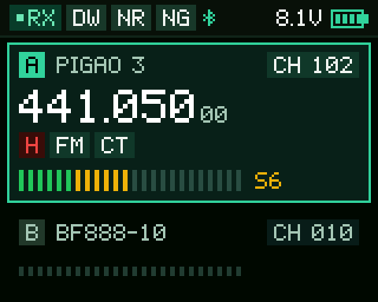</a> | <a href="https://github.com/tempraturbo/BajetonBJ8300/wiki/Fun%C3%A7%C3%B5es-do-r%C3%A1dio#-menu-novo-tudo-em-pastas">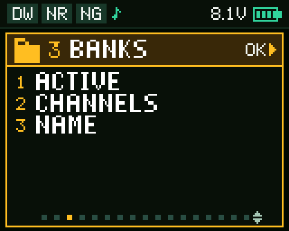</a> | <a href="https://github.com/tempraturbo/BajetonBJ8300/wiki/Fun%C3%A7%C3%B5es-do-r%C3%A1dio#-triple-o-bj-8300-escutando-tr%C3%AAs-frequ%C3%AAncias">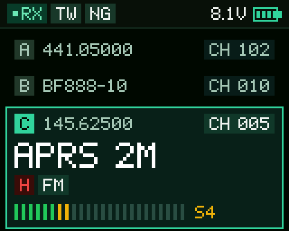</a> |
| [**Tela nova**, com a barra S](https://github.com/tempraturbo/BajetonBJ8300/wiki/Fun%C3%A7%C3%B5es-do-r%C3%A1dio#-a-cara-nova) | [**Menu em 17 pastas**](https://github.com/tempraturbo/BajetonBJ8300/wiki/Fun%C3%A7%C3%B5es-do-r%C3%A1dio#-menu-novo-tudo-em-pastas) | [**TRIPLE:** três frequências](https://github.com/tempraturbo/BajetonBJ8300/wiki/Fun%C3%A7%C3%B5es-do-r%C3%A1dio#-triple-o-bj-8300-escutando-tr%C3%AAs-frequ%C3%AAncias) |
| <a href="https://github.com/tempraturbo/BajetonBJ8300/wiki/Fun%C3%A7%C3%B5es-do-r%C3%A1dio#-a-tela-messages-do-aprs-na-v32t">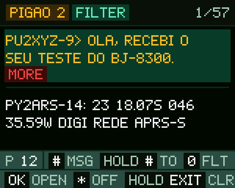</a> | <a href="https://github.com/tempraturbo/BajetonBJ8300/wiki/Fun%C3%A7%C3%B5es-do-r%C3%A1dio#-a-tela-messages-do-morse-na-v37t">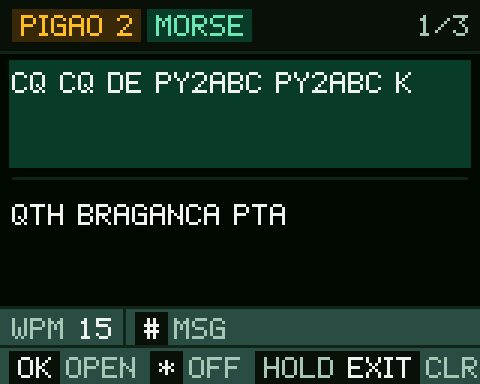</a> | <a href="https://github.com/tempraturbo/BajetonBJ8300/wiki/Fun%C3%A7%C3%B5es-do-r%C3%A1dio#usando-os-bancos-no-r%C3%A1dio">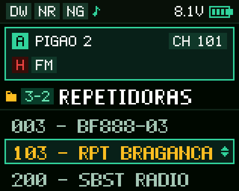</a> |
| [**APRS:** mensagens e posição](https://github.com/tempraturbo/BajetonBJ8300/wiki/Fun%C3%A7%C3%B5es-do-r%C3%A1dio#-a-tela-messages-do-aprs-na-v32t) | [**Morse:** lê e envia](https://github.com/tempraturbo/BajetonBJ8300/wiki/Fun%C3%A7%C3%B5es-do-r%C3%A1dio#-a-tela-messages-do-morse-na-v37t) | [**16 bancos de canais**](https://github.com/tempraturbo/BajetonBJ8300/wiki/Fun%C3%A7%C3%B5es-do-r%C3%A1dio#usando-os-bancos-no-r%C3%A1dio) |
| <a href="https://github.com/tempraturbo/BajetonBJ8300/wiki/Fun%C3%A7%C3%B5es-do-r%C3%A1dio#espectro">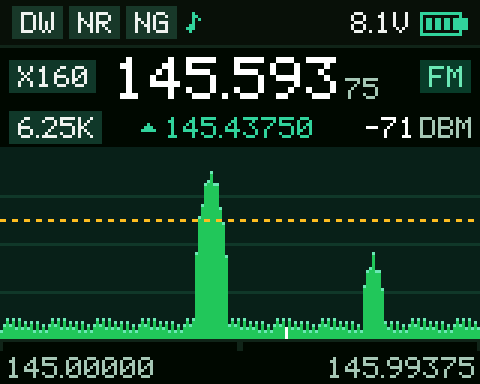</a> | <a href="https://github.com/tempraturbo/BajetonBJ8300/wiki/Fun%C3%A7%C3%B5es-do-r%C3%A1dio#roger-custom">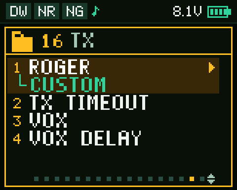</a> | <a href="https://github.com/tempraturbo/BajetonBJ8300/wiki/Fun%C3%A7%C3%B5es-do-r%C3%A1dio#eq">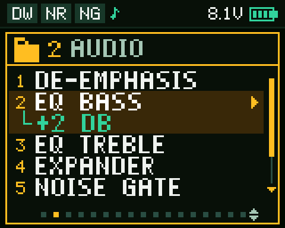</a> |
| [**Espectro** mais rápido](https://github.com/tempraturbo/BajetonBJ8300/wiki/Fun%C3%A7%C3%B5es-do-r%C3%A1dio#espectro) | [**ROGER CUSTOM**](https://github.com/tempraturbo/BajetonBJ8300/wiki/Fun%C3%A7%C3%B5es-do-r%C3%A1dio#roger-custom) | [**EQ** no RX e no TX](https://github.com/tempraturbo/BajetonBJ8300/wiki/Fun%C3%A7%C3%B5es-do-r%C3%A1dio#eq) |

**E mais:** barra S do S1 ao S9+60, as memórias do rádio de AM, FM e SSB com nome, scramble que fala com o Baofeng
UV-17L, busca a um canal por 60 ms com o THRESHOLD, compressor e AGC do microfone, ajuste fino do cristal, brilho da
tela, o lado C completo e o controle remoto pelo cabo e pelo Bluetooth. **[Todas as funções, explicadas na wiki →](https://github.com/tempraturbo/BajetonBJ8300/wiki/Fun%C3%A7%C3%B5es-do-r%C3%A1dio)**

---

## 💻 Tempra Link: o rádio pelo PC

O programa para Windows que vem com este firmware. Ele **grava o firmware sozinho** (do de fábrica para o TEMPRA, sem
baixar nada à mão) e depois programa o rádio inteiro pelo cabo. Um `.exe` só, sem instalar nada.

| | |
|:---:|:---:|
| <a href="https://github.com/tempraturbo/BajetonBJ8300/wiki/Manual-do-Tempra-Link#10-controle-remoto">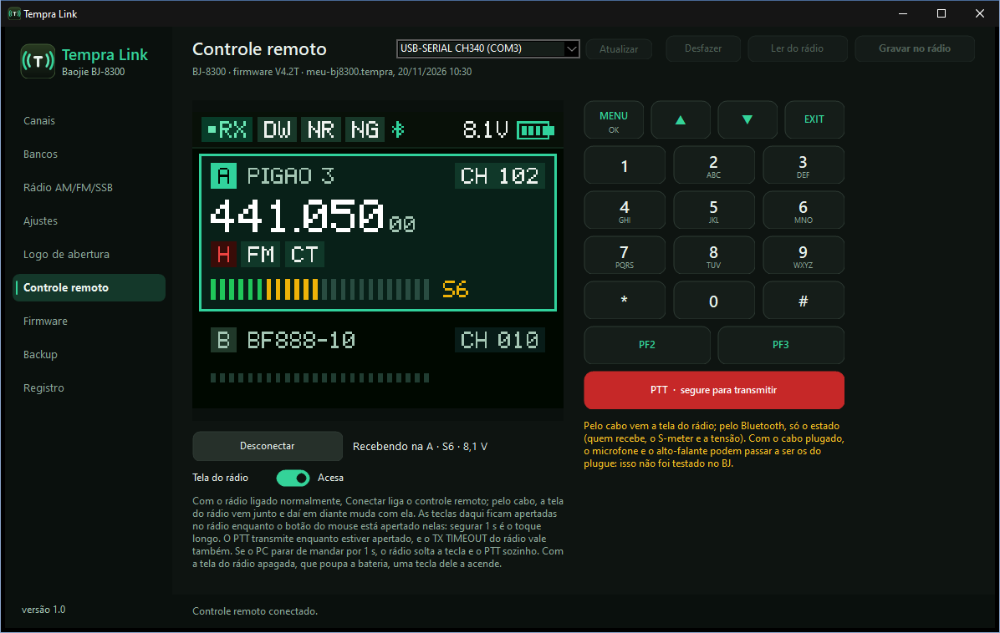</a> | <a href="https://github.com/tempraturbo/BajetonBJ8300/wiki/Manual-do-Tempra-Link#4-canais">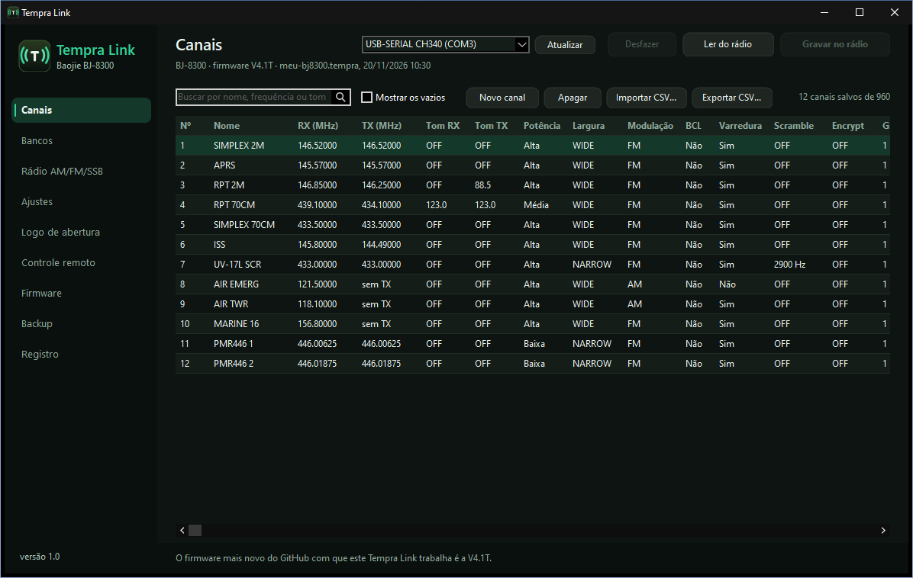</a> |
| [**Controle remoto:** a tela, o teclado e o PTT do rádio no PC](https://github.com/tempraturbo/BajetonBJ8300/wiki/Manual-do-Tempra-Link#10-controle-remoto) | [**Canais:** os 960, como numa planilha](https://github.com/tempraturbo/BajetonBJ8300/wiki/Manual-do-Tempra-Link#4-canais) |

- 🔥 **Grava o firmware:** baixa a versão certa do GitHub, confere e grava pelo cabo; e volta ao de fábrica.
- 📻 **Canais e bancos:** copiar e colar e o CSV do CHIRP; e as **memórias do rádio** de AM, FM e SSB, com nome.
- ⚙️ **Ajustes:** o menu do rádio, os VFOs, os textos do APRS e do Morse e o DTMF.
- 🎵 **ROGER CUSTOM:** composto num piano, ou importado de MIDI e de som.
- 💾 **Backup** a cada leitura, e **se atualiza sozinho** pelo GitHub.

**[⬇️ Baixar o Tempra Link](https://github.com/tempraturbo/BajetonBJ8300/releases/latest)** ·
**[📖 O manual, com todas as telas](https://github.com/tempraturbo/BajetonBJ8300/wiki/Manual-do-Tempra-Link)**

---

## 📥 Como gravar o firmware, passo a passo

**Do firmware de fábrica para o TEMPRA em uns 3 minutos**, pelo cabo de programação USB do rádio (o de chip CH340, o
mesmo do CPS de fábrica). Dois caminhos:

### 🚀 Pelo Tempra Link: automático

1. Baixe e abra o `TempraLink-BJ8300_v1.0.exe`, do [release V4.2T](https://github.com/tempraturbo/BajetonBJ8300/releases/latest).
2. Com o rádio ligado e o cabo no PC, clique em **Ler do rádio**. Vendo o firmware de fábrica, ele oferece baixar e
   gravar a V4.2T: **Sim**.
3. Quando ele pedir, desligue o rádio e ligue-o segurando **PTT2 + atalho**, até aparecer `UPDATE`, e confirme.
4. Aguarde a gravação terminar, que dura em média uns 3 minutos, e então desligue e ligue o rádio: `SYSTEM > VERSION`
   mostra `Firmware: V4.2T`.

| | |
|:---:|:---:|
| <a href="https://github.com/tempraturbo/BajetonBJ8300/wiki/Gravar-o-firmware#-op%C3%A7%C3%A3o-1-pelo-tempra-link-autom%C3%A1tico">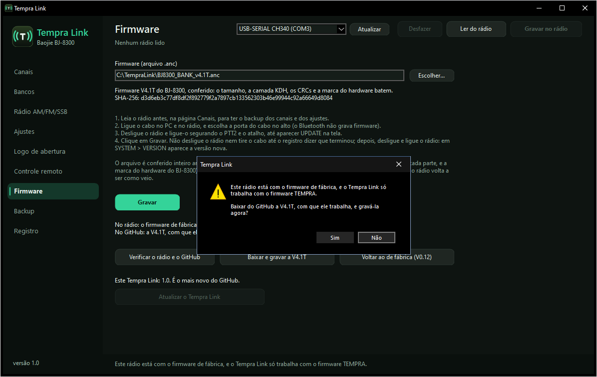</a> | <a href="https://github.com/tempraturbo/BajetonBJ8300/wiki/Manual-do-Tempra-Link#11-gravar-o-firmware">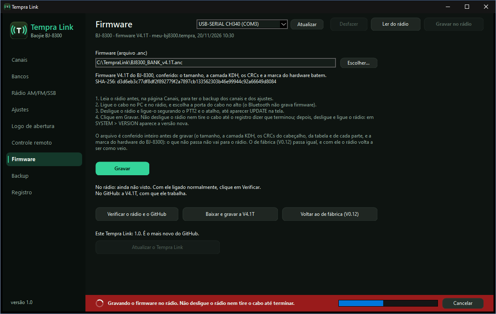</a> |
| [Ele vê o firmware de fábrica e oferece a V4.2T](https://github.com/tempraturbo/BajetonBJ8300/wiki/Gravar-o-firmware#-op%C3%A7%C3%A3o-1-pelo-tempra-link-autom%C3%A1tico) | [A gravação: a barra vermelha até o fim](https://github.com/tempraturbo/BajetonBJ8300/wiki/Manual-do-Tempra-Link#11-gravar-o-firmware) |

### 🔧 Pelo BinTalk: o gravador de fábrica

1. Baixe do [release V4.2T](https://github.com/tempraturbo/BajetonBJ8300/releases/latest) o `BJ8300_BANK_v4.2T.anc` e o
   `BinTalk-V1.1.zip`, e abra o `BinTe ANC Bootloader.exe`.
2. Escolha o `.anc`, a COM do cabo e **115200**.
3. Desligue o rádio e ligue-o segurando **PTT2 + atalho**, até aparecer `UPDATE`, e clique em **Update**.
4. Espere o `Finish` e desligue e ligue o rádio.

Canais, ajustes e calibração não são tocados pela gravação, e o modo UPDATE roda antes de qualquer parte modificada:
dá para voltar ao de fábrica quando quiser. **[O passo a passo completo: o driver do cabo, o que fazer se der erro e a
volta ao de fábrica →](https://github.com/tempraturbo/BajetonBJ8300/wiki/Gravar-o-firmware)**

---

## 🔌 Como usar o CHIRP com este firmware

Carregue no CHIRP o módulo `bj8300_v4.2TEMPRA.py` do [release V4.2T](https://github.com/tempraturbo/BajetonBJ8300/releases/latest)
(**File → Load Module**, com o modo desenvolvedor ligado) e escolha **Bajeton → BJ8300_v4.2TEMPRA**. Os modelos de
fábrica do CHIRP (Bajeton BJ7800 e Radtel RT-920) não servem para este firmware.
**[O passo a passo →](https://github.com/tempraturbo/BajetonBJ8300/wiki/Usando-o-CHIRP)**

---

## 📖 Documentação completa

> [!IMPORTANT]
> **Cada função do rádio e do Tempra Link está explicada em detalhe, com as telas, na
> [📖 wiki do projeto](https://github.com/tempraturbo/BajetonBJ8300/wiki).**

| | |
|---|---|
| 📻 **[Funções do rádio](https://github.com/tempraturbo/BajetonBJ8300/wiki/Fun%C3%A7%C3%B5es-do-r%C3%A1dio)** | o menu em 17 pastas, o TRIPLE, o APRS, o Morse, os bancos, a tela nova e tudo o que mudou da V0.12 |
| 💻 **[Tempra Link](https://github.com/tempraturbo/BajetonBJ8300/wiki/Manual-do-Tempra-Link)** | o manual, página por página, com as telas |
| 📥 **[Gravar o firmware](https://github.com/tempraturbo/BajetonBJ8300/wiki/Gravar-o-firmware)** | os dois caminhos, o driver do cabo, os erros e a volta ao de fábrica |
| 🔌 **[CHIRP](https://github.com/tempraturbo/BajetonBJ8300/wiki/Usando-o-CHIRP)** | o módulo, os bancos no CHIRP e como o driver funciona |
| 🗂️ **[Versões](https://github.com/tempraturbo/BajetonBJ8300/wiki/Vers%C3%B5es)** e **[histórico](docs/historico.md)** | cada versão, o que mudou e por quê |
| 🔬 **[Engenharia reversa](docs/engenharia-reversa.md)** | como o firmware de fábrica foi aberto e modificado |
| 🛠️ **[Desenvolvimento](https://github.com/tempraturbo/BajetonBJ8300/wiki/Desenvolvimento)** | compilar, as ferramentas do cabo, o espaço e a estrutura do repositório |

---

## 💚 Apoie o projeto

Este firmware nasceu de muitas horas de engenharia reversa: o firmware de fábrica aberto byte a
byte, sem nenhuma documentação do fabricante, cada rotina mapeada no desmontado e 49 versões, quase
todas gravadas e testadas num rádio de verdade, até chegar à tela nova e à escuta tripla. Tudo aqui
é e vai continuar **livre e gratuito**, para usar, estudar e modificar.

Se o seu BJ-8300 ficou melhor — os bancos organizaram seus canais, o TRIPLE vigia três frequências,
o scramble passou a falar com o Baofeng do colega, o espectro ficou mais rápido —, considere pagar
um café para o projeto. Qualquer valor ajuda: é tempo para novas funções, equipamento para testar e a próxima versão saindo.

  
    
  
   
  Aponte a câmera do celular para o QR code, ou clique no botão.

**Obrigado!** Cada doação é um sinal de que vale a pena continuar. 📻

---

## Créditos e licença

- O driver do CHIRP **deriva** do `chirp/drivers/radtel_rt900.py` (Copyright 2025, 2026 Fred
  Trimble; 2024 Pavel Moravec, OK2MOP; 2023 Jim Unroe), distribuído sob **GPL-2.0-or-later** — a
  mesma licença se aplica a ele.
- O firmware de fábrica (e a parte dele dentro das releases `.anc`), o gravador BinTe, o driver
  CH340 (WCH) e o logo `bajeton` são dos respectivos fabricantes e estão aqui só para
  reprodutibilidade e recuperação.
- O restante (código dos bancos, scripts, ferramentas e documentação) é de **tempraturbo**, sob a
  licença **[0BSD](LICENSE)**: use, copie, modifique e distribua para o que quiser, sem precisar
  nem dar crédito.

Sem garantia de espécie alguma. Você é responsável pelo que grava no seu rádio.
