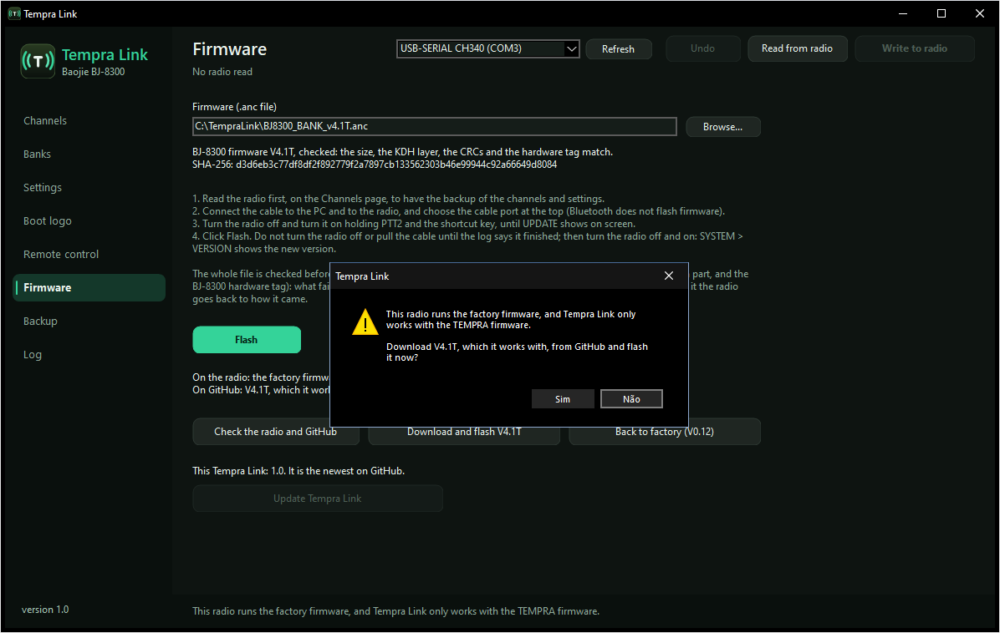
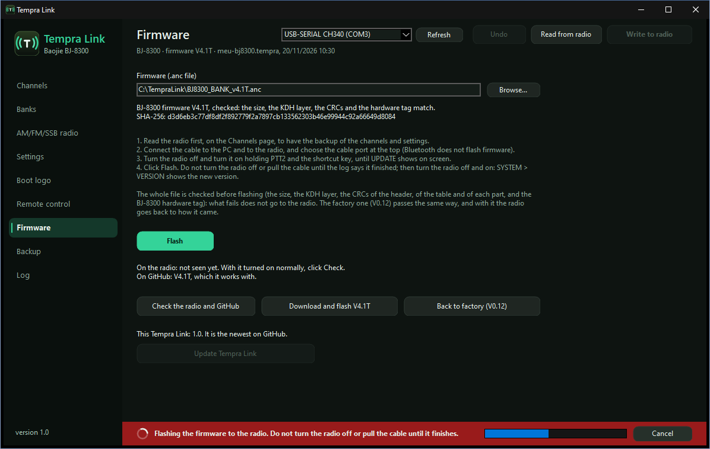
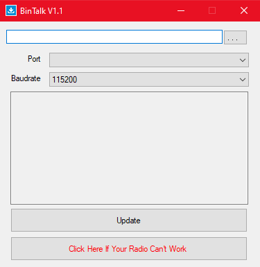

# 📥 Flashing the firmware

  

[📖 Wiki](README.en.md) · [🏠 Home page](../../README.en.md)

## ⚠️ Before flashing

Flashing modified firmware carries risk. This project has one safety net, **tested on the radio**:
powering the radio on while holding **PTT2 + the shortcut key** shows `UPDATE` on the screen and
leaves it waiting for a flash. That path runs at boot, **before** anything the modification
touches (the build script refuses to write to the functions involved; see `PROTEGIDAS` in
[firmware/scripts/montar.py](../../firmware/scripts/montar.py)). During development the radio boot-looped
once ([changelog](../changelog.md)) and came back through this combo, without opening it.

The flasher also has a *"Click Here If Your Radio Can't Work"* button, which is presumably for when
the firmware does not even start, but it has **never been tested**.

**Keep the stock firmware**: [firmware/original/BJ8300_V0.12.anc](../../firmware/original/).

## 🔌 The cable and the driver

Both ways use the radio's **USB programming cable**, the CH340 one (the same the stock CPS and CHIRP use), on a Windows
PC.

Plug the cable into the PC and open **Device Manager**. If **Ports (COM & LPT)** shows `USB-SERIAL CH340 (COMx)`, you
are set: note the COM number. If it does not, download `CH340-driver.zip` from the [V4.0T release](https://github.com/tempraturbo/BajetonBJ8300/releases/tag/v4.0T), right-click
its `ch341ser.inf` → **Install** (or, in a PowerShell **run as administrator**,
`pnputil /add-driver ch341ser.inf /install`) and unplug and replug the cable. Before flashing, close CHIRP, the CPS and
any other program that uses the port.

## 🚀 Option 1: with Tempra Link, automatic

It takes you from the stock firmware to TEMPRA, and later it updates it: Tempra Link sees the radio's firmware,
downloads the right version from GitHub and checks it before flashing (by size, by GitHub's SHA-256 and by the `.anc`'s
own CRCs and BJ-8300 hardware tag).

**1. Download and open** `TempraLink-BJ8300_v1.0.exe`, from the [V4.0T release page](https://github.com/tempraturbo/BajetonBJ8300/releases/tag/v4.0T). It installs nothing. The
first time, Windows may warn that it comes from an unknown publisher, because the `.exe` is not signed: **More info** →
**Run anyway**.

**2. Turn the radio on normally**, with the cable plugged into it and into the PC, choose the cable port at the top and
click **Read from radio**. With the stock firmware (or an older TEMPRA), Tempra Link says so and asks whether to
download V4.0T from GitHub and flash it: answer **Yes**.

**3. Put the radio in UPDATE mode** when Tempra Link asks: turn the radio off and turn it on holding **PTT2 + the
shortcut key**, until `UPDATE` shows on the screen. Then click **Yes**.

**4. Wait about 3 minutes, without turning the radio off or pulling the cable.** The bottom bar turns red, with a
spinning wheel, and says what is happening: the radio answering in UPDATE mode, the flashing program going to it (about
30 s, with the progress bar standing still) and the firmware being flashed (about 2 minutes).

**5. Turn the radio off and on.** The menu opens on the folders, and `SYSTEM` → `VERSION` shows `Firmware: V4.0T`.
Done: Tempra Link now reads and writes the radio.

With the radio already on TEMPRA, the **Firmware** page does the same: **Download and flash** the new version, or
**Browse...** for an `.anc` on the PC. [The manual](tempra-link.en.md#10-flashing-the-firmware) shows the whole page.

## 🔧 Option 2: with BinTalk, the factory flasher

The maker's flasher (BinTe ANC Bootloader). The files are in the release and also in the repository, under
[firmware/releases/](../../firmware/releases/), [tools/anc-bootloader/](../../tools/anc-bootloader/) and
[tools/ch340-driver/](../../tools/ch340-driver/).

**1. Download the files.** From the [V4.0T release page](https://github.com/tempraturbo/BajetonBJ8300/releases/tag/v4.0T), download `BJ8300_BANK_v4.0T.anc` and
`BinTalk-V1.1.zip`, and unzip it.

**2. Open the flasher.** Run `BinTe ANC Bootloader.exe` (its window is called **BinTalk V1.1**).

- In the top field, click **`...`** and pick `BJ8300_BANK_v4.0T.anc`.
- **Port:** the cable's COM port (from Device Manager).
- **Baudrate:** **115200** (the default).

**3. Put the radio in flashing mode.** With the radio **off** and the cable plugged into it, power it on **while
holding PTT2 + the shortcut key**, until `UPDATE` shows on the screen.

**4. Flash.** Click **Update** and wait. The log shows `Update Mode` → `Baudrate OK` → `Update 3%` →
`Jump To Loader` → `Progress 100%` → `Finish`. Do not unplug anything halfway.

**5. Check.** Turn the radio off and on. The menu opens on the folders, and `SYSTEM` → `VERSION` should show
`Firmware: V4.0T`.

## ↩️ Back to stock

The stock firmware is in [firmware/original/BJ8300_V0.12.anc](../../firmware/original/), and it flashes the same way:
with Tempra Link, through the **Back to factory (V0.12)** button on the Firmware page (it downloads the file and checks it
against a fixed SHA-256), or with BinTalk, picking that `.anc`. With the stock firmware, Tempra Link no longer reads or
writes the radio, and the channels are edited with CHIRP, in the stock models.

## 🆘 If it goes wrong

- **"The radio did not answer"** (Tempra Link) or **`Retry1..5 / Failure!`** (BinTalk): turn the radio off, check the
  cable, the port and that no other program has it, put the radio in UPDATE again and flash again.
- **An interrupted flashing** (the cable came off, the battery ran out) was not tested. UPDATE mode runs at startup,
  before any part TEMPRA modifies, and that is how the radio came back from a test firmware that would not start: the
  same path is the first thing to try.
