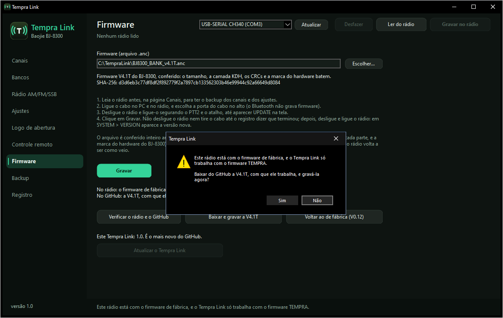
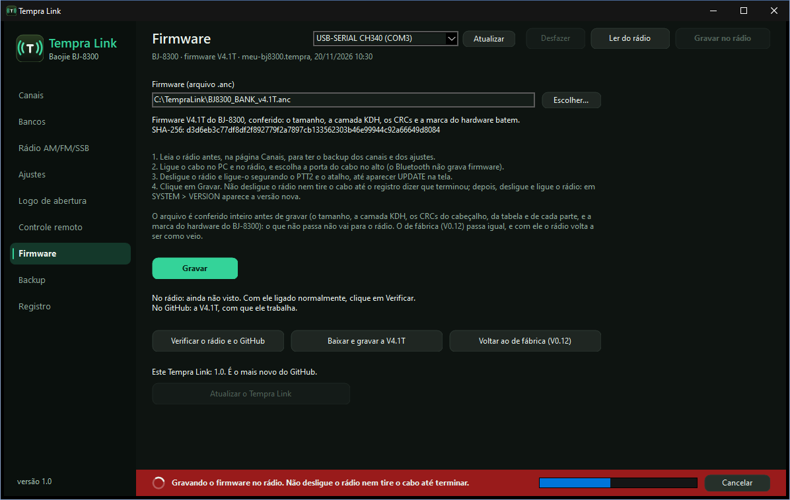
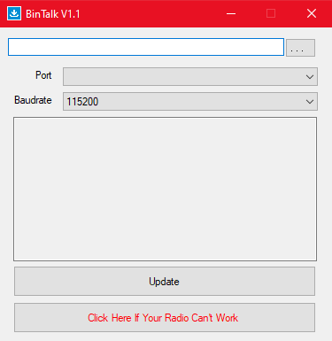

# 📥 Gravar o firmware

  

[📖 Wiki](README.md) · [🏠 Página inicial](../../README.md)

## ⚠️ Antes de gravar

Gravar firmware modificado tem risco. Este projeto tem uma rede de segurança, **testada no
rádio**: ligar o rádio segurando **PTT2 + o botão de atalho** mostra `UPDATE` na tela e deixa ele
esperando gravação. Esse caminho roda na inicialização, **antes** de qualquer coisa que a
modificação toca (o script de montagem recusa escrever nas funções envolvidas; ver `PROTEGIDAS` em
[firmware/scripts/montar.py](../../firmware/scripts/montar.py)). Durante o desenvolvimento o rádio
entrou em bootloop uma vez ([histórico](../historico.md)) e voltou por esse combo, sem abrir o
aparelho.

O gravador também tem o botão *"Click Here If Your Radio Can't Work"*, que deve servir para quando
o firmware nem chega a ligar, mas ele **nunca foi testado**.

**Guarde o firmware de fábrica**: [firmware/original/BJ8300_V0.12.anc](../../firmware/original/).

## 🔌 O cabo e o driver

Os dois caminhos usam o **cabo de programação USB** do rádio, o de chip CH340 (o mesmo do CPS de fábrica e do CHIRP),
num PC com Windows.

Ligue o cabo no PC e abra o **Gerenciador de Dispositivos**. Se em **Portas (COM e LPT)** aparece
`USB-SERIAL CH340 (COMx)`, está pronto: anote o número da COM. Se não aparece, baixe o `CH340-driver.zip` do
[release V4.1T](https://github.com/tempraturbo/BajetonBJ8300/releases/latest), clique com o botão direito no `ch341ser.inf` dele → **Instalar** (ou, num PowerShell **como
administrador**, `pnputil /add-driver ch341ser.inf /install`) e desconecte e conecte o cabo. Antes de gravar, feche o
CHIRP, o CPS e qualquer outro programa que use a porta.

## 🚀 Opção 1: pelo Tempra Link, automático

Serve para sair do firmware de fábrica e entrar no TEMPRA, e depois para atualizar: o Tempra Link vê o firmware do rádio,
baixa do GitHub a versão certa e a confere antes de gravar (pelo tamanho, pelo SHA-256 do GitHub e pelos CRCs e a marca
do hardware do próprio `.anc`).

**1. Baixe e abra** o `TempraLink-BJ8300_v1.0.exe`, da [página do release V4.1T](https://github.com/tempraturbo/BajetonBJ8300/releases/latest). Ele não instala nada. Na
primeira vez, o Windows pode avisar que ele é de um editor desconhecido, porque o `.exe` não é assinado: **Mais
informações** → **Executar assim mesmo**.

**2. Ligue o rádio normalmente**, com o cabo nele e no PC, escolha no alto a porta do cabo e clique em **Ler do rádio**.
Com o firmware de fábrica (ou um TEMPRA de antes), o Tempra Link avisa e pergunta se baixa do GitHub a V4.1T e a grava:
responda **Sim**.

**3. Ponha o rádio no modo UPDATE**, quando o Tempra Link pedir: desligue o rádio e ligue-o segurando **PTT2 + o botão
de atalho**, até aparecer `UPDATE` na tela. Então clique em **Sim**.

**4. Espere uns 3 minutos, sem desligar o rádio nem tirar o cabo.** A barra de baixo fica vermelha, com uma roda
girando, e diz o que acontece: o rádio respondendo no modo UPDATE, o programa de gravação indo para ele (uns 30 s, com a
barra de andamento parada) e o firmware sendo gravado (uns 2 minutos).

**5. Desligue e ligue o rádio.** O menu abre nas pastas, e em `SYSTEM` → `VERSION` aparece `Firmware: V4.1T`. Pronto:
o Tempra Link já lê e grava o rádio.

Com o rádio já no TEMPRA, a página **Firmware** faz o mesmo: **Baixar e gravar** a versão nova, ou **Escolher...** um
`.anc` do PC. [O manual](tempra-link.md#10-gravar-o-firmware) mostra a página inteira.

## 🔧 Opção 2: pelo BinTalk, o gravador de fábrica

O gravador do fabricante (BinTe ANC Bootloader). Os arquivos estão no release e também no repositório, em
[firmware/releases/](../../firmware/releases/), [tools/anc-bootloader/](../../tools/anc-bootloader/) e
[tools/ch340-driver/](../../tools/ch340-driver/).

**1. Baixe os arquivos.** Na [página do release V4.1T](https://github.com/tempraturbo/BajetonBJ8300/releases/latest), baixe o `BJ8300_BANK_v4.1T.anc` e o `BinTalk-V1.1.zip`,
e descompacte o zip.

**2. Abra o gravador.** Rode o `BinTe ANC Bootloader.exe` (a janela se chama **BinTalk V1.1**).

- No campo de cima, clique em **`...`** e escolha o `BJ8300_BANK_v4.1T.anc`.
- **Port:** a COM do cabo (a do Gerenciador de Dispositivos).
- **Baudrate:** **115200** (já vem assim).

**3. Ponha o rádio em modo de gravação.** Com o rádio **desligado** e o cabo conectado nele, ligue o rádio **segurando
PTT2 + o botão de atalho**, até aparecer `UPDATE` na tela.

**4. Grave.** Clique em **Update** e espere. O log mostra `Update Mode` → `Baudrate OK` → `Update 3%` →
`Jump To Loader` → `Progress 100%` → `Finish`. Não desconecte nada no meio.

**5. Confira.** Desligue e ligue o rádio. O menu abre nas pastas, e em `SYSTEM` → `VERSION` deve aparecer
`Firmware: V4.1T`.

## ↩️ Voltar ao de fábrica

O firmware de fábrica está em [firmware/original/BJ8300_V0.12.anc](../../firmware/original/), e se grava do mesmo jeito:
pelo Tempra Link, no botão **Voltar ao de fábrica (V0.12)** da página Firmware (ele baixa o arquivo e o confere por um
SHA-256 fixo), ou pelo BinTalk, escolhendo esse `.anc`. Com o de fábrica, o Tempra Link deixa de ler e gravar o rádio, e
os canais se editam pelo CHIRP, nos modelos de fábrica.

## 🆘 Se der errado

- **"O rádio não respondeu"** (Tempra Link) ou **`Retry1..5 / Failure!`** (BinTalk): desligue o rádio, confira o cabo, a
  porta e que nenhum outro programa está com ela, ponha o rádio de novo no UPDATE e grave de novo.
- **Uma gravação interrompida** (o cabo que saiu, a bateria que acabou) não foi testada. O modo UPDATE roda na partida,
  antes de qualquer parte que o TEMPRA modifica, e foi assim que o rádio voltou de um firmware de teste que não ligava:
  o mesmo caminho é a primeira coisa a tentar.
