# 📻 The radio's features

  

[📖 Wiki](README.en.md) · [🏠 Home page](../../README.en.md)

## 📁 A new menu: everything in folders

The stock menu is a queue of more than 50 items. Since V2.7T they sit in folders by topic (**17 in V4.1T**), in
alphabetical order, in a window that shows what is inside each one before you open it.

| | | |
|:---:|:---:|:---:|
| 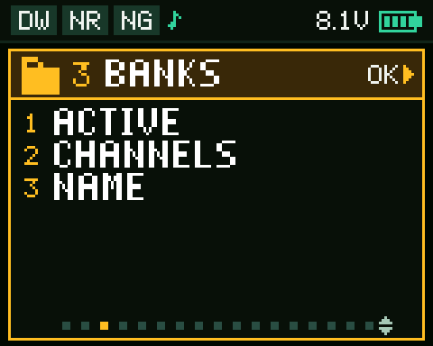 | 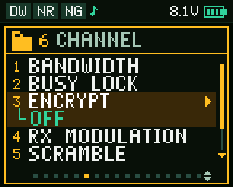 | 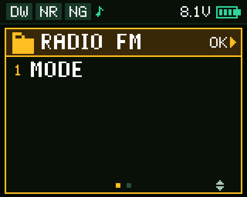 |
| **The folders:** ▲▼ pick one, its items show below, and the dots show which of the 17 is picked | **Inside a folder:** the item under the cursor in a card and its value below, in green; when the list does not fit, the arrows and the bar show there is more | **The radio menu** (FM, AM and SSB) in the same window, with the items of the current modulation |

- **OK** opens the folder and, inside it, **OK** opens the item straight away to change its value,
  with no second OK. Saving or cancelling takes you back to the folder, on the same item. **EXIT**
  goes back to the folders, and again leaves the menu. Every OK that saves a value stores it in the chip
  right away: switching off with the menu open loses nothing.
- **Typing a number** jumps straight there: `3` picks folder 3 and, inside it, `2` goes to item `3-2`.
- **ACTIVE** and **CHANNELS**, in the BANKS folder, are multi-select: each OK saves at once and the list
  stays, and EXIT goes back.
- **VERSION** opens read-only, and EXIT leaves it.
- **The menu lettering** is a little bigger and more spaced out, and the menu reopens on the last folder
  used.

| Folder | Items |
|---|---|
| 1 APRS (SMS) | CALLSIGN, DECODE, MESSAGES, PATH, SSID, TO |
| 2 AUDIO | DE-EMPHASIS, EQ BASS, EQ TREBLE, EXPANDER, NOISE GATE, SQUELCH, TAIL CUT |
| 3 BANKS | ACTIVE, CHANNELS, NAME |
| 4 CALIBRATION | CRYSTAL FINE, LIGHT PWM, MODEM GAIN, RX GAIN |
| 5 CH MEMORY | CH NAME, DELETE, SAVE |
| 6 CHANNEL | BANDWIDTH, BUSY LOCK, ENCRYPT, RX MODULATION, SCRAMBLE, STEP, TX POWER |
| 7 DISPLAY | BACKLIGHT TIME, BRIGHTNESS, MENU EXIT TIME, POWER-ON MSG, SHOW A, SHOW B, SHOW C |
| 8 DTMF | DTMF CODE, DTMF DELAY, DTMF GROUP, DTMF SIDETONE |
| 9 KEYS | AUTOLOCK, KEY BEEP, PF2, PF2 LONG, PF3, PF3 LONG |
| 10 MIC | COMPRESSOR, EQ BASS, EQ TREBLE, MIC AGC, MIC GAIN, NOISE REDUCTION |
| 11 MORSE | MESSAGES, SPEED, TONE |
| 12 REPEATER | OFFSET, RPT TAIL CUT, RPT TAIL DELAY, TONE BURST, TX SHIFT |
| 13 SCAN | SCAN ADD, SCAN RESUME, THRESHOLD |
| 14 SYSTEM | ALARM MODE, BATTERY SAVE, BLUETOOTH, RESET, VERSION |
| 15 TONES | RX CTCSS, RX DCS, TX CTCSS, TX DCS |
| 16 TX | ROGER, TX TIMEOUT, VOX, VOX DELAY |
| 17 WATCH | TRIPLE WATCH, TX SIDE, WATCH |

### 🆕 What V3.0T brought to the menu

| | | |
|:---:|:---:|:---:|
| 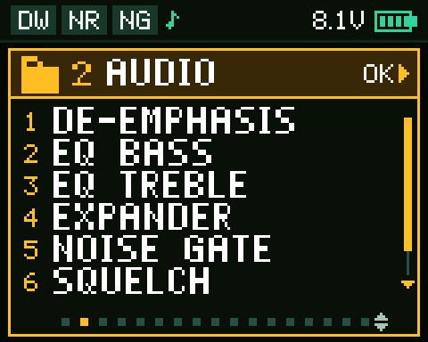 | 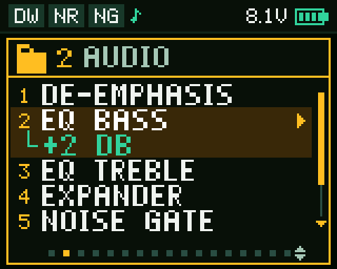 | 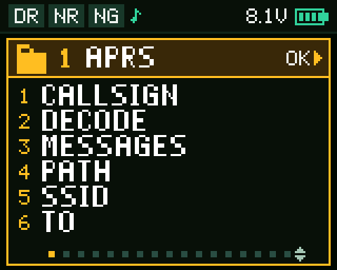 |
| **The AUDIO folder:** the receive EQ, EXPANDER, NOISE GATE and DE-EMPHASIS, with SQUELCH and TAIL CUT | **EQ BASS open,** at +2 dB: bass from −3 to +4 dB; treble from −1 to +4 dB | **The APRS (SMS) folder** (since V3.2T; the name is from V3.6T): the callsign, DECODE, the MESSAGES screen, PATH, SSID and the destination (TO) |

- **EQ BASS and EQ TREBLE:** in AUDIO they shape what you hear, in MIC what you transmit. DEFAULT is the stock
  setting, which already cuts the receive bass by 1 dB and a little of the transmit treble.
- **EXPANDER:** the compressor's twin, on received audio: below a level, each dB less becomes 2, 3 or 4 (LOW,
  MID, HIGH). It undoes the compression of a station transmitting with a compander and quiets the hiss in the
  pauses.
- **NOISE GATE:** mutes the audio below a level (OFF, LOW, DEFAULT, MID, HIGH, from the one that cuts least to
  the one that cuts most). DEFAULT is the stock setting.
- **DE-EMPHASIS:** ON is the stock setting; OFF makes FM audio much brighter.
- **MORSE:** MESSAGES reads incoming Morse, and its `#` opens the message box (up to 37 characters). SPEED goes from 5 to
  40 wpm, and TONE from 400 to 1200 Hz ([see below](#-the-morse-messages-screen-in-v37t)).
- **CALIBRATION:** LIGHT PWM (the frequency of the PWM that dims the light, to get away from interference),
  MODEM GAIN (the gain of the modem the MESSAGES screen uses) and, since V3.2T, RX GAIN (the receiver gain).

### 📨 The APRS MESSAGES screen in V3.2T

In the APRS (SMS) folder, **MESSAGES** opens the screen where messages come in and go out from.

| | |
|:---:|:---:|
| 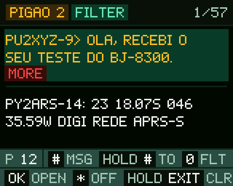 | 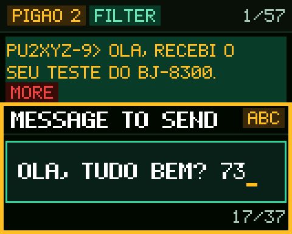 |
| **The MESSAGES screen:** the received message in a card, with MORE below it when it does not fit (OK opens it whole), the history below and, at the foot, P (the total of syncs) and the keys | **#** opens the **MESSAGE TO SEND** box over it, with the last message and up to 37 characters; the first key replaces it all. OK sends the message to TO (empty, as a status), and the screen comes back by itself after the transmission |
| 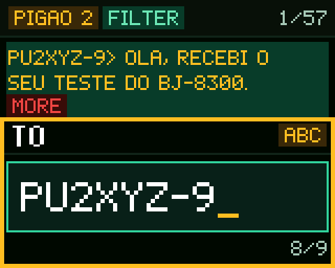 | 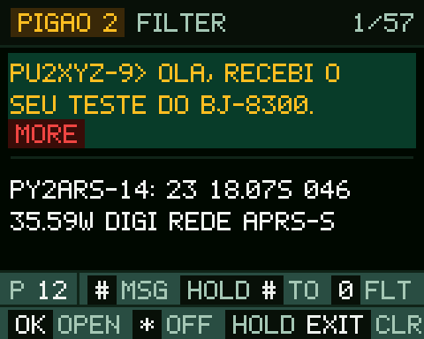 |
| **Holding #** (0.6 s) opens the **TO** box, with the saved destination. OK saves it, blank included, and goes back | **Key 0** turns off the FILTER, which the screen turns on when it opens (FM, the wide filter, bass at −3 dB, treble at +4 dB and SAVE off): the radio is as the menu leaves it and P restarts, to compare |

- **The return.** The radio only transmits with the menu closed. After sending, and after the automatic ack of
  what arrives for your callsign, the firmware reopens the MESSAGES screen by itself, with no beep, and the
  FILTER stays as it was. A key or PTT in the meantime stops the return.
- **In the box**, EXIT with it empty, or held, cancels and goes back to the screen. Each message gets a new
  number. While you type, APRS reception pauses.
- **Sound.** The screen is silent, with or without a signal; with SQUELCH OFF you hear everything. While sending is on the air, it
  shows only **SENDING**.

### 📻 The Morse MESSAGES screen in V3.7T

In the MORSE folder, **MESSAGES** opens the same screen as APRS, without FILTER and P: incoming Morse becomes text, and the messages are kept.

| | |
|:---:|:---:|
| 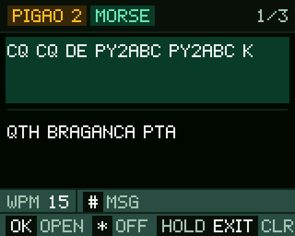 | 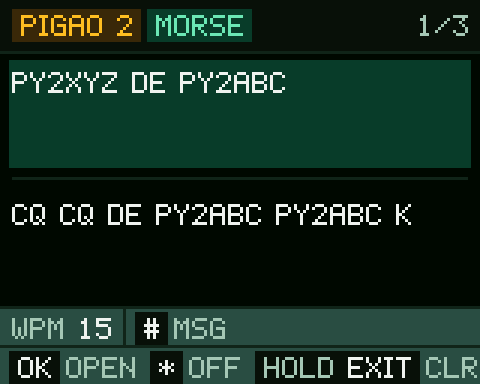 |
| **The MESSAGES screen:** the last message in a card, the history below and, at the foot, the speed read (WPM) and the keys | **Coming in:** the text enters the card word by word, and the previous message moves down to the history |
| 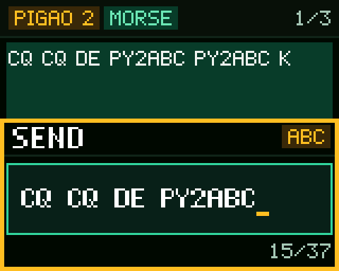 |  |
| **#** opens the **SEND** box, with the last message and up to 37 characters. The first key replaces it all, and OK sends it | **SENDING:** while Morse or APRS is on the air, the screen shows only the word |

- **Sending.** 0.5 s of silent carrier, so the receiver's squelch opens, then KA, the text and AR.
- **Reading** comes from the signal level in the radio chip, because received audio does not reach the processor. On the air, the BJ
  reads up to **15 wpm**, and the best tone is **700 Hz**. The Baofeng UV-17L, with the same screen, reads up to 20 wpm.
- **Sound.** The screen is silent, with or without a signal; with SQUELCH OFF you hear everything.

### 💾 CH MEMORY and BANKS in V3.6T

Both menus come out of the same mould, the same as the Baofeng UV-17L's: lists with only what applies, a confirmation, and
warnings instead of an empty list.

| | |
|:---:|:---:|
| 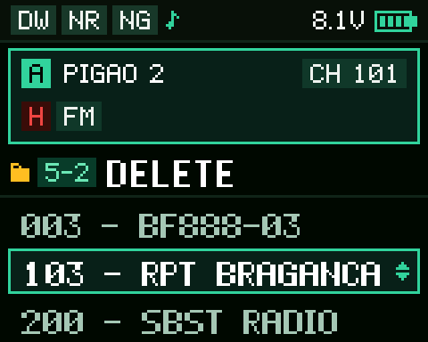 | 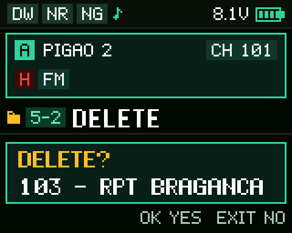 |
| **The CH MEMORY lists:** DELETE and CH NAME show only saved channels, and SAVE only free numbers, with the channel in use or the nearest one in the middle | **DELETE asks:** OK deletes and the list moves on to the nearest one, to delete several; EXIT backs out |
| 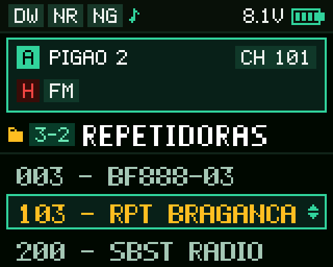 | 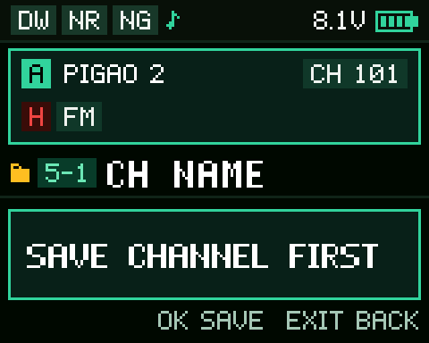 |
| **CHANNELS, in BANKS:** after you pick the bank, only the saved channels, with the bank's own in amber and its name in the title | **The warnings:** on a VFO, CH NAME and SCAN ADD show `SAVE CHANNEL FIRST`, and OK leads to SAVE |

- **Cancelling does not save.** SAVE and CH NAME only write on the editor's OK. EXIT with the box empty, or held, goes back to
  the list without saving, and OK on a blank box saves `CH 101`.
- **No empty lists.** In their place comes `NO SAVED CHANNELS`, `MEMORY FULL` or `BANK EMPTY`.
- **The modes.** On a channel, TX SHIFT and OFFSET open with `VFO ONLY`, and in the folder, under the item, `VFO` or `CHANNEL`
  shows.
- **Holding 3** opens the same SAVE, and a typed number goes to the nearest channel in the list.

## 🔺 TRIPLE: the BJ-8300 listening to three frequencies

The stock firmware has only two sides, A and B, and dual watch (TDR) watches both. Since V2.6T it has a
**third side, C**, and the radio now watches **three frequencies** at once. No BJ-8300 firmware did
this before.

| | |
|:---:|:---:|
| 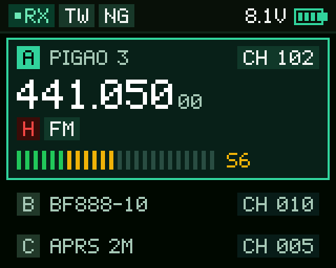 | 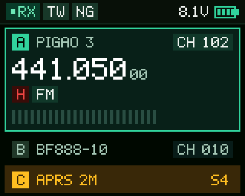 |
| **A in focus, receiving.** B and C sit in strips below, each with its letter, name and channel | **The watch stopped on C**: its strip turns amber while it receives, with the S in place of the channel |
| 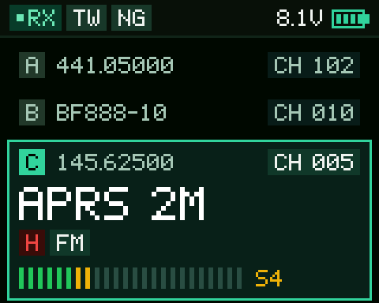 | 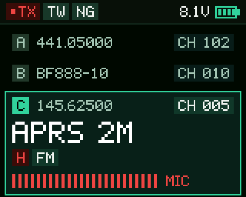 |
| **C in focus** (A/B key): it gets the card, transmits and changes channel like A and B | **Transmitting on C** with `TX SIDE` on C: it comes into focus while PTT is pressed, with the microphone bar, and goes back on release |

- **The `WATCH` menu** picks how many frequencies the main screen shows: **SINGLE** (side A only,
  full screen: the A/B key does not switch), **DUAL** (the usual A/B) or **TRIPLE**.
- **The watch (`TRIPLE WATCH`, formerly TDR)** goes through all three, A → B → C → A, with the same time
  on each. When it is off, only the one in focus receives. When it is on, the top bar shows **DW** with two
  sides and **TW** with three.
- **The A/B key** goes from A to B, from B to C and from C to A. With C in focus, everything applies
  to it: transmitting, arrows, typing, VFO/MR, STEP, power, tones.
- **C is a full side**, on a VFO or a channel, with the same options as A and B. Its channel is
  picked with C in focus (A/B key), as on the other sides, and what its strip shows (name,
  frequency or channel) is `SHOW C`.
- **`TX SIDE`** (the stock TX-A/B, with C) picks the side PTT transmits on with the watch on. On C,
  C comes into focus while PTT is pressed, as A and B do, even when it is on neither side; on
  release, everything goes back as it was.
- **In CHIRP**, all of this is under **Settings → VFO A/B/C Channel**.

## 📺 The new look

| | |
|:---:|:---:|
| 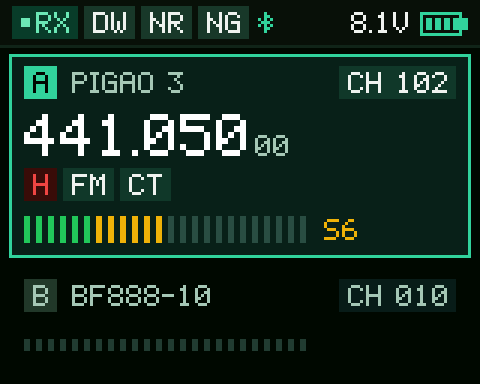 | 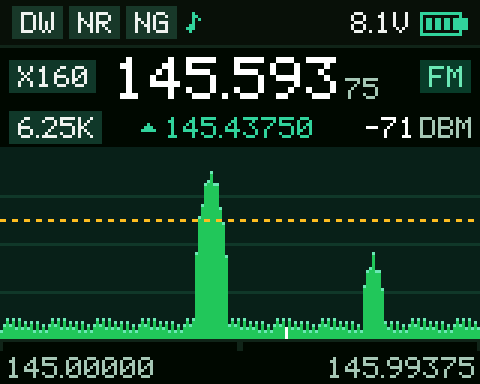 |
| **Main screen:** both sides, with A highlighted and receiving at S6 on the S-meter; the top bar shows only what is on (RX, dual watch, noise reduction, noise gate, Bluetooth) | **Spectrum:** the running frequency, the sweep peak in green with the dBm, the bars with the measured column in white and the threshold line in amber |
| 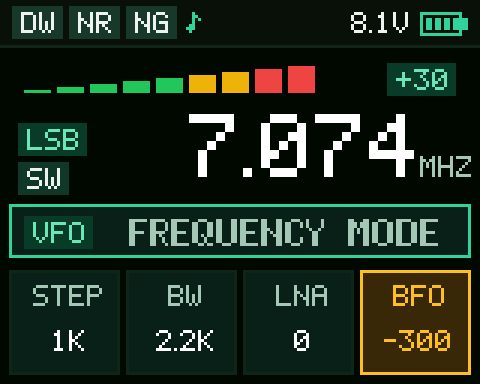 | 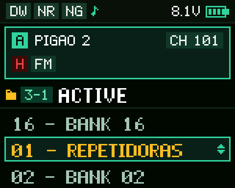 |
| **Radio** on LSB, changing the BFO: S meter, band, the big frequency and the settings in cards | **An open item (BANKS → ACTIVE):** the highlighted side summed up at the top, the folder and the number `3-1`, and the banks that are on in amber |

The images come from the PC preview ([firmware/previa/](../../firmware/previa/)), which runs the same
drawing code that goes into the radio.

## ✨ What changed from the stock V0.12 to V4.1T

### 🆕 New features

| Feature | &#8199;&#8199;&#8199;&#8199;&#8199;&#8199;&#8199;&#8199;&#8199;&#8199;&#8199;&#8199;&#8199;&#8199;&#8199;&#8199;&#8199;Screen&#8199;&#8199;&#8199;&#8199;&#8199;&#8199;&#8199;&#8199;&#8199;&#8199;&#8199;&#8199;&#8199;&#8199;&#8199;&#8199;&#8199; |
|---|:---:|
| 📁 **A menu in folders**<ul><li>The menu items sit in **17 folders** by topic, in alphabetical order, in an amber window.</li><li>The window shows each folder's items and, inside it, the value of the item under the cursor, scrolling when the list does not fit.</li><li>**OK** on an item opens it for editing straight away, and saving or cancelling goes back to the folder.</li><li>The radio menu (FM/AM/SSB) uses the same window ([see above](#-a-new-menu-everything-in-folders)).</li></ul> |  |
| 📨 **APRS**<ul><li>New **APRS (SMS)** folder: CALLSIGN, SSID, PATH (WIDE1-1, WIDE1-1,WIDE2-1 or none), TO, DECODE and the **MESSAGES** screen, where messages come in and go out from ([see above](#-the-aprs-messages-screen-in-v32t)).</li><li>**Sending:** **#** opens the message box (up to 37 characters), with the last one, and OK sends it to TO (empty, a status) in AX.25. **Holding #** opens the TO box. After sending, the screen comes back by itself.</li><li>With no **CALLSIGN** saved, **#** asks for the callsign first, and nothing goes on air without a packet.</li><li>The 1200 bps AFSK is generated in the radio and fed into the microphone input, like a sound-card TNC: APRSdroid and TNCs read it.</li><li>**FILTER:** the screen opens with FM, the wide filter, no scramble or compressor, bass at −3 dB, treble at +4 dB and SAVE off. Key 0 turns it off to compare, and everything goes back to the menu's settings on leaving.</li><li>**Receiving:** the message, position, weather, objects and Mic-E decoded (or as they came, with DECODE OFF), the ack of what arrives for your callsign, a history and the count of syncs (P).</li><li>Receiving uses the radio chip's modem, which only gets a packet that arrives without errors: it catches fewer than a TNC.</li></ul> |  |
| 📻 **Morse**<ul><li>New **MORSE** folder: **MESSAGES**, SPEED (5 to 40 wpm) and TONE (400 to 1200 Hz).</li><li>It goes out in FM through the tone generator, like the roger; PTT or any key stops it.</li><li>The message text editor goes up to 37 characters, on two lines when one is not enough.</li></ul> | 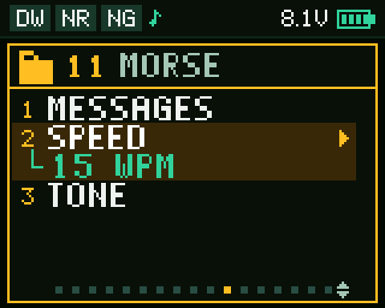 |
| 📻 **Morse MESSAGES screen**<ul><li>**MESSAGES** reads incoming Morse, word by word, and keeps the messages, like the APRS one ([see above](#-the-morse-messages-screen-in-v37t)).</li><li>**#** opens the message box, with the last text, and the first key replaces it all, as in the APRS box.</li><li>Sending takes 0.5 s of silent carrier, so the receiver's squelch opens, with KA at the start and AR at the end. While it is on the air, the screen shows only **SENDING**, for Morse and APRS.</li><li>Both MESSAGES screens stay silent, with or without a signal; with SQUELCH OFF, you hear everything.</li><li>On the air it reads up to 15 wpm, and the best tone is 700 Hz.</li></ul> |  |
| 🔦 **PF3 LONG and flashlight screen**<ul><li>New item in the KEYS folder: what holding PF3 does, **MONITOR** (the default) or **FLASHLIGHT**.</li><li>**MONITOR** opens the squelch of the side in focus, with the S-meter reading the signal.</li><li>**FLASHLIGHT**: 1 s of PF3 on the main screen turns the screen all white, at full brightness, with no timeout.</li><li>Only PF3 and EXIT leave it, and the brightness returns to what it was. Other keys do nothing, and PTT transmits without turning it off.</li></ul> | 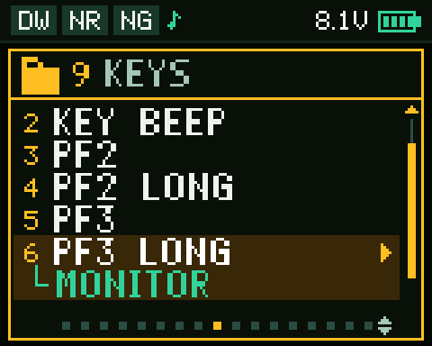 |
| 📤 **SENDING screen**<ul><li>While Morse or APRS is on the air, the screen shows only the word.</li><li>The automatic ack does not show it.</li></ul> |  |
| 🎚️ **EQ**<ul><li>**EQ BASS** and **EQ TREBLE** in the AUDIO folder (what you hear) and in MIC (what you transmit).</li><li>Bass from −3 to +4 dB and treble from −1 to +4 dB, through the radio chip's own equalizer.</li><li>DEFAULT is the stock one. CHIRP sets them too.</li></ul> |  |
| 📶 **S-meter**<ul><li>Each side's meter became a **24-segment** S-meter: 2 per S from S1 to S9 and 1 per 10 dB above, up to S9+60.</li><li>The S written next to it: green up to S3, yellow up to S8 and red from S9 up.</li><li>S1 starts at each band's hiss, by the factory calibration, and it reads 4 times a second.</li><li>In SINGLE, in DUAL (on the compact side too) and in TRIPLE (on the receiving strip, in place of the channel).</li><li>While transmitting it shows the microphone level, with MIC.</li></ul> | 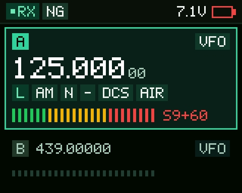 |
| 🔊 **AUDIO folder**<ul><li>**EXPANDER** (OFF, LOW, MID, HIGH): the received audio expander, which the chip has and the factory left off.</li><li>**NOISE GATE** (OFF, LOW, DEFAULT, MID, HIGH): mutes the audio below a level; DEFAULT is the stock one.</li><li>**DE-EMPHASIS**: ON, the stock one, or OFF.</li><li>With SQUELCH, TAIL CUT and the EQ.</li></ul> |  |
| 🔺 **WATCH: SINGLE, DUAL and TRIPLE**<ul><li>New menu item.</li><li>**SINGLE** shows only side A, full screen (the A/B key does not switch): the frequency in large type, a wide bar and, with an offset, the transmit frequency below (the watch stays off).</li><li>**DUAL** is the usual A/B.</li><li>**TRIPLE** adds a third side, C, and the watch goes through all three ([see above](#-triple-the-bj-8300-listening-to-three-frequencies)).</li><li>With the watch on, the **TRIPLE WATCH** item, the top bar shows **DW** with two sides and **TW** with three.</li></ul> | 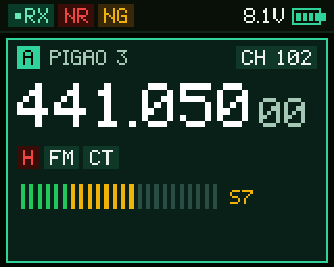 |
| 📡 **Side C**<ul><li>A full side, on a VFO or a channel, with the same options as A and B.</li><li>The A/B key goes A → B → C → A, and with C in focus it transmits and changes like the others, channel included.</li><li>New menu item: `SHOW C` (how its strip shows: name, frequency or channel).</li></ul> |  |
| 📤 **TX SIDE**<ul><li>The stock `TX-A/B` (which side PTT transmits on with the watch on) becomes `TX SIDE`: OFF, A, B and C.</li><li>In TRIPLE, on C, C comes into focus while PTT is pressed, as A and B do, even though it is outside the two sides.</li><li>On release everything goes back as it was, saving nothing.</li></ul> | 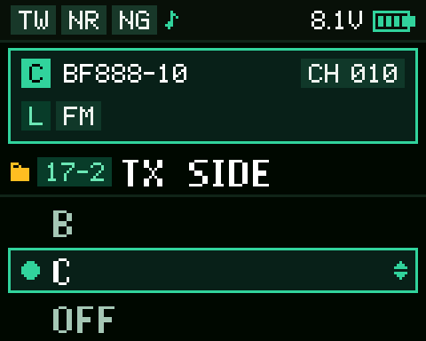 |
| 🎙️ **MIC folder**<ul><li>**MIC GAIN** with **HIGH** (31), **MID** (25), **LOW** (19) and **DEFAULT**, the radio's own calibration, in value order among them.</li><li>TX audio **COMPRESSOR** (OFF, LOW, MID and HIGH: 1.33:1, 2:1 and 4:1), which the chip has and the factory left off.</li><li>**MIC AGC**: ON, the stock one, or OFF.</li><li>**NOISE REDUCTION** with levels: OFF, LOW, MID, DEFAULT and HIGH; DEFAULT is the stock ON.</li><li>The transmit EQ.</li></ul> | 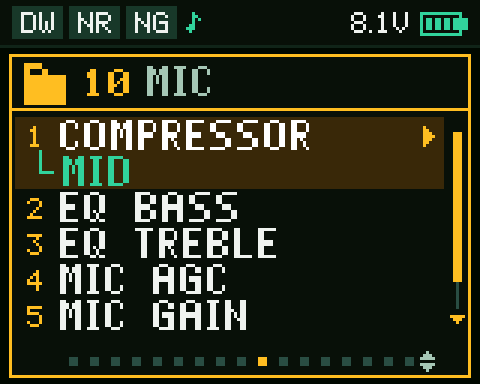 |
| 🎯 **CALIBRATION folder**<ul><li>**CRYSTAL FINE**: crystal fine tuning, from −2000 to +2000 Hz at 435.5 MHz, in 10 Hz steps, proportional to the frequency and added to the factory calibration.</li><li>**LIGHT PWM**: the frequency of the PWM that dims the light (240 Hz to 25 kHz), to take the interference away from a receiver held nearby.</li><li>**MODEM GAIN**: the gain of the modem the MESSAGES screen uses.</li><li>**RX GAIN**: the receiver's five AGC steps, at **DEFAULT** (the stock ones: −2, −17, −40, −57 and −71 dB, from the weakest signal to the strongest) or **MAX** (0, −6, −15, −30 and −50 dB), with more gain on every step; the top one is already the chip's maximum.</li></ul> | 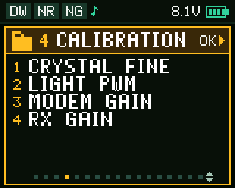 |
| 🔆 **BRIGHTNESS**<ul><li>In the DISPLAY folder: the screen light at 100% (the stock one), 60%, 35%, 20% or 10%, by PWM.</li><li>At 100% and with the light off the pin stays as stock, with no PWM.</li></ul> | 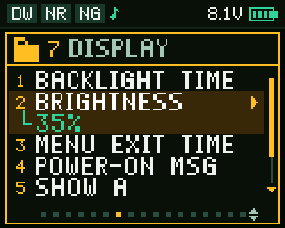 |
| 📡 **Who is receiving, with the menu open**<ul><li>Receiving with the menu open, the top bar shows, in an amber box, the side's letter (A, B or C) and its name, frequency or channel, as its MDF asks.</li><li>The box goes away when the signal ends.</li></ul> | 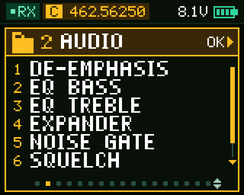 |
| 🏷️ **TX tone label**<ul><li>While transmitting, the label shows the TX tone in red, CT or DCS.</li><li>With no TX tone it disappears, even with a tone on RX.</li></ul> | 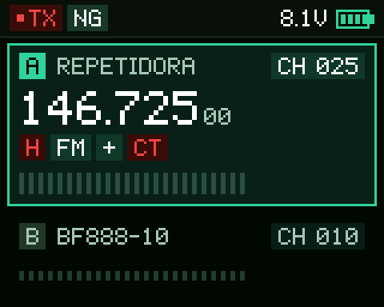 |
| ✈️ **AIR label**<ul><li>From 108 to 135.99999 MHz, next to AM.</li></ul> | 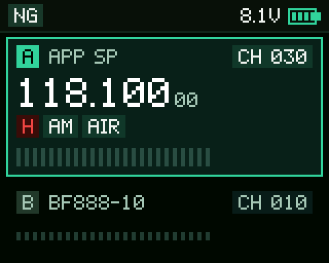 |
| 🎚️ **MIC GAIN with DEFAULT**<ul><li>**DEFAULT** is the radio's own factory calibration.</li><li>It goes in value order among the levels, on the radio and in CHIRP: on the test radio, HIGH 31, DEFAULT 30, MID 25 and LOW 19.</li></ul> | 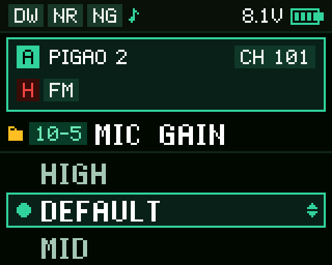 |
| 🆔 **CALLSIGN before sending**<ul><li>With no callsign saved, the MESSAGES screen's **#** opens CALLSIGN in the same box.</li><li>Once saved, it opens the message box.</li><li>Nothing goes on air without a packet.</li></ul> | 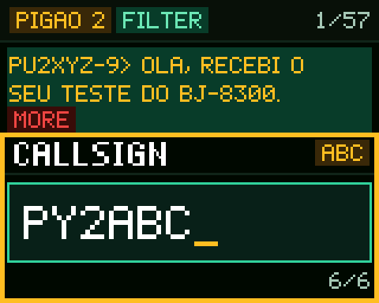 |
| 💾 **SAVE that asks for the name**<ul><li>After saving to a channel, the name editor opens empty.</li><li>The side stays on the saved channel, also coming from the VFO.</li></ul> | 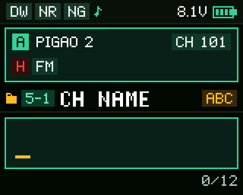 |
| 🔋 **90% PA cap**<ul><li>No bias of the power amplifier goes above 229, 90% of 255, at every power.</li><li>On the test radio only VHF and UHF H change. It caps the bias, not the watts.</li></ul> | |
| 🚫 **NO TX**<ul><li>A channel saved with no TX frequency (the way CHIRP saves a listen-only channel) shows NO TX in red.</li><li>In SINGLE, in place of the TX line; in DUAL and TRIPLE, on the labels.</li></ul> | 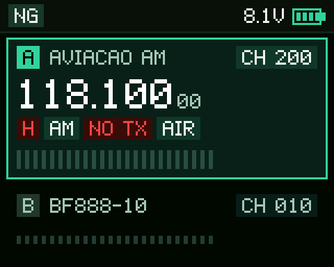 |
| ⌨️ **Text editor**<ul><li>In BANKS NAME, CH NAME, the Morse message and the APRS boxes.</li><li>**Holding EXIT** (0.6 s) leaves without saving.</li><li>**Key 0** starts at the space and brings `- / = + @ ( ) * #`, which no key reached, for the SSID and the messages.</li><li>Messages go up to 37 characters, on two lines.</li></ul> | 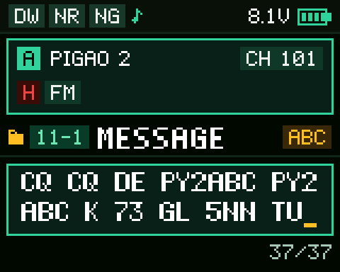 |
| 🖥️ **A new screen across the radio**<ul><li>Every screen was redrawn ([see above](#-the-new-look)).</li><li>The main one: the side in focus in a card with the big frequency and the S-meter, coloured power, modulation and tone labels, and a top bar with only what is on.</li><li>The menus and the name editor, the FM/AM/SSB radio, QT scan, DTMF, the spectrum and the voltage at power-up.</li></ul> |  |
| 💾 **CH MEMORY**<ul><li>The folder for saving and naming channels: **SAVE**, **DELETE** and **CH NAME**, with lists of only what applies ([see above](#-ch-memory-and-banks-in-v36t)).</li><li>**DELETE** asks before deleting, and cancelling does not save.</li><li>A warning instead of an empty list.</li></ul> |  |
| ⚠️ **Mode warnings**<ul><li>TX SHIFT and OFFSET on a channel open with `VFO ONLY`.</li><li>SCAN ADD and CH NAME on a VFO show `SAVE CHANNEL FIRST`, and OK leads to SAVE.</li><li>On stock, one gave only the error beep and the other did nothing.</li></ul> | 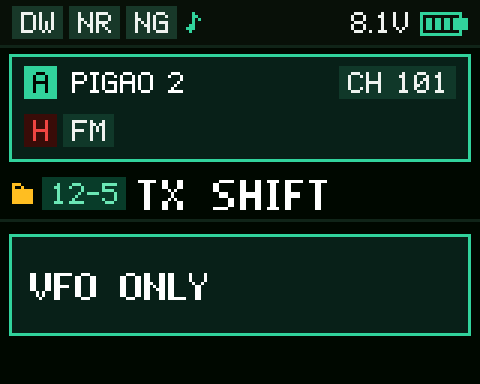 |
| 🗂️ **16 channel banks**<ul><li>Each bank has a **12-character name**, and a channel can be in **as many banks as you like**.</li><li>You can turn **several banks on at once**: up/down and scanning then see only the channels of the banks that are on.</li><li>With none on, the radio works as stock.</li><li>New **BANKS** folder, with `ACTIVE`, `CHANNELS` and `NAME` ([how to use](#using-banks-on-the-radio)).</li></ul> |  |
| 🔐 **Scramble with 8 frequencies**<ul><li>`SCRAMBLE` goes from OFF/ON to **OFF and 2700 to 3400 Hz, in 100 Hz steps**, in ascending order.</li><li>**3400 Hz** is the stock ON (talks to other BJ-8300s).</li><li>The **Baofeng UV-17L's modes 1, 2 and 3** each land on one of these frequencies. Tested with all three modes.</li></ul> | 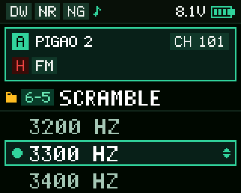 |
| 🔔 **Roger BEEP 2 and COIN**<ul><li>`ROGER` gets two options: OFF, BEEP 1 (the stock one), **BEEP 2**, **COIN** and TONE1200.</li><li>**BEEP 2**: four tones (1125, 1857, 1359 and 931 Hz), ~0.4 s in all.</li><li>**COIN**: the coin.</li></ul> | 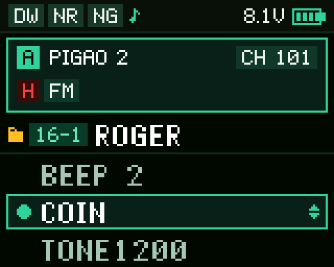 |
| 🎵 **ROGER CUSTOM**<ul><li>`ROGER` gets **CUSTOM**: up to 32 notes, 300 to 3000 Hz, up to 3 s, composed in the Tempra Link (the piano, the timeline and MIDI and sound import).</li><li>The notes go to the radio through Tempra Link; CHIRP only picks CUSTOM.</li><li>Like the Baofeng UV-17L's.</li></ul> | 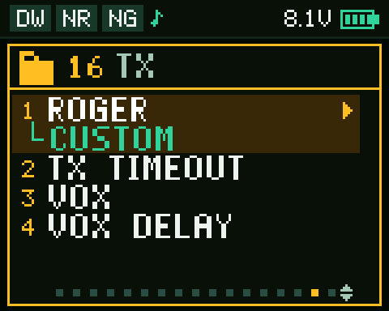 |
| 🔎 **Faster scan and THRESHOLD**<ul><li>The scan (SCAN, on channels and on the VFO) goes from 3 to 5 channels a second to **one channel every 60 ms**, like the Baofeng UV-17L's, and stops on the signal with the same stock confirmations.</li><li>While scanning channels, the number follows the visited channel, and short `*` also stops the scan, like short `#`.</li><li>**THRESHOLD** in the SCAN folder, **S1 to S9**: while scanning, a channel that opens the squelch below the chosen S is skipped. S1 is as stock.</li></ul> | 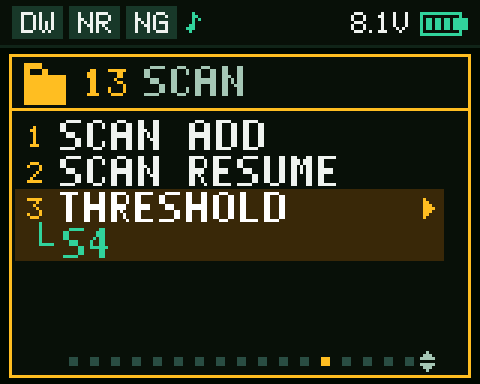 |
| 🕹️ **Remote control**<ul><li>Over the cable, Tempra Link shows the radio's screen live, drawn on the PC with the same code as the firmware's screen, and sends the keys, with the long press, and PTT.</li><li>Over Bluetooth, the keys, PTT and the state: who is receiving, the S-meter and the voltage.</li><li>The radio's screen can stay off with the remote on, to save the battery; a key on the radio turns it on.</li><li>If the PC stops sending for 1 s, the radio releases the key and PTT by itself ([the manual](tempra-link.en.md#9-remote-control)).</li></ul> | 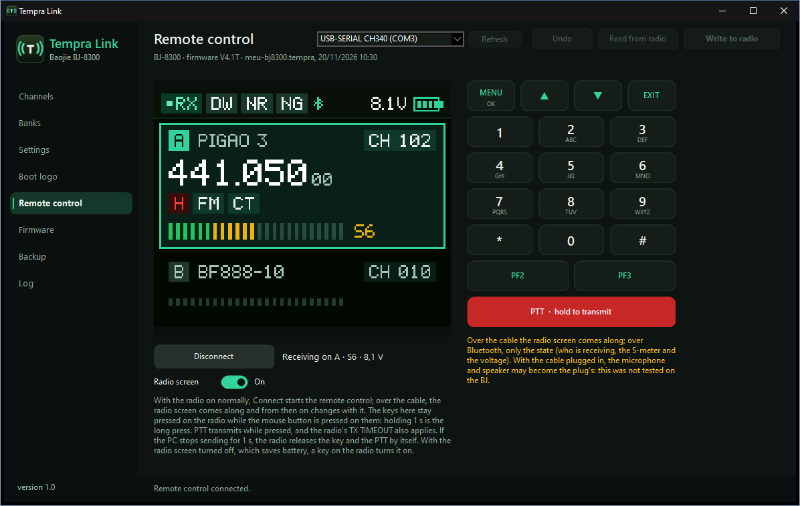 |
| 💻 **Tempra Link**<ul><li>This firmware's Windows program, with nothing to install.</li><li>It reads, edits and writes the 960 channels, the 16 banks, the menu settings, the texts, DTMF and ROGER CUSTOM, and keeps a backup of every reading.</li><li>It flashes the firmware over the cable, checking the file first, and downloads the right version from GitHub by itself.</li><li>[The manual, with the screens](tempra-link.en.md).</li></ul> | 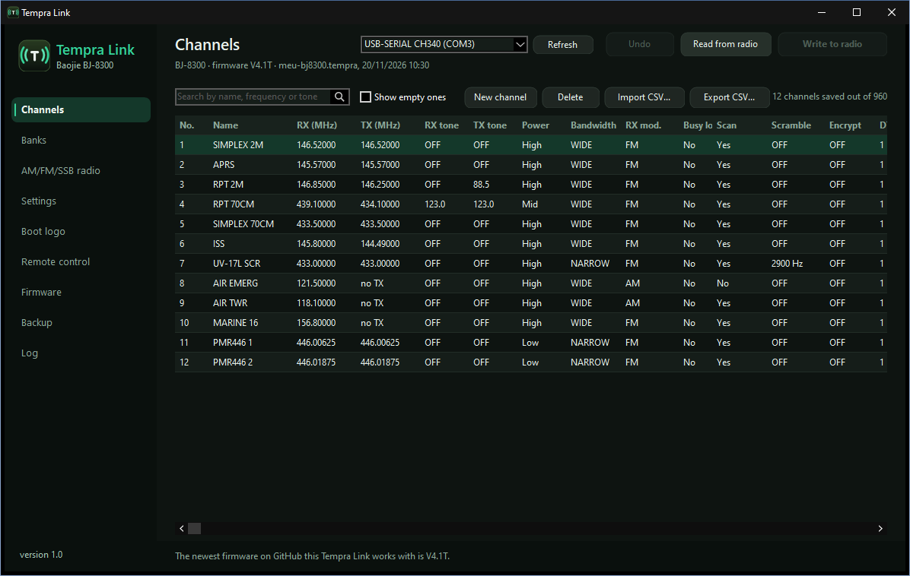 |
| 📊 **Spectrum**<ul><li>**320 and 640 points** on top of the stock 160, and a **10 kHz step**.</li><li>**Peak hold**: the bar goes up at once and comes down slowly.</li><li>The measured column in white, the running frequency at the top and each sweep's peak frequency in green, with the dBm.</li><li>The light stays on while it is on screen.</li></ul> |  |
| 🔌 **Dedicated CHIRP driver**<ul><li>Reads and writes the banks (**Banks** tab), the names, the new roger and scramble, WATCH, VFO C, the MIC folder, CRYSTAL FINE, BRIGHTNESS, LIGHT PWM, MODEM GAIN, the AUDIO folder, the EQ, the **APRS (SMS)** folder, the **Morse** folder, DECODE, PF3 LONG, THRESHOLD and ROGER CUSTOM (the notes, only Tempra Link writes).</li><li>All in a single cable session; it is listed under **Bajeton**.</li><li>It refuses to write to a radio running the stock firmware or a TEMPRA of another version ([how to use](chirp.en.md#-how-to-use-chirp-with-this-firmware)).</li></ul> | |
| 🧰 **Extended cable command**<ul><li>Reads the whole data chip (24-bit address).</li><li>Writes only to the new firmware's areas: the banks, WATCH, VFO C, Morse, APRS and ROGER CUSTOM.</li><li>Reading `0x3F0000` answers the firmware version (`TEMPRA V4.1T`).</li><li>The serial port at 460800 baud.</li><li>It is what Tempra Link and the CHIRP driver use.</li></ul> | |

### 🖥️ The new screen, screen by screen

Since V2.0T, **every** stock firmware screen gives way to a dark green theme, with coloured labels and
a font of its own:

| Screen | What changed |
|---|---|
| **Main** (both sides) | The side in focus sits in a **green-bordered card**, with the name, the channel, the **big frequency** (the last two digits small) and the **S-meter** with the S written next to it. The other side is compact, in a thin strip, also with the bar and the S. Coloured labels: power (**H** red, **M** amber, **L** green), FM/AM, tone (CT/DCS), narrow band, offset, scramble, zone and NO TX |
| **Main in SINGLE** | Only side A, from the bar to the foot of the screen: the frequency even bigger, the labels, the wide S-meter and, with an offset, the transmit frequency below |
| **Main in TRIPLE** | The side in focus in the card and the other two in strips, in A, B, C order, each with its letter, text and channel (or `VFO`). The strip receiving turns amber, with the S in place of the channel ([see above](#-triple-the-bj-8300-listening-to-three-frequencies)) |
| **Top bar** | Shows **only what is on**: RX and TX in a label with a dot (green on RX, red on TX), the watch when on (DW in DUAL, TW in TRIPLE), VOX, MO, the microphone noise reduction (NR) and the RX noise gate (NG), in the usual colour on DEFAULT and green, yellow and red on LOW, MID and HIGH, DTMF ST, Bluetooth and the lock; the **voltage in volts** and the battery, which gets a red outline and blinks when low. With the menu open, receiving, who is receiving in an amber box in place of the icons |
| **Transmitting** | The big line switches to the transmit frequency, and the bar shows the **microphone level**, in red, with MIC; the power stays on the H/M/L label |
| **Typing** | The frequency goes in its place, over the `---.---` mask; the channel, in the channel label |
| **DTMF** (`#` key) | An amber box in place of the card of the side in use, with the digits |
| **Menus** | The folders and the items in an **amber window** ([see above](#-a-new-menu-everything-in-folders)). The open item: the folder and the number (`12-2`) in a green label and the title; three options, the one under the cursor in a card and the **saved value marked with a green dot**; while changing the value, the card gets the green border and the arrows, with no blinking. At the top, the side in focus summed up. All in the menu lettering, a little bigger than the medium one |
| **Text editor** (BANKS NAME, CH NAME, the Morse message and the APRS boxes) | The text in a card, in large type when it fits and on two lines for the messages, with an amber cursor, how many characters out of how many and the mode (`ABC` or `123`, switched with `#`) in an amber label |
| **APRS MESSAGES** | The FILTER (dim when key 0 turns it off) and the page at the top, the decoded message or packet in a card, with MORE in red below it when it does not fit, the history below, and at the foot P (the total of syncs) and the keys: `#` MSG, held `#` TO, `0` FLT (the FILTER), OK OPEN, `*` OFF (turns the screen off) and held EXIT CLR (clears the history). The `#` boxes open over the bottom half, in an amber border, with the title (MESSAGE TO SEND or TO), the mode (`ABC` or `123`) and how many characters out of how many, and the screen stays behind them |
| **Morse MESSAGES** | The same screen as APRS, without FILTER and P: the text arrives in the card, word by word, and the foot shows the speed read (WPM). `#` opens the **SEND** box over it |
| **SENDING** | Only the word in red, in the middle of the screen, while Morse or APRS is on the air |
| **Banks** (ACTIVE and CHANNELS, in the BANKS folder) | The banks that are on, and the open bank's channels, in **amber**, with the bank's name in the title |
| **FM/AM/SSB radio** | A 9-step S meter, the band in a label, the **big frequency** with its unit, the station name in a card (with no name, `NO STATION NAME` instead of `Unknow`), and **STEP, BW, LNA and BFO in four cards**, the one being changed in amber. `SEEK...` and the start-up wait (`RADIO STARTING...`) are in the new theme too, and its menu is in the folder window |
| **Spectrum** | The running frequency in large type, points and step in labels, the **sweep peak in green** with the dBm, the graph in a gridded panel, the measured column in white, the **dashed amber threshold line** and the window's edges below |
| **QT scan** (EXIT held) | The title, what it looks for (CTCSS / DCS) and the state, RUNNING in a green card or STOP in amber |
| **Voltage** | At power-up (with the power-on message set to voltage) and holding `0` on the main screen, the voltage shows in a card, in volts |

### ⚡ Improvements

| What | Detail |
|---|---|
| 💾 **Every setting saved on OK** | The factory only saved the settings when the menu closed. Now each OK that confirms a value stores it in the chip right away, and switching off with the menu open loses nothing |
| 🚀 **Spectrum twice as fast** | 160 points in ≈ 2.5 s. Stopped on a signal it found, the down arrow carries on sweeping, and the up arrow raises the threshold line; on entering the spectrum, the line goes back to the stock default |
| 🟩 **The side in focus stands out** | The active side sits in a green-bordered card, with the big frequency and the S-meter; the other one is compact |
| 📻 **FM/AM/SSB radio** | Switching modulation became ~2.5 s faster, and the saved settings (step, bandwidth, LNA, BFO and the memories) are checked on entry and on each switch: a value outside the menu limits goes back to the default |
| ↕️ **Menu arrows swapped** | The up arrow now moves up the list, instead of stepping the value |
| 🔤 **English texts revised** | 25 strings fixed and made consistent (e.g. `VOICEPRI` → `ENCRYPT`), `TDR` became `TRIPLE WATCH`, because with TRIPLE the watch is triple, and `TX-A/B` became `TX SIDE`. The `VERSION` menu shows `Firmware: V4.1T` |
| 🏷️ **Clear menu names** | The short stock names became names that say what the item does, the same as the Baofeng UV-17L's: `SQL` is `SQUELCH`, `STE` is `TAIL CUT`, `BCL` is `BUSY LOCK`, `TXP` is `TX POWER`, `W/N` is `BANDWIDTH`, `TOT` is `TX TIMEOUT` and `MDF-A` is `SHOW A`, among others. The [folder table](#-a-new-menu-everything-in-folders) has them all, and [section 35](../reverse-engineering.md#35-the-menu-names-since-v141) lists each old name |
| 📶 **Bluetooth during TX** | The stock firmware turns Bluetooth off on every PTT, and the phone lost the remote control. With a link open, it now stays on; with no link, it is as stock |
| 🔌 **Faster cable** | The cable serial goes from 57600 to 460800 baud. Tempra Link and the CHIRP driver drop to the earlier speeds by themselves, to recognize the older firmwares |

### 🐞 Fixes

| V0.12 problem | In V4.1T |
|---|---|
| Menu settings only reached the chip when the menu closed: switched off with it open, whatever had changed was lost | Every OK saves right away |
| The signal meter had 5 steps and was already full on a weak signal (between −117 and −96 dBm) | The S-meter, from the hiss (S1) to S9+60 |
| With the menu open, while receiving, the side in focus showed on top of the window in the old layout (and C came out as B) | It no longer does; the top bar shows who is receiving |
| During a scan, the signal bar froze on the last channel found, and the channel number did not match the name | The screen follows each channel of the scan |
| At power-up with the voltage, and holding `0`, the text `   Voltage` had the voltage written over it, and the "ge" was lost | The whole of `VOLTAGE`, with the voltage in a card |
| A channel name saved by CHIRP opened in the editor with `?` at the end and `12/12`: the editor counted the padding bytes | The editor counts only the letters, as the screen already showed |
| On the radio, a station with no name showed as `Unknow` | `NO STATION NAME` |
| MO (PF3 held), with a carrier on the other watch side, opened that side, and the meter flashed full | It always opens the side in focus, and the S-meter starts empty and reads the signal |

### ➖ Removed

| What | Why |
|---|---|
| The `ZONE` and `Zone Or Channel` menu items | The banks do the zones' job, with more freedom. The zone function is still in the firmware, and the CHIRP driver always writes **Full Channel**, so the radio never gets stuck in zone mode |
| The voices and the `VOICE` item | On request: the radio no longer speaks numbers and modes, and their space holds part of the new code |
| The Chinese language and the `LANGUAGE` item | The new screen only has Latin letters; the radio is always in English |
| The `CH-C` item | C became a full side: its channel is picked with the A/B key, as on A and B. CHIRP still writes it |
| Lower case (`abc`) in the name editor | The font only has capitals: `ABC` and `123` remain |

### 🔒 What does not change

- **Channels, settings and calibration** live in a separate chip and are **not touched** when the
  firmware is flashed.
- The **flashing mode** (`UPDATE`) is read before any modified code, and the build script refuses
  to write to it.
- **Going back to stock** is just flashing the [original firmware](../../firmware/original/), the same
  way.

## Using banks on the radio

In the menu, the **BANKS** folder has three items:

| Item | What it does |
|---|---|
| **ACTIVE** | The list of the 16 banks, like `01 - REPEATERS`, with the ones that are on in amber. **OK turns a bank on or off** at once, and the list stays, to change several. A bank with no channels does not turn on: `BANK EMPTY` shows. In the folder, under the item, `2 ON` or `ALL CHANNELS` |
| **CHANNELS** | First you pick the bank; then come only the saved channels, like `102 - PIGAO 3`, starting from the one in use, with the bank's own in amber. **OK adds and removes** at once. EXIT goes back to the banks, and again to the folder. With no saved channel, `NO SAVED CHANNELS` |
| **NAME** | The bank list opens the editor (12 characters), empty if the bank has no name. OK saves; blank, the bank goes back to its stock name, like `BANK 01`; cancelling does not save |

Behaviour details:

- A bank with **no stored channel** does not turn on, and deleting the last visible channel rebuilds the
  filter: with nothing to show, the radio shows them all.
- Marking or unmarking a channel **takes effect at once**, no restart.
- Writing banks **over the cable** (CHIRP) needs a power cycle: the filter is built at boot.
- The bank state is stored in the data chip and **survives power-off**.
- Rewriting channels with CHIRP or the CPS **does not erase any bank**: the banks live in the data
  chip (0xC1000 onwards), outside the channel area.

The main screen looks the same: numbering stays **absolute, 1 to 960** (channel 500 is still 500,
not "the 3rd in the bank") and the active bank's name is not shown there. What changes is only what
**up/down and scan can see** — with a bank on, they jump straight from one marked channel to the
next.
