# 📻 As funções do rádio

  

[📖 Wiki](README.md) · [🏠 Página inicial](../../README.md)

## 📁 Menu novo: tudo em pastas

O menu de fábrica é uma fila de mais de 50 itens. Desde a V2.7T eles ficam em pastas por assunto (**17 na V4.2T**),
em ordem alfabética, numa janela que mostra o que tem dentro de cada uma antes de abrir.

| | | |
|:---:|:---:|:---:|
| 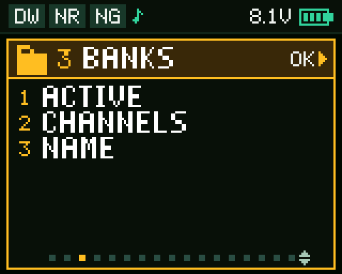 | 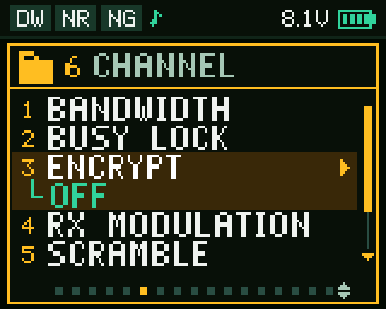 | 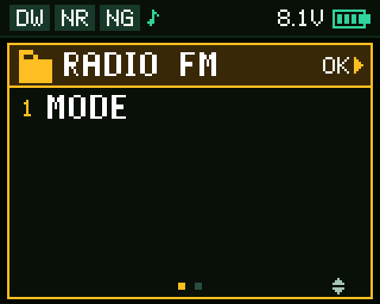 |
| **As pastas:** ▲▼ escolhem, os itens dela aparecem embaixo, e os pontinhos mostram qual das 17 está escolhida | **Dentro da pasta:** o item do cursor num cartão e o valor dele embaixo, em verde; quando a lista não cabe, as setas e a barra mostram que tem mais | **O menu do rádio** (FM, AM e SSB) na mesma janela, em duas pastas: os ajustes da banda e a CH MEMORY ([veja abaixo](#-o-rádio-de-am-fm-e-ssb-na-v42t)) |

- **OK** abre a pasta e, nela, **OK** já abre o item para mudar o valor, sem um segundo OK. Gravando
  ou cancelando, volta para a pasta, no mesmo item. **EXIT** volta para as pastas, e de novo sai do
  menu. Cada OK que grava um valor já o guarda no chip: desligar com o menu aberto não perde nada.
- **O número digitado** vai direto: `3` escolhe a pasta 3 e, dentro dela, `2` vai ao item `3-2`.
- **ACTIVE** e **CHANNELS**, na pasta BANKS, são de marcar vários: cada OK grava na hora e a lista
  fica, e o EXIT volta.
- **VERSION** abre só para leitura, e sai pelo EXIT.
- **A letra do menu** ficou um pouco maior e mais espaçada, e o menu reabre na última pasta usada.

| Pasta | Itens |
|---|---|
| 1 APRS (SMS) | CALLSIGN, DECODE, MESSAGES, PATH, SSID, TO |
| 2 AUDIO | DE-EMPHASIS, EQ BASS, EQ TREBLE, EXPANDER, NOISE GATE, SQUELCH, TAIL CUT |
| 3 BANKS | ACTIVE, CHANNELS, NAME |
| 4 CALIBRATION | CRYSTAL FINE, LIGHT PWM, MODEM GAIN, RX GAIN |
| 5 CH MEMORY | CH NAME, DELETE, SAVE |
| 6 CHANNEL | BANDWIDTH, BUSY LOCK, ENCRYPT, RX MODULATION, SCRAMBLE, STEP, TX POWER |
| 7 DISPLAY | BACKLIGHT TIME, BRIGHTNESS, MENU EXIT TIME, POWER-ON MSG, SHOW A, SHOW B, SHOW C |
| 8 DTMF | DTMF CODE, DTMF DELAY, DTMF GROUP, DTMF SIDETONE |
| 9 KEYS | AUTOLOCK, KEY BEEP, PF2, PF2 LONG, PF3, PF3 LONG |
| 10 MIC | COMPRESSOR, EQ BASS, EQ TREBLE, MIC AGC, MIC GAIN, NOISE REDUCTION |
| 11 MORSE | MESSAGES, SPEED, TONE |
| 12 REPEATER | OFFSET, RPT TAIL CUT, RPT TAIL DELAY, TONE BURST, TX SHIFT |
| 13 SCAN | SCAN ADD, SCAN RESUME, THRESHOLD |
| 14 SYSTEM | ALARM MODE, BATTERY SAVE, BLUETOOTH, RESET, VERSION |
| 15 TONES | RX CTCSS, RX DCS, TX CTCSS, TX DCS |
| 16 TX | ROGER, TX TIMEOUT, VOX, VOX DELAY |
| 17 WATCH | TRIPLE WATCH, TX SIDE, WATCH |

### 🆕 O que a V3.0T trouxe ao menu

| | | |
|:---:|:---:|:---:|
| 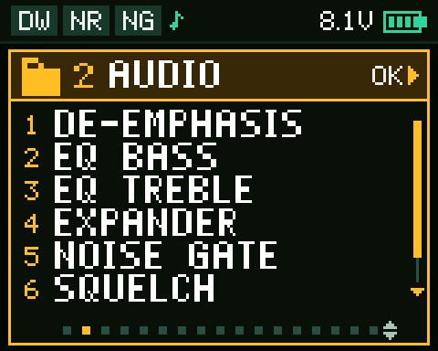 | 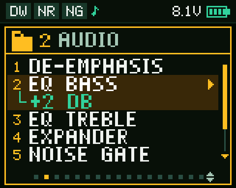 | 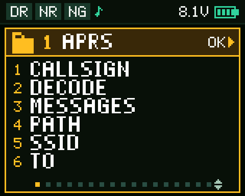 |
| **A pasta AUDIO:** o EQ, o EXPANDER, a NOISE GATE e a DE-EMPHASIS da recepção, com o SQUELCH e o TAIL CUT | **O EQ BASS aberto,** em +2 dB: os graves de −3 a +4 dB; os agudos, de −1 a +4 dB | **A pasta APRS (SMS)** (desde a V3.2T; o nome é da V3.6T): o indicativo, o DECODE, a tela MESSAGES, o PATH, o SSID e o destinatário (TO) |

- **EQ BASS e EQ TREBLE:** na AUDIO valem para o que se ouve, na MIC para o que se transmite. DEFAULT é o de
  fábrica, que já corta 1 dB dos graves na recepção e um pouco dos agudos na transmissão.
- **EXPANDER:** o gêmeo do compressor, no áudio recebido: abaixo de um nível, cada dB a menos vira 2, 3 ou 4
  (LOW, MID, HIGH). Desfaz a compressão de quem transmite com compander e cala o chiado nas pausas.
- **NOISE GATE:** corta o áudio abaixo de um nível (OFF, LOW, DEFAULT, MID, HIGH, do que menos corta ao que
  mais corta). DEFAULT é o de fábrica.
- **DE-EMPHASIS:** ON é o de fábrica; OFF deixa o áudio de FM bem mais agudo.
- **MORSE:** o MESSAGES lê o Morse que chega, e o `#` dele abre a caixa da mensagem (até 37 caracteres). O SPEED vai de 5 a
  40 wpm, e o TONE, de 400 a 1200 Hz ([veja abaixo](#-a-tela-messages-do-morse-na-v37t)).
- **CALIBRATION:** o LIGHT PWM (a frequência do PWM que escurece a luz, para fugir da interferência), o
  MODEM GAIN (o ganho do modem que a tela MESSAGES usa) e, desde a V3.2T, o RX GAIN (o ganho do receptor).

### 📨 A tela MESSAGES do APRS na V3.2T

Na pasta APRS (SMS), o **MESSAGES** abre a tela em que as mensagens chegam e de onde saem.

| | |
|:---:|:---:|
| 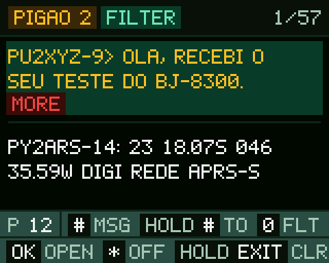 | 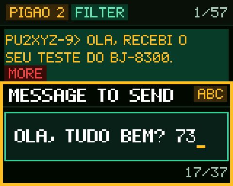 |
| **A tela MESSAGES:** a mensagem recebida num cartão, com o MORE embaixo quando não cabe (o OK a abre inteira), o histórico embaixo e, no rodapé, o P (o total de syncs) e as teclas | **O #** abre por cima a caixa **MESSAGE TO SEND**, com a última mensagem e até 37 caracteres; a primeira tecla troca tudo. O OK manda a mensagem ao TO (vazio, como status), e a tela volta sozinha depois da transmissão |
| 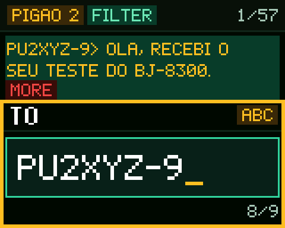 | 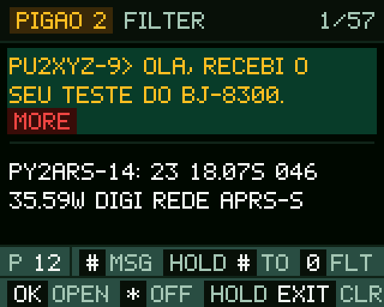 |
| **O # segurado** (0,6 s) abre a caixa **TO**, com o destinatário gravado. O OK grava, em branco inclusive, e volta | **A tecla 0** desliga o FILTER, que a tela liga ao abrir (FM, o filtro largo, os graves em −3 dB, os agudos em +4 dB e o SAVE desligado): o rádio fica como o menu o deixa e o P recomeça, para comparar |

- **A volta.** O rádio só transmite com o menu fechado. Depois do envio, e do ack automático do que chega para o
  seu indicativo, o firmware reabre a tela MESSAGES sozinho, sem bipe, e o FILTER fica como estava. Uma tecla ou
  o PTT nesse meio interrompem a volta.
- **Na caixa**, o EXIT com ela vazia, ou segurado, cancela e volta para a tela. Cada mensagem leva um número
  novo. Enquanto se digita, a recepção do APRS fica parada.
- **O som.** A tela é calada, com ou sem sinal; com o SQUELCH em OFF, ouve-se tudo. Enquanto o envio vai ao ar, ela mostra só
  **SENDING**.

### 📻 A tela MESSAGES do Morse na V3.7T

Na pasta MORSE, o **MESSAGES** abre a mesma tela do APRS, sem o FILTER e o P: o Morse que chega vira texto, e as mensagens ficam guardadas.

| | |
|:---:|:---:|
| 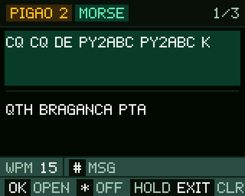 | 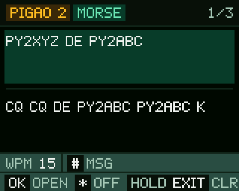 |
| **A tela MESSAGES:** a última mensagem num cartão, o histórico embaixo e, no rodapé, a velocidade lida (WPM) e as teclas | **Chegando:** o texto entra no cartão palavra por palavra, e a mensagem anterior desce para o histórico |
| 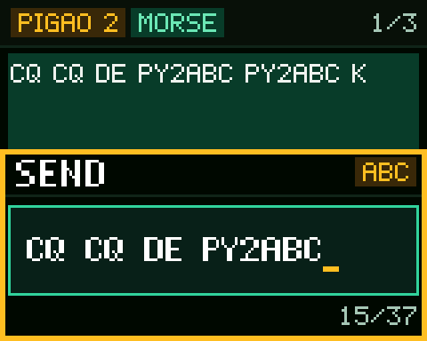 |  |
| **O #** abre a caixa **SEND**, com a última mensagem e até 37 caracteres. A primeira tecla troca tudo, e o OK envia | **SENDING:** enquanto o Morse ou o APRS vão ao ar, a tela mostra só a palavra |

- **O envio.** 0,5 s de portadora muda, para o squelch de quem recebe abrir, o KA, o texto e o AR.
- **A leitura** sai do nível do sinal no chip de rádio, porque o áudio recebido não chega ao processador. No ar, o BJ lê até
  **15 wpm**, e o melhor tom é **700 Hz**. O Baofeng UV-17L, com a mesma tela, lê até 20 wpm.
- **O som.** A tela é calada, com ou sem sinal; com o SQUELCH em OFF, ouve-se tudo.

### 💾 O CH MEMORY e os BANKS na V3.6T

Os dois menus saem do mesmo molde, igual ao do Baofeng UV-17L: listas só com o que serve, confirmação e avisos no lugar de
lista vazia.

| | |
|:---:|:---:|
| 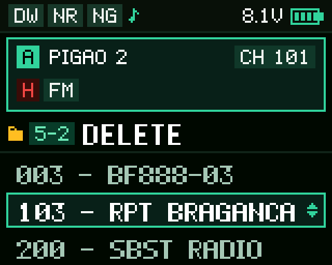 | 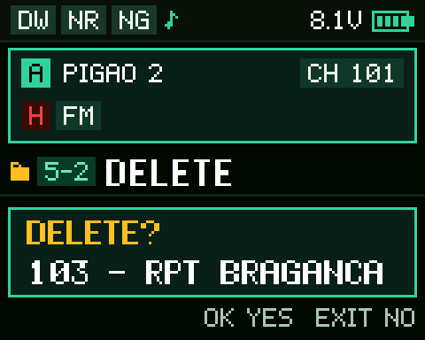 |
| **As listas do CH MEMORY:** o DELETE e o CH NAME mostram só os canais salvos, e o SAVE só os números livres, com o canal em uso ou o mais perto no meio | **O DELETE pergunta:** o OK apaga e a lista segue no mais perto, para apagar vários; o EXIT desiste |
| 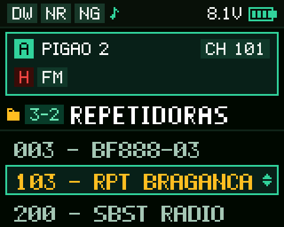 | 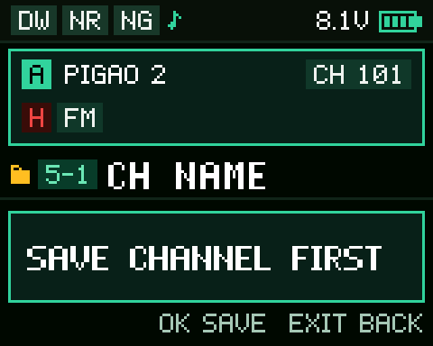 |
| **CHANNELS, nos BANKS:** depois de escolher o banco, só os canais salvos, com os do banco em âmbar e o nome dele no título | **Os avisos:** em VFO, o CH NAME e o SCAN ADD mostram `SAVE CHANNEL FIRST`, e o OK leva ao SAVE |

- **Cancelar não salva.** O SAVE e o CH NAME só gravam no OK do editor. O EXIT com a caixa vazia, ou segurado, volta à lista
  sem gravar, e o OK em branco grava `CH 101`.
- **Sem lista vazia.** No lugar dela aparece `NO SAVED CHANNELS`, `MEMORY FULL` ou `BANK EMPTY`.
- **Os modos.** Em canal, o TX SHIFT e o OFFSET abrem com `VFO ONLY`, e na pasta, embaixo do item, aparece `VFO` ou `CHANNEL`.
- **O 3 segurado** abre o mesmo SAVE, e o número digitado vai ao canal mais perto da lista.

### 📻 O rádio de AM, FM e SSB na V4.2T

O rádio de AM, FM e SSB (LSB, USB e CW) tem dois modos, como o VFO e os canais do rádio amador: o **modo frequência**,
que sintoniza qualquer frequência, e o **modo memória**, que anda só pelas estações salvas. São 15 memórias por banda,
cada uma com nome: as do FM, as do AM e as do SSB, que o LSB, o USB e o CW dividem.

| | |
|:---:|:---:|
| 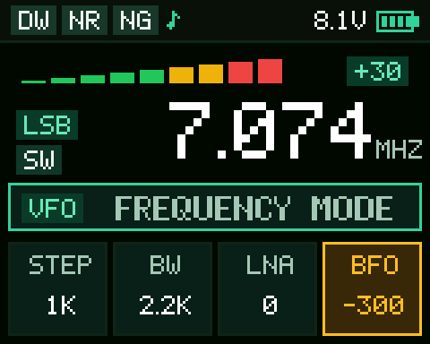 | 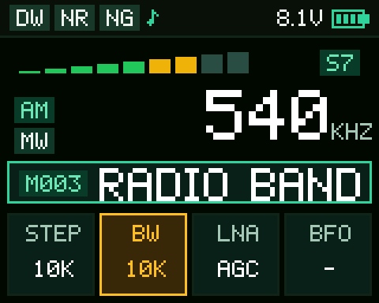 |
| **Modo frequência:** a etiqueta `VFO` e `FREQUENCY MODE` no cartão embaixo da frequência | **Modo memória:** o número da memória (`M003`) numa etiqueta e o nome dela; sem nome, `NO NAME` |
|  | 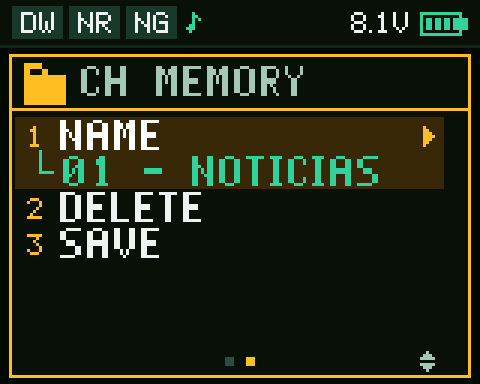 |
| **O menu em duas pastas:** a dos ajustes, com o nome da banda de agora (`RADIO FM`, `AM`, `LSB`, `USB` ou `CW`), e a `CH MEMORY`; os dois pontos embaixo mostram qual está escolhida | **CH MEMORY:** NAME, DELETE e SAVE. Com o cursor no NAME, o nome da memória em uso aparece embaixo, sem abrir |

- **Trocar de modo:** na tela do rádio, segure o **MENU**, o mesmo gesto do VFO/MR da tela principal. Ele só passa ao
  modo memória se a banda tiver alguma salva. No modo memória, ▲▼ andam só pelas salvas, e o MENU segurado de novo
  volta à frequência.
- **O menu:** o MENU, num toque curto, abre as duas pastas. ▲▼ escolhem, o OK entra, e o EXIT volta às pastas e, delas,
  ao rádio.

| Pasta | Itens |
|---|---|
| RADIO FM | MODE |
| RADIO AM | MODE, BAND, STEP, LNA |
| RADIO LSB, USB e CW | MODE, STEP, BW, LNA, BFO |
| CH MEMORY | NAME, DELETE, SAVE |

- **SAVE:** a lista mostra só as memórias livres da banda. O OK numa delas abre o editor do nome, e o OK do editor
  guarda ali a frequência de agora (no SSB, também a largura e o BFO) com o nome; sem nome, ela fica com `NO NAME`.
  Cancelar não grava, e com as 15 usadas aparece `MEMORY FULL`.
- **DELETE:** a lista mostra as salvas, e o rádio pergunta antes de apagar; a memória apagada volta a ficar livre.
- **NAME:** troca o nome de uma memória salva, no mesmo editor dos canais (até 12 letras).
- **Sem memória salva na banda,** o NAME e o DELETE mostram `NO SAVED MEMORIES`.
- **No PC,** o Tempra Link e o driver do CHIRP leem e gravam as memórias e os nomes.

## 🔺 TRIPLE: o BJ-8300 escutando três frequências

O firmware de fábrica só tem dois lados, A e B, e a dupla escuta (TDR) vigia os dois. Desde a V2.6T, ele tem um
**terceiro lado, a C**, e o rádio passa a vigiar **três frequências** ao mesmo tempo. Nenhum
firmware do BJ-8300 fazia isso.

| | |
|:---:|:---:|
| 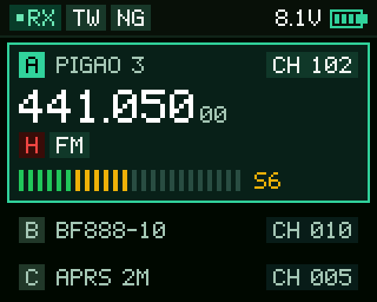 | 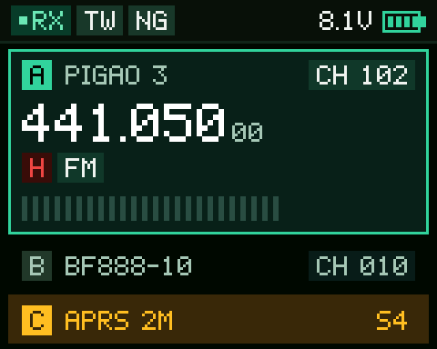 |
| **O A em evidência, recebendo.** O B e a C ficam em faixas embaixo, cada uma com a letra, o nome e o canal | **A escuta parou na C**: a faixa dela fica em âmbar enquanto recebe, com o S no lugar do canal |
| 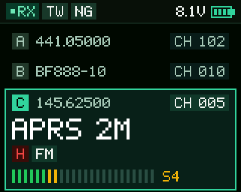 | 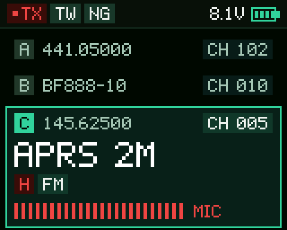 |
| **A C em evidência** (tecla A/B): ela ganha o cartão, transmite e muda de canal como o A e o B | **Transmitindo na C** com o `TX SIDE` em C: ela fica em evidência enquanto o PTT está apertado, com a barra do microfone, e volta ao soltar |

- **O menu `WATCH`** escolhe quantas frequências a tela principal mostra: **SINGLE** (só o lado A,
  em tela cheia: a tecla A/B não troca), **DUAL** (o A/B de sempre) ou **TRIPLE**.
- **A escuta (`TRIPLE WATCH`, o antigo TDR)** passa pelas três, A → B → C → A, com o mesmo tempo em
  cada uma. Desligada, só a que está em evidência recebe. Ligada, a barra de cima mostra **DW** com dois
  lados e **TW** com três.
- **A tecla A/B** vai de A para B, de B para C e de C para A. Com a C em evidência, tudo vale para
  ela: transmitir, setas, digitação, VFO/MR, STEP, potência, tons.
- **A C é um lado completo**, em VFO ou em canal, com as mesmas opções do A e do B. O canal dela se
  escolhe com ela em evidência (tecla A/B), como nos outros lados, e o que a faixa mostra (nome,
  frequência ou canal) é o `SHOW C`.
- **O `TX SIDE`** (o TX-A/B de fábrica, com o C) escolhe em que lado o PTT transmite com a escuta
  ligada. Em C, a C fica em evidência enquanto o PTT está apertado, como o A e o B ficam, mesmo
  estando fora dos dois lados; ao soltar, tudo volta como estava.
- **No CHIRP**, tudo isso fica em **Settings → VFO A/B/C Channel**.

## 📺 A cara nova

| | |
|:---:|:---:|
| 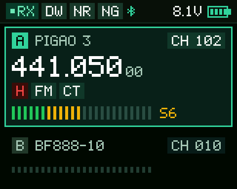 | 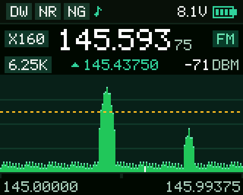 |
| **Tela principal:** os dois lados, com o A em evidência recebendo em S6 na barra S; na barra de cima só o que está ligado (RX, dupla escuta, redução de ruído, porta de ruído, Bluetooth) | **Espectro:** a frequência que roda, o pico da passada em verde com o dBm, as barras com a coluna medida em branco e a linha do limite em âmbar |
|  | 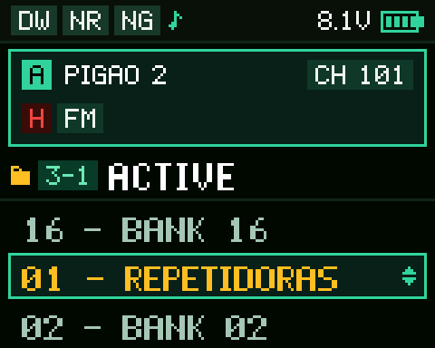 |
| **Rádio** em LSB, mudando o BFO: medidor S, a banda, a frequência grande, a etiqueta `VFO` do modo frequência e os ajustes em cartões | **Item aberto (BANKS → ACTIVE):** o lado em evidência resumido em cima, a pasta e o número `3-1`, e os bancos ligados em âmbar |

As imagens saem da prévia no PC ([firmware/previa/](../../firmware/previa/)), que roda o mesmo código de
desenho que vai para o rádio.

## ✨ O que mudou da V0.12 de fábrica para a V4.2T

### 🆕 Recursos novos

| Recurso | &#8199;&#8199;&#8199;&#8199;&#8199;&#8199;&#8199;&#8199;&#8199;&#8199;&#8199;&#8199;&#8199;&#8199;&#8199;&#8199;&#8199;Tela&#8199;&#8199;&#8199;&#8199;&#8199;&#8199;&#8199;&#8199;&#8199;&#8199;&#8199;&#8199;&#8199;&#8199;&#8199;&#8199;&#8199; |
|---|:---:|
| 📁 **Menu em pastas**<ul><li>Os itens do menu ficam em **17 pastas** por assunto, em ordem alfabética, numa janela âmbar.</li><li>A janela mostra os itens de cada pasta e, dentro dela, o valor do item do cursor, com rolagem quando a lista não cabe.</li><li>**OK** no item já abre a edição, e gravar ou cancelar volta para a pasta.</li><li>O menu do rádio (FM/AM/SSB) usa a mesma janela, em duas pastas ([veja acima](#-o-rádio-de-am-fm-e-ssb-na-v42t)).</li></ul> |  |
| 📨 **APRS**<ul><li>Pasta nova **APRS (SMS)**: CALLSIGN, SSID, PATH (WIDE1-1, WIDE1-1,WIDE2-1 ou nenhum), TO, DECODE e a tela **MESSAGES**, onde as mensagens chegam e de onde saem ([veja acima](#-a-tela-messages-do-aprs-na-v32t)).</li><li>**Envio:** o **#** abre a caixa da mensagem (até 37 caracteres), com a última, e o OK a manda ao TO (vazio, um status) em AX.25. O **# segurado** abre a caixa do TO. Depois do envio, a tela volta sozinha.</li><li>Sem **CALLSIGN** gravado, o **#** pede o indicativo antes, e nada vai ao ar sem pacote.</li><li>O AFSK de 1200 bps é gerado no rádio e posto na entrada do microfone, como um TNC de placa de som: o APRSdroid e os TNCs leem.</li><li>**FILTER:** a tela abre com FM, o filtro largo, sem scramble nem compressor, os graves em −3 dB, os agudos em +4 dB e o SAVE desligado. A tecla 0 o desliga para comparar, e tudo volta ao do menu ao sair.</li><li>**Recepção:** a mensagem, a posição, o tempo, os objetos e o Mic-E decodificados (ou como vieram, com o DECODE em OFF), o ack do que chega para o seu indicativo, o histórico e a conta dos syncs (P).</li><li>A recepção usa o modem do chip de rádio, que só acerta o pacote que chega sem erro: pega menos que um TNC.</li></ul> |  |
| 📻 **Morse**<ul><li>Pasta nova **MORSE**: **MESSAGES**, SPEED (5 a 40 wpm) e TONE (400 a 1200 Hz).</li><li>Sai em FM pelo gerador de tom, como o roger; o PTT ou qualquer tecla param no meio.</li><li>O editor de texto das mensagens vai a 37 caracteres, em duas linhas quando não cabe numa.</li></ul> | 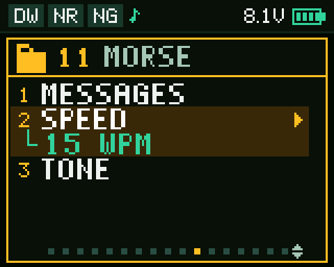 |
| 📻 **Tela MESSAGES do Morse**<ul><li>O **MESSAGES** lê o Morse que chega, palavra por palavra, e guarda as mensagens, como o do APRS ([veja acima](#-a-tela-messages-do-morse-na-v37t)).</li><li>O **#** abre a caixa da mensagem, com o último texto, e a primeira tecla troca tudo, como na caixa do APRS.</li><li>O envio leva 0,5 s de portadora muda, para o squelch de quem recebe abrir, e o KA no começo e o AR no fim. Enquanto vai ao ar, a tela mostra só **SENDING**, no Morse e no APRS.</li><li>As duas telas MESSAGES são caladas, com ou sem sinal; com o SQUELCH em OFF, ouve-se tudo.</li><li>No ar, lê até 15 wpm, e o melhor tom é 700 Hz.</li></ul> |  |
| 🔦 **PF3 LONG e lanterna de tela**<ul><li>Item novo na pasta KEYS: o que a PF3 segurada faz, **MONITOR** (o padrão) ou **FLASHLIGHT**.</li><li>**MONITOR** abre o squelch do lado em evidência, com a barra S lendo o sinal.</li><li>**FLASHLIGHT**: 1 s de PF3 na tela principal deixa a tela toda branca, no brilho máximo, sem apagar por tempo.</li><li>Só a PF3 e o EXIT saem, e o brilho volta ao que estava. As outras teclas não fazem nada, e o PTT transmite sem apagá-la.</li></ul> | 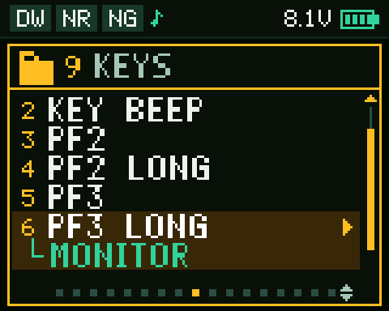 |
| 📤 **Tela SENDING**<ul><li>Enquanto o Morse ou o APRS vão ao ar, a tela mostra só a palavra.</li><li>O ack automático não a mostra.</li></ul> |  |
| 🎚️ **EQ**<ul><li>**EQ BASS** e **EQ TREBLE** na pasta AUDIO (o que se ouve) e na MIC (o que se transmite).</li><li>Graves de −3 a +4 dB e agudos de −1 a +4 dB, pelo equalizador do próprio chip de rádio.</li><li>DEFAULT é o de fábrica. O CHIRP também os ajusta.</li></ul> |  |
| 📶 **Barra S**<ul><li>O medidor de cada lado virou uma barra S de **24 segmentos**: 2 por S do S1 ao S9 e 1 por 10 dB acima, até S9+60.</li><li>O S escrito ao lado: verde até o S3, amarelo até o S8 e vermelho do S9 para cima.</li><li>O S1 começa no chiado de cada faixa, pela calibração de fábrica, e a leitura é 4 vezes por segundo.</li><li>No SINGLE, no DUAL (também no lado compacto) e no TRIPLE (na faixa de quem recebe, no lugar do canal).</li><li>Transmitindo, mostra o nível do microfone, com MIC.</li></ul> | 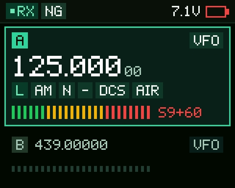 |
| 🔊 **Pasta AUDIO**<ul><li>**EXPANDER** (OFF, LOW, MID, HIGH): o expansor do áudio recebido, que o chip tem e a fábrica deixava desligado.</li><li>**NOISE GATE** (OFF, LOW, DEFAULT, MID, HIGH): corta o áudio abaixo de um nível; DEFAULT é o de fábrica.</li><li>**DE-EMPHASIS**: ON, a de fábrica, ou OFF.</li><li>Com o SQUELCH, o TAIL CUT e o EQ.</li></ul> |  |
| 🔺 **WATCH: SINGLE, DUAL e TRIPLE**<ul><li>Item novo do menu.</li><li>**SINGLE** mostra só o lado A, em tela cheia (a tecla A/B não troca): a frequência em tamanho grande, uma barra larga e, com deslocamento, a frequência de transmissão embaixo (a escuta fica desligada).</li><li>**DUAL** é o A/B de sempre.</li><li>**TRIPLE** põe um terceiro lado, a C, e a escuta passa pelas três ([veja acima](#-triple-o-bj-8300-escutando-três-frequências)).</li><li>Com a escuta ligada, o item **TRIPLE WATCH**, a barra de cima mostra **DW** com dois lados e **TW** com três.</li></ul> | 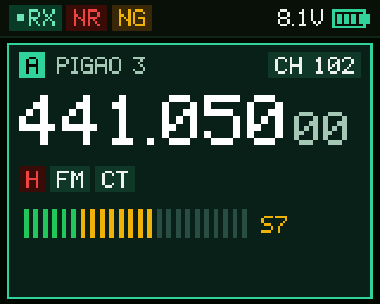 |
| 📡 **O lado C**<ul><li>Um lado completo, em VFO ou em canal, com as mesmas opções do A e do B.</li><li>A tecla A/B passa por A → B → C → A, e com a C em evidência ela transmite e muda como os outros, canal incluído.</li><li>Menu novo: `SHOW C` (como a faixa dela aparece: nome, frequência ou canal).</li></ul> |  |
| 📤 **TX SIDE**<ul><li>O `TX-A/B` de fábrica (em que lado o PTT transmite com a escuta ligada) vira `TX SIDE`: OFF, A, B e C.</li><li>No TRIPLE, em C, a C fica em evidência enquanto o PTT está apertado, como o A e o B ficam, mesmo estando fora dos dois lados.</li><li>Ao soltar, tudo volta como estava, sem gravar nada.</li></ul> | 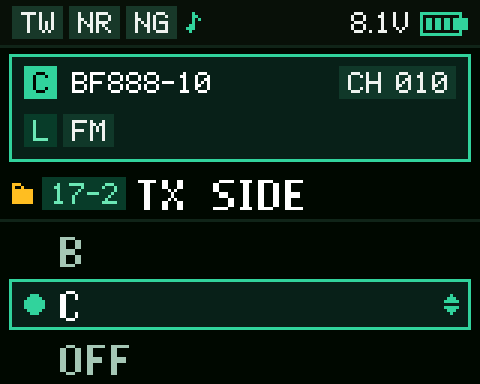 |
| 🎙️ **Pasta MIC**<ul><li>**MIC GAIN** com **HIGH** (31), **MID** (25), **LOW** (19) e **DEFAULT**, a calibração do próprio rádio, em ordem de valor entre eles.</li><li>**COMPRESSOR** do áudio de TX (OFF, LOW, MID e HIGH: 1,33:1, 2:1 e 4:1), que o chip tem e a fábrica deixava desligado.</li><li>**MIC AGC**: ON, o de fábrica, ou OFF.</li><li>**NOISE REDUCTION** com níveis: OFF, LOW, MID, DEFAULT e HIGH; DEFAULT é o ON de fábrica.</li><li>O EQ da transmissão.</li></ul> | 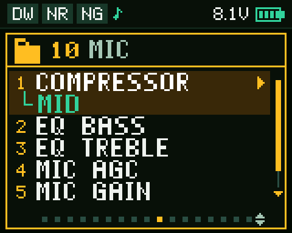 |
| 🎯 **Pasta CALIBRATION**<ul><li>**CRYSTAL FINE**: o ajuste fino do cristal, de −2000 a +2000 Hz em 435,5 MHz, de 10 em 10, proporcional à frequência e somado à calibração de fábrica.</li><li>**LIGHT PWM**: a frequência do PWM que escurece a luz (240 Hz a 25 kHz), para tirar a interferência de um receptor encostado.</li><li>**MODEM GAIN**: o ganho do modem que a tela MESSAGES usa.</li><li>**RX GAIN**: os cinco degraus do AGC do receptor, em **DEFAULT** (os de fábrica: −2, −17, −40, −57 e −71 dB, do sinal mais fraco para o mais forte) ou **MAX** (0, −6, −15, −30 e −50 dB), com mais ganho em cada degrau; o de cima já é o máximo do chip.</li></ul> | 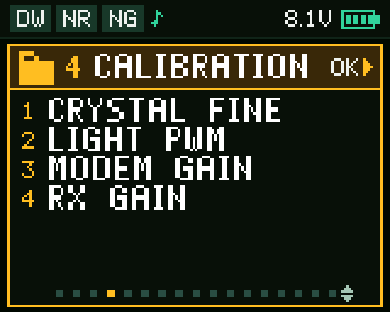 |
| 🔆 **BRIGHTNESS**<ul><li>Na pasta DISPLAY: a luz da tela em 100% (a de fábrica), 60%, 35%, 20% ou 10%, por PWM.</li><li>A 100% e com a luz apagada o pino fica como de fábrica, sem PWM.</li></ul> | 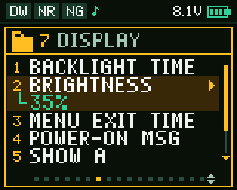 |
| 📡 **Quem recebe, com o menu aberto**<ul><li>Recebendo com o menu aberto, a barra de cima mostra, numa caixa âmbar, a letra do lado (A, B ou C) e o nome, a frequência ou o canal, como o MDF dele pede.</li><li>A caixa some quando o sinal acaba.</li></ul> | 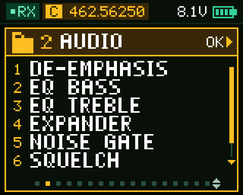 |
| 🏷️ **Etiqueta do tom de TX**<ul><li>Transmitindo, a etiqueta mostra o tom de TX em vermelho, CT ou DCS.</li><li>Sem tom de TX ela some, mesmo com tom no RX.</li></ul> | 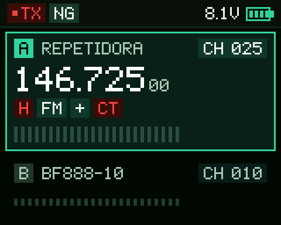 |
| ✈️ **Etiqueta AIR**<ul><li>De 108 a 135,99999 MHz, ao lado do AM.</li></ul> | 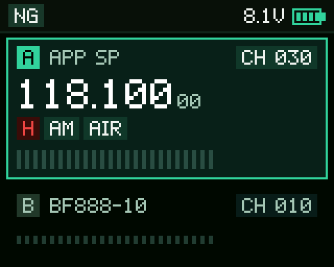 |
| 🎚️ **MIC GAIN com DEFAULT**<ul><li>O **DEFAULT** é a calibração de fábrica do próprio rádio.</li><li>Ele entra em ordem de valor entre os níveis, no rádio e no CHIRP: no rádio de teste, HIGH 31, DEFAULT 30, MID 25 e LOW 19.</li></ul> | 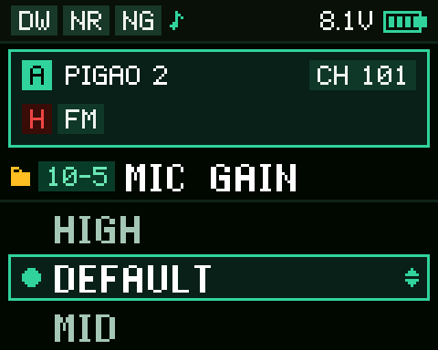 |
| 🆔 **CALLSIGN antes do envio**<ul><li>Sem indicativo gravado, o **#** da tela MESSAGES abre o CALLSIGN na mesma caixa.</li><li>Gravado, abre a caixa da mensagem.</li><li>Nada vai ao ar sem pacote.</li></ul> | 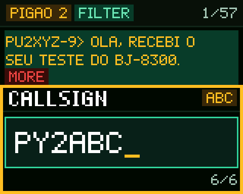 |
| 💾 **SAVE que já pede o nome**<ul><li>Depois de salvar em canal, o editor do nome abre vazio.</li><li>O lado fica no canal salvo, também vindo do VFO.</li></ul> | 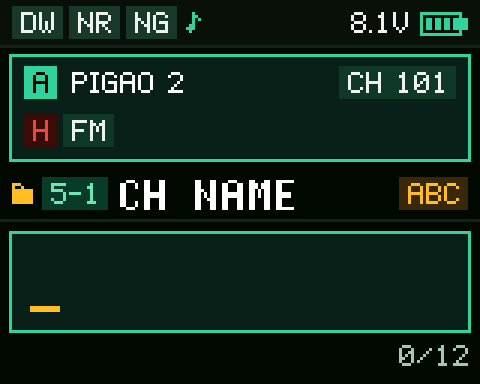 |
| 🔋 **Teto de 90% no PA**<ul><li>Nenhum bias do amplificador de potência passa de 229, 90% de 255, em todas as potências.</li><li>No rádio de teste só o H de VHF e de UHF mudam. É o teto da polarização, não de watts.</li></ul> | |
| 🚫 **NO TX**<ul><li>O canal gravado sem frequência de TX (como o CHIRP grava um canal só de escuta) mostra NO TX em vermelho.</li><li>No SINGLE, no lugar da linha de TX; no DUAL e no TRIPLE, nas etiquetas.</li></ul> | 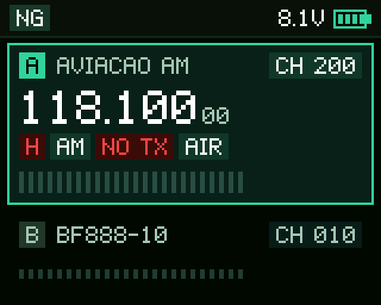 |
| ⌨️ **Editor de texto**<ul><li>No NAME dos BANKS, no CH NAME, na mensagem do Morse e nas caixas do APRS.</li><li>O **EXIT segurado** (0,6 s) sai sem gravar.</li><li>A **tecla 0** começa no espaço e traz `- / = + @ ( ) * #`, que nenhuma tecla alcançava, para o SSID e as mensagens.</li><li>As mensagens vão a 37 caracteres, em duas linhas.</li></ul> | 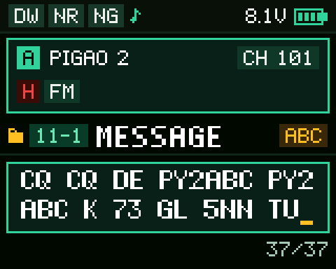 |
| 🖥️ **Tela nova em todo o rádio**<ul><li>Todas as telas foram redesenhadas ([veja acima](#-a-cara-nova)).</li><li>A principal: o lado em evidência num cartão com a frequência grande e a barra S, etiquetas coloridas de potência, modulação e tons, e a barra de cima só com o que está ligado.</li><li>Os menus e o editor de nome, o rádio FM/AM/SSB, o scan QT, o DTMF, o espectro e a tensão na partida.</li></ul> |  |
| 💾 **CH MEMORY**<ul><li>A pasta de salvar e nomear canais: **SAVE**, **DELETE** e **CH NAME**, com listas só do que serve ([veja acima](#-o-ch-memory-e-os-banks-na-v36t)).</li><li>O **DELETE** pergunta antes de apagar, e cancelar não salva.</li><li>No lugar de lista vazia, um aviso.</li></ul> |  |
| 📻 **Memórias do rádio de AM, FM e SSB**<ul><li>15 por banda, com nome, como os canais: **SAVE**, **DELETE** e **NAME** na pasta **CH MEMORY** do menu do rádio ([veja acima](#-o-rádio-de-am-fm-e-ssb-na-v42t)).</li><li>O menu do rádio em duas pastas: os ajustes da banda e a CH MEMORY.</li><li>Na tela, a etiqueta `VFO` com `FREQUENCY MODE` no modo frequência, e o número e o nome no modo memória. O **MENU segurado** troca um pelo outro.</li></ul> |  |
| ⚠️ **Avisos de modo**<ul><li>O TX SHIFT e o OFFSET em canal abrem com `VFO ONLY`.</li><li>O SCAN ADD e o CH NAME em VFO mostram `SAVE CHANNEL FIRST`, e o OK leva ao SAVE.</li><li>De fábrica, um dava só o bipe de erro e o outro não fazia nada.</li></ul> | 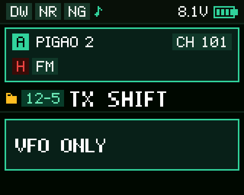 |
| 🗂️ **16 bancos de canais**<ul><li>Cada banco tem **nome de 12 caracteres**, e um canal pode estar em **quantos bancos quiser**.</li><li>Dá para ligar **vários bancos ao mesmo tempo**: o sobe/desce e a busca passam a ver só os canais dos bancos ligados.</li><li>Sem nenhum ligado, o rádio funciona como de fábrica.</li><li>Pasta nova **BANKS**, com `ACTIVE`, `CHANNELS` e `NAME` ([como usar](#usando-os-bancos-no-rádio)).</li></ul> |  |
| 🔐 **Scramble com 8 frequências**<ul><li>O `SCRAMBLE` passa de OFF/ON para **OFF e de 2700 a 3400 Hz, de 100 em 100**, em ordem crescente.</li><li>O **3400 Hz** é o ON de fábrica (fala com outros BJ-8300).</li><li>Os **modos 1, 2 e 3 do Baofeng UV-17L** caem, cada um, numa dessas frequências. Testado com os três modos.</li></ul> | 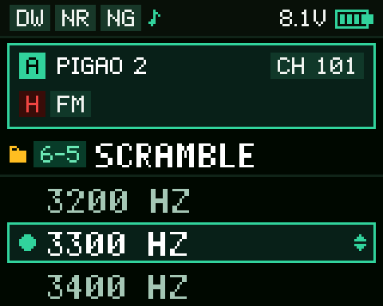 |
| 🔔 **Roger BEEP 2 e COIN**<ul><li>O `ROGER` ganha duas opções: OFF, BEEP 1 (o de fábrica), **BEEP 2**, **COIN** e TONE1200.</li><li>**BEEP 2**: quatro tons (1125, 1857, 1359 e 931 Hz), ~0,4 s no total.</li><li>**COIN**: a moeda.</li></ul> | 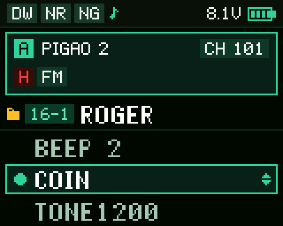 |
| 🎵 **ROGER CUSTOM**<ul><li>O `ROGER` ganha o **CUSTOM**: até 32 notas, de 300 a 3000 Hz, e até 3 s, compostas no Tempra Link (o piano, a linha do tempo e a importação de MIDI e de som).</li><li>As notas vão para o rádio pelo Tempra Link; o CHIRP só escolhe o CUSTOM.</li><li>Como o do Baofeng UV-17L.</li></ul> | 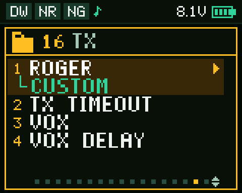 |
| 🔎 **Busca mais rápida e THRESHOLD**<ul><li>A busca (o SCAN, nos canais e no VFO) passa de 3 a 5 canais por segundo para **um canal a cada 60 ms**, como a do Baofeng UV-17L, e para no sinal com as mesmas confirmações de fábrica.</li><li>Na busca em canal, o número acompanha o canal visitado, e o `*` curto também para a busca, como o `#` curto.</li><li>**THRESHOLD** na pasta SCAN, de **S1 a S9**: na busca, o canal que abre o squelch abaixo do S escolhido é pulado. S1 é como de fábrica.</li></ul> | 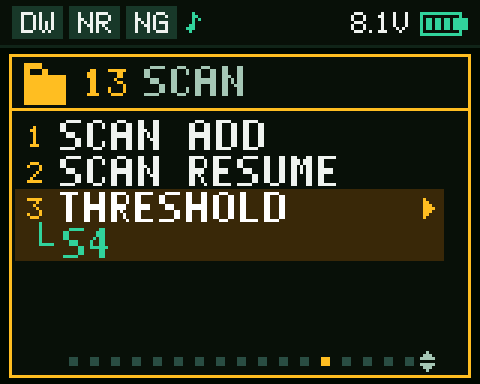 |
| 🕹️ **Controle remoto**<ul><li>Pelo cabo, o Tempra Link mostra a tela do rádio ao vivo, desenhada no PC com o mesmo código da tela do firmware, e manda as teclas, com o toque longo, e o PTT.</li><li>Pelo Bluetooth, as teclas, o PTT e o estado: quem recebe, a barra S e a tensão.</li><li>A tela do rádio pode ficar apagada com o remoto ligado, para poupar a bateria; uma tecla do rádio a acende.</li><li>Se o PC parar de mandar por 1 s, o rádio solta a tecla e o PTT sozinho ([o manual](tempra-link.md#10-controle-remoto)).</li></ul> | 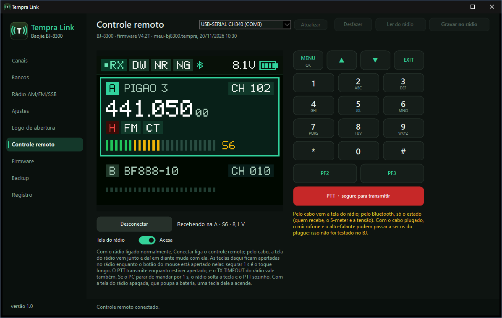 |
| 💻 **Tempra Link**<ul><li>O programa para Windows deste firmware, sem instalar nada.</li><li>Lê, edita e grava os 960 canais, os 16 bancos, as memórias do rádio de AM, FM e SSB, os ajustes do menu, os textos, o DTMF e o ROGER CUSTOM, e guarda um backup a cada leitura.</li><li>Grava o firmware pelo cabo, conferindo o arquivo antes, e baixa sozinho do GitHub a versão certa.</li><li>[O manual, com as telas](tempra-link.md).</li></ul> | 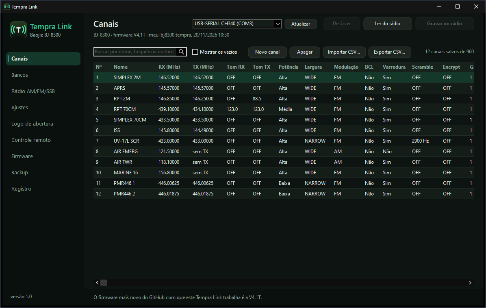 |
| 📊 **Espectro**<ul><li>**320 e 640 pontos** além dos 160 de fábrica, e **passo de 10 kHz**.</li><li>**Pico seguro**: a barra sobe na hora e desce aos poucos.</li><li>A coluna medida em branco, a frequência que roda no alto e a do pico de cada passada em verde, com o dBm.</li><li>A luz não apaga enquanto ele está na tela.</li></ul> |  |
| 🔌 **Driver do CHIRP próprio**<ul><li>Lê e grava os bancos (aba **Banks**), os nomes, o roger e o scramble novos, o WATCH, o VFO C, a pasta MIC, o CRYSTAL FINE, o BRIGHTNESS, o LIGHT PWM, o MODEM GAIN, a pasta AUDIO, o EQ, a pasta **APRS (SMS)**, a pasta **Morse**, o DECODE, o PF3 LONG, o THRESHOLD e o ROGER CUSTOM (as notas, só o Tempra Link grava).</li><li>Tudo numa sessão só pelo cabo; fica na lista do **Bajeton**.</li><li>Recusa gravar num rádio com o firmware de fábrica ou com um TEMPRA de outra versão ([como usar](chirp.md#-como-usar-o-chirp-com-este-firmware)).</li></ul> | |
| 🧰 **Comando estendido no cabo**<ul><li>Leitura do chip de dados inteiro (endereço de 24 bits).</li><li>Gravação só nas áreas do firmware novo: os bancos, o WATCH, o VFO C, o Morse, o APRS e o ROGER CUSTOM.</li><li>A leitura de `0x3F0000` responde a versão do firmware (`TEMPRA V4.2T`).</li><li>A serial a 460800 bauds.</li><li>É o que o Tempra Link e o driver do CHIRP usam.</li></ul> | |

### 🖥️ A tela nova, tela por tela

Desde a V2.0T, **todas** as telas do firmware de fábrica dão lugar a um tema escuro em verde, com
etiquetas coloridas e uma fonte própria:

| Tela | O que mudou |
|---|---|
| **Principal** (os dois lados) | O lado em evidência fica num **cartão de borda verde**, com o nome, o canal, a **frequência grande** (os dois últimos dígitos pequenos) e a **barra S** com o S escrito ao lado. O outro lado fica compacto, numa faixa fina, também com a barra e o S. Etiquetas coloridas: potência (**H** vermelho, **M** âmbar, **L** verde), FM/AM, tom (CT/DCS), banda estreita, deslocamento, scramble, zona e NO TX |
| **Principal em SINGLE** | Só o lado A, da barra ao pé da tela: a frequência ainda maior, as etiquetas, a barra S larga e, com deslocamento, a frequência de transmissão embaixo |
| **Principal em TRIPLE** | O lado em evidência no cartão e os outros dois em faixas, na ordem A, B, C, cada uma com a letra, o texto e o canal (ou `VFO`). A faixa que está recebendo fica em âmbar, com o S no lugar do canal ([veja acima](#-triple-o-bj-8300-escutando-três-frequências)) |
| **Barra de cima** | Mostra **só o que está ligado**: RX e TX numa etiqueta com bolinha (verde no RX, vermelha no TX), a escuta ligada (DW no DUAL, TW no TRIPLE), VOX, MO, a redução de ruído do microfone (NR) e a porta de ruído do RX (NG), na cor de sempre no DEFAULT e verde, amarela e vermelha no LOW, MID e HIGH, DTMF ST, Bluetooth e cadeado; a **tensão em volts** e a bateria, que fica com contorno vermelho e pisca quando está fraca. Com o menu aberto, recebendo, quem recebe numa caixa âmbar no lugar dos ícones |
| **Transmitindo** | A linha grande passa para a frequência de transmissão, e a barra mostra o **nível do microfone**, em vermelho, com MIC; a potência fica na etiqueta H/M/L |
| **Digitando** | A frequência entra no lugar dela, sobre a máscara `---.---`; o canal, na etiqueta do canal |
| **DTMF** (tecla `#`) | Uma caixa âmbar no lugar do cartão do lado em uso, com os dígitos |
| **Menus** | As pastas e os itens numa **janela âmbar** ([veja acima](#-menu-novo-tudo-em-pastas)). O item aberto: a pasta e o número (`12-2`) numa etiqueta verde e o título; três opções, a do cursor num cartão e o **valor gravado marcado com um ponto verde**; mudando o valor, o cartão ganha a borda verde e as setas, sem piscar. Em cima, o lado em evidência resumido. Tudo na letra do menu, um pouco maior que a média |
| **Editor de texto** (NAME dos BANKS, CH NAME, a mensagem do Morse e as caixas do APRS) | O texto num cartão, em tamanho grande quando cabe e em duas linhas nas mensagens, com o cursor âmbar, quantos caracteres de quantos e o modo (`ABC` ou `123`, trocado pelo `#`) numa etiqueta âmbar |
| **APRS MESSAGES** | O FILTER (apagado quando a tecla 0 o desliga) e a página no alto, a mensagem ou o pacote decodificado num cartão, com o MORE em vermelho embaixo quando não cabe, o histórico embaixo, e no rodapé o P (o total de syncs) e as teclas: `#` MSG, `#` segurado TO, `0` FLT (o FILTER), OK OPEN, `*` OFF (apaga a tela) e EXIT segurado CLR (limpa o histórico). As caixas do `#` abrem por cima da metade de baixo, numa borda âmbar, com o título (MESSAGE TO SEND ou TO), o modo (`ABC` ou `123`) e quantos caracteres de quantos, e a tela fica atrás delas |
| **Morse MESSAGES** | A mesma tela do APRS, sem o FILTER e o P: o texto chega no cartão, palavra por palavra, e o rodapé mostra a velocidade lida (WPM). O `#` abre a caixa **SEND** por cima |
| **SENDING** | Só a palavra em vermelho, no meio da tela, enquanto o Morse ou o APRS vão ao ar |
| **Bancos** (ACTIVE e CHANNELS, na pasta BANKS) | Os bancos ligados, e os canais do banco aberto, em **âmbar**, com o nome do banco no título |
| **Rádio FM/AM/SSB** | Medidor S de 9 degraus, a banda numa etiqueta, a **frequência grande** com a unidade, um cartão com o número e o nome da memória (sem nome, `NO NAME`, no lugar do `Unknow`) ou, no modo frequência, a etiqueta `VFO` e `FREQUENCY MODE`, e **STEP, BW, LNA e BFO em quatro cartões**, o que está sendo mudado em âmbar. O `SEEK...` e a espera da partida (`RADIO STARTING...`) também no tema novo, e o menu dele em duas pastas, na janela do menu |
| **Espectro** | A frequência que roda em tamanho grande, pontos e passo em etiquetas, o **pico da passada em verde** com o dBm, o gráfico num painel com grade, a coluna medida em branco, a **linha do limite tracejada em âmbar** e as pontas da janela embaixo |
| **Scan QT** (EXIT segurado) | O título, o que ele procura (CTCSS / DCS) e o estado, RUNNING num cartão verde ou STOP em âmbar |
| **Tensão** | Na partida (com a mensagem de partida em tensão) e segurando o `0` na tela inicial, a tensão aparece num cartão, em volts |

### ⚡ Melhorias

| O que | Detalhe |
|---|---|
| 💾 **Todo ajuste grava no OK** | A fábrica só gravava os ajustes ao fechar o menu. Agora cada OK que confirma um valor já o guarda no chip, e desligar com o menu aberto não perde nada |
| 🚀 **Espectro duas vezes mais rápido** | 160 pontos em ≈ 2,5 s. Parado num sinal achado, a seta de baixo continua a varredura, e a de cima sobe a linha do limite; ao entrar no espectro, a linha volta ao padrão de fábrica |
| 🟩 **Lado em evidência destacado** | O lado ativo fica num cartão de borda verde, com a frequência grande e a barra S; o outro fica compacto |
| 📻 **Rádio FM/AM/SSB** | A troca de modulação ficou ~2,5 s mais rápida, e os ajustes salvos (passo, largura, LNA, BFO e as memórias) são conferidos ao entrar e a cada troca: valor fora dos limites dos menus volta ao padrão |
| ↕️ **Setas do menu invertidas** | A seta de cima passa a subir na lista, em vez de avançar o valor |
| 🔤 **Textos em inglês revisados** | 25 cadeias corrigidas e padronizadas (ex.: `VOICEPRI` → `ENCRYPT`), o `TDR` virou `TRIPLE WATCH`, porque com o TRIPLE a escuta é tripla, e o `TX-A/B` virou `TX SIDE`. O menu `VERSION` mostra `Firmware: V4.2T` |
| 🏷️ **Nomes claros no menu** | Os nomes curtos de fábrica viraram nomes que dizem o que o item faz, iguais aos do Baofeng UV-17L: `SQL` é `SQUELCH`, `STE` é `TAIL CUT`, `BCL` é `BUSY LOCK`, `TXP` é `TX POWER`, `W/N` é `BANDWIDTH`, `TOT` é `TX TIMEOUT` e `MDF-A` é `SHOW A`, entre outros. A [tabela das pastas](#-menu-novo-tudo-em-pastas) traz todos, e a [seção 35](../engenharia-reversa.md#35-os-nomes-do-menu-desde-a-v141) lista o nome antigo de cada um |
| 📶 **Bluetooth no TX** | O de fábrica desliga o Bluetooth a cada PTT, e o celular perdia o controle remoto. Com uma ligação aberta, ele agora fica ligado; sem ligação, é como de fábrica |
| 🔌 **Cabo mais rápido** | A serial do cabo passa de 57600 a 460800 bauds. O Tempra Link e o driver do CHIRP descem sozinhos às velocidades de antes, para reconhecer os firmwares antigos |

### 🐞 Correções

| Problema da V0.12 | Na V4.2T |
|---|---|
| Os ajustes do menu só iam para o chip ao fechar o menu: desligado com ele aberto, o que mudou se perdia | Cada OK grava na hora |
| O medidor de sinal tinha 5 degraus e já enchia num sinal fraco (entre −117 e −96 dBm) | A barra S, do chiado (S1) a S9+60 |
| Com o menu aberto, ao receber, o lado em evidência aparecia por cima da janela no formato antigo (e a C saía como B) | Não aparece mais; a barra de cima mostra quem recebe |
| Durante o scan, a barra de sinal ficava congelada no último canal achado, e o número do canal descasava do nome | A tela acompanha cada canal da varredura |
| Na partida com a tensão, e segurando o `0`, o texto `   Voltage` tinha a tensão escrita por cima, e o "ge" sumia | `VOLTAGE` inteiro, com a tensão num cartão |
| Nome de canal gravado pelo CHIRP abria no editor com `?` no fim e `12/12`: o editor contava os bytes de preenchimento | O editor conta só as letras, como a tela já mostrava |
| No rádio, estação sem nome aparecia como `Unknow` | `NO NAME` na memória sem nome, e `VFO` com `FREQUENCY MODE` no modo frequência |
| O MO (PF3 segurada), com portadora no outro lado da escuta, abria aquele lado, e o medidor piscava cheio | Abre sempre o lado em evidência, e a barra S começa vazia e lê o sinal |

### ➖ Removido

| O que | Por quê |
|---|---|
| Itens de menu `ZONE` e `Zone Or Channel` | Os bancos fazem o papel das zonas, com mais liberdade. A função de zona continua no firmware, e o driver do CHIRP sempre grava **Full Channel**, para o rádio nunca ficar preso em modo zona |
| As vozes e o item `VOICE` | A pedido: o rádio deixa de falar os números e os modos, e o espaço delas guarda parte do código novo |
| O idioma chinês e o item `LANGUAGE` | A tela nova só tem letras latinas; o rádio fica sempre em inglês |
| O item `CH-C` | A C virou um lado completo: o canal dela se escolhe com a tecla A/B, como no A e no B. O CHIRP ainda o grava |
| As minúsculas (`abc`) no editor de nome | A fonte só tem maiúsculas: ficam `ABC` e `123` |

### 🔒 O que não muda

- **Canais, ajustes e calibração** ficam num chip à parte e **não são tocados** pela gravação do
  firmware.
- O **modo de gravação** (`UPDATE`) é lido antes de qualquer parte modificada, e o script de
  montagem recusa escrever nele.
- **Voltar ao de fábrica** é só gravar o [firmware original](../../firmware/original/), do mesmo jeito.

## Usando os bancos no rádio

No menu, a pasta **BANKS** tem três itens:

| Item | O que faz |
|---|---|
| **ACTIVE** | A lista dos 16 bancos, como `01 - REPETIDORAS`, com os ligados em âmbar. **O OK liga e desliga** na hora, e a lista fica, para mexer em vários. Banco sem canais não liga: aparece `BANK EMPTY`. Na pasta, embaixo do item, `2 ON` ou `ALL CHANNELS` |
| **CHANNELS** | Primeiro se escolhe o banco; depois vêm só os canais salvos, como `102 - PIGAO 3`, a partir do que está em uso, com os do banco em âmbar. **O OK põe e tira** na hora. O EXIT volta aos bancos, e de novo à pasta. Sem nenhum canal salvo, `NO SAVED CHANNELS` |
| **NAME** | A lista dos bancos abre o editor (12 caracteres), vazio se o banco não tem nome. O OK grava; em branco, o banco volta ao nome de fábrica, como `BANK 01`; cancelar não grava |

Detalhes de comportamento:

- Banco **sem nenhum canal gravado** não liga, e apagar o último canal à vista refaz o filtro: sem nada
  à vista, o rádio mostra todos.
- Marcar ou desmarcar canal **vale na hora**, sem reiniciar.
- Gravar bancos **pelo cabo** (CHIRP) exige desligar e ligar o rádio: o filtro é montado na partida.
- O estado dos bancos fica gravado no chip de dados e **sobrevive a desligar o rádio**.
- Regravar os canais pelo CHIRP ou pelo CPS **não apaga banco nenhum**: os bancos ficam no chip de
  dados (0xC1000 em diante), fora da área de canais.

Na tela inicial a aparência não muda: a numeração continua **absoluta, de 1 a 960** (o canal 500
continua sendo o 500, não "o 3º do banco") e o nome do banco ligado não aparece ali. O que muda é
só o que **o sobe/desce e a busca enxergam** — com banco ligado, eles pulam direto de um canal
marcado para o outro.
