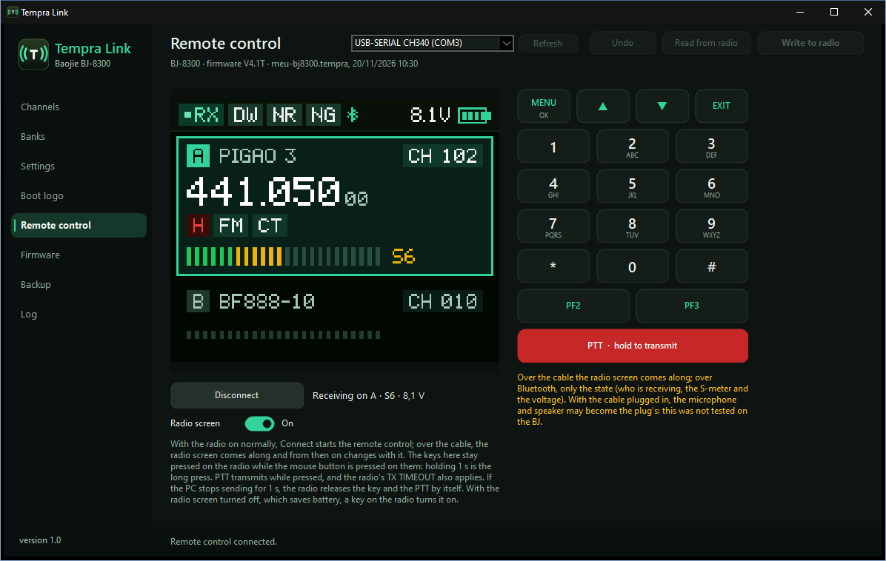
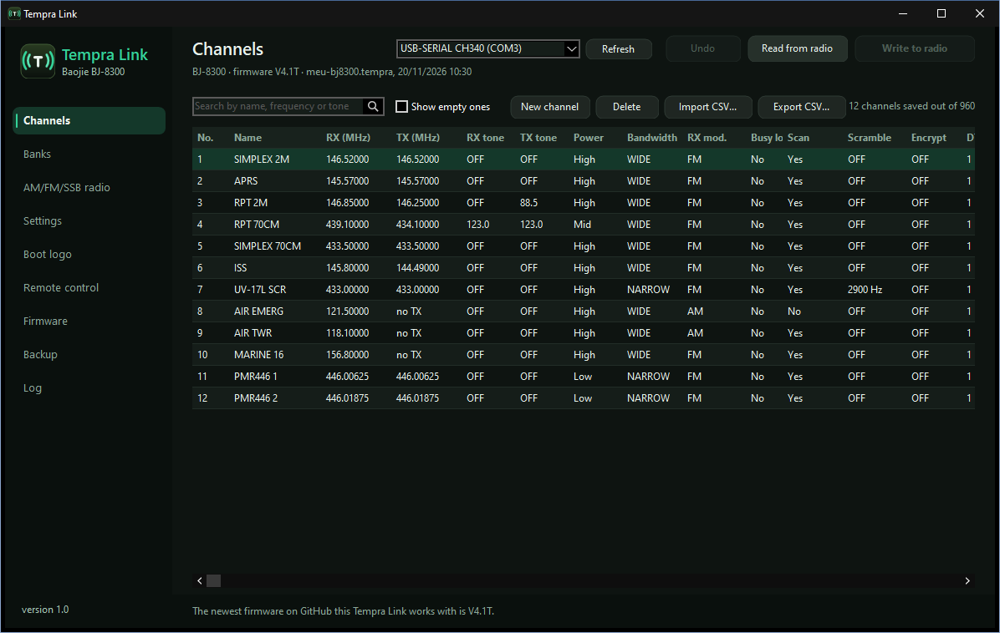
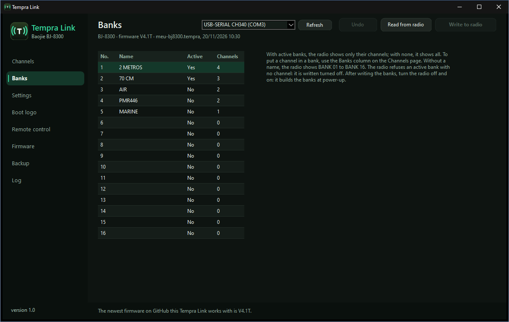
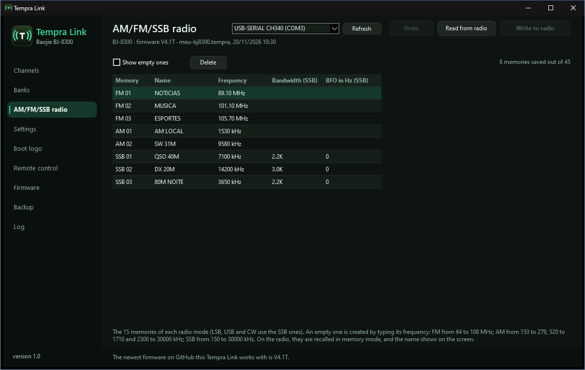
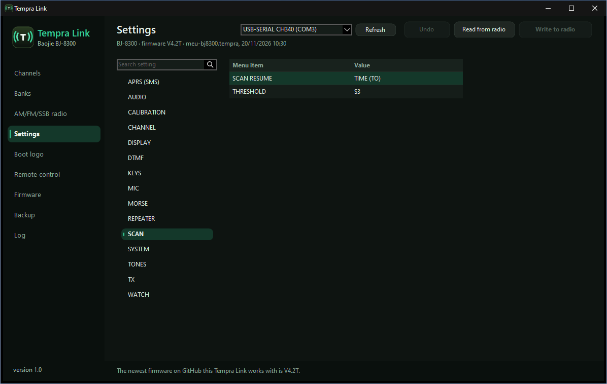
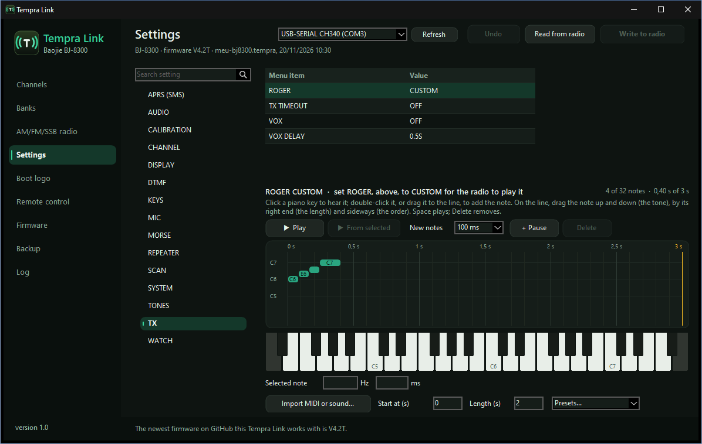
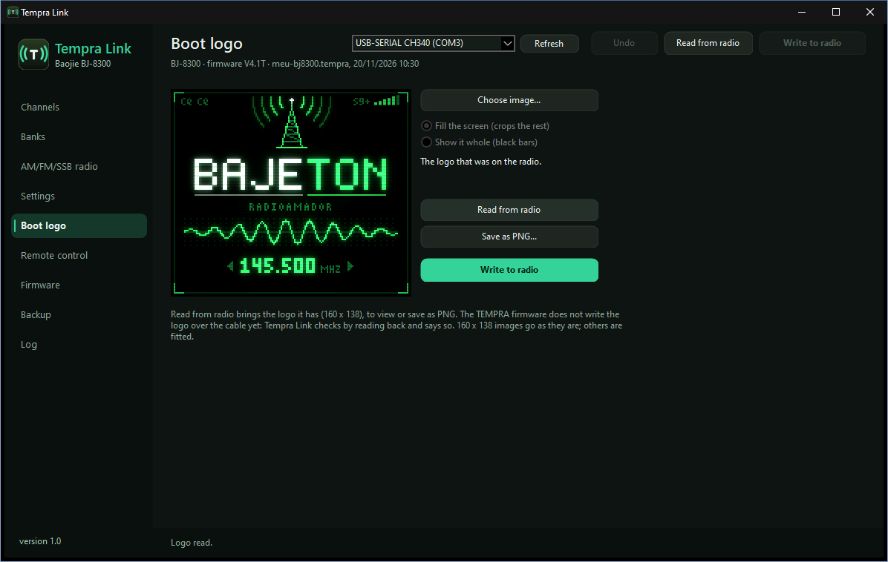
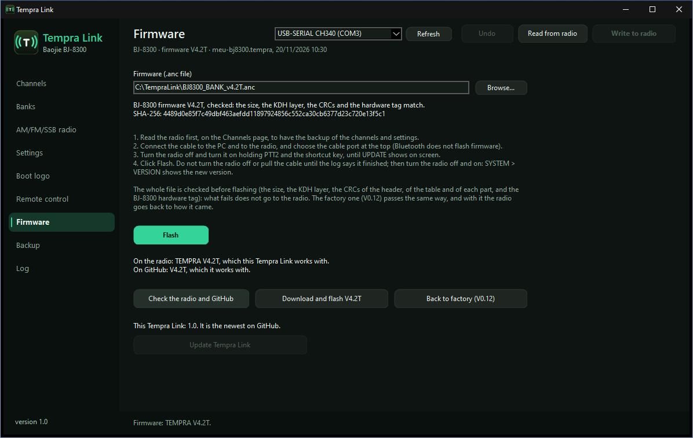
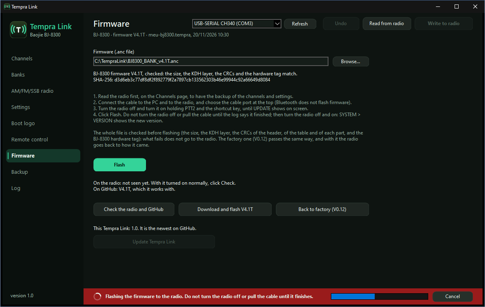
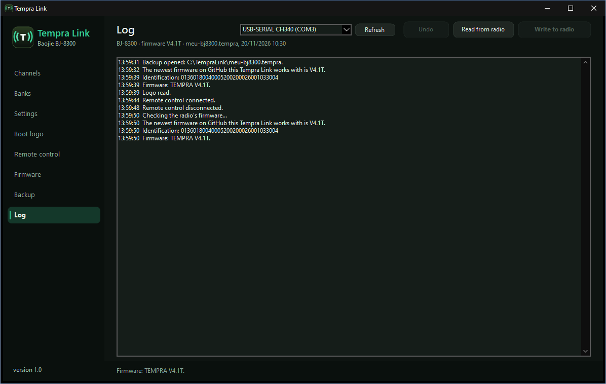

# Tempra Link for the BJ-8300: the manual

  

[📖 Wiki](README.en.md) · [🏠 Home page](../../README.en.md)

**Tempra Link** is the Windows program for the Bajeton BJ-8300 TEMPRA firmware. Over the programming cable, it reads,
edits and writes the radio's channels, banks, AM/FM/SSB radio memories and settings, keeps backups, works as a **remote control**, with the radio's
screen live on the PC, and **flashes the firmware itself**. It is a single `.exe`, with nothing to install.

## Contents

1. [Before you start](#1-before-you-start)
2. [The window](#2-the-window)
3. [Reading the radio and writing it back](#3-reading-the-radio-and-writing-it-back)
4. [Channels](#4-channels)
5. [Banks](#5-banks)
6. [AM/FM/SSB radio](#6-amfmssb-radio)
7. [Settings](#7-settings)
8. [ROGER CUSTOM](#8-roger-custom)
9. [Boot logo](#9-boot-logo)
10. [Remote control](#10-remote-control)
11. [Flashing the firmware](#11-flashing-the-firmware)
12. [Backup and log](#12-backup-and-log)
13. [Firmware versions](#13-firmware-versions)
14. [Bluetooth (experimental)](#14-bluetooth-experimental)
15. [Common problems](#15-common-problems)
16. [The phone app (Android)](#16-the-phone-app-android)

## 1. Before you start

- **The radio's firmware.** Tempra Link 1.0 works with TEMPRA firmware **V4.2T** (and with V3.8T, which only existed as
  a test build). With the factory firmware or an older TEMPRA, it reads and writes nothing, but it flashes the right
  firmware: see [Flashing the firmware](#11-flashing-the-firmware).
- **The cable** is the radio's USB programming cable, with the CH340 chip, the same one the factory CPS and CHIRP use. If
  Windows does not recognize it, install the driver from the release's `CH340-driver.zip` (see the
  [flashing page](gravar.en.md#-the-cable-and-the-driver)).
- **Download** `TempraLink-BJ8300_v1.0.exe` from the
  [V4.2T release page](https://github.com/tempraturbo/BajetonBJ8300/releases/latest) and put it in a folder of your
  own. It installs nothing: the backups go to the user's folder ([Backup and log](#12-backup-and-log)).
- **The first time,** Windows may warn that the program comes from an unknown publisher (SmartScreen), because the `.exe`
  is not signed: **More info** → **Run anyway**.
- **The language** follows Windows: Portuguese on a Portuguese Windows, English on the others.
- **The internet** is only used, on startup, to look on GitHub for the newest firmware and Tempra Link (no login).
  Without it, everything else works, and the firmware flashes from an `.anc` downloaded before.
- **Close CHIRP, the CPS and BinTalk** before using the cable: only one program at a time opens the port.

## 2. The window

- **At the top:** the cable **port** (`USB-SERIAL CH340 (COMx)`; the last item of the list looks for the radio over
  [Bluetooth](#14-bluetooth-experimental)), **Refresh** (the port list, after plugging the cable), **Undo** (also
  Ctrl+Z), **Read from radio** and **Write to radio**.
- **Below the title:** the radio, the firmware version and where the memory on screen came from (the reading, with its
  time, or the open backup). In amber, how many changes have not gone to the radio yet.
- **On the left,** the pages.
- **At the bottom,** the last message; all of them stay on the **Log** page. While the firmware flashes, this bar turns
  red, with a spinning wheel ([Flashing the firmware](#11-flashing-the-firmware)).

## 3. Reading the radio and writing it back

1. Turn the radio on normally (not in UPDATE mode) and plug the cable into it and into the PC.
2. Choose the cable port at the top (**Refresh**, if it does not show).
3. **Read from radio.** The channels, banks, AM/FM/SSB radio memories, settings, APRS and Morse texts, DTMF, VFOs and the ROGER CUSTOM notes come
   in, and each reading keeps a backup by itself.
4. Change what you like on the pages. **Undo** goes back one change at a time.
5. **Write to radio.** Only what changed goes: from the stock areas, the whole 4 KB sector where something changed,
   as CHIRP writes (the radio only erases a sector when the write starts at it). First, Tempra Link checks that the radio did not change since the reading
   (if it did, nothing is written: read again); afterwards, it reads back what it wrote in the TEMPRA bank and record
   sectors. With a backup open, it writes the backup over what is in the radio: that is how you restore.
6. **Changed the banks?** Turn the radio off and on: it builds the banks at startup.

## 4. Channels

- **The 960 channels** in a grid, like a spreadsheet: the name (up to 12 letters), RX and TX, the tones, power,
  bandwidth, modulation, busy lock, scan, scramble, encrypt, DTMF group, PTT-ID and the banks of each one.
- **Editing:** double-click the cell, or Enter, F2 or space; in a text field, just start typing. Enter confirms and goes
  down to the next row, and Esc gives up. Option columns open the radio's list.
- **Search** by name, frequency or tone; **Show empty ones** also shows the free numbers.
- **New channel** takes the first free number and opens the RX frequency; **Delete** (or the Delete key) deletes the
  chosen channels.
- **Copy and paste** channels with Ctrl+C and Ctrl+V, or with the right button.
- **Import CSV** and **Export CSV** in the CHIRP format, to bring the channels from another radio or a spreadsheet.
- **Banks:** the last column says which of the 16 banks the channel is in; in the cell, each bank is checked or
  unchecked.

## 5. Banks

- The 16 banks: the **name** (up to 12 letters), **Active** (YES or NO) and how many **channels** each one has.
- With active banks, the radio only shows their channels, in up and down and in the scan; with none, it shows all.
- To put a channel in a bank, use the **Banks** column of the Channels page.
- The radio refuses an active bank with no channel: it goes off when written.
- After writing the banks, turn the radio off and on.

## 6. AM/FM/SSB radio

- **The memories of the AM, FM and SSB radio:** 15 for each mode (LSB, USB and CW use the SSB ones), as the radio keeps
  them: the frequency and the name (up to 12 letters) and, in SSB, the bandwidth and the BFO.
- **Like the channels:** only the saved ones show, and **Show empty ones** shows all 45. An empty one is created by
  typing its frequency: FM from 64 to 108 MHz (`101.1`), AM from 153 to 279, 520 to 1710 and 2300 to 30000 kHz
  (`1530`, or `7.2 MHz`), SSB from 150 to 30000 kHz. **Delete** (or the Delete key) erases the chosen ones: the
  frequency and the name.
- **On the radio,** they are recalled in memory mode, and the name shows on the screen. CHIRP shows the same memories in
  the **FM Broadcast**, **AM Broadcast** and **HF** sub-radios.

## 7. Settings

- **The radio's menu folders,** with the same names and the same values. The search box at the top looks for the item in
  all of them.
- **Besides the menu:** the VFO A, B and C frequencies (in the CHANNEL folder), their OFFSET (REPEATER), the 15 DTMF codes
  (DTMF) and the APRS and Morse texts (APRS (SMS) and MORSE).
- **Left out** is what is an action or a screen on the radio (MESSAGES, CH MEMORY, RESET, VERSION and SCAN ADD), the
  banks (their own page) and RX GAIN.
- Editing works as on the Channels page.

## 8. ROGER CUSTOM

ROGER CUSTOM plays, at the end of each transmission, a melody of up to **32 notes** and **3 s**, each note from **300 to
3000 Hz** (or a rest) and from **10 to 1000 ms**. It is composed in the **TX** folder of the settings and goes to the
radio with the rest, on **Write to radio**.

1. Choose **CUSTOM** in ROGER, the first item of the TX folder.
2. Click a piano key to hear it; a double click, or dragging the key to the timeline, adds the note.
3. On the line, drag the note up and down (the tone), by its right end (the length) and sideways (the order). **New
   notes** chooses the length of the next ones, and **+ Pause** adds a rest.
4. **Play** (or the space bar) plays it all on the PC, and **From selected**, from the chosen note on. **Delete** (or the
   Delete key) removes the chosen note. Under **Selected note**, the tone (Hz) and the length (ms) can also be typed.
5. **Presets...** brings ready melodies, and **Import MIDI or sound...** takes the melody from a MIDI file or a sound,
   from **Start at** and for **Length** seconds. The melody taken from a sound is approximate.
6. **Write to radio.**

## 9. Boot logo

- **Read from radio** brings the image the radio shows when it turns on (160 × 138), and **Save as PNG...** keeps it.
- **Choose image...** opens an image from the PC. The 160 × 138 ones go as they are, and the others are fitted: filling
  the screen (cropping the excess) or whole (with black bars).
- **Write to radio** does not work yet: the TEMPRA firmware, V4.2T included, does not write the logo over the cable.
  Tempra Link checks by reading it back and warns.

## 10. Remote control

With the radio on normally, **Connect** starts the remote control, and the radio keeps working as always.

- **Over the cable,** the radio's screen shows on the PC and changes with it. It is drawn on the PC with the same code as
  the firmware's screen, from what the radio sends.
- **The keypad:** each key stays pressed on the radio while the mouse button is pressed on it; holding 1 s is the long
  press.
- **PTT** transmits while it is held, and the radio's TX TIMEOUT applies too. If the PC stops sending for 1 s, the radio
  releases the key and PTT by itself.
- **Radio screen:** in **Off**, the radio's screen stays off, to save the battery. A key on the radio turns it on, and the
  switch goes back to **On**.
- **Next to Disconnect,** the state: who is receiving, the S and the voltage.
- **If the link drops** (the PTT's RF can drop the cable's USB, which comes back as another port), Tempra Link reconnects
  by itself, every second, until **Disconnect**.
- **Over Bluetooth,** the keys and PTT go and the state comes, without the screen.
- With the cable plugged, the radio's microphone and speaker may switch to the plug's: this was not tested on the BJ.

## 11. Flashing the firmware

The **Firmware** page flashes the `.anc` over the cable, with the radio in **UPDATE** mode, with the same protocol as the
factory flasher (BinTalk). First, the whole file is checked: the size, the KDH layer, the CRCs of the header, of the table
and of each part, and the BJ-8300 hardware tag. What fails does not go to the radio. The factory firmware (V0.12) passes
the same way. Channels, settings and calibration are on a separate chip, which flashing the firmware does not touch.

### Step by step

1. **Read the radio first** (Channels page), to have the backup of the channels and settings.
2. **The file.** The easiest is the **Download and flash V4.2T** button: it downloads from GitHub the newest firmware this
   Tempra Link works with, checks it by size and SHA-256 and goes on to flashing. Or **Browse...** for an `.anc` on the
   PC; a `BJ8300_BANK_v*.anc` in the program's folder opens by itself.
3. **The port** is the cable's, at the top: the firmware does not flash over Bluetooth.
4. **UPDATE mode:** turn the radio off and turn it on holding **PTT2** and the **shortcut key**, until `UPDATE` shows on
   the screen.
5. **Flash** (or **Download and flash**). Tempra Link asks first, and flashing starts.
6. **Wait, without turning the radio off or pulling the cable.** The bottom bar turns red, with a spinning wheel, and says
   what is happening:
   - *calling the radio in UPDATE mode*: it tries 5 times, every 2 s;
   - *Sending the radio the program that flashes the firmware (takes about 30 seconds)*: the progress bar stands still
     at this point;
   - *Flashing the firmware to the radio*: about 2 minutes;
   - *The radio finished flashing.*
7. **Turn the radio off and on.** **SYSTEM > VERSION** shows `Firmware: V4.2T`. The **Check the radio and GitHub**
   button, with the radio on normally, shows the version too.

**Cancel** only works before the radio answers: after that, stopping would leave it without firmware, and flashing goes
on to the end.

### If it does not work

- **"The radio did not answer"** when flashing: check `UPDATE` on the screen, the cable and the port, and that no other
  program has it. Turn the radio off, put it in UPDATE again and flash again.
- **An interrupted flashing** (the cable came off, the battery ran out) was not tested. UPDATE mode runs at startup,
  before any part TEMPRA modifies, and that is how the radio came back from a test firmware that would not start; the
  same path is the first thing to try.

### Back to factory

**Back to factory (V0.12)** flashes the factory firmware: `firmware/original/BJ8300_V0.12.anc` next to the program or,
without it, this repository's, downloaded and checked against a fixed SHA-256. With the factory firmware, Tempra Link no
longer talks to the radio (the channels are edited with CHIRP, in the stock models) until TEMPRA is flashed again.

### The newest Tempra Link

On startup, Tempra Link also looks on GitHub for a newer version of itself. If there is one, it asks whether to update:
it downloads it, checks the SHA-256, puts the new one in place of this one and opens it. The **Update Tempra Link** button
does the same later.

## 12. Backup and log

- **Each reading of the radio keeps a backup by itself,** in `%LOCALAPPDATA%\TempraLink\backups` (the **Open the backups
  folder** button, on the Backup page).
- **Save backup...** keeps the memory on screen, with the changes not yet written to the radio, and **Open backup...**
  brings it back. **Restoring** is opening a backup and **Write to radio**.
- **The backup** (`.tempra`) keeps the channels, settings, banks, texts, DTMF, WATCH, VFO C, the ROGER CUSTOM notes and
  the radio's calibration. The Baofeng UV-17L Tempra Link's backup does not open here, and this one does not open there.
- **Downloaded firmwares** go to `%LOCALAPPDATA%\TempraLink\firmware`.
- **The Log page** keeps everything that happened since the program opened, with the time: it is what helps to understand
  a problem.

## 13. Firmware versions

Since V3.8T, the radio reports its firmware version over the cable and Bluetooth, and Tempra Link only works with the ones
it knows, because each version may keep things in another place of the memory. With another one, it reads and writes
nothing and offers the right thing:

| On the radio | What Tempra Link 1.0 does |
|---|---|
| TEMPRA V4.2T (or V3.8T) | everything |
| an older TEMPRA, up to V3.7T (does not report the version) | reads and writes nothing; offers to download and flash V4.2T |
| the factory firmware (V0.12) | reads and writes nothing; offers to download and flash V4.2T |
| a TEMPRA newer than V4.2T | reads and writes nothing; offers the newer Tempra Link |

The CHIRP driver does the same: each release brings the module for its version.

## 14. Bluetooth (experimental)

With the radio's **BLUETOOTH** ON (SYSTEM folder), the last item of the port list looks for the radio over the PC's
Bluetooth for 6 s, and the ones found join the list. Over Bluetooth go reading, writing the channels and the remote
control without the screen; the firmware only flashes over the cable. On the radio, the remote control over Bluetooth
worked with the phone app; reading and writing over it have not been tested yet.

## 15. Common problems

- **The port does not show:** plug the cable and click **Refresh**. If it still does not show, install the CH340 driver.
- **"The radio did not answer"** when reading or in the remote control: the radio must be on normally, not in UPDATE,
  with the cable plug well seated. Close CHIRP, the CPS and BinTalk.
- **"This radio runs firmware ..., too old for this Tempra Link"**, or the factory one: flash V4.2T from the Firmware page
  ([Firmware versions](#13-firmware-versions)).
- **"The radio changed since it was read (...). Nothing was written"**: the radio was touched after the reading. Read it again
  and redo the changes (or save a backup before reading, and write from it).
- **GitHub does not answer** (no internet, or a firewall blocking the program): the rest works. For the firmware, use an
  `.anc` downloaded from the releases page.

## 16. The phone app (Android)

Tempra Link on the phone, over the radio's Bluetooth: the remote control with the radio's screen, the channels and the
banks, the AM/FM/SSB radio memories, the settings (with ROGER CUSTOM), reading and writing, backups and a receive alert, plus a demo with no radio. It
remembers the radios used before, with a nickname for each, and connects to them without the full search; with a
firmware it does not work with, it only warns and opens the releases page, because the phone does not flash firmware.
Version 1.0 has no published APK yet: it builds with `tempralink/celular/compilar.ps1` (Delphi). On the radio, only the
remote control was tested.

---

Tempra Link's code, tests and inner workings are in [tempralink/](../../tempralink/LEIAME.md).
