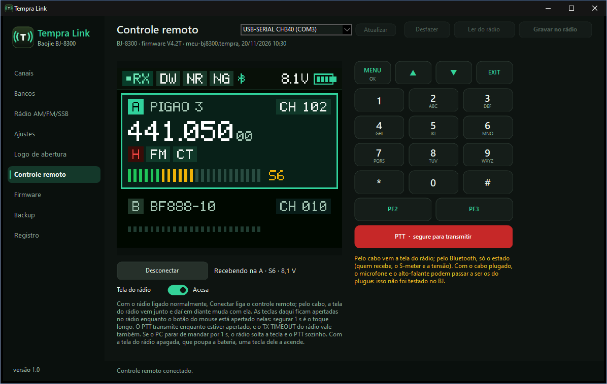
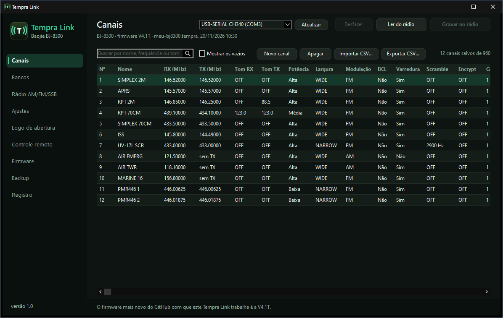
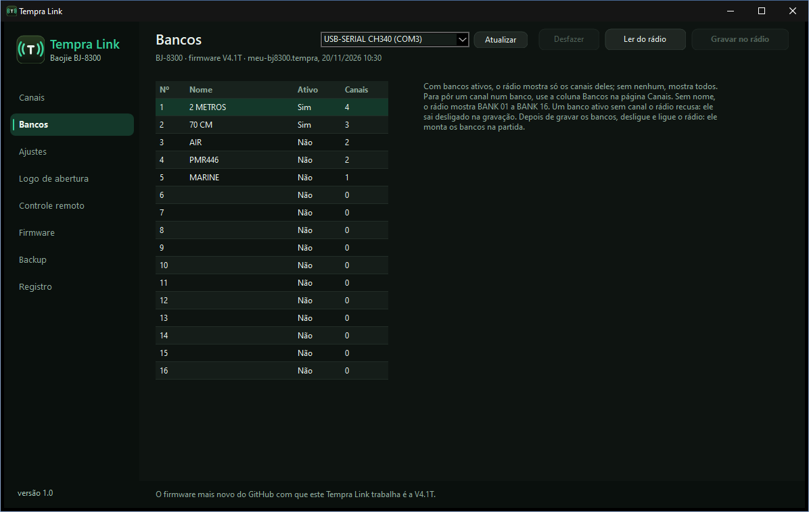
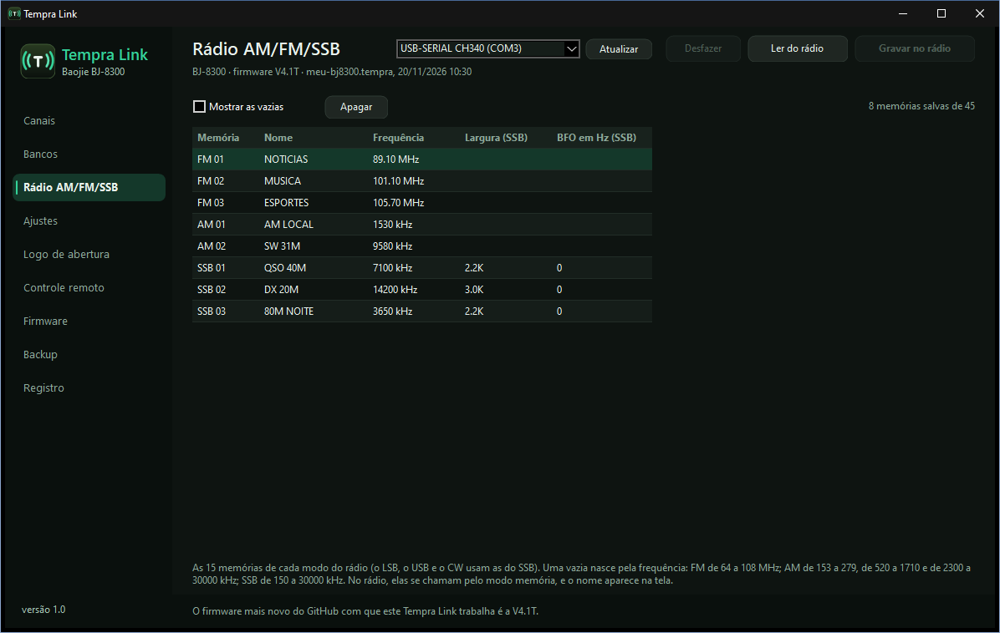
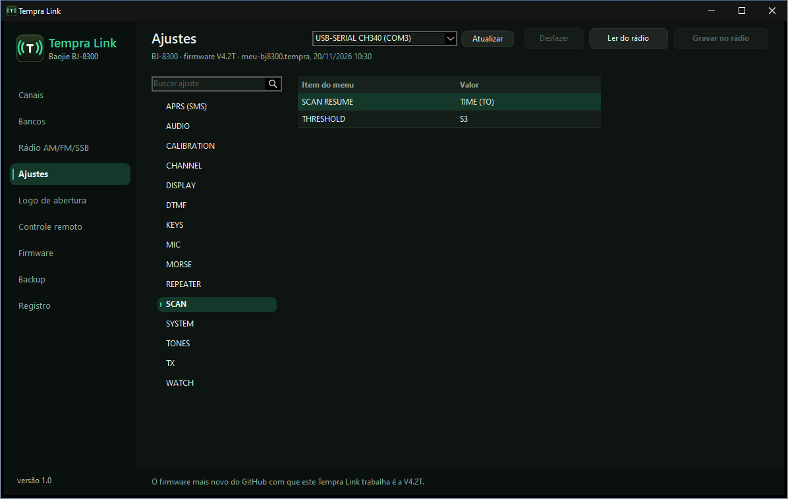
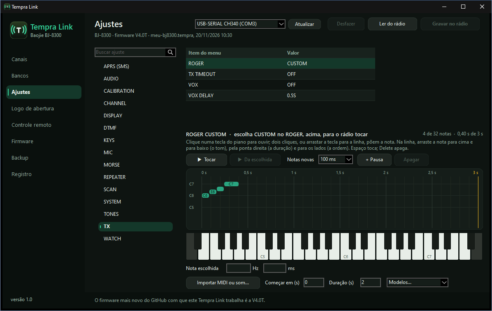
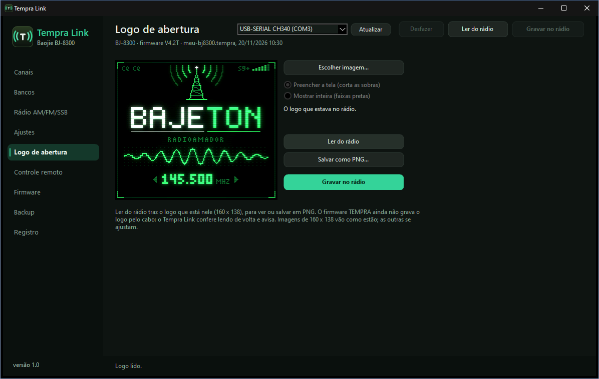
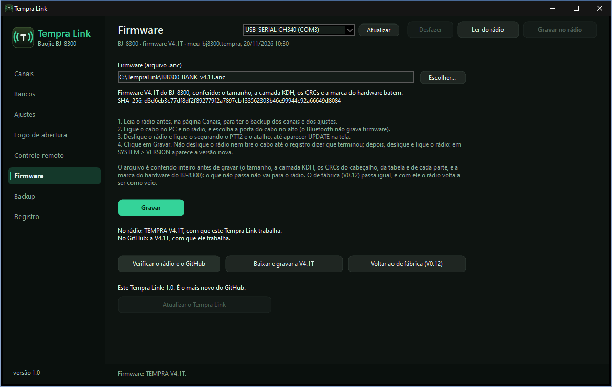
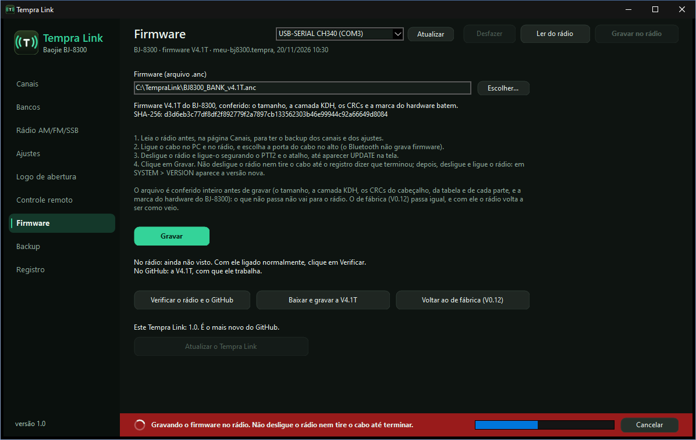
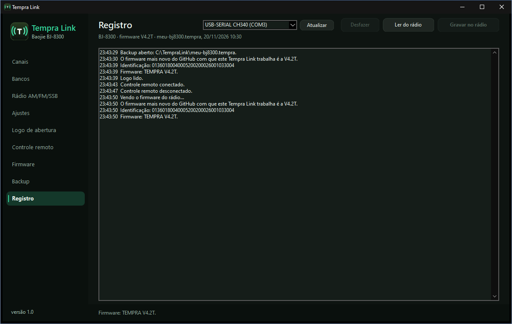

# Tempra Link do BJ-8300: o manual

  

[📖 Wiki](README.md) · [🏠 Página inicial](../../README.md)

O **Tempra Link** é o programa para Windows do firmware TEMPRA do Bajeton BJ-8300. Pelo cabo de programação, ele lê,
edita e grava os canais, os bancos, as memórias do rádio de AM, FM e SSB e os ajustes do rádio, guarda backups, faz de **controle remoto**, com a tela do rádio
ao vivo no PC, e **grava o próprio firmware**. É um `.exe` só, sem instalar nada.

## Sumário

1. [Antes de começar](#1-antes-de-começar)
2. [A janela](#2-a-janela)
3. [Ler o rádio e gravar de volta](#3-ler-o-rádio-e-gravar-de-volta)
4. [Canais](#4-canais)
5. [Bancos](#5-bancos)
6. [Rádio AM/FM/SSB](#6-rádio-amfmssb)
7. [Ajustes](#7-ajustes)
8. [ROGER CUSTOM](#8-roger-custom)
9. [Logo de abertura](#9-logo-de-abertura)
10. [Controle remoto](#10-controle-remoto)
11. [Gravar o firmware](#11-gravar-o-firmware)
12. [Backup e registro](#12-backup-e-registro)
13. [As versões do firmware](#13-as-versões-do-firmware)
14. [Bluetooth (experimental)](#14-bluetooth-experimental)
15. [Problemas comuns](#15-problemas-comuns)
16. [O app do celular (Android)](#16-o-app-do-celular-android)

## 1. Antes de começar

- **O firmware do rádio.** O Tempra Link 1.0 trabalha com o firmware TEMPRA **V4.2T** (e com a V3.8T, que só existiu em
  teste). Com o firmware de fábrica ou com um TEMPRA de antes, ele não lê nem grava nada, mas grava o firmware certo:
  veja [Gravar o firmware](#11-gravar-o-firmware).
- **O cabo** é o de programação USB do rádio, com o chip CH340, o mesmo do CPS de fábrica e do CHIRP. Se o Windows não o
  reconhece, instale o driver do `CH340-driver.zip` do release (veja na
  [página de gravar](gravar.md#-o-cabo-e-o-driver)).
- **Baixe** o `TempraLink-BJ8300_v1.0.exe` da
  [página do release V4.2T](https://github.com/tempraturbo/BajetonBJ8300/releases/latest) e ponha numa pasta sua.
  Ele não instala nada: os backups ficam na pasta do usuário ([Backup e registro](#12-backup-e-registro)).
- **Na primeira vez,** o Windows pode avisar que o programa é de um editor desconhecido (o SmartScreen), porque o `.exe`
  não é assinado: **Mais informações** → **Executar assim mesmo**.
- **O idioma** segue o do Windows: português num Windows em português, inglês nos outros.
- **A internet** só serve para, ao abrir, procurar no GitHub o firmware e o Tempra Link mais novos (sem login). Sem ela,
  todo o resto funciona, e o firmware se grava de um `.anc` baixado antes.
- **Feche o CHIRP, o CPS e o BinTalk** antes de usar o cabo: só um programa por vez abre a porta.

## 2. A janela

- **No alto:** a **porta** do cabo (`USB-SERIAL CH340 (COMx)`; a última opção da lista procura o rádio pelo
  [Bluetooth](#14-bluetooth-experimental)), **Atualizar** (a lista das portas, depois de ligar o cabo), **Desfazer**
  (também Ctrl+Z), **Ler do rádio** e **Gravar no rádio**.
- **Embaixo do título:** o rádio, a versão do firmware e de onde veio a memória que está na tela (a leitura, com a hora,
  ou o backup aberto). Em âmbar, quantas mudanças ainda não foram para o rádio.
- **À esquerda,** as páginas.
- **Embaixo,** a última mensagem; todas ficam na página **Registro**. Enquanto o firmware grava, essa barra fica
  vermelha, com uma roda girando ([Gravar o firmware](#11-gravar-o-firmware)).

## 3. Ler o rádio e gravar de volta

1. Ligue o rádio normalmente (fora do modo UPDATE) e ligue o cabo nele e no PC.
2. Escolha a porta do cabo no alto (**Atualizar**, se ela não aparece).
3. **Ler do rádio.** Vêm os canais, os bancos, as memórias do rádio de AM, FM e SSB, os ajustes, os textos do APRS e do Morse, o DTMF, os VFOs e as notas do
   ROGER CUSTOM, e cada leitura guarda sozinha um backup.
4. Mude o que quiser nas páginas. **Desfazer** volta uma mudança por vez.
5. **Gravar no rádio.** Só vai o que mudou: das áreas de fábrica, o setor de 4 KB inteiro em que houve mudança,
   como o CHIRP grava (o rádio só apaga o setor quando a gravação começa nele). Antes, o Tempra Link confere que o rádio não mudou desde a leitura (se
   mudou, nada se grava: leia de novo); depois, lê de volta o que gravou nos setores dos bancos e dos registros do
   TEMPRA. Com um backup aberto, ele grava o backup por cima do que está no rádio: é assim que se restaura.
6. **Mudou os bancos?** Desligue e ligue o rádio: ele monta os bancos na partida.

## 4. Canais

- **Os 960 canais** numa grade, como numa planilha: o nome (até 12 letras), o RX e o TX, os tons, a potência, a
  largura, a modulação, o BCL, a varredura, o scramble, o encrypt, o grupo DTMF, o PTT-ID e os bancos de cada um.
- **Editar:** dois cliques na célula, ou Enter, F2 ou espaço; num campo de texto, é só começar a digitar. Enter confirma
  e desce para a linha de baixo, e Esc desiste. As colunas de opções abrem a lista do rádio.
- **Buscar** por nome, frequência ou tom; **Mostrar os vazios** mostra também os números livres.
- **Novo canal** pega o primeiro número livre e abre a frequência de RX; **Apagar** (ou Delete) apaga os canais
  escolhidos.
- **Copiar e colar** canais com Ctrl+C e Ctrl+V, ou pelo botão direito.
- **Importar CSV** e **Exportar CSV** no formato do CHIRP, para trazer os canais de outro rádio ou de uma planilha.
- **Bancos:** a última coluna diz em quais dos 16 bancos o canal está; na célula, cada banco se marca e desmarca.

## 5. Bancos

- Os 16 bancos: o **nome** (até 12 letras), o **Ativo** (SIM ou NÃO) e quantos **canais** cada um tem.
- Com bancos ativos, o rádio mostra só os canais deles, no sobe e desce e na busca; sem nenhum, mostra todos.
- Para pôr um canal num banco, use a coluna **Bancos** da página Canais.
- Um banco ativo sem canal o rádio recusa: ele sai desligado na gravação.
- Depois de gravar os bancos, desligue e ligue o rádio.

## 6. Rádio AM/FM/SSB

- **As memórias do rádio de AM, FM e SSB:** 15 de cada modo (o LSB, o USB e o CW usam as do SSB), como o rádio as
  guarda: a frequência e o nome (até 12 letras) e, no SSB, a largura e o BFO.
- **Como os canais:** só as salvas aparecem, e **Mostrar as vazias** mostra as 45. Uma vazia nasce pela frequência: FM
  de 64 a 108 MHz (`101.1`), AM de 153 a 279, de 520 a 1710 e de 2300 a 30000 kHz (`1530`, ou `7.2 MHz`), SSB de 150 a
  30000 kHz. **Apagar** (ou Delete) apaga as escolhidas: a frequência e o nome.
- **No rádio,** elas se chamam pelo modo memória, e o nome aparece na tela. O CHIRP mostra as mesmas memórias nos
  sub-rádios **FM Broadcast**, **AM Broadcast** e **HF**.

## 7. Ajustes

- **As pastas do menu do rádio,** com os mesmos nomes e os mesmos valores. A busca, no alto, procura o item em todas.
- **Além do menu:** as frequências dos VFOs A, B e C (na pasta CHANNEL), o OFFSET deles (REPEATER), os 15 códigos DTMF
  (DTMF) e os textos do APRS e do Morse (APRS (SMS) e MORSE).
- **Ficam de fora** o que é ação ou tela no rádio (MESSAGES, CH MEMORY, RESET, VERSION e SCAN ADD), os bancos (página
  própria) e o RX GAIN.
- Edita-se como na página Canais.

## 8. ROGER CUSTOM

O ROGER CUSTOM toca, no fim de cada transmissão, uma melodia de até **32 notas** e **3 s**, cada nota de **300 a
3000 Hz** (ou uma pausa) e de **10 a 1000 ms**. Ela se compõe na pasta **TX** dos ajustes e vai para o rádio com o resto,
no **Gravar no rádio**.

1. Escolha **CUSTOM** no ROGER, o primeiro item da pasta TX.
2. Clique numa tecla do piano para ouvi-la; dois cliques, ou arrastar a tecla para a linha do tempo, põem a nota.
3. Na linha, arraste a nota para cima e para baixo (o tom), pela ponta direita (a duração) e para os lados (a ordem).
   **Notas novas** escolhe a duração das próximas, e **+ Pausa** põe um silêncio.
4. **Tocar** (ou a barra de espaço) toca tudo no PC, e **Da escolhida**, a partir da nota escolhida. **Apagar** (ou
   Delete) tira a nota escolhida. Em **Nota escolhida**, o tom (Hz) e a duração (ms) também se digitam.
5. **Modelos...** traz melodias prontas, e **Importar MIDI ou som...** tira a melodia de um arquivo MIDI ou de um som, a
   partir de **Começar em** e por **Duração** segundos. A melodia que sai de um som é aproximada.
6. **Gravar no rádio.**

## 9. Logo de abertura

- **Ler do rádio** traz a imagem que o rádio mostra ao ligar (160 × 138), e **Salvar como PNG...** a guarda.
- **Escolher imagem...** abre uma imagem do PC. As de 160 × 138 vão como estão, e as outras se ajustam: preenchendo a tela
  (corta as sobras) ou inteiras (com faixas pretas).
- **Gravar no rádio** ainda não serve: o firmware TEMPRA, a V4.2T inclusive, não grava o logo pelo cabo. O Tempra Link
  confere lendo de volta e avisa.

## 10. Controle remoto

Com o rádio ligado normalmente, **Conectar** liga o controle remoto, e o rádio continua funcionando como sempre.

- **Pelo cabo,** a tela do rádio aparece no PC e muda com ela. Ela é desenhada no PC com o mesmo código da tela do
  firmware, a partir do que o rádio manda.
- **O teclado:** cada tecla fica apertada no rádio enquanto o botão do mouse está apertado nela; segurar 1 s é o toque
  longo.
- **O PTT** transmite enquanto estiver apertado, e o TX TIMEOUT do rádio vale também. Se o PC parar de mandar por 1 s, o
  rádio solta a tecla e o PTT sozinho.
- **Tela do rádio:** em **Apagada**, a tela do rádio fica apagada, para poupar a bateria. Uma tecla do rádio a acende, e
  a chave volta a **Acesa**.
- **Ao lado do Desconectar,** o estado: quem recebe, o S e a tensão.
- **Se a ligação cai** (o RF do PTT pode derrubar o USB do cabo, que volta como outra porta), o Tempra Link se reconecta
  sozinho, a cada segundo, até o **Desconectar**.
- **Pelo Bluetooth,** vão as teclas e o PTT e vem o estado, sem a tela.
- Com o cabo plugado, o microfone e o alto-falante do rádio podem passar a ser os do plugue: isso não foi testado no BJ.

## 11. Gravar o firmware

A página **Firmware** grava o `.anc` pelo cabo, com o rádio no modo **UPDATE**, pelo mesmo protocolo do gravador de
fábrica (o BinTalk). Antes, o arquivo se confere inteiro: o tamanho, a camada KDH, os CRCs do cabeçalho, da tabela e de
cada parte, e a marca do hardware do BJ-8300. O que não passa não vai para o rádio. O firmware de fábrica (V0.12) passa
igual. Os canais, os ajustes e a calibração ficam num chip à parte, que a gravação do firmware não toca.

### Passo a passo

1. **Leia o rádio antes** (página Canais), para ter o backup dos canais e dos ajustes.
2. **O arquivo.** O mais fácil é o botão **Baixar e gravar a V4.2T**: ele baixa do GitHub o firmware mais novo com que
   este Tempra Link trabalha, confere pelo tamanho e pelo SHA-256 e segue para a gravação. Ou **Escolher...** um `.anc`
   do PC; um `BJ8300_BANK_v*.anc` na pasta do programa já abre sozinho.
3. **A porta** é a do cabo, no alto: o firmware não se grava pelo Bluetooth.
4. **O modo UPDATE:** desligue o rádio e ligue-o segurando o **PTT2** e o **atalho**, até aparecer `UPDATE` na tela.
5. **Gravar** (ou **Baixar e gravar**). O Tempra Link pergunta antes, e a gravação começa.
6. **Espere, sem desligar o rádio nem tirar o cabo.** A barra de baixo fica vermelha, com uma roda girando, e diz o que
   acontece:
   - *chamando o rádio no modo UPDATE*: ele tenta 5 vezes, de 2 em 2 s;
   - *Mandando ao rádio o programa que grava o firmware (leva uns 30 segundos)*: nessa hora a barra de andamento fica
     parada;
   - *Gravando o firmware no rádio*: uns 2 minutos;
   - *O rádio terminou a gravação.*
7. **Desligue e ligue o rádio.** Em **SYSTEM > VERSION** aparece `Firmware: V4.2T`. O botão **Verificar o rádio e o
   GitHub**, com o rádio ligado normalmente, mostra a versão também.

O **Cancelar** só vale antes de o rádio responder: depois, parar o deixaria sem firmware, e a gravação segue até o fim.

### Se não der certo

- **"O rádio não respondeu"** na gravação: confira o `UPDATE` na tela, o cabo e a porta, e que nenhum outro programa está
  com ela. Desligue o rádio, ponha-o de novo no UPDATE e grave de novo.
- **Uma gravação interrompida** (o cabo que saiu, a bateria que acabou) não foi testada. O modo UPDATE roda na partida,
  antes de qualquer parte que o TEMPRA modifica, e foi assim que o rádio voltou de um firmware de teste que não ligava;
  o mesmo caminho é a primeira coisa a tentar.

### Voltar ao de fábrica

**Voltar ao de fábrica (V0.12)** grava o firmware de fábrica: o `firmware/original/BJ8300_V0.12.anc` ao lado do programa
ou, sem ele, o deste repositório, baixado e conferido por um SHA-256 fixo. Com o de fábrica, o Tempra Link deixa de falar
com o rádio (os canais se editam pelo CHIRP, nos modelos de fábrica) até o TEMPRA ser gravado de novo.

### O Tempra Link mais novo

Ao abrir, o Tempra Link procura no GitHub também uma versão mais nova dele mesmo. Havendo, ele pergunta se atualiza:
baixa, confere pelo SHA-256, põe a nova no lugar desta e a abre. O botão **Atualizar o Tempra Link** faz o mesmo depois.

## 12. Backup e registro

- **Cada leitura do rádio guarda um backup sozinha,** em `%LOCALAPPDATA%\TempraLink\backups` (o botão **Abrir a pasta
  dos backups**, na página Backup).
- **Salvar backup...** guarda a memória que está na tela, com as mudanças que ainda não foram para o rádio, e **Abrir
  backup...** a traz de volta. **Restaurar** é abrir um backup e **Gravar no rádio**.
- **O backup** (`.tempra`) guarda os canais, os ajustes, os bancos, os textos, o DTMF, o WATCH, o VFO C, as notas do
  ROGER CUSTOM e a calibração do rádio. O do Tempra Link do Baofeng UV-17L não abre aqui, e o deste não abre lá.
- **Os firmwares baixados** ficam em `%LOCALAPPDATA%\TempraLink\firmware`.
- **A página Registro** guarda tudo o que aconteceu desde que o programa abriu, com a hora: é o que ajuda a entender um
  problema.

## 13. As versões do firmware

Desde a V3.8T, o rádio diz a versão do firmware pelo cabo e pelo Bluetooth, e o Tempra Link só trabalha com as que
conhece, porque cada versão pode guardar as coisas em outro lugar da memória. Com outra, ele não lê nem grava nada e
oferece o certo:

| No rádio | O que o Tempra Link 1.0 faz |
|---|---|
| TEMPRA V4.2T (ou V3.8T) | tudo |
| TEMPRA de antes, até a V3.7T (não diz a versão) | não lê nem grava; oferece baixar e gravar a V4.2T |
| o firmware de fábrica (V0.12) | não lê nem grava; oferece baixar e gravar a V4.2T |
| TEMPRA mais novo que a V4.2T | não lê nem grava; oferece o Tempra Link mais novo |

O driver do CHIRP faz o mesmo: cada release traz o módulo da versão dele.

## 14. Bluetooth (experimental)

Com o **BLUETOOTH** do rádio em ON (pasta SYSTEM), a última opção da lista de portas procura o rádio pelo Bluetooth do PC
por 6 s, e os achados entram na lista. Pelo Bluetooth vão a leitura, a gravação dos canais e o controle remoto sem a
tela; o firmware só se grava pelo cabo. No rádio, o controle remoto pelo Bluetooth funcionou com o app do celular; a
leitura e a gravação por ele ainda não foram testadas.

## 15. Problemas comuns

- **A porta não aparece:** ligue o cabo e clique em **Atualizar**. Se ainda não aparece, instale o driver do CH340.
- **"O rádio não respondeu"** ao ler ou no controle remoto: o rádio tem de estar ligado normalmente, fora do UPDATE, com
  o plugue do cabo bem encaixado. Feche o CHIRP, o CPS e o BinTalk.
- **"Este rádio está com o firmware ..., antigo para este Tempra Link"**, ou com o de fábrica: grave a V4.2T pela página
  Firmware ([As versões do firmware](#13-as-versões-do-firmware)).
- **"O rádio mudou desde a leitura (...). Nada foi gravado"**: o rádio foi mexido depois da leitura. Leia de novo e refaça as
  mudanças (ou salve um backup antes de ler, e grave a partir dele).
- **O GitHub não responde** (sem internet, ou um firewall que barra o programa): o resto funciona. Para o firmware, use um
  `.anc` baixado da página de releases.

## 16. O app do celular (Android)

O Tempra Link no celular, pelo Bluetooth do rádio: o controle remoto com a tela do rádio, os canais e os bancos, as
memórias do rádio de AM, FM e SSB, os ajustes (com o ROGER CUSTOM), ler e gravar, os backups e um aviso de recepção, e uma demonstração sem rádio. Ele lembra
os rádios já usados, com um apelido para cada, e conecta neles sem a procura inteira; com um firmware com que não
trabalha, só avisa e abre a página de releases, porque o celular não grava firmware. A versão 1.0 ainda não tem APK
publicado: compila pelo `tempralink/celular/compilar.ps1` (Delphi). No rádio, só o controle remoto foi testado.

---

O código do Tempra Link, os testes e o funcionamento por dentro estão em [tempralink/](../../tempralink/LEIAME.md).
